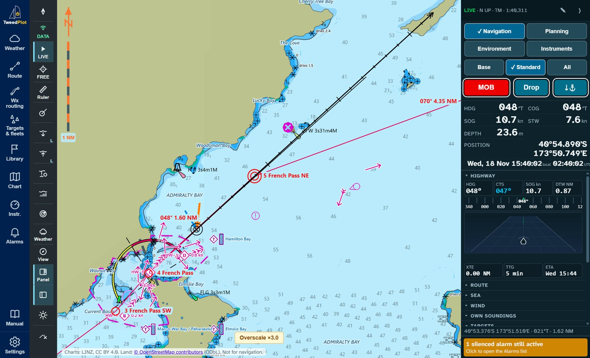
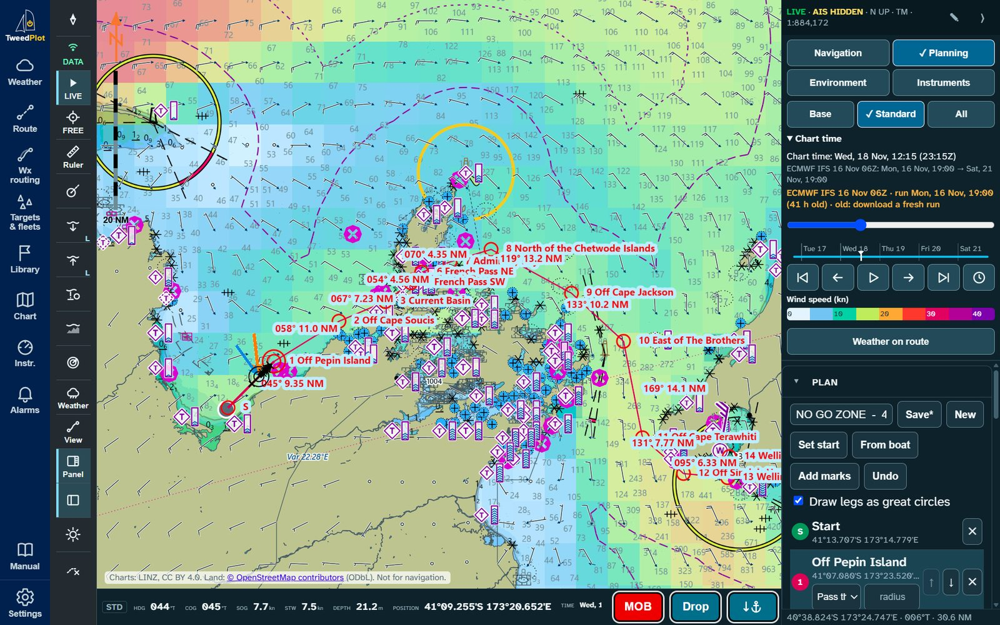
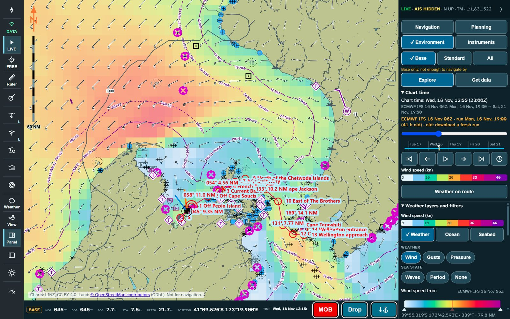
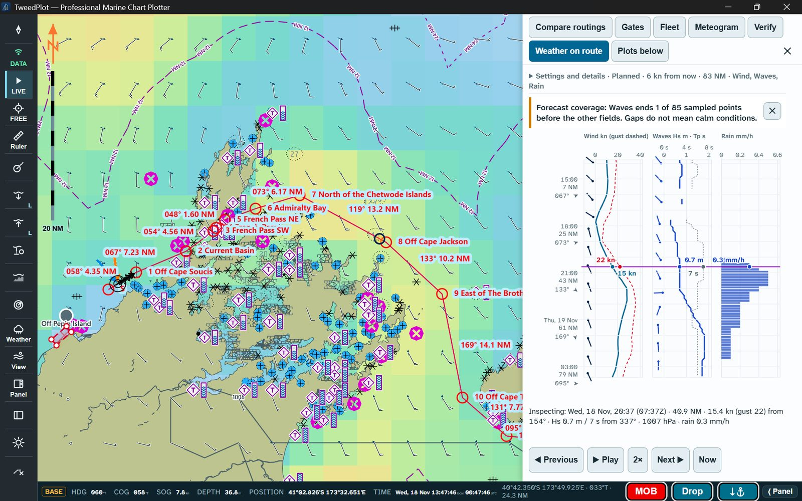
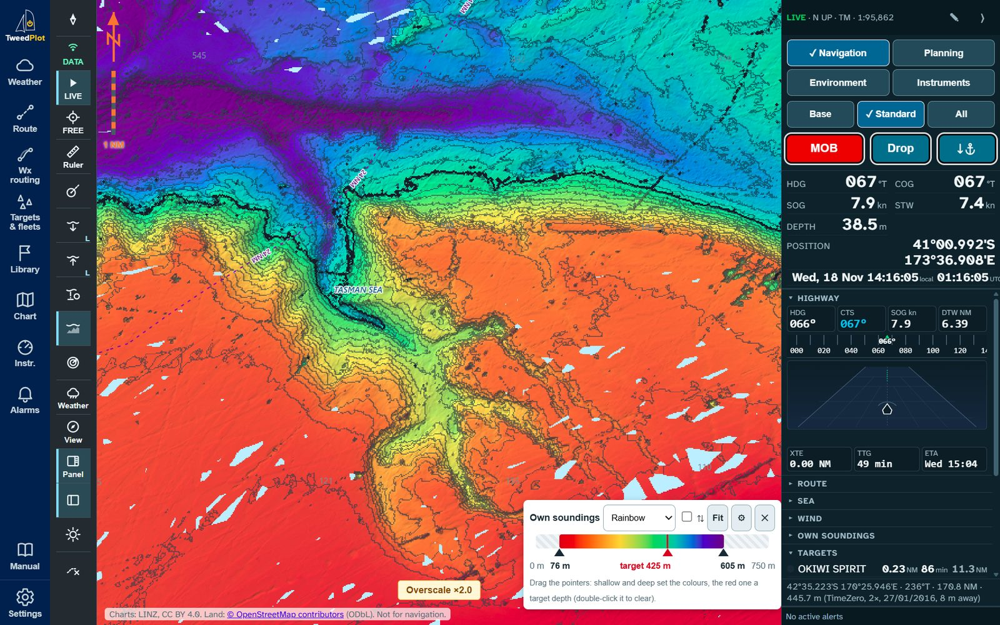
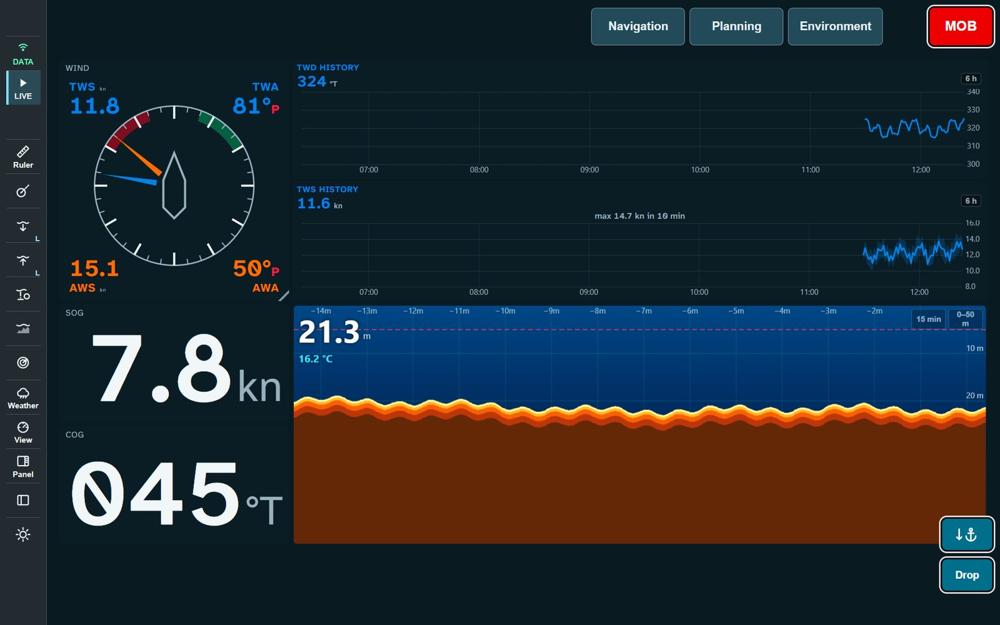
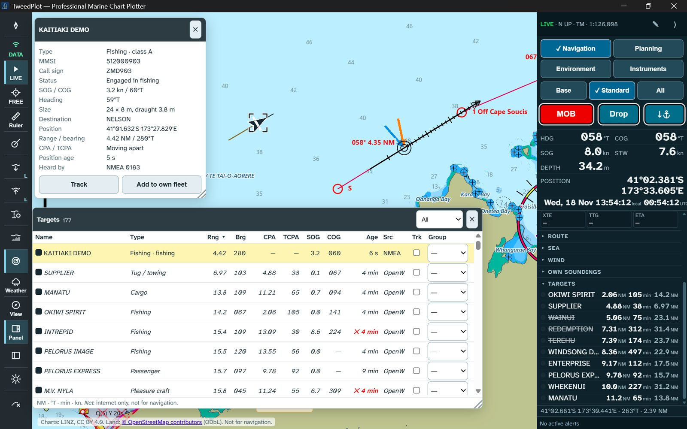
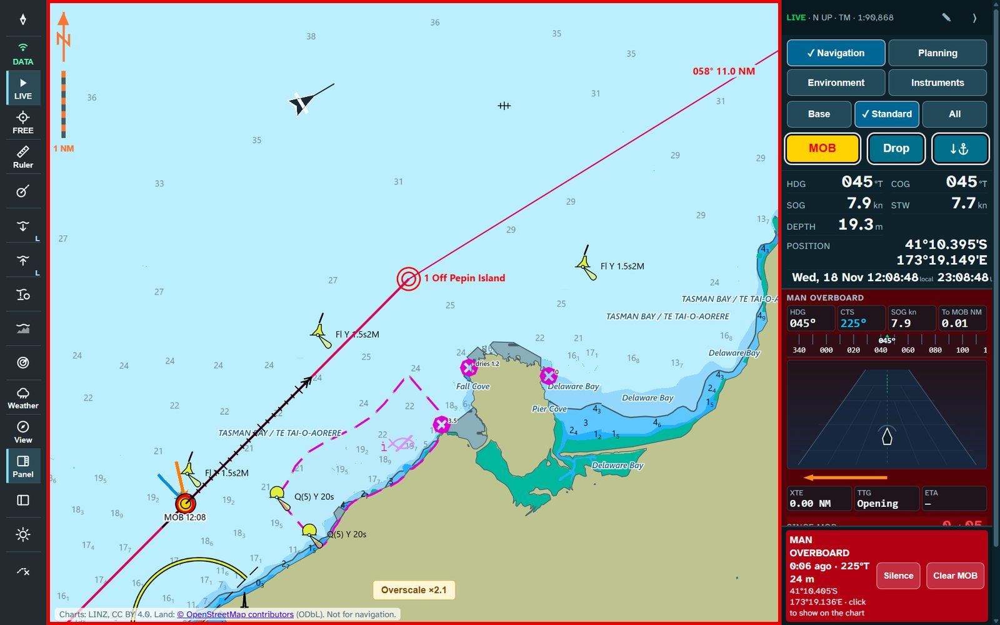
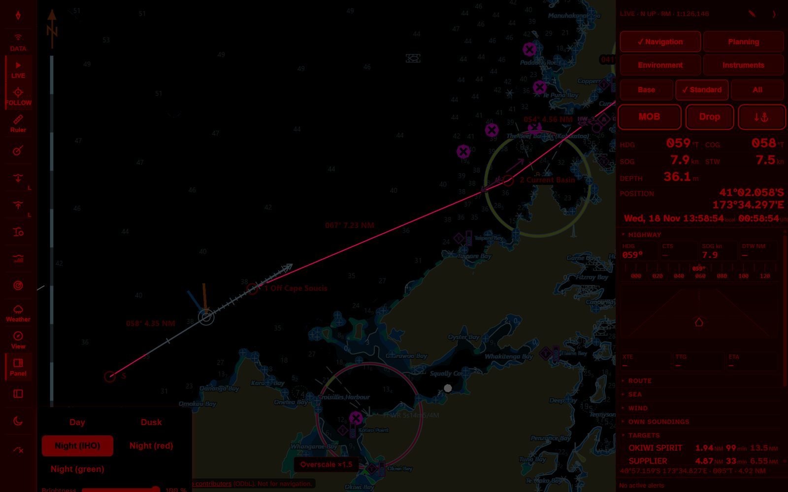
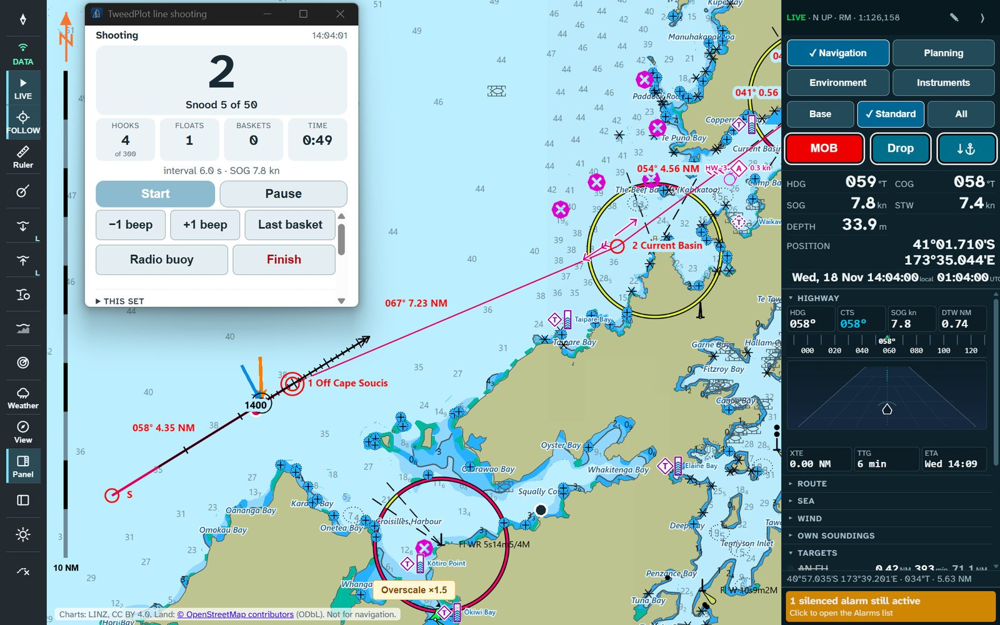

# TweedPlot

**A chart plotter, passage planner and weather router for Windows, built for racing, cruising and fishing.** Free and open source, from [TweedsMarine](https://tweedsmarine.nz), Nelson, New Zealand.



TweedPlot puts charts, forecast weather, ocean data, weather routing, live instruments, AIS and alarms in one window. Your data stays in plain files on your own PC. There are no accounts and no subscriptions, and once your charts and forecasts are downloaded it works with no internet connection at sea.

It began as a tool for racing skippers who wanted routing, weather and instruments in one place, and has grown to suit fishing boats and cruising yachts as well. It is built in New Zealand, so the New Zealand data (LINZ charts, tides and depths) is the best supported, but nothing stops you using it anywhere in the world with S-57 charts and global weather.

> **Not a certified navigation system.** TweedPlot is a planning and situational-awareness aid, not an ECDIS. Charts and forecasts can be wrong or out of date. Keep a lookout and carry official charts.

> **This is a beta (1.0.0-beta.4).** It has been used on the water by its author, but not by many people yet. That is why it is here: please try it, tell us what breaks, and tell us what you need. See [Testing and feedback](#testing-and-feedback).

## What it does now

**Charts**
- LINZ New Zealand vector charts, drawn with IHO S-52 colours and symbols, with safety depth and contour, Base / Standard / All display and light sectors.
- Unencrypted S-57 ENCs (NOAA and other hydrographic offices) with no plugin needed.
- Legacy Kap/BSB charts, Geotiff, satellite photos (direct in-app download from Sentinel), MBTiles, KMZ/KML.
- Worldwide coastline and depths, 1 m LINZ high-resolution depths, marine boundaries and fishing rules.
- **Own soundings:** build your own depth picture from your tracks and TimeZero PBG/XYZ files, reduced to chart datum.
- Optional OpenStreetMap and OpenSeaMap layers, off by default and sending nothing while off.

**Weather, ocean and tides**
- A GRIB viewer for many runs at once: time slider, comparison between models, meteograms, and a check of where the models agree.
- Downloads of GFS, ECMWF and other models, plus sea surface temperature, currents, chlorophyll, water-column temperature, salinity, currents, and satellite sea data for fishing.
- Weather stations, buoys, tide predictions and tidal streams.

**Routing and planning**
- Isochrone weather routing from your polar, with tack and gybe costs, GRIB currents, and avoidance of land and shallow water.
- Compare routings, sweep departure times, set gates, and see what the weather will be along a route.
- Routes, marks, rulers and GPX import and export, kept in a library you can also open in QGIS.

**On the water**
- Live data from Signal K, or straight from NMEA 0183 over serial, TCP and UDP, with failover between sources.
- A configurable data panel, Instruments view (with a sounder), 24-hour history, and a replay of recorded passages.
- AIS from your own receiver or the internet, with CPA and TCPA, and YB race tracking.
- Alarms for depth, safety contour ahead, air draft, off track, anchor, collision, closed areas and lost position. One-press man overboard.
- For fishing: temperature breaks, eddies and chlorophyll on the same chart as the depths, a line-shooting timer, and a catch log.
- Day, dusk and night colours that keep your night vision.

A full manual is built in (press F1) and works offline.

## Screenshots

| | |
| --- | --- |
|  **Planning**: a route from Nelson to Wellington through French Pass, with the forecast wind |  **Environment**: forecast wind, the chart time and an old-run warning |
|  **Weather on route**: wind, waves and rain along the passage |  **Own soundings**: your own seabed, with a target depth |
|  **Instruments**: wind dial, history plots and sounder |  **AIS**: the target list and a target's details |
|  **Man overboard**: one press, then steer back on the highway |  **Night (IHO)**: dim red, to keep your night vision |
|  **Fishing**: the line-shooting timer | |

## What it does not do (yet)

- **It is not certified.** Not for use as a primary means of navigation.
- **Windows and Mac** Windows 10 and 11, Intel and ARM. A universal Mac installer is built in the latest releases but it's untested. No Linux, tablet or phone version yet.
- **No NMEA 2000 connection of its own.** NMEA 2000 data comes in through Signal K or a gateway that gives NMEA 0183. A direct connection is the next big job.
- **Encrypted S-63 charts** work through a separate plugin that is still being finalised before it can be used with real chart data. It has been tested with the IHO's own test data. Once this confirmed working there will be a small charge for the admin involved in issuing user permits.
- **S-100 / S-101 charts** are not read yet. (The IHO S-101 symbols are used to draw the charts we do read.)
- **No radar overlay, and no autopilot or instrument control.** TweedPlot reads your instruments; it does not send to them. There is a Radar simulator built into the app that tests the framerate achievable on your hardware. Run it and let me know how it runs on your hardware. 
- **Touch screens:** For now I am not supporting touch screen so that I can concentrate on getting the keyboard and mouse interface tuned up. A touch screen option can follow.
- Installers are **not yet code-signed**, so Windows may warn you the first time. Mac will complain too, right click on the app and run that way.

## What is coming

In roughly this order, driven by what testers ask for:

1. **NMEA 2000 direct**, starting with Actisense gateways.
2. **Encrypted charts (S-63)** once the IHO agreement is in place.
3. **S-100 family:** S-101 charts first, then bathymetric surfaces, water levels and surface currents.
4. **More for racing:** start line tools and laylines with current, target speeds against your polar, a recorder with replay and analysis.
5. **Better routing:** tidal streams and ocean currents as routing input, ensembles, and a time-lost map.
6. **More weather:** more models and servers, and historical weather and pilot-chart style climatology for passage planning.
7. **macOS, Linux and a tablet companion.**

## Download

Installers for Windows 10 and 11 (Intel and ARM) and a universal Mac installer are on the [Releases](../../releases) page. Windows SmartScreen may warn you the first time: choose **More info › Run anyway**.

Once installed, TweedPlot looks for a newer version a minute after it starts and twice a day, when there is an internet connection. It tells you, and installs only when you choose to. Updates are signed by TweedsMarine and checked before they install. You can turn this off in Settings › Diagnostics › Software updates.

You provide your own chart data. The manual's *Getting started* and *Charts* sections explain how to download the LINZ data and load ENC cells.

## Testing and feedback

The most useful things you can tell us:

- Anything that crashes, freezes or draws wrongly (with a screenshot if you can).
- How it behaves on a touch screen.
- How it behaves with your instruments: which gateway, which sentences, what was missing.
- Anything a fishing or racing skipper needs that is not here.

Please open an [issue](../../issues). One feature request per issue is easiest to track.

## Build from source

You need Rust, Node.js and the Tauri prerequisites for Windows. See [SETUP-WINDOWS.md](SETUP-WINDOWS.md), then:

```
cargo test
cd app
npm install
npm test
npm run tauri dev
```

Architecture, crate layout and data details are in [DEVELOPING.md](DEVELOPING.md).

## Contributing

Bug reports, ideas and pull requests are welcome. Please read [CONTRIBUTING.md](CONTRIBUTING.md) first.

## Licence

- Code: [GNU GPL v3.0 or later](LICENSE), with a [plugin exception](LICENSE-PLUGIN-EXCEPTION.md): separate plugin programs that talk to TweedPlot only through its plugin interface may be under any licence. If you distribute a modified version you must release it under the same licence, with its source.
- The shared crates `crates/enc-s57` (S-57 reader and converter) and `crates/plugin-api` (the plugin interface): MIT or Apache-2.0.
- Manual and documentation: CC BY-SA 4.0 ([LICENSE-DOCS.txt](LICENSE-DOCS.txt)).
- The TweedPlot and TweedsMarine names and logos are not licensed for modified versions: see [TRADEMARKS.md](TRADEMARKS.md).
- Third-party data and libraries (LINZ, OpenStreetMap, Natural Earth, GSHHG, NOAA, ECMWF and others): see [THIRD-PARTY-NOTICES.md](THIRD-PARTY-NOTICES.md) and [NOTICE.md](NOTICE.md).

Encrypted (S-63) charts are handled not by TweedPlot itself but by the **TweedPlot S-63 Charts** plugin, TweedsMarine's separately licensed program, installed from Chart › Encrypted charts. Unencrypted S-57 ENCs and the LINZ data need no plugin.
