# AIS

AIS (the Automatic Identification System) lets ships see each other by radio: who they are, where they are and where they are going. This tab explains how it works, what it can and can't tell you, and why AIS from the internet must not be used for navigation. For the AIS screens themselves, see [Using AIS in TweedPlot](#using-ais-in-tweedplot) at the end and Reference › AIS targets.

## What AIS is

Every AIS transponder broadcasts its own ship's position, course and speed from its GPS, and its identity, on two VHF channels. Every AIS receiver in range picks them up and shows the ships on a chart or in a list. No one is polled and nothing has to be set up between ships: each one just transmits, on a schedule, and anyone listening hears it.

It was brought in to help with collision avoidance and vessel traffic services, and is now also used for search and rescue, aids to navigation and fleet tracking.

- **A transponder** sends and receives: Class A on ships that must carry AIS, Class B on smaller craft.
- **A receiver** only listens: you see others, they don't see you.
- Each station has a 9-digit **MMSI**, the same number as its DSC VHF. The first three digits (the MID) give the flag state: 512 is New Zealand.

## How it works

AIS uses two VHF channels, AIS 1 on 161.975 MHz (channel 87B) and AIS 2 on 162.025 MHz (channel 88B), at 9600 bit/s. Each minute on each channel is cut into 2250 time slots, and every report fits in one or a few slots.

- **Class A** transponders (12.5 W) use SOTDMA: each one reserves slots ahead and announces the reservation, so the others keep clear of them. Class A always gets through.
- **Class B "CS"** transponders (2 W) use CSTDMA: they listen and transmit only in a slot that is free. In a busy port, a Class B can be crowded out and report less often than it should.
- **Class B "SO"** transponders (5 W) reserve slots like Class A and report more often than Class B CS.

Range is line of sight, set mostly by the height of both antennas: typically 20 NM or more between ships, often less than 10 NM between two yachts with antennas near deck level.

**How often ships report** (ITU-R M.1371):

| Ship's state | Class A | Class B CS |
|---|---|---|
| At anchor or moored, under 3 kn | every 3 min | every 3 min (under 2 kn) |
| 0–14 kn | every 10 s (3⅓ s when turning) | every 30 s |
| 14–23 kn | every 6 s (2 s when turning) | every 30 s |
| Over 23 kn | every 2 s | every 30 s |

Name, call sign, size, ship type, destination and draught are sent separately, every 6 minutes. That is why a new target can show as an MMSI for a few minutes before its name appears.

## What the ships send

- **Dynamic data**, from the ship's GPS and compass: position, course and speed over ground, heading (Class A, from a gyro; many Class B sets have none), rate of turn, and navigational status ("under way using engine", "at anchor", "engaged in fishing", "restricted manoeuvrability"…).
- **Static data**, set when the transponder is installed: MMSI, name, call sign, ship type, length and beam, and where the GPS antenna is on the hull.
- **Voyage data**, entered by the crew: destination, ETA, draught, persons on board.

Anything entered by hand can be wrong or out of date. The navigational status is often left at "under way using engine" at anchor, or "at anchor" at sea. Ship types and names are sometimes missing or wrong, and a few ships send the default MMSI their set came with. The position is only as good as the ship's GPS, and refers to where its GPS antenna is, not its bow.

## Special AIS stations

- **AIS-SART**, **MOB device** and **EPIRB with AIS** (MMSI beginning 970, 972 and 974): distress beacons that transmit their position every minute, in bursts. TweedPlot always raises an alarm for them. They are also sent when the beacons are tested, so the name or status may say "test".
- **Aids to navigation (AtoN)**: buoys, beacons and lighthouses with their own AIS (MMSI 99…). A **virtual** AtoN marks a hazard with an AIS symbol where nothing physical exists, for example a new wreck before a buoy can be laid. A **synthetic** AtoN is a real buoy whose AIS report is sent from ashore.
- **SAR aircraft** (MMSI 111…) report their position and altitude.
- **Base stations** (MMSI 00…) are shore stations of a port or coastguard.

## CPA and TCPA

From each target's course and speed and your own, TweedPlot works out where the two of you will be closest, if neither changes course or speed:

- **CPA** (closest point of approach) is how close you will pass, in nautical miles.
- **TCPA** (time to CPA) is how long until then, in minutes. A negative TCPA means you are already moving apart.

CPA and TCPA are only as good as the data behind them:

- Course and speed over ground jump about at low speed, and a turning ship's CPA changes with every report.
- A target that reports every 30 s or 3 min (Class B, or a ship at anchor) has an older position than one reporting every 2 s.
- Your own course and speed come from your GPS, through Signal K. If they are wrong, every CPA is wrong.

Treat the CPA as a warning to look, not as the answer. Watch the target's bearing: if it barely changes as the range closes, there is a risk of collision, whatever the CPA says.

## Limits of AIS, even on board

AIS adds to a proper lookout and radar; it doesn't replace either. The collision regulations (COLREGs) require a lookout by sight and hearing, and every available means of judging the risk of collision. They warn against assuming anything from scanty information.

- **Not every vessel has AIS.** Most small fishing boats, yachts, kayaks and dinghies don't have it, and many working boats are not required to carry it. Logs, containers and rocks never will.
- **AIS can be switched off.** Some vessels switch it off for security or to keep their fishing grounds private.
- **Sets fail**, antennas break, and GPS can be wrong, jammed or spoofed.
- **Class B can be crowded out** in busy waters, and its reports are 30 s apart even at speed.
- **An empty screen doesn't mean an empty sea.**

## Internet AIS

AIS heard on board comes straight from the ship over VHF, within seconds. Internet AIS (aisstream.io and Open Waters in TweedPlot) takes a longer road: a shore station hears the ship, sends its reports over the internet to an aggregator, and the aggregator passes them on to you.

It is useful for seeing traffic before you set out, following a race, checking that your own transponder is being heard ashore, and for practice at the dock. **It must not be used for navigation or collision avoidance:**

- **Coverage.** You only see ships that a shore station hears. The stations are mostly volunteers' receivers, unevenly spread: a harbour can be well covered while the coast just outside it isn't. Offshore there is nothing.
- **Delay.** Each report passes through the station, its uplink, the aggregator and the network before it reaches you. It is usually seconds late, but it can be minutes late, and it doesn't arrive any faster in a close-quarters situation. The **Age** column in the target list shows how old each position is.
- **Gaps.** Stations go off the air, connections drop, and free services have rate limits and no guarantee of service. A ship can vanish from the screen, or never appear, while it is right there.
- **Class B and low antennas** are the least likely to be heard ashore: the yachts and small fishing boats you are most likely to meet.
- **You can't tell what is missing.** Nothing marks a ship that a shore station didn't hear.
- **The CPA is worked from a late position** compared with your own live one, so it can be wrong just when it matters.

TweedPlot has two internet feeds, set up separately in **Targets › AIS** (each has its own status light, and you can use one or both):

- **aisstream.io** needs a free key: sign in at aisstream.io with a GitHub account, paste the key in and press **Go online**.
- **Open Waters** (openwaters.io/ais) needs a free token and no account: press **Get a token** and TweedPlot makes one and fills it in (or paste one from openwaters.io/ais/token). It is a community network of receivers that also lets you share your own. When you connect it sends each ship's last known position, name and type at once, so you don't wait for the slow static reports. It has no class information of its own: TweedPlot works the class out where it can, so a class B ship is shown as class B, but a class B+ ship from Open Waters may show as plain class B.

[Screenshot: Targets › AIS with the two online sections, "Online: aisstream.io" and "Online: Open Waters", each with its status light]

A ship's info window says which feed it was heard on ("Heard by"), and the target list's source column shows it too. A ship heard by both shows both.

TweedPlot marks targets heard only over the internet: italic in the lists, "Net" in the source column, and a note in the target's info window. By default it raises no collision alarms for them (**Alarms › Targets › Alarms for internet-only targets too** turns them on). Treat an internet target as a reminder of what may be about, never as a fix.

## Using AIS in TweedPlot

- {icon:fleet} **Targets & fleets › AIS** turns targets on and off, connects online AIS, sets how they are drawn and holds the full list. The collision and distress alarms are in {icon:alarms} **Alarms › Targets (AIS)**.
- **Symbols**: every ship is one colour, and a dangerous one (inside the CPA and TCPA limits) is red. Class is shown by shape and size: a large triangle for class A, a medium one for class B+ (SOTDMA or extended class B) and a small one for class B. A fishing vessel has a bar across its triangle. The triangle points along the heading; a thin heading line extends from it only when the ship has no course vector (so it is stopped or slow), or is turning with curved vectors off, with a short barb at the end on the side the ship is turning to (rate of turn 3° to 10° a minute), or a long barb (10° a minute or more, which includes a ship whose AIS reports only "turning fast"). A ship with no heading or movement is a dot. With **Curve course vectors by rate of turn** ticked (Targets › AIS, on by default), the course vector of a ship turning at 3° a minute or more bends into an arc, as if it held that turn. A ship not heard for a while is crossed through {img:ais-lostx}; if you tick **Day shapes for navigational status** (off by default, because crews set the status by hand and often forget to change it), a tag beside a ship shows it as a day shape, such as {img:ais-st-ball} at anchor or {img:ais-st-fishing} fishing. The ship you clicked has corner brackets round it. A ship's track is drawn when you tick **Track** against it in the target list, or use the button in its info box; **Target track colour** in Targets › AIS sets the colour. This is separate from your own fleet, which you set with the group menu beside it in the target list: Friends, Company, Race fleet or Other, or No group to take it out. A ship whose V-shaped stern is filled in, giving it a flat back, is in your own fleet, in the colour you chose for its group in Targets › Own fleet. The full key is in the Reference tab under *Targets*.

[Screenshot: a close-up of AIS targets showing class A, B+ and B symbols, a heading line with a rate-of-turn barb, a curved course vector, a tracked dot, an own-fleet flat stern and the selection brackets]
- **At night**, the Night (IHO) colours dim the targets, their lines and brackets as well as the rest of the screen, so the chart doesn't spoil your night vision (see *Colours* in the Reference tab).
- **Sleeping targets** (Targets › AIS) are ships slower than a speed you set, or further away than a range you set. They can be shown small and without vectors, or hidden. Dangerous, selected and own-fleet ships are never asleep, and alarms are not affected.
- **Click a target** for its details in an info window that you can move, resize and scroll, and that keeps updating.
- {icon:targets} **Target list** in the toolbar (or the **T** key) opens the target list over the chart. Its columns are range, bearing, CPA, TCPA, speed, course, the age of each position and the source. Click a heading to sort. Distress beacons and dangerous targets always come first, and dangerous targets show in red. Click a row to centre the chart on that target and open its details. The list can be dragged by its title bar and resized from its corner. Radar (MARPA) targets will go in the same list.
- **CPA lines** (Targets › AIS › On the chart) draw, for dangerous targets and the one you clicked, dashed lines from your boat and the target to where each will be at the CPA, joined by the CPA line, with its distance and time. Red is inside the alarm limits, amber is outside them. **Course vectors** sets how far ahead each target's course line reaches.
- **Online area** asks the internet for the targets in the chart view, or within a range of the chart centre or of your boat. Targets outside the range are not shown. With "my boat", the area follows you as you go.
