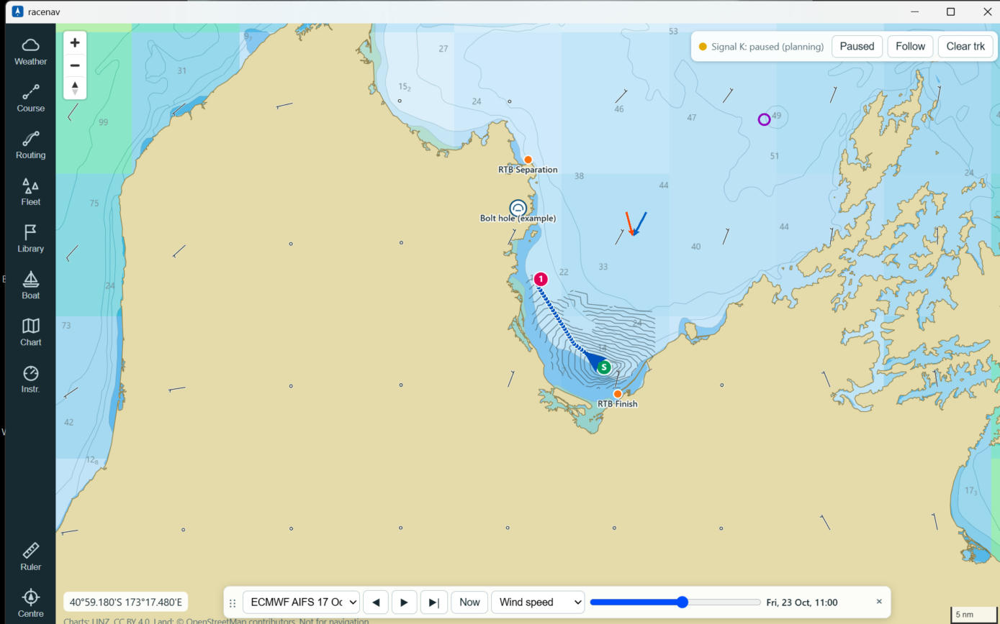
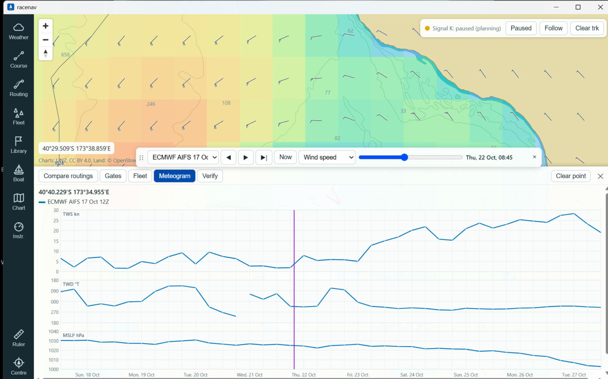
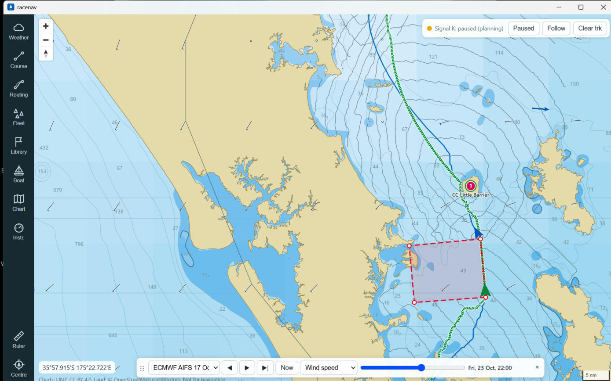

# Route planning

A good passage plan answers three questions before you leave: where is it safe to go, when should you go, and what will you do if things change. This tutorial works through them for any boat, then shows three worked examples in RaceNav.

## Four stages of every plan

Professional mariners plan every passage in four stages, and the same habit serves a two-hour fishing trip as well as an ocean race. The plan is never finished: what you see on the water feeds back into it.


- **Appraisal**: gather everything that bears on the trip before drawing a single line.
- **Planning**: turn it into a route with safety margins, a timetable and a plan B.
- **Execution**: decide to go (or not), brief the crew, and sail the plan.
- **Monitoring**: check position, weather and progress against the plan, and re-plan when they drift apart.

The effort scales with the trip. For a familiar run on a settled day, appraisal may be a five-minute look at the forecast and tides. For a new coast, a bar crossing or an overnight passage, it deserves an evening.

## Appraisal: what to gather

Gather before you draw. Most passage-planning mistakes are not navigation errors but something nobody looked up: a bar that breaks on the ebb, a reserve you may not anchor in, a forecast nobody read past day one.

- [ ] **Charts** for the whole trip, at a scale that shows the hazards near your route and your bolt holes. In RaceNav, zoom along the route and check the detailed chart is there; note where it isn't.
- [ ] **Cruising guide or pilot book** for harbour entrances, anchorages, local winds and hazards the chart doesn't explain.
- [ ] **Notices to Mariners and local bylaws**: new or moved marks, works, speed limits, marine reserves, no-anchoring areas, race or event closures.
- [ ] **Tides**: heights for depth over shoals and bars, times for passes and harbour entrances.
- [ ] **Weather**: the official marine forecast and warnings, plus the models in RaceNav for detail. Look at the whole period of the trip, including the return.
- [ ] **Boat**: speed you can really hold (not the brochure), fuel or water range, condition of engine, rig and safety gear, limits of comfort and safety in wind and sea.
- [ ] **Crew**: experience, fitness, seasickness, how long they can keep watch, who can take over if the skipper can't.
- [ ] **Rules**: COLREGs, local rules, the race's sailing instructions (marks, rounding sides, exclusion zones, time limits).
- [ ] **Communications and shore contact**: VHF channels, a trip report or someone ashore who knows your plan and when to raise the alarm.

Write down what you learn that changes the plan: "bar impassable on the ebb with any swell", "no anchoring between the two cardinals". In RaceNav these become barriers, barrier marks, points of interest with notes, or rounding sides.

## Hazards and safety margins

A route is only as safe as the margin between it and the nearest danger. Decide the margins first, then draw the route outside them.

**Safety depth: how much water you need**

Start from the deepest point of the boat and add allowances for everything that makes the water shallower or the boat deeper than you think:

| Allowance | Typical value | Why |
| --- | --- | --- |
| Draft | Your boat's (laden) | Fuel, water, gear and crew add depth |
| Squat and heel | 0.1–0.3 m | Hulls sit lower at speed; keels draw differently heeled |
| Swell and waves | Half the wave height or more | The boat drops into each trough |
| Chart and survey error | 0.5–1 m, more in old surveys | Depths in remote areas may date from lead-line surveys |
| Tide | Use the tide at your time, or assume chart datum (the lowest tide) for a plan that works at any time |  |

Set the result as RaceNav's **safety depth**, and the next charted contour deeper than it as the **safety contour**. The routing will not go shallower, and the chart shades the water inside the safety contour darker so it stands out.

**Clearing distances**

- **Headlands and reefs**: allow more off a lee shore (wind or swell towards the land) than a weather shore; half a mile in fair weather, a mile or more with onshore wind or swell, more at night.
- **Isolated dangers**: give rocks, wrecks and obstructions room for position error and set. Turn on Route round dangers, and add barrier marks with a radius for any you want to keep extra clear of.
- **Marine farms and fishing gear**: lines and floats extend beyond what the chart shows. Route round marine farms keeps out of charted ones; draw zones for others.
- **Traffic**: cross shipping lanes at right angles and keep out of ferry routes and harbour fairways where you can; a barrier line stops the routing running along them.

**Bars and harbour entrances**

A river or harbour bar can break with little warning when swell meets an ebbing tide. Plan bar crossings near high water slack, check the local advice (harbourmaster, Coastguard), and have a plan if it is breaking when you get there. Mark the bar as a point of interest with its rules in the notes.

**Turning margins into RaceNav settings**

| Margin | Set it as |
| --- | --- |
| Least depth | Safety depth and safety contour (Chart and Signal K drawer) |
| Keep off a rock or reef by a set distance | A barrier mark with a radius, or a mark on the course left to port or starboard with a clearance |
| An area you won't enter | A barrier zone |
| A line you won't cross (a fairway, a reserve boundary) | A barrier line |
| A mark you must round on one side | Leave to port / Leave to starboard with a clearance |
| A spot you must reach precisely | As close as possible |

## Tides and currents

**Height**

Charted depths are measured from chart datum, close to the lowest tide. The depth you actually have is the charted depth plus the height of tide at that moment. Over a shoal or a bar this decides whether you can cross at all, and when. Click a tide station in RaceNav for the day's curve; when planning, the marker shows the tide at the weather slider time, so you can scrub to your arrival time and read the height. The *rule of twelfths* gives a feel for it: in the six hours from low to high water the tide rises about 1/12, 2/12, 3/12, 3/12, 2/12 and 1/12 of its range in successive hours, so the middle hours change fastest.

Weather moves the tide too: low pressure and onshore wind raise the sea level, high pressure and offshore wind lower it, by a few decimetres either way.

**Streams**

Tidal streams run hardest through narrow passes, round headlands and across harbour entrances, often turning before or after high and low water at the nearest port. A two-knot stream is a quarter of a small yacht's speed: with you it takes hours off a passage, against you it can stop a boat in a pass. Plan to carry fair tide through the critical places, and time passes and entrances for slack water when the stream is strong.

**Wind against tide**

When wind and stream oppose each other, waves grow steeper and closer together, sometimes dangerously so off headlands and on bars. A fresh breeze that is comfortable with the tide can be unpleasant against it. When you scrub the forecast, check the wind direction at the times the stream turns at your critical points.

**In RaceNav**

- Tide heights and curves: tide stations (Chart and Signal K > Tides).
- Ocean currents: GRIBs with currents (for example from an ocean model) can be used in routing with **Use GRIB currents**.
- Tidal streams are not modelled yet: plan stream-critical passages from tide tables and the cruising guide, and give them extra time.

## Building the route

**Good waypoints**

- **In safe water**, never on a hazard, a mark or a headland: put them where you would be happy to arrive in poor visibility.
- **Off headlands by your clearing distance**, so each leg passes outside the danger rather than through it.
- **Where something changes**: a course alteration, the start of a fairway, a point where you'll decide to continue or turn back.
- **Named and saved** in the library, so they are reused, not re-invented: "Pepin Island 1 NM N" says more than "WP 7".
- **Checked leg by leg**: zoom along each leg at a detailed scale and look for anything the leg crosses. The ruler shows bearing and distance; RaceNav's list shows each leg's length.

**Fastest route or chosen route?**

For a power boat or a cruise the route you draw is usually the route you take: shortest safe track, perhaps adjusted for comfort. For a sailing boat the waypoints are the *places you must go*, and the best track between them depends on the wind; that is what routing is for (see the Weather routing tutorial). Even then, draw the route first: it states the constraints (marks, sides, clearances) the routing must respect.

**Quick sketch with the ruler**

Press **Ruler**, click along the passage, double-click to finish, then right-click > **Save ruler as route**. The points become library marks and the route opens in the Course drawer, ready to name, adjust and save.

**Rounding choices**

| Mark | Usual choice |
| --- | --- |
| Race mark | Leave to port or starboard as the instructions say, clearance a few boat lengths (0.02–0.05 NM) |
| Headland or reef you must keep off | Leave on the side away from danger, clearance = your clearing distance |
| Offshore turning point | Pass through, with a radius of 1–5 NM so the route isn't forced through one point |
| Fishing spot, mooring, fuel berth | As close as possible |
| Harbour entrance | Pass through with a small radius, then pilot by eye |

**Getting it on the plotter**

Library > Routes > GPX exports the route; import it on most plotters and phone apps. With Signal K, the next-mark data (BTW, DTW, XTE, TTG) shows on RaceNav's own instruments.

## Timing, fuel and weather windows

**Speed you can hold**

Plan with the speed you average, not the speed you touch. A yacht averages perhaps 70–80 % of its polar over a day; a trailer boat that planes at 25 kn in flat water may manage 12 kn into a short chop. Time = distance ÷ speed, then add time for the harbour, the bar, the slow first and last miles.

**Daylight**

Arrive in daylight anywhere unfamiliar, with a bar, or with fishing gear and farms about. Work backwards from sunset to the latest safe departure.

**Fuel and range (power boats)**

The common guide is the *rule of thirds*: a third of the fuel to get there, a third to get back, a third in reserve for headwinds, a detour or a tow. Fuel per mile rises steeply when the boat comes off the plane or punches into a sea, so a rough return can use far more than the run out. Check the return leg's forecast, not just the outbound.

**Weather windows**

A window is a period when wind and sea stay inside your limits for the whole trip, return included, with margin either side for delay. To find one in RaceNav:

1. Download a GRIB for the area (wind, gusts and waves; a wave GRIB as well if the wind GRIB has none).
2. Close the drawers and use the time slider with the GRIB-at-cursor panel: scrub through the trip at the places that matter (the exposed headland, the bar, the fishing spot).
3. Right-click > **Meteogram here** at the most exposed point: when does the wind ease, when does it build again, do the models agree?
4. Load a second model, or a newer run, and compare. If they disagree about the timing of a front, your window is the time both agree is safe.
5. For a sailing boat, run routings at several start times and compare them (Routing > Compare table).

**Your limits**

Write them down before you look at the forecast, so the forecast doesn't talk you into a trip: maximum wind and gust, maximum wave height, and the direction that matters (onshore at the bar, against the tide in the pass). Then use the same numbers as routing limits.

## Contingencies, execution and monitoring

**Plan B before you need it**

- **Bolt holes**: harbours or anchorages along the route you can reach in the worst expected wind. Save them as points of interest (shelter, good anchorage) so they show on the chart.
- **Decision points**: places where you decide to carry on or turn back, with the condition written down ("at the point, if the sea is over 1.5 m, turn back"). Make them route marks or points of interest.
- **Abort criteria**: weather worse than forecast, a crew member unwell, gear failure, falling behind the timetable by more than you allowed.

**Execution**

On the day, look again: the latest forecast, a fresh GRIB, the actual conditions. Make the go or no-go decision against the limits you wrote down. Brief the crew: route, timetable, hazards, bolt holes, who does what. Tell someone ashore (or log a trip report) and when to raise the alarm.

**Monitoring**

- In live mode RaceNav shows the boat, its track and the route; the Route instruments give the next mark's bearing and distance, cross-track error, time to go and ETA.
- Compare progress against the plan at each mark: ahead or behind the timetable? Is the weather what was forecast?
- Record the track (Library > Tracks > Record): afterwards it shows how the plan and reality differed, the best way to plan the next trip better.
- When conditions or progress drift from the plan, re-plan: a new routing from the boat's position (Course > **From boat**), or the bolt hole.

## Worked example: a cruise across Tasman Bay

*A yacht leaves Nelson for a night at anchor on the Abel Tasman coast.*

1. **Appraise.** Load the forecast (Weather > Download, GFS or ECMWF, Tasman Bay, 3 days). The cruising guide notes which bays shelter from which winds; the chart shows the Boulder Bank, the harbour entrance and the shoals off the river mouths.
2. **Set margins.** Chart and Signal K drawer: safety depth = draft 1.9 m + 1 m = 3 m; safety contour 5 m. Turn on Route round dangers and marine farms (there are farms in the bay).
3. **Sketch the route.** Ruler from the harbour entrance across the bay to the anchorage, double-click, right-click > Save ruler as route. In the Course drawer name it "Nelson to Torrent Bay" and set the anchorage mark to As close as possible.
4. **Mark the bolt holes.** Add points of interest for one or two sheltered bays you could reach if the wind turns onshore, with notes on which winds they suit.
5. **Choose the day and time.** Close the drawers, scrub the time slider and watch the GRIB-at-cursor panel at mid-bay: you want 8–18 kn from a reaching angle, not a building sea breeze on the nose for the last hours. A meteogram at the anchorage shows whether the night will stay settled.
6. **Route it.** Boat drawer: your polar at 85 % efficiency. Routing > Compute at the departure time. Then With each GRIB if you have two models: if both give a similar route and ETA, the plan is robust.
7. **Check the anchorage.** Click the tide station nearest the anchorage for the evening's low water; the depth where you plan to anchor must still be enough at low tide.
8. **Go, and monitor.** Record the track; in live mode watch XTE and TTG. If the breeze builds onshore, the bolt holes are on the chart.



## Worked example: a fishing trip in a trailer boat

*A 6 m trailer boat runs from the ramp to a favourite spot 15 NM offshore, fishes for four hours, and comes home.*

1. **Save the spot.** Right-click it on the chart > New library mark here, type **Fishing spot**, group "Fishing", and notes (depth, best tide, what bites there).
2. **Set your limits first.** For this boat: no more than 15 kn of wind and 1.2 m of sea for a comfortable, safe run; less if the wind is against the tide off the point.
3. **Check the window.** Download GFS with GFS-Wave (or ECMWF with ECMWF wave) for the area. Close the drawers. At the spot, right-click > Meteogram here: the window is the stretch when wind stays under 15 kn, from launch until you are back on the trailer, with an hour's margin. Scrub the time slider to see if the sea at the exposed point on the way out is worse than at the spot.
4. **Plan fuel.** Distance out 15 NM, back 15 NM, plus moving around on the spot. At the boat's cruising speed and fuel burn, does the rule of thirds hold with the tank you have? If the return is into the wind, allow more.
5. **Route it (optional).** With a power polar (see the last section) as the boat's polar and the wind and wave limits set, Compute gives the shortest track round land, dangers and farms, and an ETA. Set the spot to As close as possible.
6. **Tide.** Click the nearest tide station: plan to fish the tide the spot likes, and to cross any bar on the way home near high water.
7. **Tell someone.** Log a trip report or tell someone ashore your plan and return time.
8. **On the water.** In live mode the instruments show distance and time to the spot; the wind arrows on the boat show how the breeze is changing. If it freshens beyond your limit, head home early: the return is usually the rough leg.



## Worked example: a coastal race

*A yacht prepares for a coastal overnight race of about 120 NM, such as the Coastal Classic from Auckland to Russell.*

1. **Read the sailing instructions** and turn every constraint into RaceNav: the start line ends as marks (type Start line end), each course mark with its rounding side, any exclusion zones as barrier zones (with the instruction number in the name), and islands or reefs you must leave on one side as marks on the course.
2. **Margins.** Safety depth for your draft; Route round dangers on. Give headlands you will round a clearance that reflects the night and the likely sea.
3. **Weather.** From about five days out, download each new GFS and ECMWF run. Load several and use the agreement displays and Verify runs to see where the models disagree and which has been doing better lately.
4. **Polar and efficiency.** Your polar at 90–95 % for a well-sailed race boat; tack and gybe times for your crew.
5. **Route it many ways.** With each GRIB at the planned start; then several runs as each new forecast arrives. Watch the compare table: is the route the same (go and sail it) or does it flip between two sides of the course (the decision that matters)?
6. **Test the big decision.** Where the routings split, put a row of gates across the split with the gate sweep (Routing > Gates), with each GRIB. The gate that is nearly best under every model is the one to aim for.
7. **Night and safety.** Note the bolt holes, the times you'll pass the headlands, and the forecast at each.
8. **In the race.** Re-route from the boat at each new forecast (Course > From boat), and follow the fleet in the Fleet drawer if the race is on YB tracking: Route on a rival shows what the router would have them do.



## Making a power polar

Routing needs a boat speed for every wind angle and strength. For a power boat, a simple table does the job, and it can even capture how the boat slows into a head sea. Save it as a text file ending `.csv` in `racenav-data\polars`, then choose it in the Boat drawer.

The first row lists wind speeds (kn); each following row starts with a true wind angle (0 = straight into the wind) followed by the boat's speed at each wind speed, separated by semicolons. An example for a trailer boat that cruises at 22 kn:

```csv
TWA\TWS;0;10;15;20;25;30
0;22;22;18;12;8;5
45;22;22;19;14;9;6
90;22;22;21;17;12;8
135;22;22;22;19;15;10
180;22;22;22;20;16;12
```

Read across a row: heading into the wind (0°) the boat holds 22 kn up to 10 kn of wind, then slows as the sea builds; downwind (180°) it holds speed much longer. Set **efficiency** to 100 % and the tack and gybe times to 0 in the Boat drawer.

**What it does and doesn't do**

- It finds the fastest track round land, shallow water, dangers, farms and barriers, choosing a calmer side of a headland if your table says the boat is faster there.
- With the wind and wave limits it stays out of weather you don't want, or tells you there's no way through.
- It doesn't know fuel, waves from a different direction to the wind, or comfort. Full power-boat routing (fuel use, sea-state slowdown from wave GRIBs, comfort limits) is planned.
