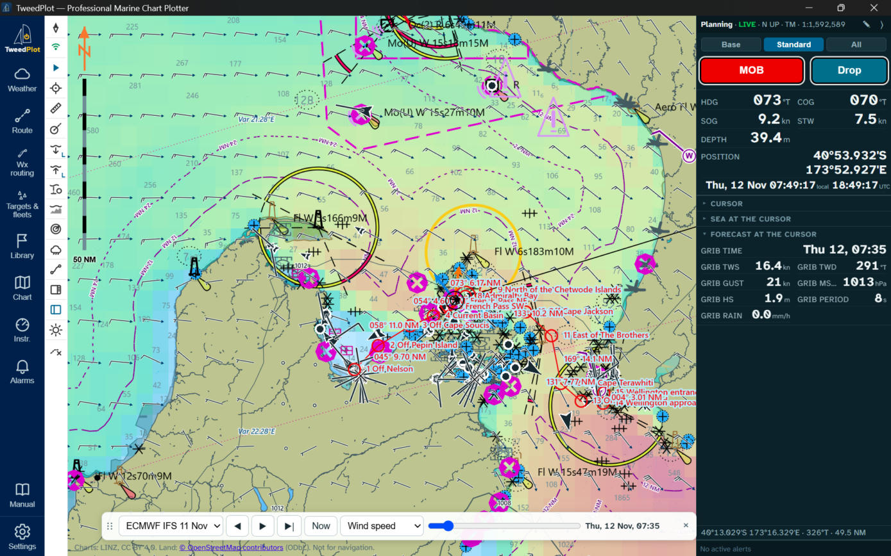

# TweedPlot User Manual

**TweedPlot: Professional Marine Chart Plotter**, from [TweedsMarine](https://tweedsmarine.nz), Nelson.

TweedPlot plans and sails passages on a Windows PC: charts, weather, routing and live instruments in one app. This tab is the reference; the tutorial tabs teach route planning and weather routing step by step.

## About this manual

This manual is for anyone who plans a passage before they leave the dock: racing and cruising sailors, and recreational fishers and launch owners running power boats. The app was built for yacht racing, but most of it (charts, tides, weather, marks, measuring, instruments) serves every boat equally.

**How it is laid out**

| Part | What it covers | Read it when |
| --- | --- | --- |
| This tab (reference) | Every panel and tool, what it does and how to use it | You want to know what a button does |
| Route planning (tutorial) | How to plan any passage: appraisal, hazards, tides, waypoints, contingencies, with worked examples for a cruise, a fishing trip and a race | You are planning a trip |
| Weather routing (tutorial) | Forecast models, GRIB files, uncertainty, polars, how a router thinks, and how to read and test its answer | You want the weather to choose or check the route |
| Glossary | Terms used in the app and the tutorials | A word is unfamiliar |

**Words used in this manual**

- *Drawer*: the panel that slides out from the icon rail on the left.
- *Dock*: the wide panel along the bottom of the chart for tables and graphs.
- *GRIB*: a weather forecast file (see Weather).
- *Routing*: a computed fastest route through the weather; *route*: your planned list of marks.
- Bearings are true (°T) unless shown as °M; distances are nautical miles (NM); speeds are knots (kn).

**Safety**

TweedPlot is a planning and situational-awareness tool, not a certified navigation system. The charts come from LINZ open data and OpenStreetMap and are not official ENCs; forecasts are model output, not warnings. Keep a proper lookout, carry official charts and publications, check MetService forecasts and warnings before and during every trip, and use your judgement. A routing is a suggestion based on a forecast that will be wrong in places.

**This manual inside TweedPlot**

The manual is built into the app, so the copy you read always matches the version you run, with or without an internet connection. Press {icon:manual} **Manual** at the bottom of the rail, or **F1**. The **?** in each drawer's title bar opens the manual at that drawer's section. In the manual, the tabs along the top switch between the reference, the two tutorials and the glossary; **Contents** lists the sections of the open tab; the search box finds a word in every tab; click a picture to see it full size; **Wide** gives the manual most of the window, and **×** or **Esc** closes it. The button icons and chart symbols in the manual are drawn by the same code as the ones on screen, so they look exactly as they do in the app.

## Getting started

TweedPlot runs on Windows 10 or 11 (Intel or ARM) and keeps all its data in plain files in one folder, so it can be backed up or copied to another PC.

**Install**

1. Run the TweedPlot installer. (During development it is built from the racenav source; the README explains how.)
2. Create the data folder `C:\dev\tweedplot-data` with the sub-folders below, or let TweedPlot create them as it needs them.
3. Start TweedPlot. The chart opens on Nelson; the Weather drawer is open.

**The data folder**

| Folder | Holds | Notes |
| --- | --- | --- |
| `linz` | LINZ chart data (the zip files as downloaded) | See Charts for which datasets to download |
| `grib` | Weather files, downloaded or copied in | qtVlm's GRIB folder is read too |
| `polars` | Your boat speed tables (polars) | See Polars, under Your boat. Without `tweedplot-data` they live in TweedPlot's own data folder |
| `library` | `library.gpkg`: marks, routes, barriers, saved routings and tracks in one database; `export`: GPX written by the app | Close TweedPlot before copying `library.gpkg` (and keep it out of Dropbox or OneDrive folders while TweedPlot is open). It's a GeoPackage, so QGIS and other GIS software open it |
| `tides` | LINZ tide tables | Downloaded from Weather and tides › Tides |
| `tracking` | YB race tracking data | One sub-folder per race |
| `enc` | Official ENC cells (S-57) and encrypted exchange sets (S-63) | See ENC cells under Charts |
| `coastline` | The world coastline (GSHHG) | Downloaded from Chart data |
| `bathy` | Detailed depths (ETOPO) for the areas you fetched | Downloaded from Chart data |
| `hires` | High-resolution depths (LINZ coastal), one file per Topo50 sheet | Downloaded from Chart data |
| `pbathy` | Own soundings (`bathy.sqlite`): your soundings from your tracks and the PBG and XYZ files imported | Built from Chart data |
| `marine` | Maritime boundaries (LINZ) and fishing rules (MPI) | Downloaded from Chart data |

Advanced: the environment variables `RACENAV_GRIB_DIR`, `RACENAV_POLAR_DIR`, `RACENAV_LIBRARY_DIR` and `RACENAV_SK_URL` point TweedPlot elsewhere.

**First launch checklist**

- [ ] {icon:settings} **Settings**: the vessel's name, MMSI, draft, length, breadth, air draft and where the GPS antenna is.
- [ ] {icon:chart} **Chart › Safety**: zoom in on New Zealand to check the LINZ charts show, and set your **safety depth** and **safety contour**.
- [ ] {icon:alarms} **Alarms**: check the alarms you want are on.
- [ ] {icon:settings} **Settings › Vessel › Performance**: choose a polar (sail) and set the efficiency and tack and gybe costs.
- [ ] {icon:weather} **Weather**: download or load a GRIB.
- [ ] {icon:inst} **Instruments**: arrange the panels you want; the layout is kept per PC.
- [ ] If you have instruments: start your Signal K server, or add your NMEA sources in **Settings › Connections › NMEA data sources**. The live data button in the toolbar turns green {icon:sk}.

**The screen**

The chart fills the window. Everything else floats over it or slides out from the edges, so any of it can be hidden. 


Drawers slide out from the rail; instrument panels, the time slider and the dock float over the chart and can each be hidden.

| Where | What | How to use it |
| --- | --- | --- |
| Left rail | The drawers, then Manual and Settings at the bottom (see *The rail* below) | Click an icon to open its drawer; click again or press Esc to close it. Only one drawer is open at a time |
| Top left | The toolbar, a column of buttons (see *The toolbar* below). It moves along when a drawer opens | Paused = planning: the boat stays where you put it |
| Top right | **MOB** (man overboard), alone, the same size and place in every view and every window | One press, no confirmation. See *Alarms and man overboard* |
| Bottom right | **Drop**: marks the boat's position with the time | No alarm, nothing else changes |
| Bottom centre | **Zoom out** and **Zoom in**, two round buttons well apart | Shown on touch screens only, unless you change it under *Screen controls* in Settings |
| Floating panels | Instrument panels and the time slider | Drag by the grip (⋮⋮); double-click the grip to fold a panel |
| Bottom | The dock: Compare routings, Gates, Fleet, Meteogram, Verify | Opens from buttons in the drawers; drag its top edge to resize |
| Bottom left | Cursor position | Also in the Cursor instrument |
| Right-click | The chart menu | Move the boat, start a route or add a mark to it, a new library mark, centre the chart, a meteogram, start a ruler here; on a mark, ruler or barrier, the actions for it |

**The rail**

| | Button | What it opens |
| --- | --- | --- |
| {icon:weather} | **Weather** | Weather and tides: GRIBs (load, download, what the chart shows), the floating time slider, tides, Saildocs, weather stations and buoys |
| {icon:course} | **Route** | **Navigate** (the mark you are steering to) at the top, then the route you are planning: start, marks, how each is rounded |
| {icon:routing} | **Routing** | Compute and compare routings, the gate sweep, limits and barriers |
| {icon:fleet} | **Targets** | AIS targets and their display, Own fleet, YB race tracking |
| {icon:library} | **Library** | Saved routes, marks, routings, tracks and barriers; GPX |
| {icon:chart} | **Chart** | Safety (safety depth and contour), chart display (Base, Standard, All), layers (high-resolution depths, boundaries, fishing rules), own ship lines, chart data and encrypted charts |
| {icon:inst} | **Instr.** | Instrument panels, the Instruments view, monitor windows |
| {icon:alarms} | **Alarms** | Every alarm in one place: the active ones, and each alarm's settings |
| {icon:manual} | **Manual** | This manual (also **F1**) |
| {icon:settings} | **Settings** | Vessel (identity, dimensions, GPS antenna, polar), Connections (Signal K, NMEA, replay, damping), Display (colours, screen controls), Diagnostics |

**The toolbar**

| | Button | What it does |
| --- | --- | --- |
| {icon:north} | **North up** | The needle shows which way north is; click to turn the chart north up again |
| {icon:sk} {icon:sk-off} | **Live data** | Green: data arriving. Amber: connected but nothing for 10 s. Red with a slash: not connected. Hover for details, click for **Settings › Connections** |
| {icon:live} {icon:paused} | **Live / Paused** | Live: the boat follows the instruments. Paused: planning, the boat stays where you put it (right-click › **Move boat here**) |
| {icon:follow} | **Follow** | Keeps the boat centred; dragging the chart turns it off |
| {icon:ruler} | **Ruler** | Measure: click points on the chart, double-click to finish, Esc to stop (see Measuring) |
| {icon:targets} | **Target list** | Opens the AIS target list over the chart (also **T**) |
| {icon:view-nav} {icon:view-plan} {icon:view-inst} | **View** | Steps through Navigation, Planning and Instruments; the icon shows the view you are in. Right-click (or hold) to choose a view, or to show or hide the chart in this view |
| {icon:panels} | **Panels** | Shows or hides the rail, drawers and dock in this view |
| {icon:day} {icon:night} | **Colours** | Steps through day, dusk, night red and night green. Right-click it (or hold it on a touch screen) for all four and the brightness at once |
| {icon:clear-track} | **Clear track** | Clears the short trail behind the boat |

**Mouse and touch**

- Drag to pan, scroll or pinch to zoom, right-drag or two-finger twist to rotate (the **North up** button at the top of the toolbar turns the chart back to north at the top; its needle shows which way north is).
- On a touch screen a tap sets the cursor (there is no hover), and a long press opens the chart menu.
- To move a course mark, library mark, ruler point or barrier point: click it (amber ring), wait for the ring to turn green, then drag. The pause stops marks being moved by accident. A library mark's new position is saved straight away, and every route using it follows.

**Info windows**

Click an AIS target, a light, buoy or other chart feature, a fishing rule area, a tide station, a weather station or a track, and what TweedPlot knows about it opens in an **info window**: a small window over the chart with a title bar, instead of a box stuck to the point that hides the chart round it.

- An orange ring marks the place or target the window is about.
- **Move** it by its title bar, **resize** it from its bottom-right corner, and **scroll** it when there is more than fits. It always stays fully on the screen.
- Each kind (AIS, chart, tides, weather station, track) has its own window and remembers where you put it and its size, so it opens there next time, out of the way of what you are watching.
- Click something else of the same kind and the same window shows it. An AIS target's window keeps updating while it is open.
- **✕** or **Esc** closes it.

## Charts

TweedPlot draws its own vector chart from free data: a world coastline everywhere, and for New Zealand the LINZ hydrographic data with depth areas, contours, soundings, lights, marks, dangers and charted areas.

**ENC cells (S-57)**

TweedPlot also reads official electronic navigational charts in the IHO S-57 format: a base cell (`.000`) and its updates (`.001`, `.002`, ...). Put the cells in `tweedplot-data\enc`, in any folders you like; a whole exchange set (`ENC_ROOT` with its agency, cell, edition and update folders) can be copied in as it is. Each cell is converted once into the `.enc` folder beside it, and again when the cell or an update changes, then drawn in the same style as the LINZ charts. The cell's intended usage sets its scale band: overview, general, coastal, approach, then harbour and berthing.

**ENC chart sets.** Each folder in `enc` (an exchange set such as NOAA's `ENC_ROOT`, or the IHO's test data), the cells straight in `enc`, and the cells installed from S-63 exchange sets are listed under Chart > Chart data > **ENC chart sets**, with how many cells each has and who produced them. Untick a set to leave it out: it isn't checked or opened when TweedPlot starts, and it stays on disk, converted, so ticking it again brings it back in moments. Keep sets you don't sail in (all of NOAA's charts, say) unticked: start-up stays quick.

Updates are applied in order. The cells of each scale band are merged into one file in `.enc`, so even thousands of cells (all of NOAA's charts, say) draw quickly.

**Encrypted ENCs (S-63).** Most official ENCs are sold encrypted under the IHO S-63 scheme. You buy permits for the cells you want, made for your system, and the charts come as exchange sets (a folder with `ENC_ROOT` in it, on a CD, DVD or download). Everything is done in **Chart › Chart data › Encrypted charts**:

- **Activation**: encrypted charts are licensed to one computer. **Copy** the **Installation code** (it starts TP1-, made from this computer's main board) and send it to Tweedsmarine; paste the **Activation code** that comes back (it starts TPA1-) and press **Activate**. It works only on this computer: a second PC on the same boat gets its own activation code, with the same user permit, so the same chart permits work on both. A new main board needs a new activation code.
- **User permit**: this computer's identity for the chart suppliers, shown once activated. **Copy** it and give it to your chart supplier when ordering permits.
- **SA key**: the IHO Scheme Administrator's key, which proves where cells come from. TweedPlot comes with it (valid to 2033). **Install key…** takes a newer `IHO.CRT` or `IHO.PUB` from the IHO website or your supplier. A key that isn't the IHO's is installed with a warning (SSE 26); an expired or damaged one is refused (SSE 22, SSE 08).
- **Install permits…**: choose the `PERMIT.TXT` from your supplier. Each permit is checked and the report says which installed, which are wrong (SSE 12, SSE 13) and which expire within 30 days (SSE 20) or have expired (SSE 15). Permits are kept separately for each data server; **Cell permits** lists them, and **Remove** (press twice) takes away one data server's.
- **Import exchange set…**: choose the exchange set's folder, or the medium if it holds several. Every cell file is checked (signature, permit, decryption, CRC) and the base cells, new editions, re-issues and updates are applied in order. Cancelled cells are removed, with their replacements named. A report lists every cell with what happened and the S-63 code for anything wrong. When an update needs base media you haven't loaded, it says which (load them, then the update again).
- **Installed ENCs** lists each cell with its edition and update. **Remove all ENCs** clears them (permits and key stay).

While a cell whose permit has expired (SSE 25), or that is behind its data server's latest edition or update (SSE 27), is on the chart, a warning stays at the bottom of the chart: such a cell may be out of date and must not be used for primary navigation. The chart data made from encrypted cells is kept on disk encrypted for this computer and opened only in memory, as the S-63 licence requires. Until TweedPlot has its own manufacturer credentials from the IHO it uses the IHO's generic test credentials, so only the IHO test data can be opened. An exchange set copied straight into `tweedplot-data\enc` with its `PERMIT.TXT` is still read as before.

**Getting the New Zealand data**

Download from the [LINZ Data Service](https://data.linz.govt.nz) (free account) as GeoPackage, and put the zip files, unopened, in `tweedplot-data\linz`. TweedPlot reads every scale band it finds and draws the most detailed one available at each place.

| Dataset | Why |
| --- | --- |
| Depth area polygons (each scale band: 1:4k–1:22k, 1:22k–1:90k, 1:90k–1:350k, 1:350k–1:1.5M, 1:1.5M and smaller) | Water depth shading and the routing safety depth |
| Depth contours and soundings (same bands) | Contours, the safety contour, spot depths |
| NZ coastlines and islands (Topo50) | The detailed coastline |
| NZ lake polygons (Topo50), and optionally NZ river polygons (Topo50) | Lakes and wide rivers as water. The coastline layer is land right across them, so without these Lake Taupō, for example, shows as land under its rocks and marks. Where a lake is charted (Taupō is) its depth areas, contours and soundings show; elsewhere it is plain water. The lake and river areas in the hydrographic feature downloads are used too |
| Hydrographic feature layers (the "121 layers" GeoPackage for each band) | Lights, buoys, beacons, rocks, wrecks, obstructions, marine farms, anchorages and other charted areas, and the tidal diamonds and flood and ebb arrows ("Tidal stream panel data points", "Tidal stream - flood/ebb points") |

The open data does not cover every harbour at large scale. Port Nelson's inner channel marks, for example, are only in the official ENC. Add missing marks yourself as library marks with buoy symbols (see Marks).

Wharves, breakwaters, jetties, pontoons, floating docks and causeways are drawn from LINZ's shoreline construction and pontoon layers (in the hydrographic feature downloads) where LINZ has them; click one for its type. Many marinas, Nelson's included, have no pontoons in the open data: those are only in the official ENC.

**The Chart drawer**

{icon:chart} **Chart** has five parts, in the order an ECDIS keeps them: what keeps the boat safe first, then what is shown, then where the data comes from.

| Part | Settings |
| --- | --- |
| **Safety** | **Safety depth** and **safety contour** (below), with the draft from **Settings › Vessel** beside them and how much water the safety depth leaves under the keel |
| **Chart display** | **Display**: Base, Standard or All (below); **Standard display**; **Light sectors**, **Names and labels**, **Soundings**; **Chart symbol size** |
| **Layers** | **High-resolution depths**, **Own soundings**, and the boundaries and fishing rules (see *Boundaries and fishing rules*) |
| **Own ship** | **Heading line**, **COG line** and **Wind arrows** (see Your boat) |
| **Chart data** | Every download and import: world coastline, detailed depths, high-resolution depths, boundaries, fishing rules, the LINZ charts, and **Encrypted charts (S-63)** |

| Setting | What it does |
| --- | --- |
| **Safety depth (m)** | The least depth you will sail in: the draft plus a margin for swell, squat and chart error. Routing will not enter water shallower than this, and it is the shallow water alarm's depth unless you set another |
| **Safety contour (m)** | The contour drawn bold. Water shallower than it is shaded darker blue, as on a paper chart. Usually the next charted contour at or deeper than the safety depth. The **Safety contour ahead** alarm watches for it |
| **Chart symbol size** | Scales buoys, beacons, lights, dangers and other chart symbols from 75% to 200% (default 120%) to suit the screen and the viewing distance. Labels grow at half the rate, so they stay clear of each other |

**Display: Base, Standard and All**

As on an ECDIS (IHO S-52), **Display** decides how much of the chart is shown:

| Display | Shows |
| --- | --- |
| **Base** | Land and coastline, depth areas, the safety contour, and the dangers to your boat (rocks, wrecks, obstructions, marine farms, bridges and overhead cables). Base can't be reduced any further: these are never hidden |
| **Standard** | Base, plus buoys, beacons and lights (with their sectors), leading lines and recommended tracks, restricted, caution and anchorage areas, wharves and other constructions, and spot soundings if **Soundings** is ticked |
| **All** | Standard, plus every spot sounding, the other depth contours, submarine cables and pipelines, ferry routes and dumping grounds |

**Names and labels** (light characteristics, names of marks and places, depths over dangers) and **Light sectors** go on and off separately in Standard and All. **Standard display** puts everything back in one press: Standard, with light sectors, names and soundings, the display to come back to when the chart has been changed for a particular job (S-Mode, IMO's standard user interface for navigation equipment, asks for this). The button is highlighted while the chart is at the standard display.

Underwater dangers deeper than the safety contour are shown with their depth only, so the chart stays readable while anything that matters to your boat stands out.

**Hazards are never hidden by zoom.** Rocks, wrecks, obstructions, piles, platforms, marine farms, hulks, bridges and overhead cables and pipelines stay on the chart at every zoom, even in the Base display, and even where the chart's own scale-minimum setting (SCAMIN) would hide them. This follows the ECDIS performance standard, which puts isolated dangers in the "display base" that can't be removed, and learns from groundings such as Team Vestas Wind's on the Cargados Carajos Shoals in 2014, where a reef did not show on a racing navigator's chart display at the zoom he was using. Zoomed well out, where symbols would pile up, they are thinned to one every few pixels, keeping the most dangerous (drying and awash first, then the shallowest), and a farm or obstruction too small to see is also drawn as its symbol. Zoom in to see each one. Underwater dangers deeper than your safety contour are the exception: they appear from the scale the chart says, as their depth.

**Port entry information shows early.** Pilot boarding places, radio calling-in (reporting) points and lines, signal stations and rescue stations show from about 1:500,000 (zoom 9), well before their charted SCAMIN, which often hides them until the harbour chart. That way they can be found while planning an approach to an unfamiliar port.

**Chart symbols at a glance**

The symbols follow the paper chart and ECDIS conventions (IHO S-52), simplified to read on a screen. The commonest:

| Symbol | Meaning | Symbol | Meaning |
| --- | --- | --- | --- |
| {img:s57:b|2|3||} | Port lateral buoy (red can) | {img:s57:b|1|4||} | Starboard lateral buoy (green cone) |
| {img:s57:b|4|2,6|1|n} | North cardinal buoy | {img:s57:b|4|6,2|1|s} | South cardinal buoy |
| {img:s57:b|4|2,6,2|1|e} | East cardinal buoy | {img:s57:b|4|6,2,6|1|w} | West cardinal buoy |
| {img:s57:b|4|2,3,2|1|isd} | Isolated danger buoy | {img:s57:b|3|3,1|2|saw} | Safe water buoy |
| {img:s57:b|4|6||spp} | Special mark (yellow) | {img:s57:l|r} | Light (the flare in the light's colour: red, green, or yellow for white) |
| {img:s57:r|3} | Rock under water (depth beside it when known) | {img:s57:r|4} | Rock that covers and uncovers |
| {img:s57:r|5} | Rock awash | {img:s57:r|2} | Rock that always dries |
| {img:s57:w|2} | Wreck dangerous to navigation | {img:s57:w|5} | Wreck showing its hull |
| {img:s57:o} | Obstruction | {img:s57:mf} | Marine farm |
| {img:s57:an} | Anchorage area | {img:s57:mo} | Mooring buoy |
| {img:s57:pb} | Pilot boarding place | {img:s57:rc} | Radio calling-in (reporting) point |
| {img:s57:ca} | Caution area: click it for the restriction | {img:s57:rs} | Rescue station |
| {img:s57:lm} | Landmark | {img:s57:fg} | Fog signal |

Depths are in metres below chart datum; a height that dries at low tide is labelled "dries", with its height above chart datum. Click any symbol for its full details in an info window.

**Where the chart scales meet.** LINZ charts come in scale bands, and the same farm, cable or rock is often drawn differently in each (a 1:190,000 chart may show one big farm block where the 1:122,000 chart shows the separate farms). TweedPlot uses each band's coverage, as an ECDIS does: inside the area a larger-scale chart covers, its features are the ones shown, and a smaller-scale chart's features are cut back to outside it. So a feature can change shape at a chart boundary, but never at the edge of a map tile, and nothing comes and goes as you zoom except where the charts themselves differ. Click a light, mark, danger or area for its details: light characteristics, buoy shape and colours, depth over a rock, area restrictions.


At small scales the world coastline (GSHHG) is drawn, and east of 180° (the Chathams, for example) works the same as west of it.

**Chart data: world depths and coastline**

Outside New Zealand, TweedPlot shades the sea by depth from free world data. **Chart › Chart data** shows what is installed (a green dot) and downloads the rest.

| Data | How you get it | What it shows |
| --- | --- | --- |
| **World depths** (Natural Earth) | Comes with TweedPlot | Depth shading at 0, 200, 1000, 2000 … 10000 m, everywhere |
| **World coastline** (GSHHG) | **Download**, once, about 150 MB | Every island, at every scale. Until then a coarser outline is drawn. Coastline detail (Standard, More, Most) brings GSHHG's finer levels in when zoomed further out: Most draws the full-resolution coast from zoom 4 instead of zoom 8, a little slower to draw |
| **Detailed depths** (ETOPO 2022) | **Get for chart view**, for the area on screen, typically 1–5 MB | Finer depth bands from zoom 4 and contours (5 m to 5000 m) from zoom 7 |
| **NZ charts** (LINZ) | **LINZ…** opens the LINZ Data Service (see above) | The full hydrographic chart |
| **High-resolution depths** (LINZ coastal, 1 m) | **Get for chart view**, zoomed in to the area; one file per Topo50 sheet, its size depending on how much was surveyed | Shaded depths with contours from about 5 NM range in, where LINZ has flown a survey (see below) |
| **Own soundings** | **Add my tracks**, and **Import PBG / XYZ…** | Your own soundings as a depth image, with the sounding under the cursor (see below) |
| **Maritime boundaries** (LINZ) | **Download**, under 1 MB | Territorial sea (12 NM), contiguous zone (24 NM), EEZ (200 NM) and the boundaries agreed with Australia (see Boundaries and fishing rules) |
| **Fishing rules** (MPI) | **Download**, several MB; **Update** before a trip | MPI's commercial fishing regulations, customary areas, voluntary closures and fisheries areas (see Boundaries and fishing rules) |

For detailed depths, zoom the chart to the area you want, pick the **Detail** (15″ is about 460 m between points) and press **Get for chart view**. The line under it gives the download size; a large area is thinned automatically, so zoom in for more detail. Each area you have downloaded is listed with **Show** and **✕** (delete). Downloads can be cancelled, and the chart redraws when one finishes.

**High-resolution depths.** LINZ publishes 1 m elevation models of the coast from aerial laser surveys (lidar), which reach the seabed down to about 25 m in clear water. Where they exist they show far more than the chart: channels, banks, bars, reefs and the shape of the seabed in harbours and anchorages. Zoom in to the area (the line under the row says how many sheets cover the chart view, how many LINZ has data for and how many are downloaded), press **Get for chart view**, and the depths are drawn from about 5 NM range in, shaded as if lit from the north-west, with contours every 10 m, 5 m, 2 m or 1 m as you zoom in. **Show** turns them on and off; **✕ All** deletes them. LINZ keeps one file for each Topo50 map sheet (24 × 36 km), from well under 1 MB where only a strip of coast was surveyed to tens of MB where the whole sheet was; up to 60 are fetched at a time.

The heights are above NZVD2016, about mean sea level, not chart datum: the depths shown are deeper than the charted depths by roughly half the tidal range, so use them for the shape of the bottom, not for clearance. Above 0 m nothing is drawn (the chart shows the land and the drying areas). Surveys were flown in different years, and sand moves. Not for navigation.

**Own soundings.** TweedPlot builds a seabed from your own soundings: every depth logged along your tracks, and any TimeZero PBG (`.tzpbg`) or XYZ file you import, gridded into cells of about 2 m (the same grid as TimeZero's files, so they import exactly). Each cell keeps how many soundings went into it, their mean, their spread, the newest date and where they came from. Soundings add up over the years, and the same cell from several trips averages out.

- **Add my tracks** adds the depth logged along every track in the library that has depth (the recorder logs it from the sounder; TimeZero track imports keep it too), whatever is ticked or selected in the Tracks tab. Tracks added before are skipped, so press it again after a trip. Spikes are left out: a depth more than 2 m or 10 % off the fixes around it (the sounder losing the bottom, seeing fish or a wake).
- **Import PBG / XYZ…** reads a TimeZero PBG file, or XYZ text with longitude, latitude and height on each line (negative down, as TimeZero exports). A file imported before is not added again unless you press **Import again** (its soundings would count twice). A large file takes a minute or two.
- **Own soundings** in **Layers** shows them, from zoom 3 in, over the chart's depth areas. **Show** (beside the count) turns them on and zooms to where nearly all of them are. Moving the cursor over them shows the depth there, the spread (±) where there are several soundings, the source, how many soundings and the newest date, on the position line at the bottom.
- **Colours**: **Rainbow** (red shallow to violet deep) or **Blues** (as charts), over a depth range. **Fit to view** sets the range to the depths in the chart view, so the ground you're working stands out. **Contours** (from 100 m apart when zoomed out to 1 m close in) and **Shading** (lit from the north-west).
- **Fill gaps** and **Fill up to** (0 to 250 m): gaps between soundings are filled from the nearest soundings around them, up to that distance. A few metres shows what was actually sounded; 25 to 100 m joins neighbouring tracks into a surface, which helps read the ground when zoomed in. Filled areas are an estimate between soundings, not soundings: the cursor readout shows real soundings only.
- **Check against the chart** (on unless you turn it off): when adding tracks or importing a file, a sounding is left out if it is well outside the chart's depth band where it is (more than 10 m and 20 % shallower than the band's shallowest depth, or deeper than its deepest), allowing for the bands of the areas within about 900 m (on a slope or a canyon wall the chart's depth areas are coarse polygons, and a sounding near a band's edge may belong to the next band). A track is also split into runs wherever the depth jumps more than the seabed could between fixes; a run that is mostly off the chart is left out whole, because the sounder was locked onto something other than the bottom (fish, a scattering layer, a second echo) or holding a depth. Then a second opinion: a left-out sounding goes back in if your own soundings within about 10 m that passed (at least three cells) agree with it, within 5 m or 5 %. Where several tracks cover a canyon wall, the chart was wrong rather than the sounder; a sounder locked onto something else disagrees with the soundings beside it. The result says how many were left out and why, how many were put back, and how many had no chart depth to check against (outside the charts, those are only checked for spikes). Left-out soundings are kept apart, not lost: **Show left out** marks them in magenta, at any zoom, with the Own soundings layer on. The chart's depth areas are the reference because they were surveyed independently. They are generalised, so only soundings well off them are left out.
- **✕ All** deletes them (click twice). The tracks and the imported files stay, so they can be built again. Your soundings stay on this computer: TweedPlot doesn't send them anywhere.

To compare tracks with the seabed, or one trip with another, colour the tracks by **Depth (own soundings colours)** in Library › Tracks: they take the same colours and depth range, and follow when you change them here.

The depths are as the sounder gave them, below the surface or the transducer, not reduced to chart datum: they differ from charted depths by up to half the tidal range, and by the transducer depth. Use them for the shape of the bottom and to find ground again, not for clearance. Not for navigation.

World depths and ETOPO depths are for orientation only. They are coarse, or interpolated near the coast, and routing does not use them: the routing safety depth works only on LINZ depth areas. Not for navigation.

Sources and licences: Natural Earth (public domain); GSHHG, Wessel and Smith, University of Hawaiʻi and NOAA (LGPL 3, downloaded from its home site); ETOPO 2022, NOAA NCEI (free to use and redistribute), fetched through NOAA CoastWatch; LINZ hydrographic data, Toitū Te Whenua LINZ (CC BY 4.0).

**Boundaries and fishing rules**

Download both in {icon:chart} **Chart › Chart data**, then choose what to show in **Chart › Layers**. After a download the rules are prepared and built into the chart; the line under the buttons says when they are ready.

- **Maritime boundaries**: the territorial sea limit (12 NM, dashed purple), the contiguous zone limit (24 NM, dotted), the EEZ limit (200 NM, dash-dot) and the boundaries agreed with Australia, for the mainland and the outlying islands, from LINZ.
- **Fishing rules**: MPI's maps of the commercial fishing regulations, customary areas and voluntary closures. By default only the areas **closed** to commercial fishing are drawn (see below), red with a solid edge. The areas are drawn under the land: some of MPI's areas run inland.
- **Customary areas**: mātaitai (closed to commercial fishing, so drawn as closed), taiāpure and other customary areas, purple when shown as restrictions.
- **Voluntary closures**: areas closed by industry agreement, for the methods in the agreement. MPI says their boundaries are approximate.
- **Fisheries areas**: the fisheries management areas (FMAs) and statistical areas, with their codes, for catch reporting.

**Closed or restricted.** MPI marks each rule, for each fishing method, as a *prohibition* or a *restriction*. A prohibition closes the area to that method; a restriction only limits it (a mesh size, a season, gear limits, species that may not be taken). Restrictions often cover huge areas, many of them the whole EEZ, so TweedPlot draws only the closed areas unless you tick **Restrictions too**:

| Colour | Shown when | Means |
| --- | --- | --- |
| Red, solid edge | Always | Closed to all commercial fishing, or to one of your ticked methods (with no methods ticked: closed to at least one method) |
| Orange, dashed edge | **Restrictions too** | A restriction: species, mesh, season or gear rules, or a method limited but not prohibited |
| Purple, dashed edge | **Restrictions too** and **Customary areas** | A customary area that isn't closed to commercial fishing (taiāpure, temporary closures) |
| Grey, dashed edge | **Restrictions too** and **Voluntary closures** | A voluntary closure that doesn't apply to your methods |

Seasonal rules are shaded more lightly.

**Only closures for my boat's methods.** Tick the methods you fish with (bottom trawl, midwater trawl, Danish seine, purse seine, beach seine or drag net, set net, longline, potting, dredge, troll, handline, hand gathering or diving) and the red areas are only those closed to those methods or to all fishing. The vessel length comes from **Settings › Vessel**: the trawl rules for vessels over 46 m are left out for a vessel known to be 46 m or shorter.

Click inside a rule area and its rules open in an info window: closed or restricted, the methods prohibited and restricted, the species, the vessels, the season, MPI's category (for example "Trawl prohibitions for vessels over 46m"), the regulation, who is responsible, the legal description and a button that opens the regulation.

**Closed-area alarm.** With **Closed-area alarm** ticked, the main window checks every 15 seconds whether the boat is inside an area closed to the ticked methods (any closed area if none are ticked; restrictions never raise it) and whether it will be within the time you choose at its course and speed over ground (5 to 30 minutes), and raises a warning naming the areas. It works on the downloaded rules: update them before a trip, because temporary closures come and go.

MPI's maps are a guide to the regulations, not the regulations: the legal descriptions and the regulations themselves are the law. Source: Ministry for Primary Industries, CC BY 4.0. Maritime boundaries: sourced from Land Information New Zealand data, Crown Copyright Reserved. Not for navigation.

## Your boat

TweedPlot shows your own boat from live instruments, or wherever you put it when planning.

**Signal K**

TweedPlot reads live data (position, heading, speed, wind, depth) from a [Signal K](https://signalk.org) server, normally running on the same PC. Signal K takes NMEA 0183 and NMEA 2000 from your GPS and instruments through a USB adapter or gateway and serves it to any number of apps. TweedPlot connects to `ws://localhost:3000` (set `RACENAV_SK_URL` for another address). The live data button in the toolbar at the top left shows the connection at all times: green {icon:sk} when data is arriving, amber when connected but nothing has arrived for 10 seconds, red with a slash {icon:sk-off} when there is no connection (blinking while it first tries). Hover it for the server address, the time of the last update and what is arriving; click it for **Settings › Connections**.

No instruments? A GPS dongle into Signal K is enough for position, course and speed. With no Signal K at all, TweedPlot works fully in planning mode.

**NMEA 0183 direct**

TweedPlot can also read NMEA 0183 itself, without Signal K: from a COM port (USB adapter or multiplexer), a TCP connection or UDP broadcasts. Add each source in **Settings › Connections › NMEA data sources**. When NMEA sources are on, they take over from Signal K for your own boat's data.

- **Several sources:** each kind of data (position, motion, heading, speed through water, wind, depth, water temperature) can come from a different source. If the chosen one goes quiet for longer than **Source stale after**, the next source that has the data takes over (**Automatic failover**), and an alarm says so.
- **Heading:** a true heading (HDT, or VHW with a true heading) is used when there is one. Otherwise the magnetic heading (HDG, HDM) is corrected with the variation from the compass or the GPS.
- **AIS:** AIS sentences from an AIS receiver or transponder on any source (`!AIVDM`) become AIS targets, the same as AIS through Signal K. Your own transponder's reports of your own ship (`!AIVDO`) are not shown as a target.
- **Live NMEA data** shows the sentences as they arrive and what was read from them, for checking the wiring.

**Replaying a log**

TweedPlot logs every Signal K session, AIS targets included, while it runs. **Settings › Connections › Replay a log** lists the logs by start time, length and size; choose one and press **Replay**. The log then drives the boat, instruments, AIS targets and alarms as if it were live, and the live Signal K data waits until the replay stops. A bar at the top of the chart has pause, speed (1× to 300×), a slider to jump to any time, and **✕** to go back to live data. Tracks are not recorded from a replay. Use it to go over a race, test alarms and settings at the dock, or show someone what happened.

**Live and planning**

| Mode | Button (toolbar, top left) | The boat | Time used by the instruments and routing |
| --- | --- | --- | --- |
| Live | {icon:live} **Live** | Follows Signal K (or NMEA) | Now (GPS time) |
| Planning | {icon:paused} **Paused** | Stays where you put it: right-click > **Move boat here** | The weather slider time |

{icon:follow} **Follow** keeps the chart centred on the boat (dragging the chart turns it off); right-click › **Centre chart here** centres it on a place once; {icon:clear-track} **Clear track** clears the short trail behind the boat.

**Size and GPS antenna**

In **Settings › Vessel**, set the **Length overall** and **Breadth**, and where the **GPS antenna** is: metres aft of the bow, and metres off the centre line to starboard or port. Signal K gives the antenna's position, not the boat's centre, so on a 20 m boat with the antenna at the stern the bow is 20 m ahead of the position. When you zoom in far enough for the boat to be bigger than its symbol (harbour scales), it is drawn to scale as its outline, pointing along the heading (or the course over ground when there is no heading), with a dot at the antenna. Zoom out again and the symbol comes back.

**Lines and arrows on the boat**

- *Heading line* (solid) and *COG line* (dashed orange): each as long as a set time at the boat's speed, or to the edge of the chart. Set in Chart › Own ship.
- *Wind arrows*: true wind (blue) and apparent wind (orange), each pointing the way the wind blows with its tip on the boat and longer as the wind gets stronger. With live data they sit on the boat. When planning (paused, or no live data) they follow the cursor instead, showing the GRIB's true wind there at the weather slider time. Near a shown routing they show that routing's nearest point instead: the true wind it had at that point's time, and the apparent wind you would feel on its heading and boat speed, matching the point's hover box. Away from a routing there is no boat to feel it, so only the true wind is shown. Expect the apparent wind well forward of the true wind whenever the boat is fast for the wind: at 7 kn on a broad reach (TWA 128°) in 9 kn of true wind, the apparent wind is about 77°, forward of the beam. That is why asymmetric spinnakers are trimmed for a beam reach in light air. Hover a routing point for the exact AWA and AWS. Turn them on or off in **Chart › Own ship**.

**Damping**

Wave motion makes heading, speed and wind jump about. Settings › Connections › Damping averages them over a few seconds for the boat, its lines and the instruments. Position is never damped.

**Tracks and recording**

Library > Tracks > **Record** logs the boat's track from Signal K while TweedPlot runs, even while plotting is paused. It keeps a fix every 10 s while moving, sooner in a tack or gybe, and is saved every 30 s and when the app closes. **New log** finishes one track and starts another. Tracks can be shown, renamed, coloured, exported as GPX, and imported from GPX (from a plotter, Navionics, qtVlm and so on). The Tracks tab finds, filters (months, dates, where from, what was logged) and selects tracks like every Library tab (see The library); an imported file's tracks are named after the file, so searching for its name finds them all. **Colour by** colours the shown tracks by **Sea temperature**, **Depth**, **Depth (own soundings colours)** (the colours and depth range set in Chart data › Own soundings, to compare with them) or **Speed (SOG)** instead of their own colours, with a scale on the chart (drag the scale wherever it's out of the way; double-click puts it back). **Line width** sets how thick all tracks are drawn.

**Effort map** (Library > Tracks) shows where the boat spent its time, from all the tracks listed (the tab's search and filters, and the Whole library ones: Months Nov–Jan for the tuna season, a trip, a year), as a heat map: red is where most time was spent. Only time at speeds in the band counts (0.5 to 5 kn to start with: towing or working, not steaming; set it to suit the gear). Each fix counts the time to the next (gaps over five minutes don't count). **Detail** sets the grid: about 2 km, 1 km or 500 m. It's made when **Show the effort map** is pressed (thousands of tracks take a few seconds, with a card and Cancel); change the filters and press it again to update it. **Hide it** takes it off the chart. The filter under it works as the GRIB sea layers' (Weather drawer): drag the outer pointers to set the lowest and highest coloured, and the middle one to a target, drawn bold on the track (for example the temperature the fish were on); **Fit** goes back to the shown tracks' whole range. Parts of a track outside the band are drawn thin and grey, and so are parts with nothing logged. Depth and sea temperature come with TimeZero tracks and are logged by TweedPlot's own recorder from Signal K (`environment.depth.belowSurface`, else `belowTransducer`, and `environment.water.temperature`). Click a track for the time, speed, course, depth and sea temperature at that point; tick **Boat at weather time** to see where the boat was at the slider time, which is useful for comparing a race track with the forecast.

**Polars**

A polar is the table of your boat's speed at each true wind angle (TWA) and true wind speed (TWS). Routing, the target speeds and the polar efficiency all come from it, so it is worth getting right. The weather routing tutorial explains what a polar is and why every polar is optimistic; this section is about the files.

*Where TweedPlot looks.* {icon:routing} **Settings › Vessel › Performance › Polar** lists two kinds:

| Kind | Where | Notes |
| --- | --- | --- |
| Yours | `tweedplot-data\polars`, or without `tweedplot-data` the `polars` folder in TweedPlot's app data | **Import polar…** copies a file here; **Open folder** opens it in Explorer. Anything you put here yourself appears too |
| Shipped | Installed with TweedPlot, marked *(shipped)* in the list | Replaced on every update: don't edit them. Copy one into your folder under the same name to use your version instead |

TweedPlot reads files ending `.pol`, `.csv` or `.txt`, and lists only those it can read. Import checks a file before copying it and says what is wrong if it can't read it. `RACENAV_POLAR_DIR` points your folder elsewhere.

*The format.* A plain text table, the same as qtVlm, OpenCPN, Expedition's text export and most other routers use:

```text
TWA\TWS	4	6	8	10	12	16	20
40	3.1	4.5	5.5	6.2	6.6	6.9	7.0
52	3.9	5.5	6.5	7.1	7.4	7.6	7.7
90	4.7	6.3	7.2	7.8	8.2	8.8	9.2
120	4.2	5.9	7.0	7.7	8.2	9.0	9.6
150	2.8	4.3	5.5	6.6	7.3	8.2	9.1
180	2.0	3.1	4.1	5.1	6.0	7.3	8.2
```

- **First line**: any label in the first cell (`TWA\TWS` by custom), then the true wind speeds in knots, increasing from left to right.
- **Each further line**: a true wind angle in degrees (0 = head to wind, 180 = dead downwind), then the boat speed in knots at each wind speed. Every line needs one speed per wind speed. The angles can be in any order; the same table serves both tacks.
- **Separators**: semicolons, tabs, commas or spaces. TweedPlot works out which from the first line. Use a full stop for decimals (`6.5`, not `6,5`).
- **Comments**: blank lines and lines starting with `#` are ignored, so you can note the source and date at the top.
- **The file name** is the polar's name in the list.

*Between and beyond the numbers.* Speeds between the table's angles and wind speeds are interpolated in a straight line both ways. Below the lightest wind speed the speed falls in proportion to zero at 0 kn (unless the table has a 0 kn column, as a power polar does). Above the strongest it holds the last column: TweedPlot never extrapolates upwards. Angles inside the first row (inside 40° in the example) are interpolated towards the nearest row; put a row of zeros at 0° (or at the angle the boat stops sailing, about 30° for most yachts) so the routing doesn't think the boat can point higher than it can.

*Where to get one.*

| Source | Notes |
| --- | --- |
| ORC certificate | The best start for most racing yachts. The certificate's speed guide is a VPP polar for that boat as measured; copy its table into a text file. The ORC site has certificates for many boats, including sister ships of yours |
| Designer, builder or class association | Often on request or in the owner's documents. Usually VPP results for a fully crewed boat with new sails |
| Another router | qtVlm, OpenCPN, Expedition, Adrena and the online sailing games ship or share polars for many production boats. Their quality varies: check against what you know of your boat |
| Sailmaker | Will often run a VPP for a customer, especially with a new sail plan |
| Your own logs | The most honest, once you have hours in a range of conditions. Recording tracks builds the data; building a polar from them is planned |

*Making or checking one.*

1. Start from the nearest you can find: your boat's ORC certificate, a sister ship's, or a similar boat's scaled by length.
2. Check the shape. Upwind speeds should peak in 12–16 kn and level off; the best upwind angle is usually 38–45°, the best downwind angle 140–170° depending on the boat and wind. Speeds that keep climbing in 30+ kn are a VPP with no sea in it.
3. Compare with the instruments: sail at a steady angle for a few minutes in steady wind, note TWS, TWA and boat speed, and compare with the table. Do this at several angles and wind speeds over a season.
4. If you are consistently a set fraction below, lower the **Polar efficiency** (Settings › Vessel › Performance) rather than editing the table. Edit the table (in a spreadsheet, saved as CSV, or any text editor) where it is wrong in shape: a sail you don't carry, an angle the boat can't hold.
5. Keep the original. Save your version under a new name (`First40_7_ours.pol`) with a `#` line saying what you changed.

For a power boat, see *Making a power polar* in the Route planning tutorial.

## Instruments

Instrument panels are rows or columns of readings that float over the chart. Make as many as you like, put them anywhere, and keep a different layout on each PC (chart table, laptop, helm screen).

**Views and monitor windows**

A **view** is an arrangement of the same screen. The **View** button in the toolbar (top left) cycles through them:

| View | Shows |
| --- | --- |
| {icon:view-nav} **Navigation** | The chart with the rail, drawers and dock tucked away, for use under way |
| {icon:view-plan} **Planning** | The chart with the rail, drawers and dock, for routes and weather. The layout the app always had |
| {icon:view-inst} **Instruments** | A screen of single readings, with no chart |

Every option is still available in every view; a view only decides what is shown to begin with. {icon:panels} **Panels** shows or hides the rail, drawers and dock in the current view. Right-click (or hold) the view button to pick a view directly, or to tick **Show the chart in this view**: the Instruments view starts without the chart, for a second screen or a helm display.

Each panel (group of instruments) has a name you can edit in the {icon:inst} Instruments drawer (the text box in its list entry), and a tick for each view, which says whether the group floats over the chart in that view.

**Monitor windows.** **Instruments › New monitor window** opens another full TweedPlot window for another screen, showing any view you choose. Open as many as you like: the Navigation view on two bridge displays, the Instruments view at the helm, Planning at the chart table. Drag each window to its screen and press **Full screen** (F11).

- Each window has its own view, colours (day, dusk, night), size and position. Monitor windows reopen where you left them when TweedPlot starts.
- Live data, alarms, marks, routes and the library are shared. Any window can silence or accept an alarm, press **MOB** or **Drop**, set or clear the anchor watch, and pan and zoom its own chart. A mark or route saved in one window appears in every other within a moment, and the route being edited in the Route drawer is shown and followed in every window. Keep the route editing to one window at a time, normally the Planning window.
- Closing a monitor window closes only that window. Closing the main window closes the whole program.
- Each window can be closed, minimised, maximised and restored with the normal window buttons.

**The Instruments view**

The Instruments view is one screen of tiles, each a single reading, on a grid of 12 columns by 8 rows. It uses the same readings as the floating panels (including the graphic Wind, Compass and Highway), but its tiles are not grouped.

- **Move**: drag a tile. A tile dropped under another locks to that tile's column; it does not shuffle to the left. Tiles snap to the grid and cannot overlap or leave the screen.
- **Resize**: drag the handle in a tile's bottom right corner. Text and dials scale to fill the tile.
- **Change a reading**: click (tap) a tile to choose what it shows, or remove it.
- **Instruments drawer › Add an instrument** puts a new tile in the first free space. **Reset Instruments screen** returns to the default arrangement.
- Night colours show red (or green) readings on black.

**Working with panels**

- **Move**: point at a panel and its grip (⋮⋮) appears along the edge; drag it. Panels snap to the screen edges and keep clear of the dock. (On a touch screen without a mouse the grip is always shown.)
- **Fold**: double-click (or double-tap) the grip to shrink a panel to a small title; again to open it.
- **Change a reading**: click (tap) it to choose what it shows, add another beside it, remove it, change the panel's size (small, medium, large) or lay it out across or down.
- **Instruments drawer**: **Add panel**, **Fold all**, **Lock layout** (stops accidental moves), **Reset**, **Show instrument panels** (hide or show them all at once), and a tick beside each panel to hide just that one. The alarms have their own drawer, {icon:alarms} **Alarms**, and the wind arrows are in **Chart › Own ship**.

**What can be shown**

| Group | Readings |
| --- | --- |
| Navigation | SOG, COG, heading (°T and °M), boat speed, depth, position, log, trip, UTC and local time |
| Wind | AWS, AWA, TWS, TWA, TWD, VMG |
| Route | Next mark, BTW, DTW, VMC, TTG, ETA, XTE; the active routing's target TWA, boat speed and heading, and % of target speed |
| Cursor | Cursor position, bearing and range from the boat to the cursor (rhumb line) |
| GRIB at cursor | Wind speed and direction, gust, pressure, wave height, period and direction, rain, air temperature, the GRIB time and its name, for the GRIB shown on the chart at the cursor and slider time |

Port and starboard are marked on wind angles. Readings from Signal K grey out after 10 seconds without data, so stale numbers can't be mistaken for live ones. Depth turns amber within 2 m of the safety depth and red below it.

**The floating time slider**

A bar with the GRIB choice, step back and forward, play, **Now**, what the shading shows, the slider and the time. Drag it anywhere. With it and the GRIB-at-cursor panel you can close every drawer and still scrub the forecast and read values anywhere on the chart, which is the most useful layout for planning or talking a route through with crew. Hide it with ×; bring it back with Weather and tides › **Floating time slider**.



**Graphical readings**

Two readings are drawn rather than written, in the Graphic group of any tile's menu:

- **Wind**: a dial with the boat pointing up, apparent wind (orange) and true wind (blue) pointers, close-hauled sectors red to port and green to starboard, true wind speed at the top and apparent at the bottom.
- **Compass**: heading at the top of a turning card, with course over ground (orange) and the bearing to the next mark (green) on its rim.
- **Highway**: a stacked navigation display with heading, course to steer (CTS), speed over ground (SOG), waypoint distance (DTW), a full-width heading-following compass ribbon, a perspective track grid, cross-track error (XTE), time to go (TTG) and estimated arrival (ETA). The heading is marked at the ribbon centre and the bearing graduations scroll continuously. The perspective lane shifts with XTE while the vessel stays fixed. CTS steers back toward the active route leg, with the correction limited to 30°. When both heading and course over ground (COG) are available, their signed difference estimates the combined track offset; the target heading compensates for that offset. A horizontal arrow below the highway shows the direction and size of the required heading change. Values ease toward new readings at 4 Hz. During MOB the display switches to direct bearing and range to the MOB position. Without a heading sensor it works from course over ground (COG), and says so.

The main window does the work that must happen once, whatever the number of windows: it checks the alarms, plays their sound, and keeps the MOB and anchor watch. Monitor windows show the same alarms and can silence them. Keep the main window open; closing it closes the program.

## Alarms and man overboard

Alarms appear in a banner at the top of the chart and sound until silenced. The banner is in every window; **Silence**, accept and **Clear MOB** work from any of them. **Silence** stops the sound; the alarm stays in the banner while its cause lasts. Click an alarm's text to show its place on the chart. They work from live data (or a replay), not in planning.

**The Alarms drawer**

{icon:alarms} **Alarms** is the one place for every alarm, as IMO's bridge alert management asks: no alarm is set up anywhere else. At the top, **Active** lists everything raised now, silenced ones included, with when it started and a **Silence** button. Below it, each alarm with its settings:

| Group | Alarm | Raised when | Settings |
| --- | --- | --- | --- |
| Depth and clearance | **Shallow water** | The depth (under the keel if the instruments give it, else below the transducer) is less than the alarm depth | Alarm depth; empty = the safety depth (Chart › Safety) |
| | **Safety contour ahead** | Water shallower than the safety contour, land or a charted danger lies on the course over ground within the time you choose (3 to 15 minutes), from the chart's depth areas. Checked every 10 seconds while moving | Look-ahead time. Charted depths only, not the high-resolution depths |
| | **Air draft** | A bridge, overhead cable or pipeline on the chart within a mile (or 10 minutes) ahead has less charted clearance than your air draft plus the margin | Air draft in **Settings › Vessel**; margin. Charted clearances are above Highest Astronomical Tide |
| Navigation | **Off track** | The boat is further than the limit from the line between the last mark and the next (cross-track error, Route › Navigate) | Limit in NM; off until you turn it on |
| | **Approaching the next mark** | The next mark is the time you set away at your speed made good towards it, or you are inside its arrival radius (a warning, once per mark) | Minutes before |
| | **Position lost** | Live data is connected but no position has come for 30 seconds | On or off |
| Anchor watch | **Anchor watch** | The boat is outside the swing circle | **Drop anchor here** (at the boat), radius; the circle is drawn on the chart. **Weigh anchor** ends it |
| Targets (AIS) | **Collision** | A ship's closest point of approach (CPA) is less than the limit within the time limit (TCPA) | CPA and TCPA; ignore anchored and moored ships; alarms for internet-only targets too |
| | **AIS-SART, MOB device, EPIRB** | One is heard | Always on |
| Areas | **Closed area** | The boat is inside, or within the time you choose of, an area closed to the methods ticked in Chart › Layers (see *Boundaries and fishing rules*) | On or off; look-ahead time |

**Alarm volume** and **Test** are at the bottom. Alarms (red: shallow water, safety contour, air draft, off track, anchor, collision, distress) repeat their sound until silenced; warnings (amber: approaching a mark, position lost, closed area) chime.

**Man overboard**

Press the red **MOB** button at the top right the moment someone goes over. It is alone in that corner, in the same place and size in every view and in every window, and works with one press and no confirmation: a mistaken press costs little, a delayed one may not. Clearing a MOB asks twice.

TweedPlot marks the boat's position (or where it was put when planning) and raises an alarm that shows the time since, and the bearing and distance back to the position, updated every second, with a line from the boat to it on the chart. A large red **Man overboard** instrument panel comes up below the alarms with **Brg to MOB** (°T), **Rng to MOB** (metres under 0.2 NM, then NM), **Since MOB** (minutes and seconds) and **MOB at** (the position and the time it was pressed, local and UTC, for the log and a distress call), big enough to read from the helm; it comes up even if it was folded or hidden, can be dragged like any panel, and goes when the MOB is cleared. The Highway switches to direct bearing and range to the MOB position. Every window has the MOB button and shows the same readings for as long as the MOB is set, and the MOB can be cleared in any window. The position is also saved as a library mark in the group "MOB". **Clear MOB** in the banner, pressed twice, ends it.

**Drop mark**

The **Drop** button (bottom right of every window) marks the boat's position now and stamps it with the time, as a library mark named "Drop hh:mm:ss" in the group "Drops". Use it for a fish, a pot, a floating object or a depth change. Unlike MOB it raises no alarm and changes no view or instrument. The mark shows in the Library at once, in every window.

## Targets

{icon:fleet} **Targets › AIS** shows ships, aids to navigation, SAR aircraft and AIS distress beacons on the chart, from two sources merged by MMSI:

- **Signal K**: whatever an AIS receiver or transponder on board passes to the Signal K server.
- **Online (aisstream.io)**: what volunteer shore stations hear. Get a free API key by signing in at aisstream.io with a GitHub account, paste it in and press **Go online**. **Online area** is the chart view (up to about 6° across), or a **Range** in NM round the chart centre or round your boat (it follows you). Online targets are not for navigation (see the AIS tab): they show in italics, marked "Net", and raise no collision alarm unless **Alarms for internet-only targets too** is ticked.

On the chart, ships are triangles pointing along their heading (class B a little smaller), or a dot when a ship is stopped and sends no heading, in solid colours by type:

- <span class="mi"><svg viewBox="0 0 20 20"><path d="M10 2 L16 17 L10 14 L4 17 Z" fill="#27ae60" stroke="#1d2a33" stroke-width="1.2" stroke-linejoin="round"/></svg></span> Cargo
- <span class="mi"><svg viewBox="0 0 20 20"><path d="M10 2 L16 17 L10 14 L4 17 Z" fill="#c0392b" stroke="#1d2a33" stroke-width="1.2" stroke-linejoin="round"/></svg></span> Tanker
- <span class="mi"><svg viewBox="0 0 20 20"><path d="M10 2 L16 17 L10 14 L4 17 Z" fill="#2e6fd8" stroke="#1d2a33" stroke-width="1.2" stroke-linejoin="round"/></svg></span> Passenger
- <span class="mi"><svg viewBox="0 0 20 20"><path d="M10 2 L16 17 L10 14 L4 17 Z" fill="#e8792e" stroke="#1d2a33" stroke-width="1.2" stroke-linejoin="round"/></svg></span> Fishing
- <span class="mi"><svg viewBox="0 0 20 20"><path d="M10 2 L16 17 L10 14 L4 17 Z" fill="#9b59b6" stroke="#1d2a33" stroke-width="1.2" stroke-linejoin="round"/></svg></span> Sailing and pleasure craft
- <span class="mi"><svg viewBox="0 0 20 20"><path d="M10 2 L16 17 L10 14 L4 17 Z" fill="#1abc9c" stroke="#1d2a33" stroke-width="1.2" stroke-linejoin="round"/></svg></span> Tugs, pilots, search and rescue and other special craft
- <span class="mi"><svg viewBox="0 0 20 20"><path d="M10 2 L16 17 L10 14 L4 17 Z" fill="#f1c40f" stroke="#1d2a33" stroke-width="1.2" stroke-linejoin="round"/></svg></span> High-speed craft
- <span class="mi"><svg viewBox="0 0 20 20"><path d="M10 2 L16 17 L10 14 L4 17 Z" fill="#5d6d7e" stroke="#1d2a33" stroke-width="1.2" stroke-linejoin="round"/></svg></span> Military
- <span class="mi"><svg viewBox="0 0 20 20"><path d="M10 2 L16 17 L10 14 L4 17 Z" fill="#56636e" stroke="#1d2a33" stroke-width="1.2" stroke-linejoin="round"/></svg></span> Other or unknown type

Other AIS targets:

- <span class="mi"><svg viewBox="0 0 20 20"><path d='M10 3 L17 10 L10 17 L3 10 Z' fill='none' stroke='#6a1b9a' stroke-width='2'/></svg></span> Aid to navigation (AtoN): a buoy or beacon with its own AIS
- <span class="mi"><svg viewBox="0 0 20 20"><path d='M10 3 L17 10 L10 17 L3 10 Z' fill='none' stroke='#c2185b' stroke-width='2'/></svg></span> Virtual aid to navigation: only a broadcast, nothing is physically there
- <span class="mi"><svg viewBox="0 0 20 20"><circle cx='10' cy='10' r='7' fill='none' stroke='#d00000' stroke-width='2'/><path d='M5 5 L15 15 M15 5 L5 15' stroke='#d00000' stroke-width='2'/></svg></span> AIS-SART, MOB device or EPIRB (always raises an alarm)
- <span class="mi"><svg viewBox="0 0 20 20"><rect x='4' y='4' width='12' height='12' fill='none' stroke='#5d6d7e' stroke-width='2'/></svg></span> AIS base station
- <span class="mi"><svg viewBox="0 0 20 20"><path d='M10 2 L11 8 L17 11 L17 13 L11 11 L11 15 L13 17 L7 17 L9 15 L9 11 L3 13 L3 11 L9 8 Z' fill='#e67e22'/></svg></span> Search and rescue aircraft

**Not heard: crossed through.** A target that hasn't been heard for a while is drawn crossed through {img:ais-lostx} at its last known position, with no course vector, as radar and ECDIS displays show a lost target (IEC 62288). "A while" is 3 minutes for a moving ship, 10 minutes for one that isn't moving and 20 minutes for an AtoN or base station. Targets go after 20 minutes. In the target list its age shows in red with a ✕.

**Navigational status.** Beside a ship, a small white tag shows the day shape it would show for the status it sends, so it reads as it would on the water (from zoom 8 in):

| Tag | Status | Tag | Status |
| --- | --- | --- | --- |
| {img:ais-st-ball} | At anchor (one ball) | {img:ais-st-nuc} | Not under command (two balls) |
| {img:ais-st-ram} | Restricted in her ability to manoeuvre (ball, diamond, ball): dredging, diving, survey, cable laying | {img:ais-st-cbd} | Constrained by her draught (cylinder) |
| {img:ais-st-aground} | Aground (three balls) | {img:ais-st-fishing} | Engaged in fishing (two cones, points together) |
| {img:ais-st-tow} | Towing or pushing (diamond) | {img:ais-st-moored} | Moored (a bollard: there is no day shape for it) |

Under way using engine or sailing has no tag. The status is set by hand on the ship and is often wrong: trawlers at sea still "at anchor", ships at anchor "under way" (see the AIS tab).

A line ahead of a moving ship shows where it will be in 6 minutes (**Course vectors** sets the time). Click a target and its info window shows its name, type, status, speed and course, size, destination, and the range, bearing, CPA and TCPA from your boat, with **Add to own fleet** and track buttons. The window keeps updating while it is open, and the target is drawn in yellow while selected.

**CPA lines** draw, for dangerous targets and the one you clicked (or every target closing within the time limit), dashed lines from your boat and the target to where each will be at the closest point of approach, joined by the CPA line with its distance and time: red inside the alarm limits, amber outside.

**Target list**: {icon:targets} **Target list** in the toolbar, **Target list** in Targets › AIS, or **T** opens a list over the chart with name, type (with the status, such as "Fishing · anchored" or "Cargo · RAM"), range, bearing, CPA, TCPA, speed, course, the age of the last position (✕ in red when not heard for a while) and the source. Click a heading to sort (again to reverse); distress beacons and dangerous targets always come first. The filter shows all targets, vessels only, those under way, those closing, or only dangerous ones. Click a row to centre the chart on the target and open its details. Drag the list by its title bar and resize it from the corner; it stays where you leave it. The list under the settings in the drawer sorts by range, CPA or name.

**Alarms**: the collision alarm (CPA and TCPA limits, anchored and moored ships ignored or not, internet-only targets) and the distress beacon alarm are set in {icon:alarms} **Alarms › Targets (AIS)**. An AIS-SART, MOB device or EPIRB always raises an alarm, with its bearing and distance.

**To scale**: at harbour scales, a ship that has sent its size is drawn as its outline at its real size, placed by its GPS antenna (the A, B, C and D distances in its AIS data) and pointing along its heading (or its course when it has no heading and is moving). Click the outline for its details as you would the symbol. Ships whose size or heading isn't known keep their symbol.

**Your own boat**: put your MMSI in **Settings › Vessel** and your boat is never shown or alarmed as a target, whichever source hears it.

**Tracks**: tick **Track of the selected target** and the boat you last clicked shows where it has been. Tracks are what TweedPlot has heard over the last 6 hours, so they start when the app does.

**Own fleet** (Targets › Own fleet): a list of boats to pick out, such as friends, your company's vessels or a race fleet. Add an MMSI with a name and a group (Friends, Company, Race fleet, Other), or click a boat on the chart and press **Add to own fleet** in its info window. Own-fleet boats are ringed in their group's colour and named at every zoom; each has a **Track** tick, **Track all** draws them all, and **Only these on the chart** hides every other AIS target. The list shows each boat's speed, distance and how long since it was heard; click one to show it.

## Routes, marks and the library

A **mark** is a named position kept in the library. A **route** (or course) is a start and an ordered list of marks. Marks are shared: move a mark once and every route using it follows.

**The Route drawer**

{icon:course} **Route** keeps sailing a route apart from planning one, as an ECDIS keeps route monitoring apart from route planning:

- **Navigate**, at the top: **◀ ▶** choose the mark the instruments and alarms steer to (BTW, DTW, XTE, the Highway, *Off track* and *Approaching the next mark*). With live data it moves on by itself when you reach a mark.
- **Plan**, below: the route being built or changed.

**Building a route**

1. **Set start**, then click the chart (or click a library mark to start at it). **From boat** starts at the boat.
2. **Add marks**, then click the chart for each mark in order, or click library marks to reuse them. Press Esc or **Add marks** again to stop.
3. Under each mark choose how it is to be reached (below) and, if you like, a radius.
4. Name the route and **Save**. New marks are saved to the library under the route's name.

**Undo** takes off the last mark added. **Draw legs as great circles** draws each leg as the shortest path over the globe instead of a straight (rhumb) line, which matters on ocean legs. **Weather on route** opens the forecast along the course (see Weather and tides).

The list shows each leg's distance. **↑ ↓** reorder marks; **✕** takes a mark off the route (it stays in the library). Click a mark on the chart to select it; wait for the green ring to drag it, or right-click to move or remove it.

**How each mark is reached**

| Choice | Meaning for routing | On the chart |
| --- | --- | --- |
| Pass through | Reach the mark's arrival circle: its own radius if typed, else the routing's arrival radius. For waypoints and turning points | A grey dashed ring if it has its own radius |
| Leave to port | Pass with the mark on your left, at least the radius off. The routing may not cut through the mark's circle on the way in or out | Red ring |
| Leave to starboard | The same, mark on your right | Green ring |
| As close as possible | Reach within 0.01 NM (about 20 m): a fishing spot, a mooring, a fuel berth | Black ring |

Rounding works like the string rule in the racing rules: a string following the route from the previous mark to the next must go round the mark on the side asked. When the course turns towards that side (the mark is inside the turn: a windward mark, a turning mark you go out to and come back from, an island you sail round), the routing goes right round it. When the course turns away from that side, passing it on the correct side is enough. The rounding leg ends a little way out from the mark heading for the next one (about a mile, or half the distance to the next mark), so the route never runs up a blind inlet just to touch the line to the next mark. The routing really goes round, so if the way between the mark and the shore is closed by land, water shallower than the safety depth or a barrier, it stops and says there is no way round on that side, rather than touching the mark and turning back. Then check the rounding side in the sailing instructions, and only lower the safety depth if the water is really safe.

A mark in the middle of an island (as in "leave Little Barrier to starboard") is fine: give it a clearance (radius) that keeps the route off the shore by as much as you want, and the routing rounds the island.

Use the rounding sides for race marks and headlands you must keep off; use a generous radius for marks you only need to pass near (an offshore waypoint) so the routing is not forced through a single point.

**Mark types and points of interest**

In the mark editor (Library > Marks > **Edit**, which opens above the list, or right-click > **New library mark here**) choose a type: racing mark, waypoint, start or finish line end, danger, an IALA A buoy (port, starboard, cardinals, isolated danger, safe water, special), or a point of interest: good anchorage, mooring, shelter, fishing spot, diving spot, foul ground, wreck, hazard, landing point, camping spot, hut, viewpoint, water filling, fuel, provisions, note. Each draws with its own symbol, and the **Type** list shows each symbol in front of its name. Any of them can be a course mark. On the chart, the course itself shows the start {img:mk:S} and the marks numbered in order {img:mk:1} {img:mk:2}.

| Symbol | Type | Symbol | Type |
| --- | --- | --- | --- |
| {img:s57:b|2|3||} | Port lateral (red can) | {img:s57:b|1|4||} | Starboard lateral (green cone) |
| {img:s57:b|4|2,6|1|n} {img:s57:b|4|2,6,2|1|e} {img:s57:b|4|6,2|1|s} {img:s57:b|4|6,2,6|1|w} | North, east, south and west cardinals | {img:s57:b|4|2,3,2|1|isd} {img:s57:b|3|3,1|2|saw} {img:s57:b|4|6||spp} | Isolated danger, safe water, special |
| {img:poi:anchorage} | Good anchorage | {img:poi:mooring} | Mooring |
| {img:poi:shelter} | Shelter | {img:poi:fishing} | Fishing spot |
| {img:poi:diving} | Diving spot | {img:poi:foul} | Foul ground |
| {img:poi:wreck} | Wreck | {img:poi:hazard} | Hazard |
| {img:poi:landing} | Landing point | {img:poi:camping} | Camping spot |
| {img:poi:hut} | Hut or building | {img:poi:viewpoint} | Viewpoint |
| {img:poi:water} | Water filling | {img:poi:fuel} | Fuel |
| {img:poi:provisions} | Provisions or shop | {img:poi:info} | Note |

**Symbols for your own marks**, drawn in the mark's own colour (a TimeZero mark keeps its red, blue and so on), or when it has none in red (shapes), black (seabed and dangers), teal (fish) or orange (fishing gear):

| Symbol | Type | Symbol | Type |
| --- | --- | --- | --- |
| {img:sym:sym-circle:} {img:sym:sym-circle-f:} | Circle, filled circle | {img:sym:sym-square:} {img:sym:sym-square-f:} | Square, filled square |
| {img:sym:sym-diamond:} {img:sym:sym-diamond-f:} | Diamond, filled diamond | {img:sym:sym-tri-up:} {img:sym:sym-tri-up-f:} | Triangle up, filled |
| {img:sym:sym-tri-down:} {img:sym:sym-tri-down-f:} | Triangle down, filled | {img:sym:sym-cross:} {img:sym:sym-x:} | Cross, X |
| {img:sym:sym-star:} {img:sym:sym-flag:} {img:sym:sym-dot:} | Star, flag, dot | {img:sym:sym-excl:} {img:sym:sym-asterisk:} | Exclamation mark, asterisk |
| | | {img:sym:sym-rock:} | Rock |
| {img:sym:sym-wreck:} | Wreck | {img:sym:sym-snag:} | Obstruction or snag |
| {img:sym:sym-pot:} | Pot or trap (fishing gear) | {img:sym:sym-fish:} {img:sym:sym-school:} | Fish, school of fish |
| {img:sym:sym-tuna:} | Tuna | {img:sym:sym-swordfish:} | Swordfish |
| {img:sym:sym-shark:} | Shark | {img:sym:sym-skate:} | Skate or ray |
| {img:sym:sym-crayfish:} | Crayfish | {img:sym:sym-albacore:} | Albacore |
| {img:sym:sym-ling:} | Ling | {img:sym:sym-hoki:} | Hoki |
| {img:sym:sym-squid:} | Squid | {img:sym:sym-trawl:} | Trawl |
| {img:sym:sym-longline:} | Longline | {img:sym:sym-hook:} | Hook |
| {img:sym:sym-float:} | Float | {img:sym:sym-float-flag:} | Float with a flag |

Every type list (the mark editor, Type… for selected marks, and TimeZero symbols) shows each type with its picture. A mark whose name says rock or wreck comes in with the rock or wreck symbol.

Racing marks, waypoints, line ends and dangers show as coloured dots with their names. Groups (e.g. "RNZYS 2026", "Fishing spots") keep the library tidy.

**Barriers**

Barriers are places routings must keep out of, beyond what the chart already avoids: a marine reserve, a race exclusion zone from the sailing instructions, a shipping lane, a bar you won't cross, or a rough headland you'd rather stay off.

- **Lines** (Library > Barriers > **Draw line**): fences the routing may not cross. Click points, double-click to finish.
- **Zones** (**Draw zone**): areas the routing may not enter. Click the corners, double-click to finish.
- **Barrier marks**: give any mark a **Barrier radius** in the mark editor and routings keep that far off it (a red dashed ring), unless the mark is on the course.

Untick a barrier to keep it but not use it; rename it in the list; move its points like marks; right-click it to delete a point, delete it, or switch it off. Routing > Limits and barriers > **Keep off barriers** turns them all on or off for routings.


**The library (Library drawer)**

{icon:library} The drawer's header shows the library in use (*My library* is the one TweedPlot started with) and opens the **Library menu**:

| Menu | Does |
| --- | --- |
| New library… | Starts an empty library (another boat, another fishery). The one in use stays as it is, and is in the menu to go back to |
| Open library… | Uses another TweedPlot library (a `.gpkg` file, or a protected `.tplib`): one shared from another boat, or kept for a different seasonal fishery. The libraries used lately are listed under it. A protected one asks for its passphrase and is unlocked into a `.gpkg` beside it |
| Save a copy as… | A copy of the whole library, to share or keep. The one in use stays in use |
| Merge from another library… | Brings another library's marks, routes, tracks, routings and barriers into this one, matched as an import is, so merging twice adds nothing. The other library isn't changed |
| Import… | Marks, routes and tracks from GPX, TimeZero (`.tzd`, `.TzBackup`), Google Earth (KML, KMZ) or a spreadsheet (CSV) (below) |
| Export everything as GPX | Every mark and route in one GPX file in the export folder |
| Back up to… | Copies the whole library to a USB stick or another disk, as `<library> YYYY-MM-DD HHMM.gpkg`, so it survives if this computer fails (TweedPlot's own backups are on the same disk). The folder is remembered: next time the menu offers **Back up to <folder>** (greyed while the stick isn't plugged in) and **Back up to another folder…**, and says when the library was last copied out. If it hasn't been for a week, a card says so once a day. To use a copy: Open library |
| Backups… | TweedPlot's own daily copies of this library, in the `backups` folder beside it (the menu shows where, and **Open the backups folder** shows them in Explorer). One is made the first time TweedPlot starts each day (by the computer's date); the last 7 days are kept, and one a week for 4 weeks before that. Using one copies it beside the library and opens the copy: the backup and the library stay as they were |
| Libraries alongside… | Shows other libraries on the chart with this one, read-only (below) |
| Trash… | What was deleted in the last 30 days (below) |
| Undo an import… | Takes out again what a file brought in (below) |

TweedPlot opens the library last used. Changing library isn't possible while the track recorder is on (stop recording first).

**From the chart.** Double-click a library mark, a barrier (its line, edge or a point), a track or the route on the chart to open it in the Library: its tab, its row (flashed; the search and filters are cleared if they hid it) and, for marks and tracks, its editor. Right-click it for **Edit in the library**, which does the same. A route not saved yet opens in the Route drawer.

**The tabs**: Marks, Routes, Tracks, Trips, Log, Routings and Barriers. All times are shown on the 24-hour clock. Each has the same list:

- **Find**: by name (marks also by group, notes and tags; tracks also by date).
- **Order**: by name, newest or oldest first, and others to suit (marks: deepest first, nearest the chart centre; routes and tracks: longest first).
- **Whole library** filters, in the band above the tabs, apply to every tab and to the chart at once: **Dates**, **Months**, **Trip** and **In chart view**. Set Dates to a week and every tab lists only what was made (or ran) that week, the chart shows only those marks, and the tracks that match are drawn (up to 200; past that, only those you show yourself). What counts as when: a mark, when it was made (marks whose date is unknown, moved in from another plotter in one go, are left out); a track or trip, any time it ran; a routing, when computed. Routes and barriers aren't filtered by date (In chart view still applies to routes).
- **Each tab's own filters**, as buttons under its search: each opens its choices, with how many each has; a filter in use is highlighted and has ✕ to clear it; **Clear filters** clears the tab's own.
  - Marks: Group, Type, Tag, TimeZero symbol, Routes (in a saved route or not), **Duplicates** (marks that repeat another: the same name within 30 m, or unnamed within 5 m; the oldest of each is left out, so Select these then Delete keeps one of each), Date unknown.
  - Tracks: From (logged here, GPX, TimeZero), Sea temperature, Depth (logged along it), On the chart.
  - Routes: From a file. Barriers: Kind, Not used.
- **★ Saved**, the first button of Whole library, keeps every filter set now (the Whole library ones and each tab's own) under a name, such as Tuna season or Last trip, and brings them all back in one press. The button shows the name while those filters are in use; ✕ beside one in its list forgets it. Saved filters are the same in every library.
- **Months** picks months of the year, any year: Nov, Dec and Jan shows only what was made in the tuna season, whatever the year.
- **Select**: tick rows one by one, or **Select all** (or **Select these**, all the filters list). In Marks, **Select on chart** then drag a box on the chart lists just the marks inside it, all ticked (the **In the drawn box** filter; untick it to see the rest again). Esc stops. A bar then shows how many and what can be done with them:
  - Marks: **GPX** (one file), **Library file…** (a library of their own, to give another boat or keep apart; the library in use is unchanged), **Group…** (move them to a group: type a new one or pick), **Type…**, **Colour…**, **Route** (a route of them, in the order listed, opened in the Route drawer), **Delete** (marks in saved routes are taken out of them).
  - Tracks: **Show**, **Hide**, **GPX**, **Library file…**, **Colour…**, **Delete**.
  - Routes: **GPX**, **Library file…** (with their marks), **Delete** (their marks stay). Routings: Delete. Barriers: Use, Don't use, Delete.
  Delete asks first, with the number.
- The list is drawn as it scrolls, so tens of thousands of marks or tracks scroll smoothly.

Marks: click a row to go to the mark; **+ Route** adds it to the route being built; **Edit** opens the mark editor above the list, which also shows when it was made and the depth, sea temperature and speed then, and has **Route start** and **Delete**. **Chart shows only the marks listed** draws just the marks the search and filters list (else every mark), handy with Months or a group. Tracks: the round swatch at the left of a row shows or hides the track on the chart; click the row to zoom to it.

**Groups** (Library > Marks > Groups) lists every group (TimeZero's layers come in as groups) with how many marks it has. Untick one to hide its marks on the chart. **Lock** keeps a group's marks from being deleted or moved by accident: on the chart, by Delete, or by Group… to another group; **Unlock** lets them be again. **List** filters the list to the group.

**Trips.** Library > **Trips**. A trip holds what was made while it lasted: the marks made between its start and end, and the tracks that ran in that time. Nothing has to be put into a trip by hand.

- **Start a trip** (the large button) when you leave: the number goes up by one from the last trip, the fishery and crew are the last trip's (change them if need be), and **Record the track** starts the track recorder with a new track. **Start the trip** saves it.
- While a trip is on, the tab shows it at the top: its name, how long it has been out, the distance and marks so far, and the large **End the trip** button (**Stop recording the track** stops the recorder too). Ended by mistake? **Edit** and clear **Ended**.
- **Add a past trip…** gives a trip already made its dates; the marks and tracks made then (imported from TimeZero, say) fall into it. Marks whose date is unknown are never in a trip.
- Each trip in the list shows its dates, time out, distance, and the marks and tracks made. **Show** sets the Whole library **Trip** filter to it (every tab and the chart show just that trip, and its tracks are drawn) and moves the chart to it; the filter's ✕ shows everything again. **Edit** changes the name, number, fishery, crew, times and notes.
- Select trips for **Library file…** (their marks and tracks as a library of their own) or **Delete** (the trips only: their marks and tracks stay; the Trash brings a trip back).
- Only one trip can be on at a time.

**Shooting a longline (toolbar Shoot, or Library > Log > Line shot).** It opens the line-shooting window: the snood and float beeper, in place of a hardware hook-and-buoy timer. It stays on top of other windows and can be dragged to another screen; it follows the main window's day and night colours. The pattern, basket after basket: a float (a long tone, 1 s, higher), then the empty intervals, then the snoods (a short tone, 0.5 s, for each), then the empty intervals and the next float. The big number counts down to the next tone, and says when a float is next; counters show the hooks, floats and baskets set and the time.

- **This set**: the **radio buoys** at the start and end of the line (name or number), **Hooks to set** (the set finishes at the end of the basket that reaches it; empty for no limit) and notes.
- **Start** logs **Line shot** in the Log (with the radio buoys and the settings) and, after three seconds, sounds the first float. **Pause** (or the space bar) stops the tones; **Resume** carries on with the pattern after two seconds. **−1 beep** and **+1 beep** move the pattern back or on one interval if the crew gets out of step. **Last basket** finishes after the next float with three short tones; **Finish** (press twice) ends the set now. Either way **Line shot finished** is logged with the hooks, floats and baskets. **Radio buoy** logs one put on part way.
- **Settings**: tones **every so many seconds** (4 to 20), or **every so many metres of line**: the interval is the snood spacing over the line speed, from the **line shooter speed** (typed in, or worked out from its wheel's circumference × RPM), or SOG if no shooter speed is given (setting without a shooter). While setting, the window shows the interval, SOG, shooter speed and the **sag ratio** (SOG over shooter speed: below 1 the line sags and fishes deeper). **Snoods per basket**, **intervals each side of a float** (1 to 4), the two tones' pitch (snood 1 kHz and float 1.5 kHz to start with; **Test** plays each), **Sharp** (a square wave, which carries over engine noise) or **Clear**, the volume, and which **speaker** (a USB sound card wired to the horn amplifier keeps Windows' own sounds off the horns). **Log each float's position** puts each float in the Log (listed when **Floats** is ticked in the Log; always on the chart), for finding the line at the haul. **Make a mark at each float** also puts a library mark (the float symbol) at each float, and one (a float with a flag) at each radio buoy, all in a group named after the set ("Set 28 Oct 05:30") with the tag *floats and buoys of a line set*: in Library > Marks > Groups the whole line can be shown, hidden, locked or deleted at once. Each mark keeps the depth, sea temperature and SOG at the time. **Saved settings** keeps them per gear (Bigeye deep, Swordfish).
- The tones are timed by the sound card, so they keep time when the computer is busy or the window is behind another. A set keeps the pattern it started with; the interval can be changed while setting.
- **Hauling** (toolbar **Haul**, or Library > Log > Line haul) opens the haul box: **Start haul** when the first float comes aboard (it pairs with the shot, so the soak time shows), **Catch** as fish come aboard, however you like to count them (per hook or per basket: type what, and how many, and press Catch; each catch is logged with the time and position), and **End haul** (press twice) at the last float, which logs the haul with how many were caught, how long it took and the soak. The box can be closed and opened again: a haul in progress is read back from the Log. Nets and pots haul the same way.

**Shoot and Haul on the toolbar.** Left click shoots or hauls the gear used last (the small letter on the button: N net, L line, P pots); right-click (or hold) chooses **net**, **line** or **pots**. Shooting a line opens the line-shooting window; shooting a net or pots logs it at once. Hauling any of them opens the haul box.

**The fishing log (Library > Log).** One press saves an event with the time, the boat's position (from Signal K) and what the instruments said: depth, sea temperature, SOG and COG. The large buttons: **Net shot** and **Net haul**, **Line shot** (opens the line-shooting window, above) and **Line haul**, **Pots shot** and **Pots haul** (each haul opens the haul box), **Catch** and **Note** (these two ask for a few words; the time is when the button was pressed). **Gear** chooses which pairs of buttons show. A haul is paired with the last shot (or set) of the same gear not hauled yet, and its row shows the tow: how long, and how far from where it was shot. While gear is in, the top of the tab says since when.

- **Timer every … min, Start**: a reminder (a soft chime and a card, never an alarm) every so many minutes until stopped. **Start the timer when gear goes in** starts it with each shot or set, and stops it with the haul.
- Events are listed newest first, with **Event** to filter by kind; the Whole library filters (Dates, Months, Trip, In chart view) apply. **Edit** changes the time and notes, or deletes it (the Trash keeps it 30 days). Select events for **CSV** (time in UTC, event, position, depth, sea temperature, SOG, COG, when the tow started, notes: for a spreadsheet, or an e-logbook that takes CSV) or **Library file…**.
- On the chart (**On chart**), a shot or set is a blue triangle pointing down, a haul an orange one pointing up, a catch a fish and a note an exclamation mark, with the time beside it close in; a tow is a dashed line from shot to haul. Click one to find it in the log.
- A trip's summary counts its sets, and a trip's library file takes its log events with it.

**Libraries alongside.** Library menu > **Libraries alongside…** shows another library on the chart with the one in use: a mate's marks, or another season's, without mixing them in. Nothing in it can be changed. **Show another library alongside…** picks one (a protected one asks for its passphrase). Each has its own colour, as a ring round its marks (its own symbols and colours are kept); click one of its marks to see what it is, from which library, when it was made, the depth and temperature and its notes. The Whole library filters (Dates, Months, Trip) apply to it too, so "Nov, Dec, Jan" shows the tuna-season marks of every library shown. Its tracks are drawn, dashed in its colour, when those filters pick 200 or fewer (untick **Tracks** to leave them out). Untick a library to hide it for now, or **Remove** it (the library itself isn't touched). The libraries shown are opened again next time; the chip by the library's name in the drawer header lists them and opens this view. They don't appear in the tabs' lists: to work with their marks, open the library, or merge it in.

**Sharing a library file.** **Library file…** (select marks, routes, tracks or trips) asks first: **Include notes** (untick to leave out the notes, catch details and so on) and **Protect it with a passphrase**. A protected file (`.tplib`) can't be opened or read without the passphrase: it's locked with XChaCha20-Poly1305 under a key made from the passphrase (Argon2id), so a wrong passphrase, or a damaged file, is refused. Give the passphrase separately (by phone, not in the same email). A lost passphrase can't be recovered.

**Trash.** Library menu > **Trash…** lists everything deleted in the last 30 days: marks, routes, tracks, trips, routings and barriers, newest deletion first. **Kind** and **Deleted** filter it (Deleted picks one deletion: the 1,240 marks deleted at 14:05 on Tuesday). **Restore** on a row, or select and press Restore, brings things back; a route brings its marks back with it, but a restored mark isn't put back into routes it was taken out of. **Delete for good** and **Empty the Trash** (press it twice) can't be undone. After 30 days things are deleted for good when the library is opened. **← Back** returns to the lists.

**Undo an import.** Library menu > **Undo an import…** lists each GPX or TimeZero file (and each merged library) with what it brought in that is still here. **Undo** asks first, then moves those marks, routes and tracks to the Trash, so a wrong import can be taken out and, if need be, put back. Marks that were already in the library and only matched (or had depth and temperature filled in) stay. Imports made before the library moved into its database (October 2026) aren't listed.

**What's happening: activity cards.** Long jobs (importing, deleting, removing duplicates, moving the library into its database, changing chart sets, GRIB and data downloads, routings, effort maps) show a card over the chart, centred a little above the bottom of the screen (clear of the dock when it is shown), so it's seen with the drawer closed. While it runs: what it's doing, a bar, and **Cancel** where the job can stop (an import stops after the tracks read so far and keeps what came in; import the file again for the rest). When it's done: one line saying how it went, **Details** for the rest, and **Copy for support**, which puts what happened, with TweedPlot's version, on the clipboard to send to Tweedsmarine. Drag a card by its title to move the cards out of the way (they stay there; double-click a title to put them back where they started). A card that went well goes after a few seconds; one with something to read (things not imported, a failure) stays until closed. Cards never use alarm colours or sounds: alarms stay in the Alarms drawer and banner. Everything is also kept in the **activity log**, Settings > Diagnostics, and in `logs\activity.log` in the data folder.

**Where the library is kept.** Everything in the Library drawer is in one database file, `tweedplot-data\library\library.gpkg` (SQLite, as a GeoPackage, so QGIS and other GIS software can open it and show the marks). Lists and the chart come up quickly however big it grows: tens of thousands of marks and years of tracks. Deleted marks, routes, routings, barriers and tracks are kept for 30 days before they are cleared out (Library menu > Trash). Each import is remembered, so it can be undone (Library menu > Undo an import). Libraries from earlier versions, kept as JSON files, are moved into the database once, the first time the new version starts (a message shows the progress); the old files are kept, untouched, in `library\json-backup-<date>`. TweedPlot keeps its own backups in `library\backups`: a copy each day it's started, kept for 7 days, and one a week for 4 weeks before that. Each is a complete library, so restoring one is a matter of copying it over `library.gpkg` with TweedPlot closed. To copy the library to another PC or a USB stick, close TweedPlot and copy `library.gpkg`; don't keep it in a Dropbox or OneDrive folder while TweedPlot is open.

**GPX** exchanges marks, routes and tracks with plotters, phone apps, qtVlm, OpenCPN and Navionics. Import adds new marks and matches ones you already have: a named mark within about 50 m of one with the same name, an unnamed mark within a few metres of another unnamed one, so importing the same file twice adds nothing. Marks keep their date, colour and plotter symbol; TimeZero files keep their symbol number and colour, and export back the same way.

**TimeZero.** Library menu > **Import…** also reads TimeZero's own files: a `.tzd` (File > Export user data) or `.TzBackup`, or the `WaypointRouteDatabase.xml` inside one. Each TimeZero layer becomes a group, marks keep their symbol number, colour and date, text labels come in as marks, and routes come in as routes. Tracks (`Tracks.bin`) come in too, thinned as TweedPlot's own recorder keeps fixes (one every 10 s, sooner in turns; TimeZero keeps one every 2 s), each in its TimeZero colour and named by the file and its start time; tracks already in the library are skipped, so a file can be imported again safely. A plotter's years of tracks are not all shown at once: show the ones you want in Library > Tracks (Months, Dates and In chart view find them quickly). Lines, areas and circles come in as barriers, switched off: drawn faintly on the chart, not used by routing until ticked in Library > Barriers (**Imported** lists them). Each is named by its TimeZero name, or its layer ("WESTCOAST-STN circle"), and its notes say the layer, colour and, for a circle, the radius; a circle becomes a 48-sided zone. Importing again matches them, and Undo an import takes them out. The lines some files keep among the tracks (brought in from MaxSea) come in the same way, in the layer MaxSea. A TimeZero file with millions of fixes takes several seconds, a 2 GB one about a minute. Unnamed marks (most of a plotter's) stay unnamed and are listed as *(no name)*, newest first, after the named ones. Exports go to `tweedplot-data\library\export`.

**KML and KMZ** (Google Earth, and many plotters' and websites' exports): a point is a mark (with its folder as its group, its time, its description as notes, and its icon colour), a line of 60 points or fewer is a route, a longer one a track, a Google Earth track (gx:Track) a track with its times, and an area (polygon) a barrier, switched off, as TimeZero's areas are.

**CSV** (a spreadsheet of marks): the first row names the columns, in any order: **name**, **lat** (or latitude) and **lon** (or long, lng, longitude) are needed; **notes** (or description), **group** (or layer, folder), **date** (or time), **symbol** (or type), **colour** and **depth** are used if there. Positions can be decimal (-41.25) or degrees and minutes (41 15.000 S, 41°15.000'S, or with seconds). Commas, semicolons or tabs all work; a date is ISO (2024-11-21 05:30) or day/month/year, taken as UTC. Rows without a position it can read are counted in the report.

**What TweedPlot reads from TimeZero marks.** Besides the symbol, colour, date and layer:
- *Marks made at the boat.* A mark made within 2 seconds of a track fix and within 30 m of the boat takes that fix's depth, sea temperature and speed, and the tag *at-boat*. Importing a file again fills these in for marks already in the library.
- *Names.* A depth in the name ("180 m", "200MTS", "10 fm") becomes the mark's depth (a plain number like "6" is taken as the mark's number). Words become tags: foul ground (foul, fast, snag, hang), rock, wreck, the bottom (hard, rough, rolly, soft, mud, sand, shell, gravel, weed), tow; "?" is *unsure* and "!" *caution*. Foul ground, wrecks and rocks get their own symbols on the chart.
- *Event marks.* Marks dropped with TimeZero's quick-mark or event button ("Event 12") are tagged *event*.
- *Dates.* Marks moved into TimeZero from another plotter in one go (20 or more made in the same second, such as a fleet's SeaPlot marks) carry only the day they were moved: they show *date unknown*.

The Marks list shows each mark's date, depth, sea temperature and tags.

**TimeZero symbols.** Library > Marks > **TimeZero symbols** lists the symbol numbers your marks use, with how many marks and their colours. **Show** draws only the marks with that symbol (list and chart) so you can see what you used it for; then pick its type from the list. Every mark with that symbol takes the type (marks you've changed yourself, and foul ground or wrecks found from their names, keep theirs), and so do marks imported later. There is one table of symbol meanings for all your libraries: a new library, or one you open, takes the same meanings (its marks change type to match), and setting a symbol in any library sets it for all.


## Weather and tides

{icon:weather} **Weather** (the drawer is titled *Weather and tides*) holds everything about the sea and the air the boat will meet: GRIB forecasts, the floating time slider, tides, the Saildocs request and live observations from weather stations and buoys.

Weather comes from GRIB files: gridded forecasts from computer models, one value per grid point per forecast time. TweedPlot downloads them, reads files from other sources, shows them on the chart, compares several at once, and routes through them. The Weather routing tutorial explains models, resolution and how much to trust them.

**Loading GRIBs**

The list shows every GRIB in the GRIB folders, described by model, run time, area and how far ahead it goes rather than by file name. Choose one and **Load** (↻ rescans the folders). Load as many as you like: different models, or several runs of one. One is shown on the chart (its radio button), and the table under the legend gives every loaded GRIB's values at the cursor. A tick beside each loaded GRIB includes it in the agreement displays; × unloads it.

TweedPlot reads GRIB2 (including ECMWF's compressed files) and GRIB1 (Saildocs and older tools): wind, gusts, pressure, waves (height, period, direction, swell, wind waves), rain, CAPE, air temperature and ocean currents. Outside a file's area or time span there is no value: a short GRIB never shows as calm.

**Time**

**Floating time slider**, under the slider, shows or hides the floating copy of it (see Instruments). The slider, **◀ ▶|** steps, **▶** play and **Now** set the forecast time; the floating time slider does the same with the drawers closed. The time shows in local time with UTC in brackets.

**What the chart shows**

| Control | Choices |
| --- | --- |
| **Show** (shading) | Wind speed, gusts, wave height, swell, wave period, rain, CAPE (squall risk), pressure, air temperature, or none; the agreement and verify displays (below) |
| Wind barbs | Arrows with feathers: each full feather 10 kn, half feather 5 kn, flag 50 kn |
| Wave direction | Arrows pointing the way the waves travel |
| Isobars | Pressure lines at 1 to 10 hPa intervals (2 hPa suits the tropics, 4 hPa higher latitudes); **Auto** widens the interval when zoomed out |
| Display | Barb density and size, shading opacity and steps (smooth, or 1, 2 or 5 kn bands), shading under the land or under the coastline only |

Choices a GRIB doesn't contain are greyed out, and a wave-only GRIB switches to wave height by itself.

**Downloading (Weather > Download GRIBs)**

| Source | Models | Notes |
| --- | --- | --- |
| NOAA NOMADS | GFS 0.25°, 0.5°, 1° (wind, gusts, pressure, rain, CAPE, air temperature); GFS-Wave 0.25° | Cut to your area on the server: small downloads. Free, US government data |
| ECMWF open data | IFS 0.1° (~11 km grid; model about 9 km) and 0.25° (wind, pressure, gusts, air temperature); 0.1° IFS surface currents (non-tidal); AIFS 0.25° (ECMWF's AI model); ECMWF wave 0.1° and 0.25° | Free open data, CC BY 4.0, © ECMWF. The 0.1° products arrive about two hours after the 0.25° products; 0.1° surface and pressure-level data are separate global files. TweedPlot fetches only the fields you tick and crops them to your area. Requested 0.1° global fields are cached for reuse across areas (up to 5 GiB; oldest first). IFS 06Z and 18Z runs stop at 144 h |
| NOAA CoastWatch ERDDAP | MUR sea surface temperature, 1 km (ocean, see below) | A satellite analysis, cut to your area on the server. Free to use and share (NASA JPL) |
| NOAA CoastWatch THREDDS | Himawari-9 hourly sea temperature, 2 km (ocean, see below) | One file an hour, cut to your area on the server. GHRSST data, free and open |
| NOAA CoastWatch ERDDAP | Chlorophyll-a, 9 km, daily (ocean, see below) | Cut to your area on the server. Free to use and share |
| HYCOM (US Navy) | HYCOM ESPC ocean model, 1/12°: sea temperature, salinity, currents, and temperature and salinity at a depth (ocean, see below) | Cut to your area on the server. Public release; a demonstration service, so it may be down at times |

1. Choose the model and tick the fields.
2. Set the area: **Draw** a rectangle, use the **Chart view**, or the **Course** with a margin. Edges can be typed.
3. Choose the forecast length and time step; check the size estimate.
4. **Download**. TweedPlot finds the newest complete run, downloads it, saves it in the GRIB folder and loads it.

**ECMWF 0.1° product coverage**

The new 0.1° IFS data is the same high-resolution forecast as the 0.25° product, distributed on a finer grid (roughly 11 km north–south). It is free open data, released about two hours later than the 0.25° products. ECMWF publishes surface (`sfc`, including soil-level fields) and pressure-level (`pl`) files separately; the Download choices fetch selected surface fields, not the pressure-level files.

| File | Products available from ECMWF |
| --- | --- |
| Surface atmosphere | 10 m and 100 m wind components; 10 m gusts; 2 m temperature and dewpoint; 3-hour maximum and minimum 2 m temperature; mean sea-level and surface pressure; skin temperature; low, medium, high and total cloud cover; most-unstable CAPE |
| Precipitation and snow | Convective and total precipitation, precipitation rate and type; snowfall; runoff; snow depth, density and albedo |
| Water and radiation | Total column water and water vapour; cloud ice, cloud liquid water and rain water; surface and top-of-atmosphere shortwave and longwave radiation |
| Soil, land, ocean and ice | Soil temperature and soil water; land-sea mask and sub-grid orography; eastward and northward sea-water velocity components (surface-current components), sea-surface height and sea-ice thickness; eastward and northward turbulent surface stress |
| Pressure levels | Geopotential and geopotential height, temperature, U/V wind, specific and relative humidity, vertical velocity, divergence and relative vorticity, at 1000, 925, 850, 700, 600, 500, 400, 300, 250, 200, 150, 100, 50 and 10 hPa |
| Wave stream | Significant wave height, mean wave direction, peak/mean/zero-crossing periods, wave-height bands by period, and other wave-model diagnostics |

The surface-current fields are ECMWF's eastward (`sve`) and northward (`svn`) sea-water velocity components; together they describe current speed and direction. Tick **Surface currents** in the **ECMWF IFS 0.1°** download choices to fetch them. ECMWF's open-data product documentation does not specify whether these fields include astronomical tidal-current components, so do not treat them as a tide prediction. They can be drawn with **Show > Current** and included in routing when **Use GRIB currents** is enabled. **Surface currents** from HYCOM are also available in the ocean-model download.

**Ocean: sea temperature, salinity, currents and chlorophyll**

Four free ocean sources sit in the same Download list, for fishing and for anyone who cares where the warm water, the fronts and the currents are:

| Source | What | Resolution and time | Best for |
| --- | --- | --- | --- |
| **MUR sea temperature** | Sea surface temperature analysed from all the satellites, without cloud gaps | About 1 km, one analysis a day, usually a day or two old. **Days of analyses** sets how many of the latest days to fetch | The detail: fronts, eddies, upwelling, river plumes near the coast |
| **Himawari-9 sea temperature** | Sea surface temperature seen by the Japanese geostationary satellite over the western Pacific, every hour, where the sky is clear (only its best-quality pixels are kept) | About 2 km, hourly, two or three hours after the hour. **Hours back** sets how far back to fetch (3 to 72 hours), the step every 1, 2, 3 or 6 hours. Cloud leaves gaps: each hour keeps the last clear value seen in the hours downloaded, so fetch 12 or 24 hours to fill in round passing cloud | Today's water, hour by hour: a front moving with the tide, a warm tongue that MUR has not caught up with yet |
| **Chlorophyll-a** | The green of the plankton: the base of the food chain, where bait and fish gather | About 9 km, one gap-filled analysis a day from the VIIRS satellites, about three days old. **Days of analyses** as for MUR | Plankton blooms and colour fronts (green water against blue), upwelling; read it with the sea temperature |
| **HYCOM ocean model** | Sea surface temperature and salinity, surface currents, and (ticked) temperature and salinity at a **depth** you choose (10–500 m) | About 9 km, from the latest analysis out to an 8-day forecast, every 3 hours or more (HYCOM's server is very slow on hourly steps). Fetched one day at a time, as HYCOM asks: each day takes from a few seconds to a minute or two, and the progress bar counts them | Salinity, what is happening below the surface (the thermocline), currents, and where things are heading over the next days |

Area, length and step work as for GRIBs; an area across 180° isn't offered yet (split it). The files are saved in the GRIB folder like any other and load straight away.

Ocean data is shown under whatever weather GRIB is on the chart: choose **Sea temperature**, **Sea temperature, satellite hourly (Himawari)**, **Salinity**, their **at depth** versions, **Chlorophyll-a** or **Current** under **Show** and the shading comes from the loaded ocean file while the wind barbs stay on. Under the colour bar, three pointers set a **filter**: drag the outer two to the lowest and highest temperature (or salinity) you want to see, and nothing outside them is shaded; drag the red middle one to your **target**. The colours run from the low limit to the target over the cool half of the scale and from the target to the high limit over the warm half, so the target water is always the green-yellow middle and stands out, and it gets its own bold contour. The track spans the whole loaded file's range; **Fit** puts the pointers back to it. The colours depend only on the filter, never on the zoom, and each layer keeps its own filter between sessions. **Contours** draws lines within the filter at a spacing that suits it: bunched lines are a front. Chlorophyll spans a hundredfold (0.05 to 5 mg/m³ is usual), so its colours, filter and contours run on a log scale: each step along the colour bar multiplies the value, and the contours sit at tidy values (0.1, 0.2, 0.3, 0.5, 1, 2 …).

Values at the cursor show under the GRIB table, one line for each ocean file (its name, then sea temperature, satellite temperature, salinity, at depth, current and set, chlorophyll). The same values are on the **Sea at cursor** instrument panel, which appears when an ocean file is loaded and hides again when none is; tap a reading to swap it for another (*Sea at cursor* group: Sea temp, Sea temp sat, Salinity, Temp at depth, Salinity at depth, Current, Current set, Chlorophyll), as with any panel.

A daily MUR analysis stands for four days after its date, so it still shows at the slider's "now". Remember what each is: MUR is an analysis of the satellites' skin temperature (the top millimetre, smoothed where cloud hid the sea); HYCOM is a model, good for the big picture and the days ahead but not for a 1 km eddy. Where they disagree, MUR is the better guide to today's surface. Himawari is the freshest of all (a couple of hours old) and the most detailed in time, but it only sees through clear sky and reads the top skin of the sea, which a calm sunny afternoon warms by a degree or more; MUR smooths that out. An hourly view stands for half a day after its time; a daily chlorophyll analysis for six days after its date.

**Tides**

In **Weather and tides › Tides**, tick **Tide stations** and press **Download LINZ tides** once a year: TweedPlot fetches the LINZ tide tables for this year and next (about 90 standard ports plus the secondary ports). Tide stations then appear on the chart with the ECDIS tide symbol (IMO SN.1/Circ.243), a diamond with T in it: {img:tide:daily} a standard port (daily LINZ tables), {img:tide:sec} a secondary port (worked from a standard port, a little smaller, from about 1:1,000,000 in), {img:tide:levels} dashed, a place with mean levels only (LINZ gives no times). Click one and its info window shows the day's tide curve, with high and low times and heights, a marker at the current time (or the weather time when planning) and arrows to step through the days. Times are New Zealand time (Chatham Islands time for Chatham ports). Secondary ports are worked from their LINZ time and height differences. These are predictions, not official tide tables, and weather (wind and pressure) can raise or lower the actual tide by several decimetres.

**Tide gauges.** With **Tide gauges** ticked, a small bar beside each station shows where the tide is at the planning time (or now, live) between low water (empty) and high water (full), filled with chevrons that point up while the tide rises {img:tg:3:u} and down while it falls {img:tg:6:d}. This is the "tidal gauge" part of the ECDIS tide symbol.

**Tidal streams.** With **Tidal streams (chart tidal diamonds)** ticked, the tidal diamonds of the LINZ charts show from about 1:500,000 in, as on a paper chart {img:tsd:A}, each with the stream it predicts at the planning time (or now, live): a dashed line with three arrowheads {img:tsa} pointing the way the stream runs, the rate on one side and the time on the other (HW+2 is two hours after high water at the diamond's reference port), as the ECDIS symbol for a predicted tidal stream (IMO SN.1/Circ.243). Each diamond's table gives the direction and spring rate for every hour from six hours before to six hours after high water at a reference port (Port Taranaki, Auckland, Nelson ...). TweedPlot finds that port's nearest high water in the LINZ tide tables, takes the direction and rate for the hour, and scales the rate by the tide's range against the mean spring range (neaps run at about half). Click a diamond for its whole table, with the current hour marked. The charted flood {img:tsf:1} and ebb {img:tsf:2} arrows show too, with their rates. They come from LINZ's "Tidal stream panel data points" and "Tidal stream - flood/ebb points" layers, in the hydrographic downloads (see Getting the New Zealand data); the tide tables must be downloaded for the predictions. Wind, pressure and river flow change real streams, and the diamonds only cover the places the charts have them. Cook Strait streams are too irregular for LINZ to predict.

Ocean currents (not tidal streams) come from the ECMWF 0.1° and HYCOM downloads; **Use GRIB currents** in Routing includes them in a route.

**Saildocs email request** (inside Download): for boats on email-only links (satellite or HF radio). It builds the request line from the same area, length and step, for GFS, ICON (0.125°) or the free part of ECMWF (0.4°), with a size estimate. **Email** opens a message to query@saildocs.com in your mail program; **Copy** copies the line. Save the GRIB that comes back attached into the GRIB folder. Keep requests small over satellite: fewer fields, a coarser grid, a shorter forecast.

**Weather on route**

**Weather on route** (Routing › a routing's buttons, or the Route drawer) opens a view in the dock with the forecast the boat meets along the way, in strips against time:

- **Wind**: true wind speed (solid) and gusts (dashed), with arrows along the top pointing where the wind blows.
- **Waves**: significant height Hs (solid, left scale) and peak period Tp (dotted, right scale), with arrows for the wave direction.
- Tick **Pressure**, **Rain**, **Air temp**, **CAPE**, **Sea temp** or **Current** to add their strips; your choice is remembered.

It follows the active routing, with its own times and positions (and its TWA in the readout). With no routing, it follows the course (start and marks) at the speed you set, from the weather slider's time. Values come from the GRIB shown on the chart, and anything it doesn't have (waves, sea temperature) from another loaded file that does. Hover a strip to see the boat's place on the chart and every value there; click to move the weather slider to that time. Distance run is marked under the times.


**Meteogram**

Right-click the chart > **Meteogram here**: every loaded GRIB's forecast at that point over time, in the dock. Wind speed is solid with gusts dashed and an ensemble's spread shaded; direction is drawn so GRIBs that agree stay together through north; pressure underneath. A line marks the slider time; click the graph to move the slider. A quick way to see when a front arrives, how long a blow lasts, or whether the models agree for your departure. 


**Wind and waves in one file**

Wind and waves come from different models: GFS with GFS-Wave, ECMWF IFS or AIFS with the ECMWF wave model. TweedPlot can keep them in one file, so one GRIB shows the wind, the waves, the GRIB-at-cursor readings and the meteogram together, and a routing with a wave limit finds its waves without a second file.

- **When downloading**: for GFS, ECMWF IFS or AIFS, tick **Waves … in the same file**. The wave model at the matching ECMWF resolution is downloaded for the same run, area and steps and written into the same file, named `…+waves.grb2`. If the waves can't be had (not on the server yet, say), the wind file is kept and a note says so.
- **Files you already have**: load the wind GRIB and the wave GRIB of the same run. The Weather drawer offers **Combine**; it writes `<wind file>+waves.grb2`, loads it and unloads the two. The original files are kept.

**Agreement of the loaded GRIBs**

With two or more GRIBs loaded, **Show** offers displays of how much they disagree at the slider time: green where the forecasts agree, red where they don't. Vector disagreement (speed and direction together), speed spread, direction spread (blank in light winds), pressure spread, and run trend (newest run minus oldest: is the forecast getting windier?). The note under the legend lists what is compared. Where the forecasts disagree, plan with margin.


**Verify runs**

Weather > **Verify runs…** scores earlier forecasts against what a later run says actually happened at its first hour (its analysis), over the sea in the chart view: vector error, speed and direction bias, pressure bias. The track record averages every verify time by model and lead time, so after some days of downloads it shows which model has been doing best in your area. Click a forecast to shade its error on the chart.

**Weather stations and buoys**

**Weather › Weather stations and buoys** shows what the wind is actually doing at stations around the chart, the quickest way to see which forecast is right today. Tick **Show observations** and the sources:

| Source | What | Updates |
| --- | --- | --- |
| **MetService (NZ)** | MetService's synoptic stations around New Zealand, many on the coast and islands (Farewell Spit, Stephens Island, Cape Campbell …). Open access data | Hourly or 3-hourly |
| **Airports (METAR)** | Airport weather reports worldwide from aviationweather.gov | Half-hourly |
| **Buoys (NDBC)** | NOAA moored buoys and coastal stations, mostly around the US, with waves and sea temperature | Hourly |

Each station is drawn with the ECDIS weather station symbol (IMO SN.1/Circ.243): {img:stnc} a circle with W in it, and its reported wind as a shaft from the circle towards where the wind comes from, with barbs like the GRIB wind barbs: a half barb 5 kn, a full barb 10 kn, a pennant 50 kn, on the anticlockwise side of the shaft in the southern hemisphere (clockwise in the northern). So {img:stnw:15:s} is 15 kn from the north. A second circle {img:stnc:calm} means calm, and an x at the end of the shaft means a direction was reported without a speed. Beside it is the wind speed and the gust after a G (15G25), with the wave height for buoys, and the station's name from about 1:70,000 in. Click a station for its latest report and a graph of its last 24 hours: observed wind (with gusts as dots) and pressure against each loaded GRIB's forecast for that place, and the average difference (the forecast minus what was observed, in knots and degrees of veer). Observations refresh every 10 minutes while shown.

## Routing

A routing is the fastest way from the start through your marks, given a forecast, your boat's speeds and the chart. TweedPlot uses the isochrone method (explained in the Weather routing tutorial) and keeps off land, water shallower than your safety depth, charted dangers, marine farms and your barriers. Lakes (from the Topo50 lake layer) can be routed on, using their charted depths where they have them; rivers are kept as land, so no route goes up one.

**Before you compute**

- **Settings › Vessel › Performance**: a polar (your boat's speed at each wind angle and strength), **Polar efficiency** (90 % is realistic for most crews; less for short-handed or cruising trim), and the seconds lost in each **tack** and **gybe** (**Tack costs**, **Gybe costs**).
- **Route drawer**: a start and at least one mark.
- **Weather and tides**: a GRIB covering the area and the time of the passage.
- **Chart › Safety**: the safety depth.

**Routing drawer, Run tab**

| Control | What it does |
| --- | --- |
| **Start time** | The weather slider time, Now (when you press Compute), or a time you type |
| Settings > **Time step** | Minutes per isochrone; 0 = automatic (about 80 steps per leg, 5 minutes to 3 hours) |
| Settings > **Arrival radius** | How close counts as reaching a mark without a radius of its own |
| Settings > **Use GRIB currents** | Adds available ocean currents from the GRIB to the boat's speed; ECMWF does not document its 0.1° currents as tidal-stream predictions |
| Settings > **Hovering a routing point moves the GRIB time** | Off by default, so pointing at the screen doesn't move the forecast |
| **Limits and barriers** | Below |
| **Compute** | Routes with the GRIB shown on the chart |
| **With each GRIB** | One routing per loaded GRIB, then opens the compare table |

Each result is drawn in its own colour. The active one shows its points (hover for time, heading, TWA, TWS and boat speed) and isochrones, and a summary: start, ETA, elapsed time, distance, average speed, time upwind, reaching and downwind, wind range, tacks and gybes, and each leg. A triangle on every routing shows where that boat is at the slider time, so scrubbing the time slider plays the routings against each other. **Save** keeps it in the library, **GPX** writes it with times, **Use its course** puts its marks back in the Route drawer.

**Limits and barriers**

| Limit | Use it to |
| --- | --- |
| **Search angle** (±° from the mark) | Speed up long routings by only trying headings towards the mark. Keep 90° or more where the route may need to tack, gybe or go round land |
| **Heading step** | Spacing of headings tried: larger is faster, smaller finds finer routes |
| **Wind min / max** | Keep out of calms (min) or of more wind than you want to sail in (max) |
| **Max wave height Hs** | Keep out of big seas: uses the waves in the routing GRIB, else a loaded wave GRIB covering the start. The message warns if no waves were found |
| **TWA min / max** | Keep the boat off the wind (e.g. 50° for a cruiser that won't pinch) or off a dead run (e.g. 165°) |
| **Route round dangers** | Keep off rocks, wrecks and obstructions that dry, are awash, or have less water than the safety depth or an unknown depth |
| **Route round marine farms** | Keep out of charted marine farms |
| **Keep off barriers** | Use the Library's barrier lines, zones and barrier marks |

Limits stop the routing sailing on from places outside them. If every way forward is blocked, the routing says so: relax a limit, move a barrier, or change the start time.

**Comparing routings (Routings tab)**

Every routing of this session and the saved ones are listed; tick to show, click to make it the active one. **Compare table** opens a table in the dock with a column for each statistic (choose them with ⚙, sort by any column; the best values are green: earliest finish, shortest elapsed time, fewest tacks and so on. Distance is marked only when no routing reached the finish, and then the furthest is best, since it made the most progress; once routings finish, sailing further is no merit and Elapsed shows the winner), with its own GRIB chooser and time slider. Typical uses: one routing per GRIB to see how much the route depends on the model; several start times to choose when to leave.

**Gate sweep (Gates tab)**

The automated gate method: one routing through each of a row of points ("gates") on the way to a mark, to see how much each option costs. Choose the mark the gates come before, a line along a meridian (e.g. 5°E) or a parallel, the range (e.g. 30°S to 40°S) and the number of gates; the gates show as violet dots. **Run gate sweep** uses the same start time and settings as Compute, with the GRIB shown or with each loaded GRIB. The Gates table in the dock gives each gate's arrival and the time lost against the best gate; with several GRIBs, the mean and worst time lost, ranked by the mean. The gate that is nearly best under every GRIB is the robust choice when the models disagree.


**Power boats**

Routing is built around a sailing polar, and dedicated power-boat routing (fuel use, sea-state slowdown, comfort) is planned. Meanwhile a power boat can be routed with a simple "power polar": a polar file with the same cruising speed at every wind angle and strength. The routing then finds the shortest safe track round land and dangers, and the wind, wave and barrier limits keep it out of weather you don't want. See the Route planning tutorial for how to make one.

## Measuring and fleet tracking

**Ruler**

Press {icon:ruler} **Ruler** in the toolbar and click the first point, or right-click the chart › **Start ruler here**; click for each next point, and double-click to finish; Esc stops. Each leg is labelled with its bearing (°T, plus °M when the instruments give the magnetic variation) and distance, and the total shows at the end. Rulers stay on the chart until deleted. Move their points like marks. Right-click a ruler to delete a point, delete it, delete all rulers, **Show ruler as great circle**, or **Save ruler as route** (its points become library marks and a route opens in the Route drawer): a fast way to sketch a passage.

Ruler bearings and distances are rhumb lines: a constant compass course, which is what you steer and what a paper chart's straight line shows. Over a few hundred miles a great circle is shorter: **Show ruler as great circle** draws that ruler's legs as great circles, with each leg's starting bearing and its great-circle distance. The router allows for the curve itself.

**Cursor readings**

The Cursor panel shows the cursor's latitude and longitude and the bearing and range to it from the boat. With the GRIB-at-cursor panel beside it you can point at any spot and read its position, distance from you and forecast at the slider time.

**YB race tracking (Targets › YB race)**

Targets › YB race: type the race's YB name (as in `yb.tl/<race>`, for example `ggr2026`) and **Open**. TweedPlot downloads the race setup, every boat's published track, then the latest positions every 5 minutes to 3 hours.

- Boats show at their latest fix, or where they were at the weather slider time, so you can replay a race against the forecast.
- ★ follows a boat (thicker track, name kept first when names would overlap). Choose a class, tracks for all or followed boats, names, and the YB course.
- The Fleet table in the dock ranks boats by distance to finish, with speed and course made good and distance in the last 24 hours.
- **Copy course** puts the YB course in the Route drawer; **Route** on a boat starts a routing from its last fix and time: what would the router have them do now?

Positions may be delayed by the race organiser.

## Settings

{icon:settings} **Settings** holds what is set once for the vessel and the PC, in four tabs.

**Vessel**

| Section | Settings | Used for |
| --- | --- | --- |
| **Vessel identity** | Vessel name, IMO number, call sign, **MMSI** | The MMSI keeps your own boat from showing as an AIS target |
| **Vessel dimensions** | **Draft**, **Length overall**, **Breadth**, **Air draft** (metres) | The safety depth check in Chart › Safety, the boat drawn to scale, the fishing rules for vessels over 46 m, the air draft alarm |
| **Position and GPS antenna** | Reference latitude and longitude; GPS antenna aft of the bow and off the centre line | Where the chart opens without a GPS fix; placing the boat's outline round the antenna |
| **Performance (polar)** | **Polar**, **Import polar…**, **Open folder**, **Polar efficiency**, **Tack costs**, **Gybe costs** | Routing and the target speeds (see Polars, under Your boat) |

Press **Save vessel details** after changing the identity, dimensions or antenna; the polar settings save as you change them.

**Connections**

Where the live data comes from and how it is treated: **Signal K** (its connection and what is arriving), **NMEA data sources** (COM, TCP and UDP sources, failover and the live NMEA monitor, see *NMEA 0183 direct*), **Replay a log**, and **Damping** (see Your boat).

**Display**

**Colours: day, dusk and night**

The colours button {icon:day} in the toolbar at the top left (or **Settings › Display › Colours**) steps through four sets of colours; it shows a moon {icon:night} while dusk or night colours are on. Right-click it (or hold it on a touch screen) for all four and the brightness in one small panel:

| Colours | Use |
| --- | --- |
| **Day** | Normal colours |
| **Dusk** | Dimmer, a little less colour |
| **Night (red)** | Everything as shades of red on black: chart, GRIB shading, panels and drawers. Keeps night vision best |
| **Night (green)** | The same in green, if you find it easier to read than red |

**Brightness** sets how bright dusk and night are. Turn the screen's own brightness down at night too: night colours dim what is drawn, not the backlight.

**Each window has its own colours.** A monitor window in a lit office can stay on day colours while the one on the fly bridge is on night red. Each window remembers its own setting.

**Night cursors.** In the night modes the mouse pointer is drawn in the night colour (an arrow, a ring over things you can click, a cross while drawing and a four-way mark for dragging the chart), because the system's white pointer would spoil night vision. The pointer is drawn at a fixed brightness; the resize pointers and the text caret stay as Windows draws them. A touch screen has no pointer.

With dusk and night colours the window's title bar turns dark as well. To get rid of it altogether, press **F11** (or **Full screen** in Settings › Display) to fill the screen; F11 again switches back. Monitor windows do the same with their own colours and F11.

**Screen controls**

**Settings › Display › Screen controls** is kept for each window:

- **Zoom buttons**: Auto shows them only where a touch screen is found. **Show** or **Hide** forces it. They are two round buttons at the bottom centre, well apart.
- **Large buttons**: Auto enlarges the toolbar, MOB, Drop and zoom buttons on a touch screen. **On** does it on any screen, for gloves.

**Diagnostics**

**Radar overlay test**: a simulated radar scanner, there to prove that this PC can draw a real radar overlay smoothly before radar support is built. It makes echoes in the app's core at a real scanner's rate (24 or 48 rpm, up to 4096 spokes of 1024 samples), sends them to the chart as raw bytes and draws them with the graphics card round the boat (or the chart centre): two islands, a coast to the south, a rain cell, eight moving ships and sea clutter. The numbers underneath show frames per second, data rate, how long the chart spends taking the data in, and any backlog. Smooth means 50–60 frames a second while you pan and zoom, with no backlog building up.

## Troubleshooting

| Problem | Likely cause and fix |
| --- | --- |
| No detailed NZ chart | The LINZ zips aren't in `tweedplot-data\linz`, or only small-scale bands were downloaded. Add the bands for the area and restart |
| A harbour's buoys are missing | The open data has no large-scale coverage there. Add them as library marks with buoy symbols |
| Live data button stays red or amber | Red: the server isn't running, or is on another port or PC. Amber: connected, but the server is sending no boat data (check its connections to the GPS and instruments). Hover the button, and check **Settings › Connections** and `RACENAV_SK_URL` |
| Instruments show — | No data for that reading, or more than 10 s old (greyed out) |
| "Load the GRIB first" | Routing needs the GRIB shown on the chart to be loaded and cover the start time |
| "The weather runs out first" | The GRIB ends before the boat arrives: download a longer forecast, or accept the partial routing |
| "No wind data" | The route leaves the GRIB's area: download a bigger area |
| "Start (or mark) blocked" | It is on land, in water shallower than the safety depth, or inside a barrier: move it |
| "Every heading is blocked" | Land, shallow water, barriers or limits close every way forward: relax a limit or check the safety depth |
| The routing hugs a point | A mark without its own radius uses the arrival radius: give offshore waypoints a radius of a mile or more |
| ECMWF download slow or huge | ECMWF publishes whole-globe fields: choose fewer fields, a shorter forecast or a longer time step. 0.1° is much larger per field than 0.25°; requested global fields are cached (up to 5 GiB) and reused for later area requests |
| Saildocs reply too big | Coarser grid, fewer fields, shorter forecast, smaller area |
| A panel or the time slider has gone | Instruments drawer: **Show instrument panels** or the tick beside the panel; the time slider: Weather and tides › **Floating time slider** |
| Soundings, contours or cables have gone | **Chart › Chart display**: the display is on Base or Standard. Choose All, or tick Soundings |
| An info window is off where I can't see it | It is kept on the screen, but may be behind a drawer: close the drawer, or drag the window by its title bar |
| An AIS target is crossed through | It hasn't been heard for a while (see Targets): out of range, behind land, its set switched off, or (online AIS) no shore station in reach |
| Fishing rules download fails | Check the internet connection; MPI's map server is sometimes down for maintenance. The message gives the cause for each set that failed; the sets that came in are kept |
| Fishing rules show nothing | By default only areas closed to your ticked methods are drawn: tick **Restrictions too**, or untick **Only closures for my boat's methods**. Make sure the download finished and the line in Chart data says the rules are ready |
| High-resolution depths: none here | LINZ has flown coastal surveys only in some places: the line under the row says when there is no survey for the chart view |
