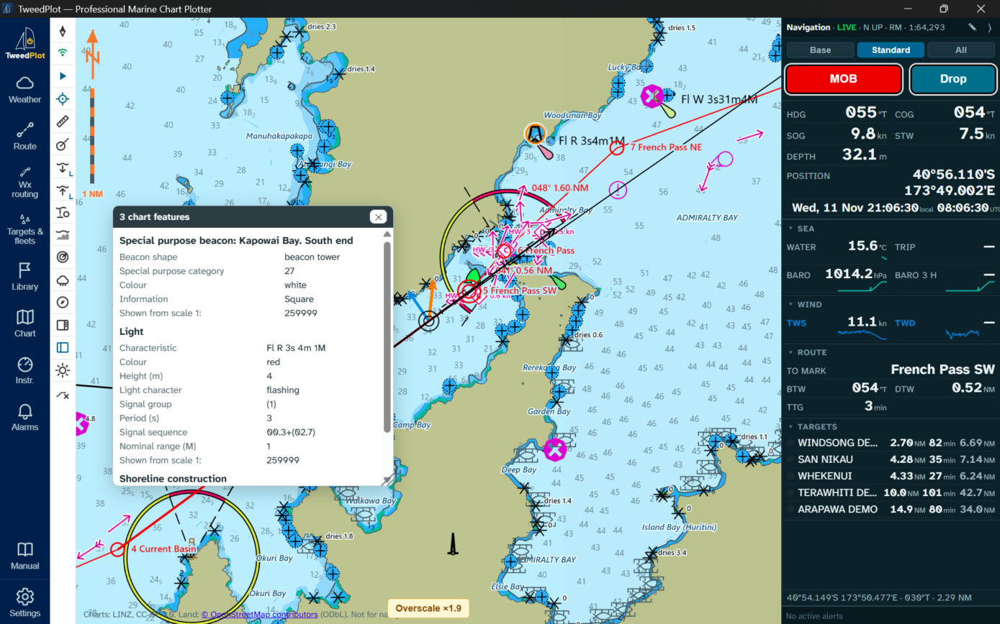
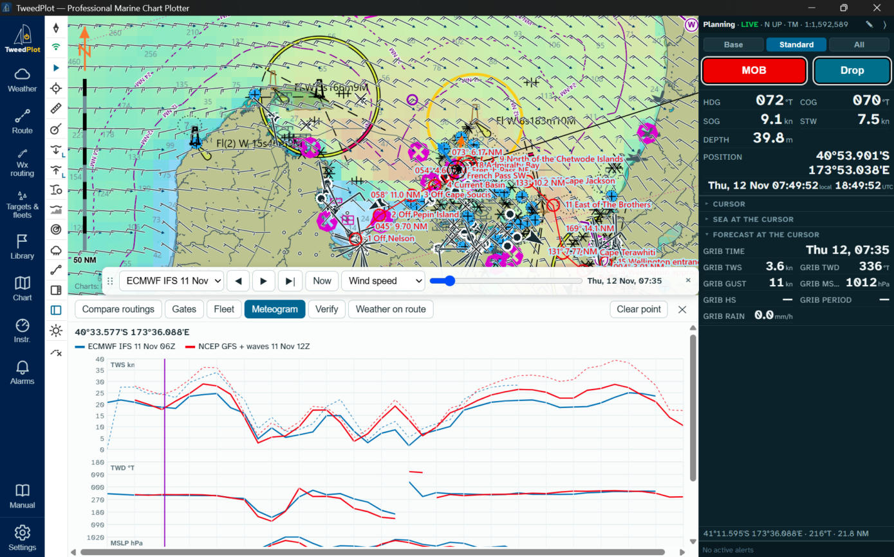
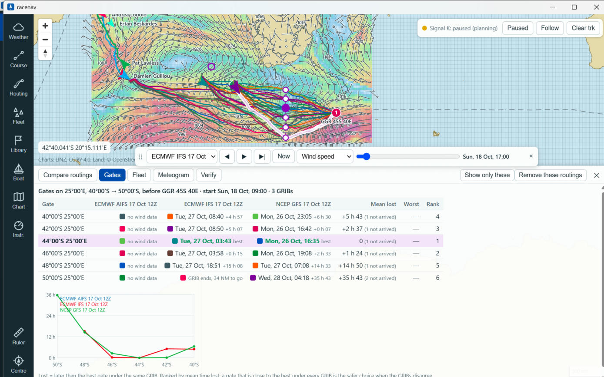

# RaceNav User Manual

RaceNav plans and sails passages on a Windows PC: charts, weather, routing and live instruments in one app. This tab is the reference; the tutorial tabs teach route planning and weather routing step by step.

## About this manual

This manual is for anyone who plans a passage before they leave the dock: racing and cruising sailors, and recreational fishers and launch owners running power boats. The app was built for yacht racing, but most of it (charts, tides, weather, marks, measuring, instruments) serves every boat equally.

**How it is laid out**

| Part | What it covers | Read it when |
| --- | --- | --- |
| This tab (reference) | Every panel and tool, what it does and how to use it | You want to know what a button does |
| Route planning (tutorial) | How to plan any passage: appraisal, hazards, tides, waypoints, contingencies, with worked examples for a cruise, a fishing trip and a race | You are planning a trip |
| Weather routing (tutorial) | Forecast models, GRIB files, uncertainty, polars, how a router thinks, and how to read and test its answer | You want the weather to choose or check the route |
| Glossary | Terms used in the app and the tutorials | A word is unfamiliar |

**Words used in this manual**

- *Drawer*: the panel that slides out from the icon rail on the left.
- *Dock*: the wide panel along the bottom of the chart for tables and graphs.
- *GRIB*: a weather forecast file (see Weather).
- *Routing*: a computed fastest route through the weather; *route*: your planned list of marks.
- Bearings are true (°T) unless shown as °M; distances are nautical miles (NM); speeds are knots (kn).

**Safety**

RaceNav is a planning and situational-awareness tool, not a certified navigation system. The charts come from LINZ open data and OpenStreetMap and are not official ENCs; forecasts are model output, not warnings. Keep a proper lookout, carry official charts and publications, check MetService forecasts and warnings before and during every trip, and use your judgement. A routing is a suggestion based on a forecast that will be wrong in places.

**This manual inside RaceNav**

The manual is built into the app, so the copy you read always matches the version you run, with or without an internet connection. Press **Manual** at the bottom of the rail, or **F1**. The **?** in each drawer's title bar opens the manual at that drawer's section. In the manual, the tabs along the top switch between the reference, the two tutorials and the glossary; **Contents** lists the sections of the open tab; the search box finds a word in every tab; click a picture to see it full size; **Wide** gives the manual most of the window, and **×** or **Esc** closes it.

## Getting started

RaceNav runs on Windows 10 or 11 (Intel or ARM) and keeps all its data in plain files in one folder, so it can be backed up or copied to another PC.

**Install**

1. Run the RaceNav installer. (During development it is built from the racenav source; the README explains how.)
2. Create the data folder `C:\dev\racenav-data` with the sub-folders below, or let RaceNav create them as it needs them.
3. Start RaceNav. The chart opens on Nelson; the Weather drawer is open.

**The data folder**

| Folder | Holds | Notes |
| --- | --- | --- |
| `linz` | LINZ chart data (the zip files as downloaded) | See Charts for which datasets to download |
| `grib` | Weather files, downloaded or copied in | qtVlm's GRIB folder is read too |
| `polars` | Boat speed tables (polars) | qtVlm's polar folder is read too |
| `library` | Marks, routes, barriers, saved routings, tracks, GPX exports | Plain JSON: safe to back up and copy |
| `tides` | LINZ tide tables | Downloaded from the Chart drawer |
| `tracking` | YB race tracking data | One sub-folder per race |

Advanced: the environment variables `RACENAV_GRIB_DIR`, `RACENAV_POLAR_DIR`, `RACENAV_LIBRARY_DIR` and `RACENAV_SK_URL` point RaceNav elsewhere.

**First launch checklist**

- [ ] Chart and Signal K drawer: zoom in on New Zealand to check the LINZ charts show, and set your **safety depth** and **safety contour**.
- [ ] Boat drawer: choose a polar (sail) and set efficiency and tack/gybe times.
- [ ] Weather drawer: download or load a GRIB.
- [ ] Instruments drawer: arrange the panels you want; the layout is kept per PC.
- [ ] If you have instruments: start your Signal K server; the status at the top right turns green.

**The screen**

The chart fills the window. Everything else floats over it or slides out from the edges, so any of it can be hidden. 

Drawers slide out from the rail; instrument panels, the time slider and the dock float over the chart and can each be hidden.

| Where | What | How to use it |
| --- | --- | --- |
| Left rail | Weather, Course, Routing, Fleet, Library, Boat, Chart, Instruments; Ruler and Centre at the bottom | Click an icon to open its drawer; click again or press Esc to close it. Only one drawer is open at a time |
| Top right | Signal K status, **Live / Paused**, **Follow**, **Clear trk** | Paused = planning: the boat stays where you put it |
| Floating panels | Instrument panels and the time slider | Drag by the grip (⋮⋮); double-click the grip to fold a panel |
| Bottom | The dock: Compare routings, Gates, Fleet, Meteogram, Verify | Opens from buttons in the drawers; drag its top edge to resize |
| Bottom left | Cursor position | Also in the Cursor instrument |
| Right-click | The chart menu | Start or add marks, move the boat, meteogram, ruler and barrier actions |

**Mouse and touch**

- Drag to pan, scroll or pinch to zoom, right-drag or two-finger twist to rotate (the compass button resets north up).
- On a touch screen a tap sets the cursor (there is no hover), and a long press opens the chart menu.
- To move a mark, ruler point or barrier point: click it (amber ring), wait for the ring to turn green, then drag. The pause stops marks being moved by accident.

## Charts

RaceNav draws its own vector chart from free data: a world coastline everywhere, and for New Zealand the LINZ hydrographic data with depth areas, contours, soundings, lights, marks, dangers and charted areas.

**Getting the New Zealand data**

Download from the [LINZ Data Service](https://data.linz.govt.nz) (free account) as GeoPackage, and put the zip files, unopened, in `racenav-data\linz`. RaceNav reads every scale band it finds and draws the most detailed one available at each place.

| Dataset | Why |
| --- | --- |
| Depth area polygons (each scale band: 1:4k–1:22k, 1:22k–1:90k, 1:90k–1:350k, 1:350k–1:1.5M, 1:1.5M and smaller) | Water depth shading and the routing safety depth |
| Depth contours and soundings (same bands) | Contours, the safety contour, spot depths |
| NZ coastlines and islands (Topo50) | The detailed coastline |
| Hydrographic feature layers (the "121 layers" GeoPackage for each band) | Lights, buoys, beacons, rocks, wrecks, obstructions, marine farms, anchorages and other charted areas |

The open data does not cover every harbour at large scale. Port Nelson's inner channel marks, for example, are only in the official ENC. Add missing marks yourself as library marks with buoy symbols (see Marks).

**Chart and Signal K drawer: chart settings**

| Setting | What it does |
| --- | --- |
| **Safety depth (m)** | The least depth you will sail in: the draft plus a margin for swell, squat and chart error. Routing will not enter water shallower than this |
| **Safety contour (m)** | The contour drawn bold. Water shallower than it is shaded darker blue, as on a paper chart. Usually the next charted contour at or deeper than the safety depth |
| **Route round dangers** | Routing keeps off rocks, wrecks and obstructions that dry, are awash, or have less water than the safety depth or an unknown depth |
| **Route round marine farms** | Routing keeps out of charted marine farms |
| **Lights, marks, dangers, areas** | Shows the hydrographic features, with **Light sectors** and **Names and labels** on or off |

Underwater dangers deeper than the safety contour are shown with their depth only, so the chart stays readable while anything that matters to your boat stands out. Click a light, mark, danger or area for its details: light characteristics, buoy shape and colours, depth over a rock, area restrictions. 

At small scales the world coastline (GSHHG) is drawn, and east of 180° (the Chathams, for example) works the same as west of it.

**Tides**

Tick **Tide stations** and press **Download LINZ tides** once a year: RaceNav fetches the LINZ tide tables for this year and next (about 90 standard ports plus the secondary ports). Tide stations then appear on the chart. Click one for the day's tide curve, with high and low times and heights, a marker at the current time (or the weather time when planning) and arrows to step through the days. Times are New Zealand time (Chatham Islands time for Chatham ports). Secondary ports are worked from their LINZ time and height differences. These are predictions, not official tide tables, and weather (wind and pressure) can raise or lower the actual tide by several decimetres.

Tidal streams are not shown yet; ocean currents from a GRIB can be used in routing (see Routing).

## Your boat

RaceNav shows your own boat from live instruments, or wherever you put it when planning.

**Signal K**

RaceNav reads live data (position, heading, speed, wind, depth) from a [Signal K](https://signalk.org) server, normally running on the same PC. Signal K takes NMEA 0183 and NMEA 2000 from your GPS and instruments through a USB adapter or gateway and serves it to any number of apps. RaceNav connects to `ws://localhost:3000` (set `RACENAV_SK_URL` for another address). The dot at the top right is green when data is arriving; the Chart and Signal K drawer shows the connection details.

No instruments? A GPS dongle into Signal K is enough for position, course and speed. With no Signal K at all, RaceNav works fully in planning mode.

**Live and planning**

| Mode | Button (top right) | The boat | Time used by the instruments and routing |
| --- | --- | --- | --- |
| Live | **Live** | Follows Signal K | Now (GPS time) |
| Planning | **Paused** | Stays where you put it: right-click > **Move boat here** | The weather slider time |

**Follow** keeps the chart centred on the boat (dragging the chart turns it off); **Centre** (rail) recentres once; **Clear trk** clears the short trail behind the boat.

**Lines and arrows on the boat**

- *Heading line* (solid) and *COG line* (dashed orange): each as long as a set time at the boat's speed, or to the edge of the chart. Set in Chart and Signal K > Own boat.
- *Wind arrows*: true wind (blue) and apparent wind (orange), each pointing the way the wind blows with its tip on the boat and longer as the wind gets stronger. With live data they sit on the boat. When planning (paused, or no live data) they follow the cursor instead, showing the GRIB's true wind there and the apparent wind you would feel on a shown routing's heading and boat speed when the cursor is near that routing. Away from a routing there is no boat to feel it, so only the true wind is shown. Turn them on or off in the Instruments drawer.

**Damping**

Wave motion makes heading, speed and wind jump about. Chart and Signal K > Damping averages them over a few seconds for the boat, its lines and the instruments. Position is never damped.

**Tracks and recording**

Library > Tracks > **Record** logs the boat's track from Signal K while RaceNav runs, even while plotting is paused. It keeps a fix every 10 s while moving, sooner in a tack or gybe, and is saved every 30 s and when the app closes. **New log** finishes one track and starts another. Tracks can be shown, renamed, coloured, exported as GPX, and imported from GPX (from a plotter, Navionics, qtVlm and so on). Click a track for the time, speed and course at that point; tick **Boat at weather time** to see where the boat was at the slider time, which is useful for comparing a race track with the forecast.

## Instruments

Instrument panels are rows or columns of readings that float over the chart. Make as many as you like, put them anywhere, and keep a different layout on each PC (chart table, laptop, cockpit screen).

**Working with panels**

- **Move**: drag the grip (⋮⋮). Panels snap to the screen edges and keep clear of the dock.
- **Fold**: double-click (or double-tap) the grip to shrink a panel to a small title; again to open it.
- **Change a reading**: click (tap) it to choose what it shows, add another beside it, remove it, change the panel's size (small, medium, large) or lay it out across or down.
- **Instruments drawer**: **Add panel**, **Fold all**, **Lock layout** (stops accidental moves), **Reset**, **Show instrument panels** (hide or show them all at once), and a tick beside each panel to hide just that one.

**What can be shown**

| Group | Readings |
| --- | --- |
| Navigation | SOG, COG, heading (°T and °M), boat speed, depth, position, log, trip, UTC and local time |
| Wind | AWS, AWA, TWS, TWA, TWD, VMG |
| Route | Next mark, BTW, DTW, VMC, TTG, ETA, XTE; the active routing's target TWA, boat speed and heading, and % of target speed |
| Cursor | Cursor position, bearing and range from the boat to the cursor (rhumb line) |
| GRIB at cursor | Wind speed and direction, gust, pressure, wave height, period and direction, rain, air temperature, the GRIB time and its name, for the GRIB shown on the chart at the cursor and slider time |

Port and starboard are marked on wind angles. Readings from Signal K grey out after 10 seconds without data, so stale numbers can't be mistaken for live ones. Depth turns amber within 2 m of the safety depth and red below it.

**The floating time slider**

A bar with the GRIB choice, step back and forward, play, **Now**, what the shading shows, the slider and the time. Drag it anywhere. With it and the GRIB-at-cursor panel you can close every drawer and still scrub the forecast and read values anywhere on the chart, which is the most useful layout for planning or talking a route through with crew. Hide it with ×; bring it back with Instruments > **Time slider**.

## Marks, routes and the library

A **mark** is a named position kept in the library. A **route** (or course) is a start and an ordered list of marks. Marks are shared: move a mark once and every route using it follows.

**Building a route (Course drawer)**

1. **Set start**, then click the chart (or click a library mark to start at it). **From boat** starts at the boat.
2. **Add marks**, then click the chart for each mark in order, or click library marks to reuse them. Press Esc or **Add marks** again to stop.
3. Under each mark choose how it is to be reached (below) and, if you like, a radius.
4. Name the route and **Save**. New marks are saved to the library under the route's name.

The list shows each leg's distance. **↑ ↓** reorder marks; **✕** takes a mark off the route (it stays in the library). Click a mark on the chart to select it; wait for the green ring to drag it, or right-click to move or remove it. **Navigate ◀ ▶** chooses the mark the instruments steer to; with live data it moves on by itself when you reach a mark.

**How each mark is reached**

| Choice | Meaning for routing | On the chart |
| --- | --- | --- |
| Pass through | Reach the mark's arrival circle: its own radius if typed, else the routing's arrival radius. For waypoints and turning points | A grey dashed ring if it has its own radius |
| Leave to port | Pass with the mark on your left, at least the radius off. The routing may not cut through the mark's circle on the way in or out | Red ring |
| Leave to starboard | The same, mark on your right | Green ring |
| As close as possible | Reach within 0.01 NM (about 20 m): a fishing spot, a mooring, a fuel berth | Black ring |

Use the rounding sides for race marks and headlands you must keep off; use a generous radius for marks you only need to pass near (an offshore waypoint) so the routing is not forced through a single point.

**Mark types and points of interest**

In the mark editor (Library > Marks > edit, or right-click > **New library mark here**) choose a type: racing mark, waypoint, start or finish line end, danger, an IALA A buoy (port, starboard, cardinals, isolated danger, safe water, special), or a point of interest: good anchorage, mooring, shelter, fishing spot, diving spot, foul ground, wreck, hazard, landing point, camping spot, hut, viewpoint, water filling, fuel, provisions, note. Each draws with its own symbol. Any of them can be a course mark. Groups (e.g. "RNZYS 2026", "Fishing spots") keep the library tidy.

**Barriers**

Barriers are places routings must keep out of, beyond what the chart already avoids: a marine reserve, a race exclusion zone from the sailing instructions, a shipping lane, a bar you won't cross, or a rough headland you'd rather stay off.

- **Lines** (Library > Barriers > **Draw line**): fences the routing may not cross. Click points, double-click to finish.
- **Zones** (**Draw zone**): areas the routing may not enter. Click the corners, double-click to finish.
- **Barrier marks**: give any mark a **Barrier radius** in the mark editor and routings keep that far off it (a red dashed ring), unless the mark is on the course.

Untick a barrier to keep it but not use it; rename it in the list; move its points like marks; right-click it to delete a point, delete it, or switch it off. Routing > Limits and barriers > **Keep off barriers** turns them all on or off for routings.

**The library (Library drawer)**

| Tab | Holds |
| --- | --- |
| Routes | Saved routes: open one in the Course drawer, export as GPX, delete |
| Marks | Every mark, by group: edit, show on the chart, delete (a mark used by a route asks first) |
| Routings | Saved routings: show, delete |
| Tracks | Logged and imported tracks (see Your boat) |
| Barriers | Lines and zones (above) |

**GPX** exchanges marks, routes and tracks with plotters, phone apps, qtVlm, OpenCPN and Navionics. Import adds new marks and matches ones you already have by name and position. Exports go to `racenav-data\library\export`.

## Weather

Weather comes from GRIB files: gridded forecasts from computer models, one value per grid point per forecast time. RaceNav downloads them, reads files from other sources, shows them on the chart, compares several at once, and routes through them. The Weather routing tutorial explains models, resolution and how much to trust them.

**Loading GRIBs (Weather drawer)**

The list shows every GRIB in the GRIB folders, described by model, run time, area and how far ahead it goes rather than by file name. Choose one and **Load** (↻ rescans the folders). Load as many as you like: different models, or several runs of one. One is shown on the chart (its radio button), and the table under the legend gives every loaded GRIB's values at the cursor. A tick beside each loaded GRIB includes it in the agreement displays; × unloads it.

RaceNav reads GRIB2 (including ECMWF's compressed files) and GRIB1 (Saildocs and older tools): wind, gusts, pressure, waves (height, period, direction, swell, wind waves), rain, CAPE, air temperature and ocean currents. Outside a file's area or time span there is no value: a short GRIB never shows as calm.

**Time**

The slider, **◀ ▶|** steps, **▶** play and **Now** set the forecast time; the floating time slider does the same with the drawers closed. The time shows in local time with UTC in brackets.

**What the chart shows**

| Control | Choices |
| --- | --- |
| **Show** (shading) | Wind speed, gusts, wave height, swell, wave period, rain, CAPE (squall risk), pressure, air temperature, or none; the agreement and verify displays (below) |
| Wind barbs | Arrows with feathers: each full feather 10 kn, half feather 5 kn, flag 50 kn |
| Wave direction | Arrows pointing the way the waves travel |
| Isobars | Pressure lines at 1 to 10 hPa intervals (2 hPa suits the tropics, 4 hPa higher latitudes); **Auto** widens the interval when zoomed out |
| Display | Barb density and size, shading opacity and steps (smooth, or 1, 2 or 5 kn bands), shading under the land or under the coastline only |

Choices a GRIB doesn't contain are greyed out, and a wave-only GRIB switches to wave height by itself.

**Downloading (Weather > Download GRIBs)**

| Source | Models | Notes |
| --- | --- | --- |
| NOAA NOMADS | GFS 0.25°, 0.5°, 1° (wind, gusts, pressure, rain, CAPE, air temperature); GFS-Wave 0.25° | Cut to your area on the server: small downloads. Free, US government data |
| ECMWF open data | IFS 0.25° (wind, pressure, gusts where published, air temperature); AIFS 0.25° (ECMWF's AI model); ECMWF wave 0.25° | Published as whole-globe files: RaceNav fetches only the fields you ticked and cuts them to your area, but downloads far more than the file it keeps (the estimate shows both). CC BY 4.0, © ECMWF. The 06Z and 18Z IFS runs stop at 144 h |

1. Choose the model and tick the fields.
2. Set the area: **Draw** a rectangle, use the **Chart view**, or the **Course** with a margin. Edges can be typed.
3. Choose the forecast length and time step; check the size estimate.
4. **Download**. RaceNav finds the newest complete run, downloads it, saves it in the GRIB folder and loads it.

**Saildocs email request** (inside Download): for boats on email-only links (satellite or HF radio). It builds the request line from the same area, length and step, for GFS, ICON (0.125°) or the free part of ECMWF (0.4°), with a size estimate. **Email** opens a message to query@saildocs.com in your mail program; **Copy** copies the line. Save the GRIB that comes back attached into the GRIB folder. Keep requests small over satellite: fewer fields, a coarser grid, a shorter forecast.

**Meteogram**

Right-click the chart > **Meteogram here**: every loaded GRIB's forecast at that point over time, in the dock. Wind speed is solid with gusts dashed and an ensemble's spread shaded; direction is drawn so GRIBs that agree stay together through north; pressure underneath. A line marks the slider time; click the graph to move the slider. A quick way to see when a front arrives, how long a blow lasts, or whether the models agree for your departure. 

**Wind and waves in one file**

Wind and waves come from different models: GFS with GFS-Wave, ECMWF IFS or AIFS with the ECMWF wave model. RaceNav can keep them in one file, so one GRIB shows the wind, the waves, the GRIB-at-cursor readings and the meteogram together, and a routing with a wave limit finds its waves without a second file.

- **When downloading**: for GFS, ECMWF IFS or AIFS, tick **Waves … in the same file**. The wave model is downloaded for the same run, area and steps and written into the same file, named `…+waves.grb2`. If the waves can't be had (not on the server yet, say), the wind file is kept and a note says so.
- **Files you already have**: load the wind GRIB and the wave GRIB of the same run. The Weather drawer offers **Combine**; it writes `<wind file>+waves.grb2`, loads it and unloads the two. The original files are kept.

**Agreement of the loaded GRIBs**

With two or more GRIBs loaded, **Show** offers displays of how much they disagree at the slider time: green where the forecasts agree, red where they don't. Vector disagreement (speed and direction together), speed spread, direction spread (blank in light winds), pressure spread, and run trend (newest run minus oldest: is the forecast getting windier?). The note under the legend lists what is compared. Where the forecasts disagree, plan with margin.

**Verify runs**

Weather > **Verify runs…** scores earlier forecasts against what a later run says actually happened at its first hour (its analysis), over the sea in the chart view: vector error, speed and direction bias, pressure bias. The track record averages every verify time by model and lead time, so after some days of downloads it shows which model has been doing best in your area. Click a forecast to shade its error on the chart.

## Routing

A routing is the fastest way from the start through your marks, given a forecast, your boat's speeds and the chart. RaceNav uses the isochrone method (explained in the Weather routing tutorial) and keeps off land, water shallower than your safety depth, charted dangers, marine farms and your barriers.

**Before you compute**

- **Boat drawer**: a polar (your boat's speed at each wind angle and strength), **efficiency** (90 % is realistic for most crews; less for short-handed or cruising trim), and the time lost in each **tack** and **gybe**.
- **Course drawer**: a start and at least one mark.
- **Weather drawer**: a GRIB covering the area and the time of the passage.

**Routing drawer, Run tab**

| Control | What it does |
| --- | --- |
| **Start time** | The weather slider time, Now (when you press Compute), or a time you type |
| Settings > **Time step** | Minutes per isochrone; 0 = automatic (about 80 steps per leg, 5 minutes to 3 hours) |
| Settings > **Arrival radius** | How close counts as reaching a mark without a radius of its own |
| Settings > **Use GRIB currents** | Adds ocean currents from the GRIB to the boat's speed |
| Settings > **Hovering a routing point moves the GRIB time** | Off by default, so pointing at the screen doesn't move the forecast |
| **Limits and barriers** | Below |
| **Compute** | Routes with the GRIB shown on the chart |
| **With each GRIB** | One routing per loaded GRIB, then opens the compare table |

Each result is drawn in its own colour. The active one shows its points (hover for time, heading, TWA, TWS and boat speed) and isochrones, and a summary: start, ETA, elapsed time, distance, average speed, time upwind, reaching and downwind, wind range, tacks and gybes, and each leg. A triangle on every routing shows where that boat is at the slider time, so scrubbing the time slider plays the routings against each other. **Save** keeps it in the library, **GPX** writes it with times, **Use its course** puts its marks back in the Course drawer.

**Limits and barriers**

| Limit | Use it to |
| --- | --- |
| **Search angle** (±° from the mark) | Speed up long routings by only trying headings towards the mark. Keep 90° or more where the route may need to tack, gybe or go round land |
| **Heading step** | Spacing of headings tried: larger is faster, smaller finds finer routes |
| **Wind min / max** | Keep out of calms (min) or of more wind than you want to sail in (max) |
| **Max wave height Hs** | Keep out of big seas: uses the waves in the routing GRIB, else a loaded wave GRIB covering the start. The message warns if no waves were found |
| **TWA min / max** | Keep the boat off the wind (e.g. 50° for a cruiser that won't pinch) or off a dead run (e.g. 165°) |
| **Keep off barriers** | Use the Library's barrier lines, zones and barrier marks |

Limits stop the routing sailing on from places outside them. If every way forward is blocked, the routing says so: relax a limit, move a barrier, or change the start time.

**Comparing routings (Routings tab)**

Every routing of this session and the saved ones are listed; tick to show, click to make it the active one. **Compare table** opens a table in the dock with a column for each statistic (choose them with ⚙, sort by any column; the best values are green), with its own GRIB chooser and time slider. Typical uses: one routing per GRIB to see how much the route depends on the model; several start times to choose when to leave.

**Gate sweep (Gates tab)**

The automated gate method: one routing through each of a row of points ("gates") on the way to a mark, to see how much each option costs. Choose the mark the gates come before, a line along a meridian (e.g. 5°E) or a parallel, the range (e.g. 30°S to 40°S) and the number of gates; the gates show as violet dots. **Run gate sweep** uses the same start time and settings as Compute, with the GRIB shown or with each loaded GRIB. The Gates table in the dock gives each gate's arrival and the time lost against the best gate; with several GRIBs, the mean and worst time lost, ranked by the mean. The gate that is nearly best under every GRIB is the robust choice when the models disagree.

**Power boats**

Routing is built around a sailing polar, and dedicated power-boat routing (fuel use, sea-state slowdown, comfort) is planned. Meanwhile a power boat can be routed with a simple "power polar": a polar file with the same cruising speed at every wind angle and strength. The routing then finds the shortest safe track round land and dangers, and the wind, wave and barrier limits keep it out of weather you don't want. See the Route planning tutorial for how to make one.

## Measuring and fleet tracking

**Ruler**

Press **Ruler** (bottom of the rail), click to set the first point, click again for each next point, and double-click to finish; Esc stops. Each leg is labelled with its bearing (°T, plus °M when Signal K knows the magnetic variation) and distance, and the total shows at the end. Rulers stay on the chart until deleted. Move their points like marks. Right-click a ruler to delete a point, delete it, delete all rulers, or **Save ruler as route** (its points become library marks and a route opens in the Course drawer): a fast way to sketch a passage.

Ruler bearings and distances are rhumb lines: a constant compass course, which is what you steer and what a paper chart's straight line shows. Over a few hundred miles a great circle is shorter; the router allows for that itself.

**Cursor readings**

The Cursor panel shows the cursor's latitude and longitude and the bearing and range to it from the boat. With the GRIB-at-cursor panel beside it you can point at any spot and read its position, distance from you and forecast at the slider time.

**Fleet (YB race tracking)**

Fleet drawer: type the race's YB name (as in `yb.tl/<race>`, for example `ggr2026`) and **Open**. RaceNav downloads the race setup, every boat's published track, then the latest positions every 5 minutes to 3 hours.

- Boats show at their latest fix, or where they were at the weather slider time, so you can replay a race against the forecast.
- ★ follows a boat (thicker track, name kept first when names would overlap). Choose a class, tracks for all or followed boats, names, and the YB course.
- The Fleet table in the dock ranks boats by distance to finish, with speed and course made good and distance in the last 24 hours.
- **Copy course** puts the YB course in the Course drawer; **Route** on a boat starts a routing from its last fix and time: what would the router have them do now?

Positions may be delayed by the race organiser.

## Troubleshooting

| Problem | Likely cause and fix |
| --- | --- |
| No detailed NZ chart | The LINZ zips aren't in `racenav-data\linz`, or only small-scale bands were downloaded. Add the bands for the area and restart |
| A harbour's buoys are missing | The open data has no large-scale coverage there. Add them as library marks with buoy symbols |
| Signal K dot stays grey | The server isn't running, or is on another port or PC: check the Chart and Signal K drawer's details and `RACENAV_SK_URL` |
| Instruments show — | No data for that reading, or more than 10 s old (greyed out) |
| "Load the GRIB first" | Routing needs the GRIB shown on the chart to be loaded and cover the start time |
| "The weather runs out first" | The GRIB ends before the boat arrives: download a longer forecast, or accept the partial routing |
| "No wind data" | The route leaves the GRIB's area: download a bigger area |
| "Start (or mark) blocked" | It is on land, in water shallower than the safety depth, or inside a barrier: move it |
| "Every heading is blocked" | Land, shallow water, barriers or limits close every way forward: relax a limit or check the safety depth |
| The routing hugs a point | A mark without its own radius uses the arrival radius: give offshore waypoints a radius of a mile or more |
| ECMWF download slow or huge | ECMWF publishes whole-globe fields: choose fewer fields, a shorter forecast or a longer time step |
| Saildocs reply too big | Coarser grid, fewer fields, shorter forecast, smaller area |
| A panel or the time slider has gone | Instruments drawer: **Show instrument panels**, the tick beside the panel, or **Time slider** |
