# TweedPlot User Manual

**TweedPlot: Professional Marine Chart Plotter**, from [TweedsMarine](https://tweedsmarine.nz), Nelson.

TweedPlot plans and sails passages on a Windows PC: charts, weather, routing, live instruments, AIS, alarms and fishing tools in one program. This tab is the reference: every part of the screen, what it does and how to use it.

## About this manual

This manual is for anyone who plans a passage and then makes it: racing and cruising sailors, commercial and recreational fishers, and launch owners. Most of TweedPlot (charts, tides, weather, marks, measuring, instruments, alarms) serves every boat equally; the **Use** setting (Cruising, Fishing or Racing) brings forward the tools each needs.

**How it is laid out**

| Tab | What it covers | Read it when |
| --- | --- | --- |
| Quick start | Where things are and the first steps, on a few pages. Prints as an A5 booklet | You are new to TweedPlot |
| Reference (this tab) | Every part of the screen, drawer and tool: what it does and how to use it | You want to know what a button or setting does |
| Route planning | How to plan any passage: appraisal, hazards, tides, waypoints, contingencies, with worked examples for a cruise, a fishing trip and a race | You are planning a trip |
| Weather routing | Forecast models, GRIB files, uncertainty, polars, how a router thinks, and how to read and test its answer | You want the weather to choose or check the route |
| Fishing tools | Ocean data, own soundings, the catch log and the other fishing tools, with worked examples | You fish |
| AIS | What AIS shows, what it doesn't, and how far to trust it | You use AIS targets or online AIS |
| Glossary | Terms and abbreviations used in TweedPlot and in this manual | A word is unfamiliar |

**Words and conventions**

- **Bold** is a label you can see on the screen: a button, a tick box, a card.
- **Chart › Layers › Own ship** is a path: open the Chart drawer, then the Layers card, then find the Own ship group.
- *Rail*: the column of icons down the left edge of the window. *Drawer*: the panel that opens beside the rail when you click one of them. *Card*: a titled part of a drawer that opens and closes.
- *Toolbar*: the strip of buttons down the chart's left edge.
- *Data panel*: the column of readings beside the chart.
- *Dock*: the wide panel under the chart for tables and graphs.
- *View*: an arrangement of the screen (Navigation, Planning or Instruments).
- *GRIB*: a weather forecast file (see Weather and tides).
- *Routing*: a computed fastest route through the weather. *Route*: your planned list of marks.
- Bearings are true (°T) unless shown as °M; distances are nautical miles (NM); speeds are knots (kn); depths and heights are metres.

**Safety**

TweedPlot is an aid to navigation, not a certified navigation system: it is not an ECDIS and does not replace one. The charts drawn from LINZ open data, the world coastline and the depth models are not official charts. Official ENCs (S-57, and S-63 with the plugin) are official data, but TweedPlot's display of them is not type-approved. Forecasts are model output, not warnings. Keep a proper lookout, carry the charts and publications the rules require, check MetService forecasts and warnings before and during every trip, and use your judgement. A routing is a suggestion based on a forecast that will be wrong in places.

**This manual inside TweedPlot**

The manual is built into TweedPlot, so the copy you read always matches the version you run, with or without an internet connection.

- **Open it** with {icon:manual} **Manual** at the bottom of the rail, or **F1**. The **?** in a drawer's title bar opens the manual at that drawer's section.
- **Find your way**: the tabs along the top switch between the parts listed above; **Contents** lists the sections of the open tab; the search box finds a word in every tab.
- **Pictures**: click one to see it full size. The button icons and chart symbols in the text are drawn by the same code as the ones on the screen, so they look exactly as they do there.
- **Wide** gives the manual most of the window; **✕** or **Esc** closes it.
- **Print ▾** offers **Whole manual (A4)**: a cover, the contents, and each tab as a chapter; and **Quick start (A5 booklet)**. Both print in day colours and open the print dialog, where **Save as PDF** makes a copy to print later or keep on a tablet.

## Installing and setting up

TweedPlot runs on Windows 10 or 11 (Intel or ARM).

**Install**

1. Run the TweedPlot installer.
2. Start TweedPlot. The first time, the welcome screen asks what the boat is mostly for: **Cruising**, **Fishing** or **Racing** (see *Use* under Settings). Choose one and press **Start**.
3. The chart opens in the Navigation view, on Nelson until a position arrives or you set a reference position in **Settings › Vessel**.

**The data folder**

TweedPlot keeps all its data in plain files in one folder, so it can be backed up or copied to another PC:

`%APPDATA%\nz.tweedsmarine.tweedplot`

Type that into the address bar of File Explorer to open it. You rarely need to: TweedPlot makes each sub-folder when it first needs it and downloads most of the data itself. **Settings › Diagnostics › Where to install data files** lists the folders with their full paths, and **Open** beside each one opens it in File Explorer (making it first if need be).

| Folder | Holds | How it gets there |
| --- | --- | --- |
| `charts` | LINZ chart data for New Zealand (the zip files as downloaded) | You copy the files in: see *Getting the New Zealand data* under Charts |
| `enc` | Official ENC cells (S-57), and the cells installed from encrypted exchange sets (S-63) | You copy S-57 cells in; S-63 sets are imported in Chart › Encrypted charts (S-63) |
| `coastline` | The world coastline (GSHHG) | Chart › Get data |
| `bathy` | Detailed depths (ETOPO) for the areas you fetched | Chart › Get data |
| `hires` | High-resolution depths (LINZ coastal), one file per Topo50 sheet | Chart › Get data |
| `depth` | Survey depth packages (`.tpdepth`) | Chart › Get data › Import packages… |
| `nzbathy` | NIWA bathymetry | Chart › Get data › Import… |
| `pbathy` | Own soundings (`bathy.sqlite`): the soundings from your tracks and the PBG and XYZ files imported | Built in Chart › Get data |
| `marine` | Maritime boundaries (LINZ) and fishing rules (MPI) | Chart › Get data |
| `publications` | LINZ's Annual Notices to Mariners and Nautical Almanac | Chart › Nautical publications |
| `grib` | Weather files | Downloaded in the Weather drawer, or copied in. If qtVlm is installed, its GRIB folder is read too |
| `tides` | LINZ tide tables | Weather › Tides › Download LINZ tides |
| `polars` | Your boat speed tables (polars) | Settings › Vessel › Performance › Import polar…, or copied in |
| `library` | `library.gpkg`: marks, routes, tracks, trips, the catch log, saved routings and barriers in one database. `export`: GPX files TweedPlot writes. `backups`: its daily copies | Made by TweedPlot. Close TweedPlot before copying `library.gpkg`, and keep it out of Dropbox or OneDrive folders while TweedPlot is open |
| `tracking` | YB race tracking data, one sub-folder per race | Targets & fleets › YB race |
| `logs` | `activity.log`: what TweedPlot has done and how each job went | Made by TweedPlot; also shown in Settings › Diagnostics |

**First start checklist**

- [ ] {icon:settings} **Settings › Vessel**: the vessel's name, MMSI, draft, length, breadth, air draft, transducer depth and where the GPS antenna is. Press **Save vessel details**.
- [ ] {icon:settings} **Settings › Connections**: start your Signal K server, or add direct NMEA sources under **NMEA 0183 inputs**. The live data button in the toolbar turns green {icon:sk}.
- [ ] {icon:chart} **Chart › Get data**: get the charts and depths for where you sail.
- [ ] {icon:chart} **Chart › Safety**: set your **safety depth** and **safety contour**.
- [ ] {icon:alarms} **Alarms**: check the alarms you want are on.
- [ ] {icon:settings} **Settings › Vessel › Performance** (sail): choose a polar and set the efficiency and the tack and gybe costs.
- [ ] {icon:settings} **Settings › Display › Screen calibration**: measure the bar, so symbols and text are their true size.
- [ ] {icon:weather} **Weather**: download or load a GRIB.
- [ ] The data panel: **✎** to choose the readings you want beside the chart.

## The screen

Nothing covers the chart. The rail, the open drawer, the toolbar, the data panel and the dock sit beside it, and the chart narrows to make room for them. Only things you ask for float over it, and they can be moved or closed.


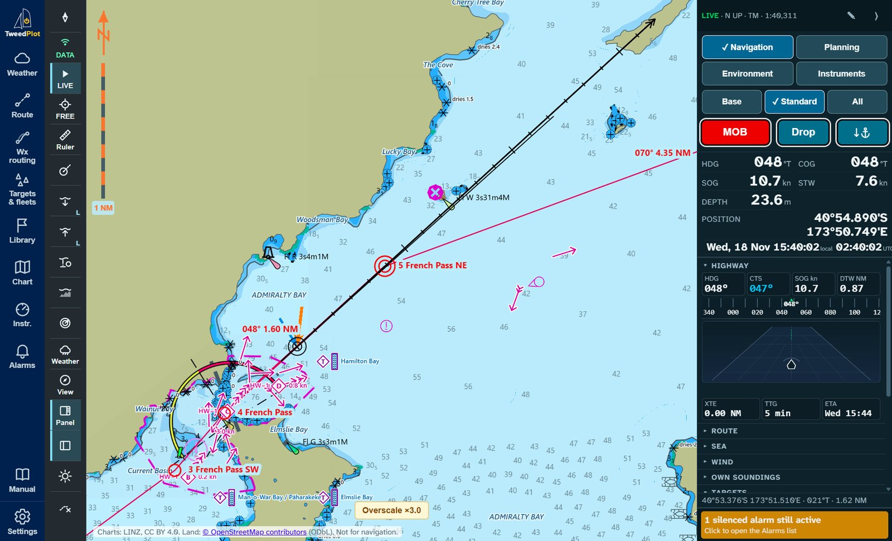

| Where | What | How to use it |
| --- | --- | --- |
| Left edge | **The rail**: the drawers, then Manual and Settings at the bottom | Click an icon to open its drawer; click it again or press Esc to close it. One drawer is open at a time |
| Beside the rail | **The drawer** that is open | The chart narrows while it is open. **?** in its title bar opens the manual at its section |
| Chart's left edge | **The toolbar**: a strip of buttons, outside the chart | See *The toolbar* below. Hover a button for what it does and its key |
| Middle | **The chart** | Drag to pan, scroll to zoom. Click a light, buoy, target or area for its details. Right-click for the chart menu |
| On the chart, left | The scale bar and north arrow | See *Scale bar, north arrow and overscale* under Charts |
| Beside the chart, on the right | **The data panel**: status, Base / Standard / All, MOB and Drop, own ship, readings, the cursor readout and the alerts | **O** hides it to one line under the chart; **✎** changes what it shows. It can go on the left: Settings › Display › **Data panel side** |
| Under the chart | **The dock**: Compare routings, Gates, Fleet, Meteogram, Verify, Weather on route | Opens from buttons in the drawers or Weather on route in the Planning data panel; drag its top edge to resize; **✕** closes it |
| Over the chart, when asked for | Info windows, the target list, history cards, the own soundings card and activity cards | Drag one by its title bar or grip; **✕** closes it. Each remembers where you put it |
| Bottom centre of the chart | **Zoom out** and **Zoom in**, two round buttons well apart | Off unless you choose Show in Settings › Display › Screen controls (for a trackball or a mouse without a wheel) |
| Right-click the chart | **The chart menu** | Move the boat, start a route or add a mark to it, a new library mark, record soundings, drop anchor, go to, laylines, EBL/VRM, centre the chart, a meteogram, a ruler. On a mark, ruler, barrier or EBL/VRM: the actions for it |

**The rail**

| | Button | What it opens |
| --- | --- | --- |
| {icon:weather} | **Weather** | *Weather and tides*: GRIBs (load, download, what the chart shows), the time slider, Saildocs, tides, weather stations and buoys |
| {icon:course} | **Route** | **Navigate** (the mark you are steering to), then **Plan**: the route being built, its start, marks and how each is rounded |
| {icon:routing} | **Wx routing** | *Weather routing*: compute and compare routings, limits and barriers, the gate sweep |
| {icon:fleet} | **Targets & fleets** | AIS targets and how they are shown, your own fleet, YB race tracking |
| {icon:library} | **Library** | Marks, routes, tracks, trips, the catch log, saved weather routings and barriers; import and export |
| {icon:chart} | **Chart** | Layers (everything that can be drawn on the chart, own ship's lines included), safety depth and contour, chart display, getting chart data, encrypted charts, chart notes and nautical publications |
| {icon:inst} | **Instr.** | *Instruments*: the data panel's settings, the Instruments view, monitor windows and history |
| {icon:alarms} | **Alarms** | Every alarm in one place: the active ones, and each alarm's settings |
| {icon:manual} | **Manual** | This manual (also **F1**) |
| {icon:settings} | **Settings** | Vessel (identity, dimensions, GPS antenna, polar, laylines, fishing methods), Connections (Signal K, NMEA, replay, damping), Display (colours, Use, screen calibration and controls), Diagnostics |

**Drawers and cards.** Most drawers are divided into **cards**: click a card's heading to open it (one is open at a time). The line under a closed card's heading shows its current state, for example the safety depth and contour under Safety. The grey explanatory notes are tucked away to keep the drawers short: hover the **ⓘ** on a card to read them, or click it to open the card with its notes showing.

**The toolbar**

From top to bottom. Every button has a short label under its icon (**North**, **LIVE**, **Ruler**, **Targets**, **Left**, **Right**…), and the three groups (status, tools, display) are set apart by a wider line:

| | Button | What it does |
| --- | --- | --- |
| {icon:north} | **North up** | The needle shows which way north is; click to turn the chart north up again (also **U**) |
| {icon:sk} {icon:sk-off} | **Live data** | Green, labelled **DATA**: data arriving. Amber, **QUIET**: connected but nothing for 10 s. Red with a slash, **NO LINK**: not connected. Hover for details, click for **Settings › Connections** |
| {icon:live} {icon:paused} | **Live / Paused** | Live: the boat follows the instruments. Paused: planning, the boat stays where you put it (right-click › **Move boat here**). Also **Space** |
| {icon:follow} | **Follow** | Keeps the boat in the same place on the screen (centred to begin with); dragging the chart turns it off. Drag the boat to put it anywhere you like, to see more chart ahead; double-click the boat to centre it again (also **F**) |
| {icon:ruler} | **Ruler** | Measure: click points on the chart, double-click to finish, Esc to stop (also **M**; see Measuring) |
| {icon:ebl} | **EBL/VRM** | An electronic bearing line and range ring from the boat: move the cursor to set them, click to fix (also **V**; see Measuring) |
| {icon:shoot} | **Shoot** | Logs the gear going in (net, line or pots); a line opens the line-shooting window. Right-click to choose the gear. Fishing use only |
| {icon:haul} | **Haul** | Opens the haul box for the gear. Right-click to choose the gear. Fishing use only |
| {icon:rec} | **Record soundings** | Starts and stops recording your own soundings from the depth sounder; the dot is red while it records (also **D**). Shown in the Fishing use, in every use if you tick it in Settings › Display, and always while recording |
| {icon:soundings} | **Own soundings** | Shows or hides your soundings as a seabed in this view, with the depth range card. Fishing use only (in other uses: Chart › Layers › Own soundings) |
| {icon:targets} | **Target list** | Opens the AIS target list over the chart (also **T**) |
| {icon:clear-track} | **Clear track** | Clears the short trail behind the boat |
| {icon:screenshot} | **Capture** | Saves a screenshot of this window (also **Ctrl+Shift+S**) in the screenshots folder, for your own records or to send for support. The first time it asks where (TweedPlot-Screenshots on the Desktop to begin with); right-click opens the folder. See *Screenshots* under Settings |
| {icon:view-nav} {icon:view-plan} {icon:view-inst} | **View** | Lists Navigation, Planning and Instruments and **Show the chart in this view**. The icon shows the view you are in (also **F2**, **F3**, **F4**) |
| {icon:side} | **Right** | The right panel: shows the data panel beside the chart, or hides it to a line under the chart (also **O**). Labelled **Data** when the panel is on the left |
| {icon:panels} | **Left** | The left panels: shows or hides the rail and drawers in this view (also **P**). The dock remains independent |
| {icon:day} {icon:night} | **Colours** | Steps through day, dusk, night (IHO), night red and night green (also **N**). Right-click it for all five and the brightness at once |

In the Instruments view, three buttons at the top right (Navigation, Planning, Environment) return you to those views. In Environment the chart background (depth shading) is switched off while weather is shaded, so the colours are true; the key always shows the same bands as the chart, with round numbers when a filter is set.

With no GRIB loaded, the chart-time slider, transport buttons, Weather on route and the compare controls are hidden. A new information window opens beside any already open instead of over it.

In the Instruments and Live data views the toolbar stays at the left edge, so the View button is always there.

**Views**

A **view** is an arrangement of the same screen. Every drawer and tool is available in every view; a view decides what is shown to begin with, and remembers what you change.

| View | Shows | For |
| --- | --- | --- |
| {icon:view-nav} **Navigation** (F2) | The chart, with the data panel's Navigation layout: route, marks ahead, targets, wind | Under way |
| {icon:view-plan} **Planning** (F3) | The chart, with the data panel's Planning layout: the cursor and the forecast at the cursor | Routes, weather and routing, at the chart table |
| **Environment** | The chart and a workspace for layers, chart time, cursor readings and GRIB data | Weather, ocean and seabed exploration |
| {icon:view-inst} **Instruments** (F4) | A screen of large single readings and dials, with no chart | A helm display or a second screen |

Use the view buttons at the top of the data panel or the toolbar's View button. The current panel button has a check mark and a highlighted border. The NMEA monitor is under **Settings › Diagnostics › Live NMEA data**. Open it in a separate window with **Pop out** there or **Settings › Connections › NMEA 0183 inputs › Pop out live NMEA data**.

- TweedPlot always starts in the Navigation view.
- Each view remembers, in each window, whether its rail and drawers are shown, whether the data panel is shown, and whether own soundings are shown. Survey depths and survey outlines also have separate visibility choices for each view. The dock opens and closes independently.
- Navigation, Planning and Environment remember their chart centre and zoom independently while the window is open. The first time you enter a view it starts at the current centre and zoom; switching back restores that view's last centre and zoom, including when returning from Instruments or after the inactivity timeout. Follow is shared between views: if it is on, subsequent boat position updates move the chart to follow the boat.
- AIS chart visibility is selected per view in **Targets & fleets** or **Chart › Layers**. Planning starts with AIS hidden; the other views keep the previous AIS setting until changed. Reception, target lists and AIS alarms continue when chart symbols are hidden.
- **Settings › Display › Return to Navigation after Planning inactivity** also applies to Environment. It defaults to five minutes, and can be set from one to ten minutes or Off for this window. Mouse, wheel and keyboard input in that window resets the timer. It applies only while a live position is arriving, so nothing happens at the desk. For the last 30 seconds a notice counts down at the top of the window; **Stay**, or any input, cancels it. The switch occurs even with an edit or dialog open; check any unfinished work afterwards. Other windows have their own timers.
- Navigation, Planning and Environment each keep their own chart display: **Base**, **Standard** or **All**, and the switches of Chart › Chart display (light sectors, names and labels, soundings, information symbols, important and other text, date-dependent symbols). Environment starts with Base; other views start with the display of the view you came from. Changes are remembered per view. Base is not sufficient for navigation: use Standard or All for planning and monitoring. The symbols, their size and the safety depth and contour are the same in every view.
- **Esc** leaves the Instruments or Live data view for the view you came from.
- **Show the chart in this view**, in the View button's list, turns the chart on or off in the view you are in. The Instruments and Live data views start without it.


**Monitor windows.** **Instruments › New monitor window** opens another full TweedPlot window for another screen, showing any view you choose. Open as many as you like: the Navigation view on two bridge displays, the Instruments view at the helm, Planning at the chart table. Drag each window to its screen and press **Full screen** (F11).

- Each window has its own view, colours (day, dusk, night), size and position. Monitor windows reopen where you left them when TweedPlot starts.
- Live data, alarms, marks, routes and the library are shared. Any window can silence or accept an alarm, press **MOB** or **Drop**, set or clear the anchor watch, and pan and zoom its own chart. A mark or route saved in one window appears in every other within a moment, and the route being edited in the Route drawer is shown and followed in every window. Keep the route editing to one window at a time, normally the Planning window.
- Closing a monitor window closes only that window. Closing the main window closes the whole program.
- Each window can be closed, minimised, maximised and restored with the normal window buttons.
- The main window does the work that must happen once, whatever the number of windows: it checks the alarms, plays their sound, and keeps the MOB and the anchor watch. Keep it open.

**Mouse and keyboard**

- Drag to pan, scroll to zoom, right-drag to rotate (the **North up** button at the top of the toolbar turns the chart back to north at the top; its needle shows which way north is).
- TweedPlot is laid out for a mouse (or trackball) and keyboard: every control is the same compact size throughout, hover shows what a button does, and right-click opens the menus. A touch-screen layout may come later as a separate mode.
- To move a course mark, library mark, ruler point or barrier point: click it (amber ring), wait for the ring to turn blue and fill, then drag. The pause stops marks being moved by accident. A library mark's new position is saved straight away, and every route using it follows.

**Info windows**

Click an AIS target, a light, buoy or other chart feature, a fishing rule area, a tide station, a weather station or a track, and what TweedPlot knows about it opens in an **info window**: a small window over the chart with a title bar, instead of a box stuck to the point that hides the chart round it.

- An orange ring marks the place or target the window is about.
- **Move** it by its title bar, **resize** it from its bottom-right corner, and **scroll** it when there is more than fits. It always stays fully on the screen.
- Each kind (AIS, chart, tides, weather station, track) has its own window and remembers where you put it and its size, so it opens there next time, out of the way of what you are watching.
- Click something else of the same kind and the same window shows it. An AIS target's window keeps updating while it is open.
- **✕** or **Esc** closes it.

**Activity cards.** Long jobs (importing, deleting, removing duplicates, changing chart sets, GRIB and data downloads, routings, effort maps) show a card over the chart, centred a little above the bottom of the screen, so it is seen with the drawer closed. While the job runs the card shows what it is doing, a bar, and **Cancel** where the job can stop (an import stops after the tracks read so far and keeps what came in; import the file again for the rest). When it is done: one line saying how it went, **Details** for the rest, and **Copy for support**, which puts what happened, with TweedPlot's version, on the clipboard to send to TweedsMarine. Drag a card by its title to move the cards out of the way; double-click a title to put them back. A card that went well goes after a few seconds; one with something to read (things not imported, a failure) stays until closed. Cards never use alarm colours or sounds. Everything is also kept in the **activity log**: Settings › Diagnostics, and `logs\activity.log` in the data folder.

## The data panel and instruments

The boat's numbers are in the **data panel**, a column beside the chart that never covers it. ECDIS and professional chart systems lay their screens out this way (IMO MSC.191(79): the chart kept apart from the data and menus).

**The data panel**

From top to bottom:

- **Status line**: **GO TO** while a Go to is set; **LIVE**, **PAUSED** or **REPLAY**; the orientation (**N UP**, or **ROT 045°** when the chart is turned); the motion (**RM**, relative motion: Follow is on and the chart moves under the boat; **TM**, true motion: the boat moves across the chart); and the display scale on this screen. **✎** edits the panel; **⟩** hides it.
- **MOB**, **Drop** and (when switched on) the **anchor** button, at the top in Navigation, Planning and Environment alike (on the line under the chart when the panel is hidden).
- The **view icons**: Navigation (compass), Planning (route), Environment (waves) and Instruments (dial); the current one is lit, and hovering names it (F2, F3, F6, F4). Beside them, the **chart detail** list: **Base**, **Standard** or **All** (see *Display: Base, Standard and All* under Charts).
- In Environment and Planning, **Chart time** shows the time, with **Loaded GRIBs** folded under it: its summary line gives how many and the one shown, amber when the chart time is outside it or the run is old; open it for each file's times and run.
- **Own ship**, always shown, in the order IMO's S-Mode guidelines give: HDG (°T), COG, SOG, STW (boat speed through the water), depth, position, and the date and time, local and UTC. A reading with no data shows a dash, and one from live data that has stopped greys out after 10 seconds, so a failed sensor is seen, not hidden.
- **Man overboard**, while a MOB is set: the highway steering back to it (course to steer and distance), the time since, and where and when it was pressed, in red, whatever the layout.
- **Sections** that change with the view and the Use: Navigation and Planning each have a layout for Cruising, Fishing and Racing.
  - Navigation · Cruising starts with Route (BTW, DTW, XTE, VMC), Marks ahead, Targets, Wind and Weather.
  - Navigation · Racing starts with Performance (boat speed against target, % of target, TWA against target, VMG, VMC), the wind dial, Route, Marks ahead, Weather and Targets.
  - Navigation · Fishing starts with Sea (water temperature, trip, pressure and its 3-hour change), Wind, Route and Targets.
  - Planning puts own-ship readings, safety buttons and alerts in the bar below the chart, leaving room for Chart time and the shared route's editing controls in the panel. Navigation keeps the active-route controls in the Route drawer. Cruising and Racing also have Route and marks; Racing adds routing targets. Use Environment for detailed weather controls and GRIB cursor readings, and Environment › Get data to manage GRIB files.
  - Click a section's title to fold it.
- **Marks ahead**: the route's next marks, in order, with the distance to each along the route (from the boat to the next mark, then mark to mark) and the time you would get there at the present speed over ground. "and 3 more" says how many are left. Click a mark to show it on the chart.
- **Targets**: the AIS targets that matter most: distress beacons (SART, MOB, EPIRB) first, then dangerous targets (inside your CPA and TCPA limits, in red), then targets closing on you by CPA (CPA and TCPA shown), then the rest by range. A lost target is crossed out. Click one to show it on the chart and open its info window. The full list is the target list (T).
- **Trend lines**: in sections with ∿ switched on (Wind and Weather to begin with), a reading that has a history gets a thin line under it: the last 3 hours from the history record, so a rising wind, a veer or a falling barometer can be seen at a glance. Right-click the reading for its full history.
- **Clicks**: outside editing, clicking a reading can show its place on the chart: Position centres on the boat (and follows it); the next mark's readings (BTW, DTW, TTG, ETA) show the mark; XTE shows the leg being sailed; the MOB readings show the MOB position; the cursor's position shows the cursor. Showing a place turns Follow off; B or Position brings the boat back.
- **Cursor readout**: the position under the cursor, its depth, and bearing and range from the boat, on one line above the alerts (on the line under the chart when the panel is hidden).
- **Alerts**, always at the bottom. New alarms appear here with **Silence** and the other buttons, and the edge of the chart flashes red while an alarm is unacknowledged. Silenced alarms are one steady line; click it for the Alarms drawer.

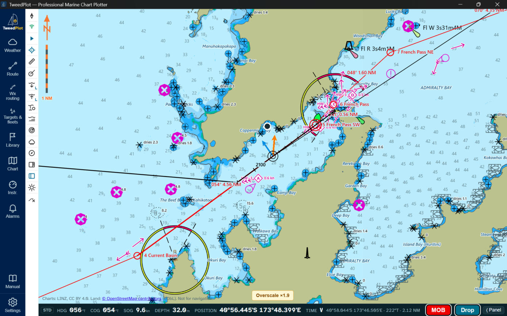

**Narrow screens.** On a screen under 1000 pixels wide (a tablet, or a small window) a panel beside the chart would leave too little chart, so the line under the chart stays and **O** (or **⟨ Panel**) slides the panel over the chart's edge; ⟩ or O puts it away again. That is the only time the panel covers the chart.

**Hide it** with **O**, the panel button in the toolbar or **⟩**. Hidden, the panel leaves one line under the chart: HDG, COG, SOG, depth, position and time, with MOB and Drop, and **⟨ Panel** to bring it back. When the readings are wider than the room (a narrow window, or the wide Environment panel) their type shrinks a little, to 60 %, so the position and time are not cut off; below that the line scrolls sideways. Each window remembers for each view whether its panel is shown. A new MOB brings the panel back. In a view without a chart (Instruments, Live data) there is no data panel: MOB is at the top right of the screen, Drop at the bottom right, and the alerts at the top.

**Edit it** with **✎** (or **Instruments › Edit the data panel**; **Reset this layout** beside it goes back to the starting layout). Each section gets ▲ ▼ to move it, **1 col / 2 col** for one or two columns, **∿** for trend lines, **＋ −** for a graphic's height (or how many marks or targets a list shows), ✕ to remove it, and a box for its name. Click a reading to change it, move it or remove it; **+ Add a reading** adds one at the end. At the bottom, **+ Add a section** adds a section of readings, the marks ahead, the AIS targets, a graphic (wind dial, compass, highway, sounder history) or a history plot. **Reset** goes back to the starting layout for this view and Use. **Done** finishes. Your changes are kept for that view and Use, and are shared by every window.

**Chart time**, **Weather layers and filters** and **GRIB data at the cursor** are separate sections: use ▲ ▼ to reposition them, ✕ to remove them, and **+ Add a section** to add them back. Planning starts with Chart time pinned above the scrolling panel, except while editing; its detailed weather sections are optional. The toolbar Weather button opens Environment; load, choose or unload files in Environment › Get data.

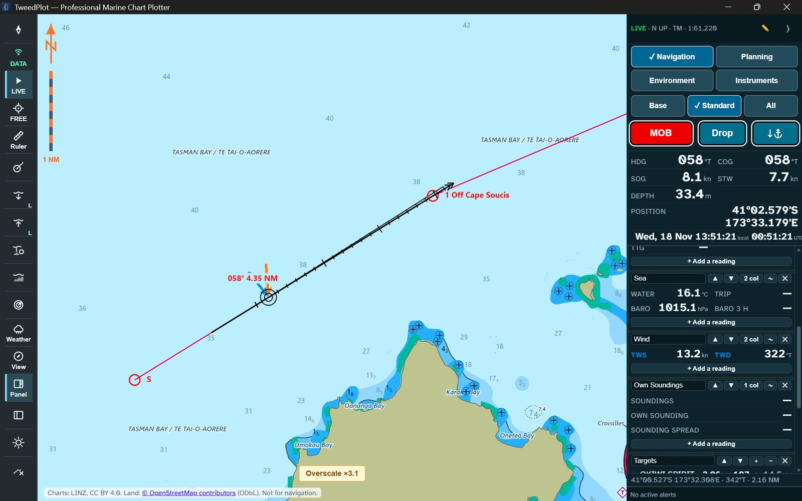

**Right-click** a reading for its history in a card (see *History plots*).

**Sizes.** The panel's text is sized in millimetres from the screen calibration (Settings › Display), as the chart symbols are, so it is the same size on every screen. It is one fixed size, matching the rest of TweedPlot; for reading from further away, use the Instruments view, whose readings are much larger. Choose **Instruments › Panel width** for narrow, normal or wide, or drag the panel's inner edge; it snaps to the nearest. **Side** (Instruments, or Settings › Display › **Data panel side**) puts it to the right of the chart (to begin with) or the left, between the drawers and the chart.

**The Instruments view**

The Instruments view is one screen of tiles, each a single reading, on a grid of 12 columns by 8 rows. It uses the same readings as the data panel (including the graphic Wind, Compass, Highway, Sounder history and the history plots).

- **Move**: drag a tile. A tile dropped under another locks to that tile's column; it does not shuffle to the left. Tiles snap to the grid and cannot overlap or leave the screen.
- **Resize**: drag the handle in a tile's bottom right corner. Text and dials scale to fill the tile.
- **Change a reading**: click (tap) a tile to choose what it shows, or remove it.
- **Instruments › Add an instrument** puts a new tile in the first free space. **Reset Instruments screen** returns to the default arrangement.
- **Names and headings.** Click a tile › **Give this instrument its own name…** to label it your way ("Port engine", "Mast TWS"); an empty name goes back to the reading's own. **Instruments › Add a heading** puts a heading across the first free row to name a group of instruments (Engine, Wind, Tanks); drag and size it like a tile, and click it to rename or remove it.
- Night colours show red (or green) readings on black.
- **Instruments › Lock layout** stops the screen being changed by accident.


**What can be shown**

The same readings are offered in the data panel (**+ Add a reading**) and on the Instruments screen (click a tile).

| Group | Readings |
| --- | --- |
| Navigation | SOG, COG, heading (°T and °M), boat speed through the water (BSP; the own-ship block calls it STW), **Set** and **Drift** (the current the boat is in, see below), depth, position, log, trip, UTC and local time, and both together |
| Weather | Barometric pressure and its change over 3 hours, air temperature, humidity, water temperature |
| Wind | AWS, AWA, TWS, TWA, TWD, VMG |
| Route | Next mark, BTW, DTW, VMC, TTG, ETA, XTE; the active routing's target TWA, boat speed and heading, and boat speed as a percentage of target |
| Cursor | Cursor position, bearing and range from the boat to the cursor (rhumb line); the own sounding under the cursor, its spread and how many soundings it is made from |
| GRIB at cursor | Wind speed and direction, gust, pressure, wave height, period and direction, rain, air temperature, the GRIB time and its name, for the GRIB shown on the chart at the cursor and slider time |
| Sea at cursor | Sea temperature, satellite sea temperature, chlorophyll, salinity, temperature and salinity at depth, current and its set, sea ice, from the loaded ocean files |
| Man overboard | Bearing and range to the MOB, its position and the time since |
| Graphic | The wind dial, compass, highway and sounder history (see *Graphical readings*) |
| History | A plot of any recorded reading against time (see *History plots*) |

Port and starboard are marked on wind angles. Position and depth are marked **STALE** after 10 seconds without their own updates, even if other data is still arriving. Other live readings currently use the age of the overall vessel feed, so an individual sensor can stop without its reading being marked stale. Depth turns amber within 2 m of the safety depth and red below it only while its reading is fresh.

**Graphical readings**

Some readings are drawn, not written. They are in the Graphic group of a tile's menu, and in **+ Add a section** in the data panel:

- **Wind**: a dial with the boat pointing up, true wind (blue) and apparent wind (orange) needles pointing to where each wind comes from, and close-hauled sectors red to port and green to starboard. True wind is in the two top corners (TWS left, TWA right) and apparent wind in the two bottom corners (AWS left, AWA right), each in its needle's colour; the angles carry a red P or green S for the side. The chart's wind arrows and the TWS, TWA, TWD, AWS and AWA readings use the same two colours.
- **Compass**: heading at the top of a turning card, with course over ground (orange) and the bearing to the next mark (green) on its rim.
- **Sounder history**: a record of the depth under the boat, drawn like a fish-finder's screen. Time runs left to right with now at the right edge, and the depth scale on the right; the bottom is drawn as a hard return, a yellow line over orange bands on a brown body, so a ledge, a drop-off or a hump shows as a shape rather than a number. The depth is big at the top left, with the water temperature under it when the boat reports it. A dashed red line marks the safety depth (Chart › Safety). Two small buttons in the corner set **how much history** fits across the screen (5, 15, 30 minutes, 1 or 2 hours: click to step through) and **how deep** the screen goes (Auto follows the bottom, or fixed at 10, 20, 50, 100, 200 or 500 m). A break in the data (the sounder drops out) leaves a gap, not a made-up line. It records from the Signal K depth (below transducer, or below surface when that is all there is), one point a second for up to two hours, and keeps those two hours when TweedPlot is closed and opened again (the time it was closed shows as a gap). It draws the bottom only: it is a record of depth, not a fish-finder's sonar picture, so it does not show fish, bait or the bottom's hardness. Give it a wide tile, or a section of its own in the data panel.
- **Highway**: a steering display. From the top: heading, course to steer (CTS), speed over ground and the distance to the waypoint (DTW); a compass ribbon that follows the heading, with the heading marked at its centre; a perspective lane that shifts with the cross-track error (XTE) while the boat stays fixed; an arrow showing which way to turn and how much; then XTE, time to go (TTG) and the estimated arrival (ETA). CTS steers back towards the leg being sailed, with the correction limited to 30°. When both heading and course over ground are known, their difference estimates the set and leeway, and the course to steer allows for it. Without a heading sensor it works from course over ground, and says so. While a MOB is set it shows the direct bearing and range to the MOB position. In the data panel it lays itself out to the panel's width, with short labels (HDG, CTS, SOG, DTW, XTE, TTG, ETA) and the ribbon figured every 20°.

**History plots**

TweedPlot keeps a record of the boat's readings for nowcasting: watching the barometer and the wind for the weather coming, as you would with a barograph. It records TWS, TWD, AWS, AWA, SOG, boat speed, barometric pressure, air temperature, humidity, water temperature and depth from the live data, for 24 hours to begin with (6, 12, 24, 48 or 72 hours: **Instruments › History › Keep history for**; **Clear** beside it empties the record). Each minute keeps the average and, for speeds and the other readings, the lowest and highest, so the wind plot shows the gusts and lulls as a band around the average; directions are averaged as directions (350° and 010° average to 000°, not 180°). The last hour is also kept in five-second steps, so a short window shows the detail. A day of every reading is about 16,000 small records: recording, keeping and drawing it takes very little of the PC. The record is kept when TweedPlot closes (written every five minutes and on closing), and the time it was closed shows as a gap; a replay and stale data are not recorded.

- **Right-click a reading** in the data panel or on the Instruments screen (TWS, TWD, Pressure, SOG…) for its history in a card. Drag the card by its title and size it by its corner; choose how much history it shows (15 minutes to 72 hours); ✕ closes it. Cards stay open where they were when TweedPlot starts again. **Show … history** in a reading's menu does the same.
- **The History group** of a tile's menu puts a plot on the Instruments screen (a plot gets a tile 4 × 2 to begin with; size it as you like); in the data panel, **+ Add a section** offers the same plots. The small button in its corner steps through the time shown.
- Each plot shows the latest value, times along the bottom in local time, and the scale on the right. The wind and its plots use the true (blue) and apparent (orange) colours of the dial and the chart arrows.
- **Pressure** shows its change over the last three hours, in hPa and in the shipping forecast's words: steady (less than 0.1 hPa), rising or falling slowly (0.1 to 1.5), rising or falling (1.6 to 3.5), quickly (3.6 to 6) and very rapidly (more than 6). It turns amber when falling quickly or faster. **Pressure 3 h** in the Weather group is the same change as a single reading (amber falling quickly, red very rapidly). It needs three hours of record. As a rule of thumb, a fall of 3 hPa or more in three hours means a front or low close by and wind to come.
- Pressure, air temperature, humidity and water temperature are also single readings in the Weather group.

## MOB, Drop and anchoring

**MOB**, **Drop** and the optional **anchor** button are together near the top of the data panel, under Base / Standard / All. With the panel hidden they are on the line under the chart. In the views without a chart (Instruments, Live data) MOB is at the top right of the screen and Drop at the bottom right. They are in every window, and work the same from any of them.

**Man overboard**

Press the red **MOB** button (or **Ctrl+M**) the moment someone goes over. It works with one press and no confirmation: a mistaken press costs little, a delayed one may not. Clearing a MOB asks twice.

TweedPlot marks the boat's position (or where it was put when planning) and raises an alarm that shows the time since, and the bearing and distance back to the position, updated every second, with a line from the boat to it on the chart. A red **Man overboard** section comes up in the data panel, under the own-ship readings:

- the **Highway**, steering you back to the MOB position: heading, course to steer, speed and distance to the MOB, and the arrow showing which way to turn;
- **Since MOB**, in minutes and seconds;
- **MOB at**: the position and the time it was pressed, local and UTC, for the log and a distress call.


Bearing and range to the MOB are also readings you can add anywhere (the Man overboard group). The data panel is shown again if it was hidden, and the section goes when the MOB is cleared. Every window shows the same readings for as long as the MOB is set, and the MOB can be cleared in any window. The position is also saved as a library mark in the group "MOB". **Clear MOB** in the alerts, pressed twice, ends it.

**Drop mark**

The **Drop** button (or **E**) marks the boat's position now and stamps it with the time, as a library mark named "Drop hh:mm:ss" in the group "Drops". Use it for a fish, a pot, a floating object or a depth change. Unlike MOB it raises no alarm and changes no view or reading. The mark shows in the Library at once, in every window.

**Anchoring and the anchor alarm**

The anchor is a mark you drop, drag to where it really lies, and watch: the **anchor alarm** (anchor watch, drag alarm) sounds if the bow goes outside its swing circle.

1. **Drop it.** Press the **anchor button** (beside **Drop**: ↓ and an anchor; it's optional, turn it on in Settings › Display › **Anchor button beside MOB and Drop**), or **K**, or right-click the chart and choose **Drop anchor here**. From the button it goes at the bow: the GPS position moved forward along the heading by the antenna's distance from the bow, and across by its offset from the centreline (Settings › Vessel; the antenna of the receiver in use). From the menu it goes where you clicked. The anchor symbol (orange) and its swing circle (dashed) appear, and a dotted line joins the anchor to the bow.
2. **Put it where it lies.** You can rarely press the button at the moment the anchor goes down. During the pull test, drag the anchor on the chart: the readout says how far it is from the bow and on what bearing ("34 m at 012°T from the bow"). Or type it on the anchor's card: **30 m at 012°T from the bow** (**Dead ahead** fills in the heading), then **Move the anchor there**.
3. **Set the swing circle.** On the card, type the **Radius**, or the **Scope** (chain or rode out) and press **Radius = scope**: the bow can't swing further from the anchor than the rode is long. The circle is round the anchor, and the anchor alarm measures from the **bow**, as the anchor was placed: the GPS position moved forward along the heading by the antenna's distance from the bow (Settings › Vessel › Position and GPS antenna; with that unset, or no heading, it measures from the GPS antenna). The anchor alarm sounds when the bow goes outside the circle, with its own sound (Alarms › Sound › **Anchor alarm sound**). It is a watchdog alarm: silenced, it sounds again after the watchdog time while the bow is still outside. Typed or spun numbers on the card take effect when you stop changing them.
4. **Note the anchorage.** The card also keeps the **Name**, the **Bottom** (sand, mud, clay, shingle, weed, shell, rock, coral), the **Holding** (1 poor to 5 excellent) and **Notes**, with the depth and time it was dropped.
5. **Weigh anchor** (on the card, the right-click menu, Alarms › Anchor watch, or the anchor button, which turns red with ↑ and an anchor while anchored: press it twice, as it flashes, or **K** twice) ends the watch. The anchor stays: it's a mark of type *Anchor* in the **Anchorages** group of the Library, so over time the group becomes your own record of where you've anchored and how it held. Click one on the chart to open its card, and **Anchor here again** to watch it once more.

Click the anchor any time to open its card. **Alarms › Anchor watch** sets the **Default swing radius** a new anchor starts with.

## Alarms

Alarms appear in the **alerts** at the bottom of the data panel and sound until silenced; the edge of the chart flashes red while one is unacknowledged. With the panel hidden, the alerts are on the line under the chart: the newest alarm with its buttons, and "+ more" when there are others. In the Instruments and Live data views, which have no chart, they appear at the top of the screen. The alerts are in every window; **Silence**, accept and **Clear MOB** work from any of them. They work from live data (or a replay), not in planning.

- **New alarms** stack in the alerts, one under another, so none is ever hidden. Click an alarm's text to show its place on the chart.
- **Silence** stops the sound only: the alarm moves to the **Active** list in the Alarms drawer (one steady line in the alerts shows how many are silenced) and stays while its cause lasts. It clears when the cause ends or you change the limits.
- **Dismiss** (collision risk) quiets an alarm for a minute: it stays on the **Active** list (marked "dismissed"), comes back into the alerts sounding if the risk lasts, and sounds again at once if it gets worse.
- **Clear** (a source changed, a lost distress beacon) removes an alarm that reports an event, not a lasting cause.
- **Alarms that escalate.** A collision alarm sounds again when TCPA or CPA falls to half, then a quarter, of your limit. So do the safety contour ahead, a closed area ahead and the approach to a mark (by the time left), and the off-track alarm (at twice, then four times, your limit).
- **Watchdog.** Shallow water, air draft, the anchor alarm, man overboard, AIS-SART, MOB device and EPIRB alarms, position lost and being inside a closed area don't escalate; but if you silence one and its cause still lasts, it sounds again after the **Watchdog** time (Alarms › Sound; 1 to 20 minutes, 5 to begin with).

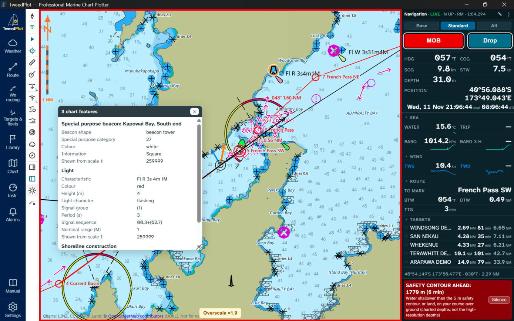

**The Alarms drawer**

{icon:alarms} **Alarms** is the one place for every alarm, as IMO's bridge alert management asks: no alarm is set up anywhere else. At the top, **Active** lists everything raised now, silenced ones included, with when it started and a **Silence** button. Below it, each alarm with its settings:

| Group | Alarm | Raised when | Settings |
| --- | --- | --- | --- |
| Depth and clearance | **Shallow water** | The depth (under the keel if the instruments give it, else below the transducer) is less than the alarm depth. If the selected depth is missing or 10 seconds old, **DEPTH DATA UNAVAILABLE** warns that the alarm cannot be checked. There is a 10-second grace period at startup or a navigation-source change. An active shallow alarm remains until a fresh safe reading, the alarm is disabled, or plotting is paused. Replay uses recorded time | Alarm depth; empty = the safety depth (Chart › Safety) |
| | **Safety contour ahead** | Water shallower than the safety contour, land or a charted danger lies on the course over ground within the time you choose (3 to 15 minutes), from the chart's depth areas. Checked every 10 seconds while moving | Look-ahead time. Charted depths only, not the high-resolution depths |
| | **Air draft** | A bridge, overhead cable or pipeline on the chart within a mile (or 10 minutes) ahead has less charted clearance than your air draft plus the margin | Air draft in **Settings › Vessel**; margin. Charted clearances are above Highest Astronomical Tide |
| Navigation | **Off track** | The boat is further than the limit from the line between the last mark and the next (cross-track error, Route › Navigate) | Limit in NM; off until you turn it on |
| | **Approaching the next mark** | The next mark is the time you set away at your speed made good towards it, or you are inside its arrival radius (a warning, once per mark) | Minutes before |
| | **Position lost** | No valid position fix has been received for 30 seconds while plotting live, including when the connection is lost. A new valid fix clears the warning; other sensor updates do not. At startup or after changing the navigation source there is a 30-second grace period if no fix is available. The warning is suppressed while plotting is paused; replay uses recorded time, which stops when the replay is paused | On or off |
| Anchor watch | **Anchor alarm** | The bow is outside the anchor's swing circle | **Default swing radius** here; the swing radius and scope on the anchor's card. **Drop anchor** here, the anchor button or the right-click menu starts the watch; **Weigh anchor** ends it (see *Anchoring*) |
| Targets (AIS) | **Collision** | A ship's closest point of approach (CPA) is less than the limit within the time limit (TCPA) | CPA and TCPA; ignore anchored and moored ships; alarms for internet-only targets too |
| | **AIS-SART, MOB device, EPIRB** | One is heard (a test transmission is a caution only); not heard for 6 minutes it becomes a warning you can clear | Always on |
| Areas | **Closed area** | The boat is inside, or within the time you choose of, an area closed to your methods (Settings › Vessel › Fishing) (see *Boundaries and fishing rules*) | On or off; look-ahead time |

**Alarms › Sound** has the **Watchdog** time, the **Alarm volume** with **Test**, and the **sounds**: **Alarm sound** for alarms (red: shallow water, safety contour, air draft, off track, collision, distress), which repeat until silenced; **Warning sound** for warnings (amber: approaching a mark, position lost, closed area); and **Anchor alarm sound**, so a dragging anchor sounds different from everything else. Each has a choice of triple beep, chime, siren, pulse, whoop, bell, low tone and horn, and a ▶ button to hear it.

## Charts

TweedPlot draws its own vector chart from free data: a world coastline everywhere, and for New Zealand the LINZ hydrographic data with depth areas, contours, soundings, lights, marks, dangers and charted areas.

**ENC cells (S-57)**

TweedPlot also reads official electronic navigational charts in the IHO S-57 format: a base cell (`.000`) and its updates (`.001`, `.002`, ...). Put the cells in the `enc` folder of the data folder (Settings › Diagnostics › Where to install data files opens it), in any folders you like; a whole exchange set (`ENC_ROOT` with its agency, cell, edition and update folders) can be copied in as it is. Each cell is converted once into the `.enc` folder beside it, and again when the cell or an update changes, then drawn in the same style as the LINZ charts. The cell's intended usage sets its scale band: overview, general, coastal, approach, then harbour and berthing.

**ENC chart sets.** Each folder in `enc` (an exchange set such as NOAA's `ENC_ROOT`, or the IHO's test data), the cells straight in `enc`, and the cells installed from S-63 exchange sets are listed under **Chart › Get data › ENC chart sets**, with how many cells each has and who produced them. Untick a set to leave it out: it isn't checked or opened when TweedPlot starts, and it stays on disk, converted, so ticking it again brings it back in moments. Keep sets you don't sail in (all of NOAA's charts, say) unticked: start-up stays quick. The list also has **LINZ open data charts**: TweedPlot's own chart, made from LINZ's open hydrographic data. It is not an official ENC. Untick it to see only official ENCs (your S-57 and S-63 cells), for example to check exactly what the official chart shows; where no ENC covers a place, only the world coastline and depths show there, and the tidal diamonds and features that come only from the LINZ data go with it. Tick it again to bring it back. **Get data** then says the LINZ charts are left out.

Updates are applied in order. The cells of each scale band are merged into one file in `.enc`, so even thousands of cells (all of NOAA's charts, say) draw quickly.

**Encrypted ENCs (S-63).** Most official ENCs are sold encrypted under the IHO S-63 scheme. You buy permits for the cells you want, made for your system, and the charts come as exchange sets (a folder with `ENC_ROOT` in it, on a CD, DVD or download). Encrypted charts need **TweedPlot S-63 Charts**, a plugin from TweedsMarine: a separate program that TweedPlot starts and that does all the S-63 work, so the protected data never passes through TweedPlot itself. Everything is done in the **Chart › Encrypted charts (S-63)** card:

- **The plugin**: at the top of the card. Without it, the card offers **Download** (from tweedsmarine.nz) and **Install from file…** (a `.tpplugin` package, for a computer without internet: copy it on a USB stick). TweedPlot checks the package is signed by TweedsMarine before it installs or starts it. Once installed, the card shows its version, **Check for update** (then **Update**) and **Remove plugin**. Removing it keeps its activation on the computer, for when it is installed again; the encrypted charts aren't shown without it. Plain (unencrypted) ENCs and the LINZ charts don't need the plugin.
- **Activation**: a TweedPlot licence for encrypted charts is for **one vessel**, on up to three computers on board (seats), for a one-off activation fee per vessel. **Copy** the **Installation code** (it starts TP2-: it is made from this computer's main board and this installation of TweedPlot) and send it to TweedsMarine with the boat's name and MMSI; paste the **Activation code** that comes back (it starts TPA2-) and press **Activate**. It works only on this computer and this installation. The other computers on the same boat get their own activation codes with the same user permit, so one set of chart permits covers them all. Once activated, the card shows who the licence is for (vessel, MMSI, licence and seat); if the MMSI in **Settings › Vessel** is a different one, it says so. A new main board, or TweedPlot reinstalled after Windows is reinstalled, needs a new activation code (the same seat).
- **Remove** (beside the activation): gives the seat back, for example before a computer is replaced. The chart data decrypted under the activation is deleted, and a **Release code** (TPR2-…) is shown: **Copy** it and send it to TweedsMarine, who can then activate another computer in that seat. The last release code stays on the card until the computer is activated again.
- **User permit**: this computer's identity for the chart suppliers, shown once activated. **Copy** it and give it to your chart supplier when ordering permits.
- **SA key**: the IHO Scheme Administrator's key, which proves where cells come from. TweedPlot comes with it (valid to 2033). **Install key…** takes a newer `IHO.CRT` or `IHO.PUB` from the IHO website or your supplier. A key that isn't the IHO's is installed with a warning (SSE 26); an expired or damaged one is refused (SSE 22, SSE 08).
- **Install permits…**: choose the `PERMIT.TXT` from your supplier. Each permit is checked and the report says which installed, which are wrong (SSE 12, SSE 13) and which expire within 30 days (SSE 20) or have expired (SSE 15). Permits are kept separately for each data server; **Cell permits** lists them, and **Remove** (press twice) takes away one data server's.
- **Import exchange set…**: choose the exchange set's folder, or the medium if it holds several. Every cell file is checked (signature, permit, decryption, CRC) and the base cells, new editions, re-issues and updates are applied in order. Cancelled cells are removed, with their replacements named. A report lists every cell with what happened and the S-63 code for anything wrong. When an update needs base media you haven't loaded, it says which (load them, then the update again).
- **Installed ENCs** lists each cell with its edition and update. **Remove all ENCs** clears them (permits and key stay).

While a cell whose permit has expired (SSE 25), or that is behind its data server's latest edition or update (SSE 27), is on the chart, a warning stays at the bottom of the chart: such a cell may be out of date and must not be used for primary navigation. The plugin keeps the chart data made from encrypted cells on disk encrypted for this computer and installation, and opens it only in its own memory; the cell keys are decrypted only while cells are being converted and are wiped from memory afterwards, as the S-63 scheme requires. TweedPlot asks the plugin only for what it draws (a table and an area at a time), so the chart, the feature details, routing and the alarms work on encrypted charts as on any other. The encrypted charts also appear in **Chart › Get data › ENC chart sets**, where they can be left out of use like any set. Encrypted cells are only read once imported with **Import exchange set**: an exchange set copied straight into a chart folder is left alone, with a message saying to import it.

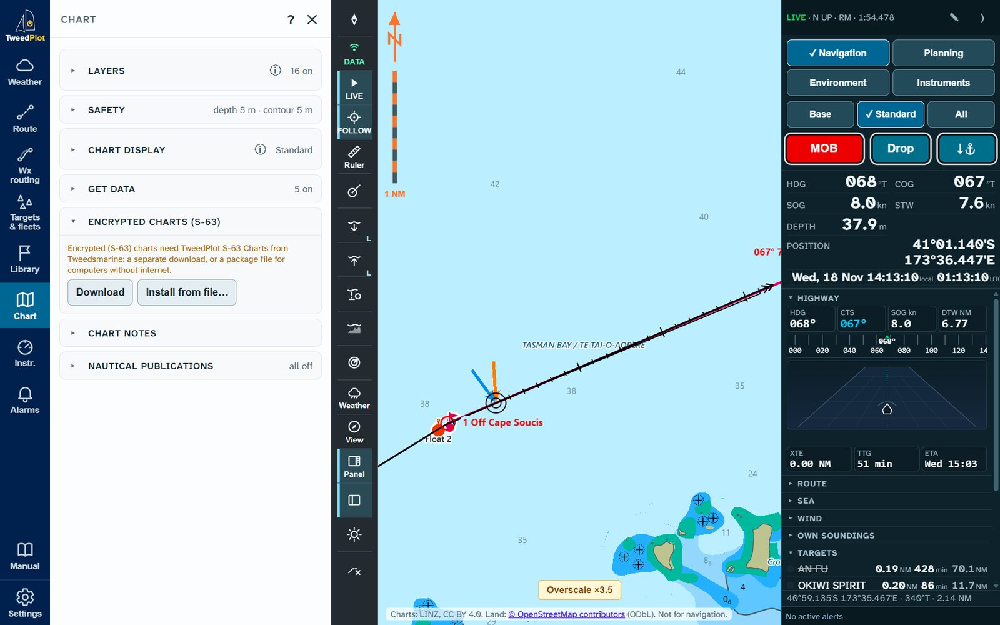

**Where to get charts outside New Zealand**

Check the format before you pay for anything: TweedPlot reads **S-57 ENCs**, free or encrypted (S-63). It does not read charts sold in a program's own format.

*Free S-57 ENCs.* Copy these into the `enc` folder as they are. Offers change, so follow each link to the source's own page for its current coverage and terms.

| Where | What | Notes |
|---|---|---|
| United States, [NOAA](https://nauticalcharts.noaa.gov/charts/noaa-enc.html) | The official ENCs, free, one chart at a time or by region | The whole US coast, and also Puerto Rico, the US Virgin Islands, Hawaii, American Samoa, Guam and the Northern Marianas. The US Army Corps of Engineers has [inland ENCs](http://ienccloud.us/#DataDownload) for its waterways |
| South China Sea, [East Asia Hydrographic Commission](http://scsenc.eahc.asia/main.php) | Small-scale official ENCs, made by the commission's member states | Good for planning a passage, too coarse for pilotage in a harbour or reef |
| European rivers and canals, [eurisportal.eu](https://www.eurisportal.eu/default.aspx?path=Diensten/Vaarkaarten/DownloadOverview) | Inland ENCs for several countries (Austria, Belgium, Bulgaria, Croatia, Czechia, France, Germany, Hungary, Luxembourg, the Netherlands, Romania, Serbia, Slovakia) | Waterways only, not the coast |
| Brazil, [Marinha do Brasil](https://www.marinha.mil.br/chm/dados-do-segnav/cartas-ienc) | Downloadable inland ENCs | Inland waterways only |

A few offices publish raster charts (BSB/KAP) free. TweedPlot does not read these.

*Everything else is sold.* Most hydrographic offices sell their ENCs through distributors, encrypted under S-63. Buy from an official distributor, such as the UK Hydrographic Office's Admiralty Vector Chart Service (AVCS), the **Primar** and **IC-ENC** services and the resellers they approve, which includes many chart shops and some marine electronics dealers. Prices differ between sellers for the same chart, so ask for a price by chart (a harbour and its approach) and not only by region. Many hydrographic offices list their approved distributors on their own websites. Searching in the language of the country you are visiting often finds local sellers: for French waters try *cartes ENC S-63* or *cartes marines vectorielles officielles*; for Spanish, *cartas náuticas electrónicas ENC S-63*. You give the seller your **User permit** (see **Encrypted ENCs (S-63)**), and they send back the permit file for the cells you bought and the chart data.

*Lists of approved sellers.* Rather than trust a list in this manual, which would go out of date, use the ones the services keep. ADMIRALTY has a *find a distributor* page on its [AVCS site](https://admiralty.co.uk/avcs), Primar lists its [authorised distributors](https://www.primar.org/distributors), and the IHO keeps a [list of ENC and chart distributors](https://portal.iho.int/iho-ohi/stakeholders/Chart_ENC_Distributer.php) on its portal. The IHO list is long and some entries are old, so check that a seller still trades before you order. Several of these services sell mainly to ships. Recreational buyers are welcome at some distributors and not at others, so ask.

*Australia, Papua New Guinea and the Solomon Islands.* The Australian Hydrographic Office sells its own official S-63 ENCs as **AusENC**, and describes them as suitable for recreational vessels as well as ships ([hydro.gov.au](https://hydro.gov.au/prodserv/digital/ausENC/enc.htm)). Packs are subscriptions, with free weekly updates downloaded from the AHO's website for the length of the subscription. You can buy from the AHO's resellers, such as chart shops in Australia. The AHO emails you the permit files, which you load as for any S-63 chart. The AHO's coverage list also includes the New Zealand cells that LINZ publishes.

*Charts that will not load.* Several chart stores sell charts made for one program only. The **O-Charts** (oeSENC) charts work only in OpenCPN, **Meltemus chart packs** only in qtVlm, TimeZero's **TZ Maps** only in TimeZero, and Navionics, Garmin and C-MAP charts only in their own devices and apps. They can be good value, but they will not work in TweedPlot. If the shop talks of an *S-57 ENC with a user permit* or *S-63*, it will.

*Chart sets with no stated source.* Chart collections passed around on hard drives or file-sharing sites, including the C-MAP CM93 sets, are in general copies made without the owner's licence. TweedPlot does not read them, and you should not rely on them: they carry no updates and no guarantee of accuracy, and this software cannot vouch for them.

> **Status (November 2026).** S-63 permits can be issued to a program only once its maker has an OEM agreement with the IHO. The TweedPlot S-63 plugin works with the IHO's own test data, and the agreement is in progress. Until it is complete, use the free S-57 charts above, and do not buy encrypted charts for TweedPlot.

**Chart notes.** Many chart features refer to a text file: a caution area's warning, an Area to be Avoided with its exemptions, the chart's general notes ("Text file: NZFER003.TXT" on the card). The texts come with the ENC exchange sets and aren't encrypted, even in S-63 sets. **Import exchange set…** keeps them, whether or not you have permits for the cells, and **Chart › Chart notes › Add from an ENC folder…** copies them from any ENC folder: an exchange set, a chart DVD, or another navigation program's ENC folder (for the NZ ENC service, the folder holding ENC_ROOT). A feature's card then shows the text in full under its details, also for the LINZ open data, which names the files but doesn't carry them. Where an update brings a newer version of a note, the newer one is kept. Pictures ("Picture: NZ7132P3.TIF") come the same way and show on the card: in the New Zealand set they are the drawings of the leading marks into Westport and Greymouth, on the cards of the front and rear leads. Click a picture to see it full size. The ENC pictures are TIFF files; TweedPlot reads them itself, so nothing else needs installing.

**Nautical publications.** Chart notes often refer to LINZ's *Annual New Zealand Notices to Mariners* ("refer to Annual New Zealand Notices to Mariners No. 19") or the *New Zealand Nautical Almanac* (NZ 204). In a note these references are links: click one and TweedPlot opens that notice as a PDF, downloading the current notices from linz.govt.nz first if it hasn't yet. **Chart › Nautical publications** downloads them (about 4 MB) and, ticked, the full Almanac (about 9 MB: tides, lights, maritime contacts and the notices in one book), lists the notices to open, and says when a new edition is out (each 1 July): press **Update**. Changes during the year come in LINZ's fortnightly Notices to Mariners, not in these files. Sourced from Land Information New Zealand, Crown Copyright Reserved. They don't replace the nautical publications required by Maritime Rules Part 25. The Admiralty *New Zealand Pilot* (NP51) is a UK Hydrographic Office publication and isn't included.

**Getting the New Zealand data**

Download from the [LINZ Data Service](https://data.linz.govt.nz) (free account) as GeoPackage, and put the zip files, unopened, in the `charts` folder of the data folder (Settings › Diagnostics › Where to install data files: **Open** beside *LINZ charts (NZ)*). TweedPlot reads every scale band it finds and draws the most detailed one available at each place.

| Dataset | Why |
| --- | --- |
| Depth area polygons (each scale band: 1:4k–1:22k, 1:22k–1:90k, 1:90k–1:350k, 1:350k–1:1.5M, 1:1.5M and smaller) | Water depth shading and the routing safety depth |
| Depth contours and soundings (same bands) | Contours, the safety contour, spot depths |
| NZ coastlines and islands (Topo50) | The detailed coastline |
| NZ lake polygons (Topo50), and optionally NZ river polygons (Topo50) | Lakes and wide rivers as water. The coastline layer is land right across them, so without these Lake Taupō, for example, shows as land under its rocks and marks. Where a lake is charted (Taupō is) its depth areas, contours and soundings show; elsewhere it is plain water. The lake and river areas in the hydrographic feature downloads are used too |
| Hydrographic feature layers (the "121 layers" GeoPackage for each band) | Lights, buoys, beacons, rocks, wrecks, obstructions, marine farms, anchorages and other charted areas, and the tidal diamonds and flood and ebb arrows ("Tidal stream panel data points", "Tidal stream - flood/ebb points") |

The open data does not cover every harbour at large scale. Port Nelson's inner channel marks, for example, are only in the official ENC. Add missing marks yourself as library marks with buoy symbols (see Marks).

Wharves, breakwaters, jetties, pontoons, floating docks and causeways are drawn from LINZ's shoreline construction and pontoon layers (in the hydrographic feature downloads) where LINZ has them; click one for its type. Many marinas, Nelson's included, have no pontoons in the open data: those are only in the official ENC.

**The Chart drawer**

{icon:chart} **Chart** opens on **Layers**: everything that can be drawn on the chart, in one list, so you can see at a glance what is on and off. The other cards set what keeps the boat safe, how the chart is drawn, and where the data comes from.

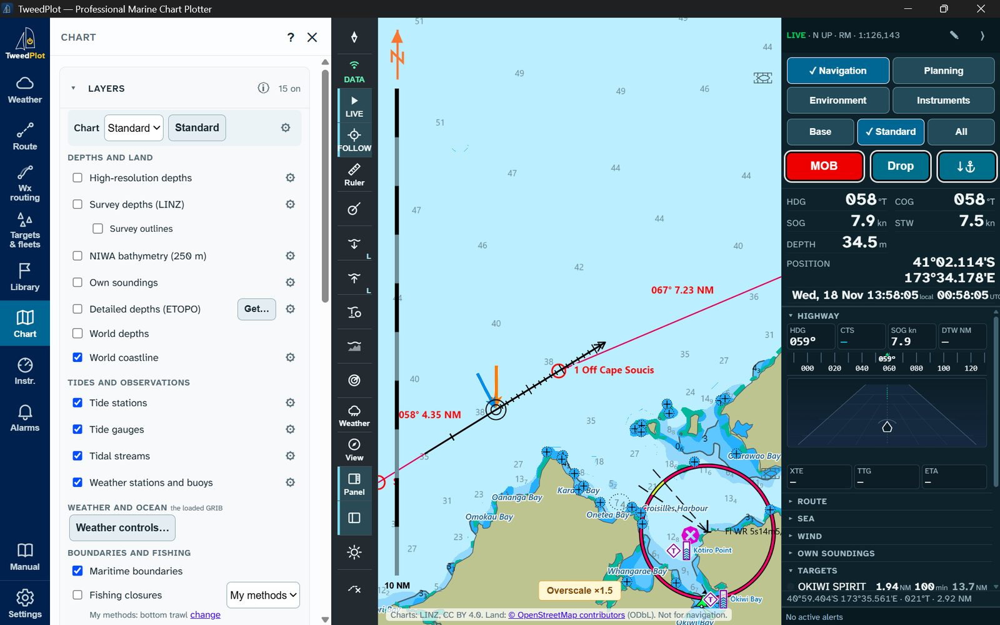

| Part | Settings |
| --- | --- |
| **Layers** | At the top, **Chart**: **Base**, **Standard** or **All** (below), and **Standard** to go back to the standard display. Then the layers, in groups: **Depths and land** (high-resolution depths, survey depths and their outlines, NIWA bathymetry, own soundings, detailed depths, world depths, world coastline); **Tides and observations** (tide stations, tide gauges, tidal streams, weather stations and buoys); **Weather and ocean** (a shortcut to the data panel's weather controls); **Boundaries and fishing** (see *Boundaries and fishing rules*); **My things** (marks, barriers, AIS targets, laylines, tacking cone); **Own ship** (heading line, COG line, beam bearing line, range rings, wind arrows); **Images** (raster charts and satellite images, below); **Online maps**. The **⚙** at the end of a row opens that layer's settings, wherever they are (the tide settings in Weather, say), and **Get…** shows on a layer whose data you haven't downloaded yet: it takes you to **Get data**. Other switches are also in the drawers they belong to (the tides in Weather › Tides, marks in the Library…): ticking one ticks the other |
| **Safety** | **Safety depth** and **safety contour** (below), **Isolated dangers in shallow water** (see Isolated dangers), **Depth shades** (four: drying, shallow, safety and deep contours; or two, as S-52: shallower or deeper than the safety contour), **Shallow water pattern** (the S-52 grid of small diamonds over water shallower than the safety contour) and **Contour labels** |
| **Chart display** | **Display**: Base, Standard or All (below); **Reset to standard**; **Light sectors**, **Sector lines to full range**, **Names and labels**, **Soundings**, **Information symbols**, **Important text**, **Other text**, **Date-dependent symbols**, **Chart date**; **Symbols**: IHO (S-52) with paper-chart or simplified symbols, or TweedPlot paper chart (below); **Area boundaries**; **Chart symbol size**. To make the IHO symbols their true size, calibrate the screen in **Settings › Display › Screen calibration** |
| **Get data** | Every download and import: world coastline, detailed depths, high-resolution depths, survey depths, NIWA bathymetry, own soundings, maritime boundaries, fishing rules, and the LINZ and ENC charts. Each layer that needs data says **Get…** in Layers until it's here |
| **Encrypted charts (S-63)** | The plugin, the installation code, activation, and installing S-63 permits and exchange sets (see *Encrypted ENCs*) |
| **Chart notes** | **Add from an ENC folder…**: the texts and pictures chart features refer to (see *Chart notes*) |
| **Nautical publications** | LINZ's Annual Notices to Mariners and the Nautical Almanac (see *Nautical publications*) |

| Setting | What it does |
| --- | --- |
| **Safety depth (m)** | The least depth you will sail in: the draft plus a margin for swell, squat and chart error. Routing will not enter water shallower than this, and it is the shallow water alarm's depth unless you set another |
| **Safety contour (m)** | The contour drawn bold. Water shallower than it is shaded darker blue, as on a paper chart. Set it to the safety depth or the next contour deeper. Where the chart has no contour at exactly that depth, the next deeper contour it has is drawn bold instead (as an ECDIS does), so the bold line never goes missing. The **Safety contour ahead** alarm watches for it |
| **Chart symbol size** | Scales buoys, beacons, lights, dangers and other chart symbols from 75% to 200% (default 100%, the IHO's size) to suit the screen and the viewing distance. Labels grow at half the rate, so they stay clear of each other |

**Display: Base, Standard and All**

As on an ECDIS (IHO S-52), **Display** decides how much of the chart is shown:

| Display | Shows |
| --- | --- |
| **Base** | Land and coastline, depth areas, the safety contour, the dangers to your boat (rocks, wrecks, obstructions, marine farms, bridges and overhead cables), buoys and beacons, and traffic separation schemes. Base can't be reduced any further: these are never hidden (the IMO ECDIS performance standard's "display base") |
| **Standard** | Base, plus lights (with their sectors), leading lines and recommended tracks, fairways and ferry routes, restricted, caution and anchorage areas, wharves and other constructions, chart objects TweedPlot has no symbol for (a magenta ?), and spot soundings if **Soundings** is ticked |
| **All** | Standard, plus every spot sounding, the other depth contours, submarine cables and pipelines, dumping grounds and kelp |

The display in use is always shown (the IMO ECDIS performance standard puts the display mode in the display base): at the top of the data panel, the chart detail list beside the view icons (**Base**, **Standard** or **All**); with the panel hidden, BASE, STD or ALL at the left of the line under the chart. Choose one from the list to change the display. Whenever the display isn't the unchanged standard one, a **Std** button shows beside the list: the one press back to the standard display (below). If you have changed the standard display since (light sectors, names or soundings off), the list shows **Standard \*** with "Standard changed" under it, as an ECDIS must indicate a changed standard display. Selecting **Base** shows an amber warning: S-52 warns that the display base alone isn't enough to navigate by, so use it briefly to declutter, then go back. The same choice is in **Chart › Chart display** and on the Layers header.

**Names and labels** (light characteristics, names of marks and places, depths over dangers) and **Light sectors** go on and off separately in Standard and All. **Reset to standard** (Chart › Chart display), like **Standard** in the data panel, puts everything back in one press: Standard, with light sectors, names and soundings, the display to come back to when the chart has been changed for a particular job (S-Mode, IMO's standard user interface for navigation equipment, asks for this). The button is highlighted while the chart is at the standard display.

**Isolated dangers.** A rock, wreck or obstruction shallower than your safety contour (or of unknown depth, drying or awash) with water deeper than the safety contour all round it gets the ECDIS isolated danger symbol {img:s57:iso}: a magenta ring with a cross. It is the danger the shading alone won't warn you of, out in what looks like safe water. Only the danger's own chart counts, and land or shallower water within about half a millimetre at that chart's scale means it isn't isolated (a rock at the foot of a cliff, or on the edge of water already shaded shallow). Dangers in water already shaded shallow keep their ordinary symbols, and so do dangers deeper than the safety contour, with their depth beside them. Wrecks charted as not dangerous and foul ground never get it. **Chart › Safety › Isolated dangers in shallow water** (the ECDIS mariner option, off to start with) gives the symbol also to dangers in water from 0 m to the safety contour; it fills harbours and coasts with it, so it suits close-quarters pilotage more than passage making. Dangers in drying areas never get it.

**Depths of rocks, wrecks and obstructions.** With the IHO symbols, a rock, wreck or obstruction of known depth has its depth written inside a dotted circle, about twice the size of the plain symbol. Where that circle would crowd the symbols around it, TweedPlot draws the plain symbol instead, without the depth: a cross in a dotted circle for a rock, a dotted circle for an obstruction, the dotted wreck for a wreck. Zoom in and the depth appears as soon as there is room for its circle (from zoom 17 always). This is TweedPlot's decluttering, not part of S-52: the danger is never hidden, only its figure, and clicking it or the cursor readout gives the depth at any zoom. Bigger symbols (Symbol size) or a calibrated screen need more room, so the depths come in a little later.

**Objects without a symbol.** An ENC can hold objects TweedPlot doesn't draw yet (an unsurveyed area, a sand wave, a water turbulence warning...). Rather than leave them off, they are drawn with a magenta question mark {img:s57:uk} (areas also with a magenta dashed outline), as an ECDIS does with an unknown object. Click it to see what it is: the S-57 object class and its details. Roads, buildings, the seabed type and other land features are left out.

**Hazards are never hidden by zoom.** Rocks, wrecks, obstructions, piles, platforms, marine farms, hulks, bridges and overhead cables and pipelines stay on the chart at every zoom, even in the Base display, and even where the chart's own scale-minimum setting (SCAMIN) would hide them. This follows the ECDIS performance standard, which puts isolated dangers in the "display base" that can't be removed, and learns from groundings such as Team Vestas Wind's on the Cargados Carajos Shoals in 2014, where a reef did not show on a racing navigator's chart display at the zoom he was using. Zoomed well out, where symbols would pile up, they are thinned to one every few pixels, keeping the most dangerous (drying and awash first, then the shallowest), and a farm or obstruction too small to see is also drawn as its symbol. Zoom in to see each one. Underwater dangers of known depth that aren't isolated dangers are the exception, as on an ECDIS: those deeper than your safety contour, and those in water already shaded shallower than it, appear from the scale the chart says, with their depth. Isolated dangers, drying and awash rocks, and dangers of unknown depth show at every zoom.

**Port entry information shows early.** Pilot boarding places, radio calling-in (reporting) points and lines, signal stations and rescue stations show from about 1:500,000 (zoom 9), well before their charted SCAMIN, which often hides them until the harbour chart. That way they can be found while planning an approach to an unfamiliar port.

**Chart symbols at a glance**

**Chart › Chart display › Symbols** chooses how buoys, beacons, lights, rocks, wrecks and the other point features are drawn:

- **IHO (S-52)**, the default: the ECDIS symbols, chosen for each feature by the IHO S-101 portrayal rules (as on an ECDIS: a beacon with its topmark, a light's flare turned the way the rules turn it, a rock or wreck as an isolated danger when it is shallower than your safety contour with deeper water all round it, as above). The rules run in the background when the charts load and whenever the safety contour, safety depth or the shallow water dangers option changes; until they finish, and for any feature the rules don't cover, the paper-chart symbol stands in, and the chart redraws when they are done.
- **IHO (S-52), simplified symbols**: the same, with the ECDIS simplified buoys and beacons (small shapes by colour and type, as on most ECDIS at sea) instead of the paper-chart style ones.
- **TweedPlot paper chart**: simplified paper-chart symbols (INT 1), shown below.

**Area boundaries** (Chart display, with the IHO symbols): **Plain** draws restricted areas, farms, anchorages and the like with plain dashed edges; **Symbolised** adds the IHO's small symbols along the inside of each edge (ticks, anchors, "T"s...), as an ECDIS's symbolised boundaries, so the kind of area shows from any part of its edge.

With the IHO symbols, the ENC charts' other objects show as on an ECDIS too, each in its display category: land detail (buildings, tanks, chimneys, roads, vegetation), dams, canals, conveyors, bridge pylons, islets charted as points, administrative limits and the like. TweedPlot's own paper chart leaves them out. (They come from ENC cells; LINZ's chart layers don't carry them.) With the IHO symbols, point features also follow the display category the rules give them: in Standard, those the IHO puts in "Other" (landmarks, for one) wait for All. Hazards, buoys and beacons stay in every category.

With **IHO (S-52)** the rules also draw the lines and areas they cover: cables, pipelines, tracks, leading lines, coastlines and constructions in the IHO line styles (a submarine cable's wave, a recommended track's arrows), and restricted, caution, anchorage and marine farm areas, foul ground and the like with their boundaries, fill patterns and the symbol at their middle. A feature that appears on more than one chart scale gets one symbol, from the chart in use there. Each shows in the display category the IHO rules give it (Base, Standard or All). **Information symbols** (Chart display) adds the IHO "i" to every feature the chart has notes for: marine farms, lights, landmarks, restricted areas. As on an ECDIS it is off to start with, because in places like Tasman Bay or the Sounds they crowd the chart; turn it on to find which features have notes, and click one to read them. Light sectors are drawn as on an ECDIS: each sector's arc 20 mm round the light in the light's colour, edged in black, with its limits as dashed lines 25 mm long; a sector where the light is obscured has a thin dashed arc. A sector light has no flare of its own, just its sectors and its description. **Sector lines to full range** (Chart display) draws each sector's limits out to the light's nominal range instead, as an ECDIS's full light lines: useful in pilotage to see which sector you will be in, though busy in a harbour with many lights. Depth areas, contours and land are coloured from the IHO palette too (they are still drawn TweedPlot's way).

The IHO rules also write text on the chart, as an ECDIS does. **Important text** (Chart display) covers vertical clearances, the bearings of recommended tracks and leading lines, and radio and pilot information. **Other text** covers light descriptions (Fl(2) W 10s 15m 18M), the nature of the seabed (S, M, Sh), heights of islets and land features, current rates and berth numbers. With other text on, a light's description comes from the IHO rules, placed beside the light, and TweedPlot's own light label gives way to it. Each text shows in its feature's display category and from the feature's chart scale. Where texts would overlap, the important ones win and the rest wait until you zoom in. Names of buoys, beacons and places are still TweedPlot's (**Names and labels**): the IHO rules for S-101 leave most of them off.

**Scale bar, north arrow and overscale.** The left edge of the chart, just inside it, has the S-52 scale bar and north arrow, with either kind of chart symbols (they are part of the IMO display base). At display scales larger than 1:80,000 the bar is one nautical mile long in tenths (orange and grey); at smaller scales it is a ten-mile latitude scale in miles (black and grey). Just smaller than 1:80,000 ten miles are some 23 cm long, more than most chart windows are high, so until the ten-mile scale fits on the chart the one-mile bar is shown instead, rather than one running off the screen. Zoomed further out, where ten miles would be only a few millimetres, the latitude scale grows with the chart (20, 50, 100, 200, 500 NM…, still in ten parts) so it is never shorter than about 35 mm; its length is written under it. Zoomed so far in that a mile would be taller than half the chart, it is a tenth (or a hundredth) of a mile, as written under it. The north arrow turns with the chart. With both kinds of symbols, **Overscale ×2.5** (say) shows at the bottom of the chart when you are zoomed in beyond the scale the chart in the middle of the screen was made for: the chart is magnified, and its detail and positions are no better than at its own scale. TweedPlot judges that scale from the chart's scale band: for LINZ's open data, the largest scale of the band (1:14,000 for harbour and approach charts, 1:122,000, 1:190,000, 1:1,350,000); for ENC cells, the usual largest scale of their usage band. So it can be an overscale chart before the indication shows, never after. The S-52 overscale pattern (vertical lines over the overscaled part where charts of different scales meet) isn't drawn yet.

The IHO symbols, lines, patterns and text are drawn to their S-52 sizes in millimetres. Screens differ, so **Screen calibration** (Settings › Display) shows a bar that is 50 mm long on a typical screen: measure it on yours with a ruler and enter what you measure, and the IHO chart is drawn true to size (a 20 mm light sector arc is 20 mm). **Chart symbol size** enlarges the symbols beyond that if you want them bigger; at 100% they are the IHO's size. Contour labels follow the calibration too.

Some things are charted for a time only: a seasonal buoy (laid each summer), a temporary change, a new traffic scheme coming into force on a given date. The chart shows what is charted for today. **Chart date** (Chart display) shows the chart as at another date, or for a range of dates (everything charted at some time between them), to plan a passage ahead; the date is shown in amber under the Base / Standard / All buttons (and the display label on the line under the chart turns amber) while it is set, and **Today** puts it back. TweedPlot always starts on today's date. **Date-dependent symbols** marks every such feature with the IHO "d" symbol.

With **TweedPlot paper chart**, some symbols still come from the ECDIS presentation library (IHO S-52): the isolated danger, the unknown object, tide and weather stations, tidal streams. The commonest:

| Symbol | Meaning | Symbol | Meaning |
| --- | --- | --- | --- |
| {img:s57:b|2|3||} | Port lateral buoy (red can) | {img:s57:b|1|4||} | Starboard lateral buoy (green cone) |
| {img:s57:b|4|2,6|1|n} | North cardinal buoy | {img:s57:b|4|6,2|1|s} | South cardinal buoy |
| {img:s57:b|4|2,6,2|1|e} | East cardinal buoy | {img:s57:b|4|6,2,6|1|w} | West cardinal buoy |
| {img:s57:b|4|2,3,2|1|isd} | Isolated danger buoy | {img:s57:b|3|3,1|2|saw} | Safe water buoy |
| {img:s57:b|4|6||spp} | Special mark (yellow) | {img:s57:l|r} | Light (the flare in the light's colour: red, green, or yellow for white) |
| {img:s57:r|3} | Rock under water (depth beside it when known) | {img:s57:r|4} | Rock that covers and uncovers |
| {img:s57:r|5} | Rock awash | {img:s57:r|2} | Rock that always dries |
| {img:s57:w|2} | Wreck dangerous to navigation | {img:s57:w|5} | Wreck showing its hull |
| {img:s57:o} | Obstruction | {img:s57:mf} | Marine farm |
| {img:s57:an} | Anchorage area | {img:s57:mo} | Mooring buoy |
| {img:s57:pb} | Pilot boarding place | {img:s57:rc} | Radio calling-in (reporting) point |
| {img:s57:ca} | Caution area: click it for the restriction | {img:s57:rs} | Rescue station |
| {img:s57:lm} | Landmark | {img:s57:fg} | Fog signal |
| {img:s57:iso} | Isolated danger: shallower than your safety contour, in deeper water | {img:s57:uk} | Chart object with no symbol yet: click it |
| {img:s57:ts} | Traffic lane direction (turns with the chart) | | |

Depths are in metres below chart datum; a height that dries at low tide is labelled "dries", with its height above chart datum. Click any symbol for its full details in an info window; click open water for the charted depth there (the depth area, or the dredged area of a channel or berth with the depth it is dredged to) and which chart scale it comes from. Dredged channels and berths are drawn in the colour of their dredged depth, outlined with grey dashes as on an ECDIS. Where the largest-scale chart covers a place but charts no depth there, the place is drawn in the very-shallow colour rather than taking a depth from a smaller-scale chart, and a click says "No charted depth"; where that chart has land there (its coastline and the more detailed Topo50 coastline differ), it is drawn as land. **Unsurveyed areas** (as the chart marks them) are grey with grey diagonal hatching and a grey outline, the ECDIS no-data look: the chart has no depths there to give.

**Where the chart scales meet.** LINZ charts come in scale bands, and the same farm, cable or rock is often drawn differently in each (a 1:190,000 chart may show one big farm block where the 1:122,000 chart shows the separate farms). TweedPlot uses each band's coverage, as an ECDIS does: inside the area a larger-scale chart covers, its features are the ones shown, and a smaller-scale chart's features are cut back to outside it. So a feature can change shape at a chart boundary, but never at the edge of a map tile, and nothing comes and goes as you zoom except where the charts themselves differ. Click a light, mark, danger or area for its details: light characteristics, buoy shape and colours, depth over a rock, area restrictions.


At small scales the world coastline (GSHHG) is drawn, and east of 180° (the Chathams, for example) works the same as west of it.

**Getting chart data: Chart › Get data**

Outside New Zealand, TweedPlot shades the sea by depth from free world data. **Chart › Get data** shows what is installed (a filled green dot; a hollow ring is not installed, half filled is partly there) and downloads the rest.

| Data | How you get it | What it shows |
| --- | --- | --- |
| **World depths** (Natural Earth) | Comes with TweedPlot | Depth shading at 0, 200, 1000, 2000 … 10000 m, everywhere |
| **World coastline** (GSHHG) | **Download**, once, about 150 MB | Every island, at every scale. Until then a coarser outline is drawn. Coastline detail (Standard, More, Most) brings GSHHG's finer levels in when zoomed further out: Most draws the full-resolution coast from zoom 4 instead of zoom 8, a little slower to draw |
| **Detailed depths** (ETOPO 2022) | **Get for chart view**, for the area on screen, typically 1–5 MB | Finer depth bands from zoom 4 and contours (5 m to 5000 m) from zoom 7 |
| **NZ charts** (LINZ) | **LINZ…** opens the LINZ Data Service (see above) | The full hydrographic chart |
| **High-resolution depths** (LINZ coastal, 1 m) | **Get for chart view**, zoomed in to the area; one file per Topo50 sheet, its size depending on how much was surveyed | Shaded depths with contours from about 5 NM range in, where LINZ has flown a survey (see below) |
| **Survey depths** (LINZ multibeam and lidar, 1–50 m) | **Import packages…** or **Import folder…**: depth packages (.tpdepth) from TweedsMarine or your fleet manager | Shaded depths with contours where LINZ has surveyed, to chart datum, with the depth under the cursor and the survey outlines (see below) |
| **NIWA bathymetry** (NZ region, 250 m) | **Import…** the zip you download from NIWA (about a minute) | Shaded seabed with contours over the whole NZ region, at ocean and coastal scales (see below) |
| **Own soundings** | **Add my tracks**, and **Import PBG / XYZ…** | Your own soundings as a depth image, with the sounding under the cursor (see below) |
| **Maritime boundaries** (LINZ) | **Download**, under 1 MB | Territorial sea (12 NM), contiguous zone (24 NM), EEZ (200 NM) and the boundaries agreed with Australia (see Boundaries and fishing rules) |
| **Fishing rules** (MPI) | **Download**, several MB; **Update** before a trip | MPI's commercial fishing regulations, customary areas, voluntary closures and fisheries areas (see Boundaries and fishing rules) |

For detailed depths, zoom the chart to the area you want, pick the **Detail** (15″ is about 460 m between points) and press **Get for chart view**. The line under it gives the download size; a large area is thinned automatically, so zoom in for more detail. Each area you have downloaded is listed with **Show** and **✕** (delete). Downloads can be cancelled, and the chart redraws when one finishes.

**High-resolution depths.** LINZ publishes 1 m elevation models of the coast from aerial laser surveys (lidar), which reach the seabed down to about 25 m in clear water. Where they exist they show far more than the chart: channels, banks, bars, reefs and the shape of the seabed in harbours and anchorages. Zoom in to the area (the line under the row says how many sheets cover the chart view, how many LINZ has data for and how many are downloaded), press **Get for chart view**, and the depths are drawn from about 5 NM range in, shaded as if lit from the north-west, with contours every 10 m, 5 m, 2 m or 1 m as you zoom in. **Show** turns them on and off; **✕ All** deletes them. LINZ keeps one file for each Topo50 map sheet (24 × 36 km), from well under 1 MB where only a strip of coast was surveyed to tens of MB where the whole sheet was; up to 60 are fetched at a time.

The heights are above NZVD2016, about mean sea level, not chart datum: the depths shown are deeper than the charted depths by roughly half the tidal range, so use them for the shape of the bottom, not for clearance. Above 0 m nothing is drawn (the chart shows the land and the drying areas). Surveys were flown in different years, and sand moves. Not for navigation.

**Survey depths.** LINZ publishes the depth models of its hydrographic surveys: multibeam sonar (and some airborne lidar) gridded at 1 to 50 m, about 64 surveys from Northland to the subantarctic islands, most of them in 10–40 m of water and more of them on the east coast. Tasman Bay, Pelorus and Queen Charlotte Sounds, Port Underwood and the Kaikōura coast are among them. TweedPlot reads them from **depth packages**: files made from LINZ's data by TweedsMarine about every six months and handed out on a USB stick, a shared folder or (later) as a download. There is one **national** package (every survey, with cells of about 7 m at Nelson's latitude) and **regional** packages with each survey's full detail (1–5 m) for one area: Northland; Auckland, Hauraki Gulf and Coromandel; Bay of Plenty, East Cape and Gisborne; Hawke's Bay and Wairarapa; Taranaki and Whanganui; Cook Strait, Wellington, Nelson and Marlborough; Canterbury and Kaikōura; Fiordland; Otago; Southland and Stewart Island; the subantarctic islands; and offshore (the shipping lanes). Load the national one and the regions you sail in: **Import packages…** for the files, or **Import folder…** for a whole folder, which also checks each file against the folder's *manifest.json* so a damaged copy is refused. Importing a newer edition of a package replaces the older; an older edition than the one you have is skipped. The list under the row shows each package, its edition, its surveys and size; **✕** deletes one, **✕ All** deletes them all.

The depths are drawn from about 1:900,000 in (regional scales), shaded and with contours like the high-resolution depths, over them where both have data. Where surveys overlap, the finer grid wins, then the newer survey. As you zoom out each cell keeps the **shallowest** of the four below it (shoal-biased, as LINZ grids its surveys), so a small shoal never vanishes from the picture. Unlike the coastal elevation, the depths are to **approximate Lowest Astronomical Tide**, close to the chart datum of LINZ's charts, so they read like charted depths: the cursor line shows *survey 14.2 m (LAT)*. Tick **Survey outlines** (Chart › Layers) to see where each survey is; click an outline for the survey's name, year, grid, accuracy and when LINZ published it. Sourced from the LINZ Data Service and licensed for reuse under the CC BY 4.0 licence. Not for navigation: use the official chart.

**NIWA bathymetry.** NIWA's NZ 250 m gridded bathymetry (Mitchell et al. 2012, released 2016) covers the whole New Zealand region, from the Kermadecs to the sub-Antarctic islands, out to the abyssal plains. Download the zip from NIWA's bathymetry page (niwa.co.nz, Oceans › Bathymetry › Download the data), then **Import…** it in Chart › Get data; TweedPlot keeps a compact copy (a few hundred MB) and **✕** deletes it. **NIWA bathymetry** in Chart › Layers turns it on. It shows the shape of the seabed (canyons, banks, the shelf edge, seamounts) shaded and contoured, with contours every 1000 m zoomed out down to every 50 m. It is a compilation of old and new surveys on a 250 m grid, not chart datum, and smooths out anything smaller than a few hundred metres, so it is drawn only at ocean and coastal scales: it fades out from about 10 NM range in and is gone at harbour scales, where the chart's own depths are what count. **Not for navigation.**

**Own soundings.** TweedPlot builds a seabed from your own soundings: every depth logged along your tracks, and any TimeZero PBG (`.tzpbg`) or XYZ file you import, gridded into cells of about 2 m (the same grid as TimeZero's files, so they import exactly). Each cell keeps how many soundings went into it, their mean, their spread, the newest date and where they came from. Soundings add up over the years, and the same cell from several trips averages out.

- **Add my tracks** adds the depth logged along every track in the library that has depth (the recorder logs it from the sounder; TimeZero track imports keep it too), whatever is ticked or selected in the Tracks tab. Tracks added before are skipped, so press it again after a trip. Spikes are left out: a short excursion (up to five fixes) that starts and ends with a jump in depth steeper than a seabed could be over the distance run (about 63°, plus 10 m and 10 %), the depths either side agreeing: the sounder losing the bottom, seeing fish or a wake. Crossing a narrow channel or a bank goes down and up at a believable slope and stays.
- **Import PBG / XYZ…** reads a TimeZero PBG file, or XYZ text with longitude, latitude and height on each line (negative down, as TimeZero exports). A file imported before is not added again unless you press **Import again** (its soundings would count twice). A large file takes a minute or two.
- **Own soundings** on the toolbar (the seabed button), or **Own soundings** in **Chart › Layers**, shows them in the view you're in, from zoom 3 in, over the chart's depth areas. Each view keeps its own choice: on in Planning and off in Navigation to begin with. With them shown, a card over the chart holds the depth range: drag the pointers under its colour bar. The outer two set the shallowest and deepest depths coloured; the red middle one sets a **target depth**: the colours run from shallow to the target over the first half of the palette and from the target to deep over the second, so ground near it stands out, and it gets a bold dark contour. Double-click the red pointer to clear the target. The card also has the palette, **Fit** (to the depths in the chart view), ⚙ (these settings) and ✕ (hide them in this view); drag it by its title, double-click the title to put it back. When you let go of a pointer the bar's scale refits to the range, with a quarter of it either side: drawing the shallow and deep pointers together zooms the bar in (to tenths of a metre on a range under about 20 m), drawing them apart zooms it out, and pushing either to the end of the bar makes room to go further. **Show** (beside the count) turns them on and zooms to where nearly all of them are. Moving the cursor over them (from zoom 7 in) shows the nearest sounding within about 8 pixels of it: its depth, the spread (±) where there are several soundings, the source, how many soundings, the newest date and how far from the cursor it is, in the cursor readout and in the Own sounding readings. Zoomed out, a cell there merges the soundings in it.
- **Colours**: **Rainbow** (red shallow to violet deep), **Blues** (as charts), or **Night mono** and **Night bands** (grey ramps for the night colours, shallow brightest), over a depth range. **Reverse** turns the palette round, and **Target depth** can be typed here as well as dragged on the card. **Fit to view** sets the range to the depths in the chart view, so the ground you're working stands out. **Contours** (from 100 m apart when zoomed out to 1 m close in) and **Shading** (lit from the north-west).
- **Fill gaps** and **Fill up to** (0 to 250 m): gaps between soundings are filled from the nearest soundings around them, up to that distance. A few metres shows what was actually sounded; 25 to 100 m joins neighbouring tracks into a surface, which helps read the ground when zoomed in. Filled areas are an estimate between soundings, not soundings: the cursor readout shows real soundings only.
- **Record soundings** on the toolbar (a depth line with a dot that turns red while recording, with a count of the soundings added today) switches live recording on and off in one click: it's for skippers who record over ground they trust and stop over ground they don't. **D** does the same, and so does **Record soundings** in the chart's right-click menu. It shows in the Fishing use; **Settings › Display › Record soundings button in every use** shows it whatever the use (while recording it always shows). Right-click it for the speed limit and the rest of these settings.
- **Add soundings live** (Get data › Own soundings) is the same switch, with the speed limit beside it. It adds depths as they come in from the depth source selected in Settings (Signal K, NMEA 0183, or NMEA 2000 through Signal K): about one a second, checked as tracks are (spikes, second echoes, the chart) and added a minute at a time, so the seabed builds up as you go. They are the depth below the transducer plus the **Transducer depth** set in Settings › Vessel (a warning shows until it's set, and if no depth below the transducer arrives the depth below the surface is used). **Up to … kn** leaves out soundings above that speed (aerated water, planing); 0 for no limit. Each day's live soundings are one line in the list of sources, and the card over the chart shows today's count. A track recorded with live soundings on is left out of **Add my tracks** (its soundings are in already).
- **Check against the chart** (on unless you turn it off): when adding tracks or importing a file, a sounding is left out if it is well outside the chart's depth band where it is: more than 10 m and 20 % shallower than the band's shallowest depth, or deeper than 1.8 times the deepest charted depth within about 5 km plus 20 m (a canyon's head lies under shallow bands, and the deep water it leads to may be kilometres away). Too deep is judged loosely because a sounder's faults read shallow, while a channel, drowned river valley or canyon narrower than the chart's depth areas really is deeper than charted; a stretch of track reading about twice the depth either side of it is left out as a second echo. The bands are taken from the areas within about 900 m (on a slope or a canyon wall the chart's depth areas are coarse polygons, and a sounding near a band's edge may belong to the next band). A track is also split into runs wherever the depth jumps more than the seabed could between fixes; a run that is mostly off the chart is left out whole, because the sounder was locked onto something other than the bottom (fish, a scattering layer, a second echo) or holding a depth. Then a second opinion: a left-out sounding goes back in if your own soundings within about 50 m that passed agree with it, within 5 m or 5 %. Where several tracks cover a canyon wall, the chart was wrong rather than the sounder; a sounder locked onto something else disagrees with the soundings beside it. A left-out sounding *deeper* than the chart also goes back in when left-out soundings from at least two other days within about 200 m agree with it: in a drowned river channel or a narrow canyon the chart's depth areas are too coarse, and a sounder's faults read shallow, not deep. Pressing **Add my tracks** with nothing new to add gives what was left out a second look with the latest rules: soundings left out only by the chart that the chart rule now allows go back in. The result says how many were left out and why, how many were put back, and how many had no chart depth to check against (outside the charts, those are only checked for spikes). Left-out soundings are kept apart, not lost: **Show left out** marks them in magenta, at any zoom, with the Own soundings layer on. With it on, the cursor readout also gives a left-out sounding under the cursor and why it was left out (a spike, too shallow or too deep for the chart, or in a run mostly off it). Only runs too shallow for the chart are left out whole; one too deep is checked sounding by sounding. The chart's depth areas are the reference because they were surveyed independently. They are generalised, so only soundings well off them are left out.
- **✕ All** deletes them (click twice). The tracks and the imported files stay, so they can be built again. Your soundings stay on this computer: TweedPlot doesn't send them anywhere.

To compare tracks with the seabed, or one trip with another, colour the tracks by **Depth (own soundings colours)** in Library › Tracks: they take the same colours and depth range, and follow when you change them here.

The depths are **reduced to chart datum**, as charted depths are:

- **What they are measured below.** Each track with depths says what they are measured below: the transducer (plus its depth, from Settings › Vessel or a figure for the track), the surface, or the keel (plus the draft). Tracks TweedPlot records note it from the data (Signal K's below-transducer or below-surface depth). When an imported file doesn't say (a spreadsheet, say), TweedPlot asks after the import, and again before **Add my tracks** if any track still doesn't say. Change it any time in **Library › Tracks › Depth reference…**; soundings already built change only when they are built again (Clear, then Add my tracks).
- **The tide.** The height of tide above chart datum at the sounding's place and time comes from the LINZ ports near it: one port within 2 km, else up to three within 30 km, the nearest counting most. A port's tides come from its LINZ daily table, or from LINZ's harmonic constituents for any other year (Weather › Tides › Download fetches both). Further than 30 km from a port, or with no tide data, a sounding stays below the surface, and the report says how many.
- **TimeZero.** Depths from TimeZero (PBG files and its tracks) are already reduced, and go in as they are. So do XYZ files.
- **Live soundings** are reduced as they arrive.

Use them for the shape of the bottom and to find ground again, not for clearance. Not for navigation.

World depths and ETOPO depths are for orientation only. They are coarse, or interpolated near the coast, and routing does not use them: the routing safety depth works only on LINZ depth areas. Not for navigation.

Sources and licences: Natural Earth (public domain); GSHHG, Wessel and Smith, University of Hawaiʻi and NOAA (LGPL 3, downloaded from its home site); ETOPO 2022, NOAA NCEI (free to use and redistribute), fetched through NOAA CoastWatch; LINZ hydrographic data, Toitū Te Whenua LINZ (CC BY 4.0).

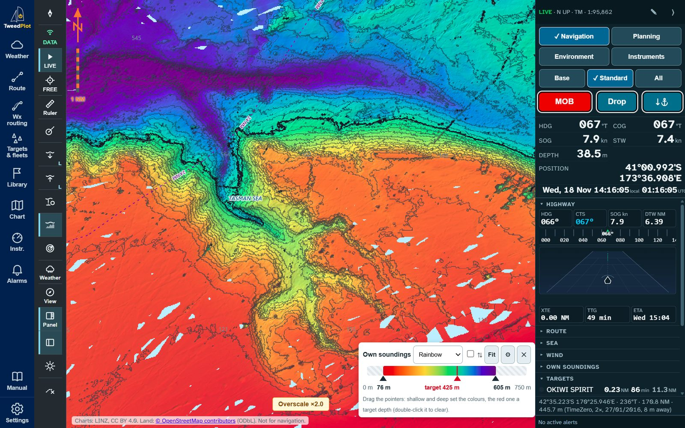

**Boundaries and fishing rules**

Download both in {icon:chart} **Chart › Get data**, then choose what to show in **Chart › Layers**. After a download the rules are prepared and built into the chart; the line under the buttons says when they are ready.

- **Maritime boundaries**: the territorial sea limit (12 NM, dashed purple), the contiguous zone limit (24 NM, dotted), the EEZ limit (200 NM, dash-dot) and the boundaries agreed with Australia, for the mainland and the outlying islands, from LINZ.
- **Fishing rules**: MPI's maps of the commercial fishing regulations, customary areas and voluntary closures. By default only the areas **closed** to commercial fishing are drawn (see below), red with a solid edge. The areas are drawn under the land: some of MPI's areas run inland.
- **Customary areas**: mātaitai (closed to commercial fishing, so drawn as closed), taiāpure and other customary areas, purple when shown as restrictions.
- **Voluntary closures**: areas closed by industry agreement, for the methods in the agreement. MPI says their boundaries are approximate.
- **Fisheries areas**: the fisheries management areas (FMAs) and statistical areas, with their codes, for catch reporting.

**Closed or restricted.** MPI marks each rule, for each fishing method, as a *prohibition* or a *restriction*. A prohibition closes the area to that method; a restriction only limits it (a mesh size, a season, gear limits, species that may not be taken). Restrictions often cover huge areas, many of them the whole EEZ, so TweedPlot draws only the closed areas unless you tick **Restrictions too**:

| Colour | Shown when | Means |
| --- | --- | --- |
| Red, solid edge | Always | Closed to all commercial fishing, or to one of your methods (with All methods, or none set: closed to at least one method) |
| Orange, dashed edge | **Restrictions too** | A restriction: species, mesh, season or gear rules, or a method limited but not prohibited |
| Purple, dashed edge | **Restrictions too** and **Customary areas** | A customary area that isn't closed to commercial fishing (taiāpure, temporary closures) |
| Grey, dashed edge | **Restrictions too** and **Voluntary closures** | A voluntary closure that doesn't apply to your methods |

Seasonal rules are shaded more lightly.

**My methods.** The methods you fish with (bottom trawl, midwater trawl, Danish seine, purse seine, beach seine or drag net, set net, longline, potting, dredge, troll, handline, hand gathering or diving) are the boat's: tick them once in **Settings › Vessel › Fishing**. In Layers, **Fishing closures** then shows **All methods** or **My methods**; with My methods the red areas are only those closed to your methods or to all fishing, and the line under it says which they are ("My methods: bottom trawl, longline · change"). With no methods set, every closure shows. The vessel length comes from **Settings › Vessel**: the trawl rules for vessels over 46 m are left out for a vessel known to be 46 m or shorter.

Click inside a rule area and its rules open in an info window: closed or restricted, the methods prohibited and restricted, the species, the vessels, the season, MPI's category (for example "Trawl prohibitions for vessels over 46m"), the regulation, who is responsible, the legal description and a button that opens the regulation.

**Closed-area alarm.** With **Closed-area alarm** ticked, the main window checks every 15 seconds whether the boat is inside an area closed to your methods (Settings › Vessel › Fishing; any closed area if none are set; restrictions never raise it) and whether it will be within the time you choose at its course and speed over ground (5 to 30 minutes), and raises a warning naming the areas. It works on the downloaded rules: update them before a trip, because temporary closures come and go.

MPI's maps are a guide to the regulations, not the regulations: the legal descriptions and the regulations themselves are the law. Source: Ministry for Primary Industries, CC BY 4.0. Maritime boundaries: sourced from Land Information New Zealand data, Crown Copyright Reserved. Not for navigation.

**Images: raster charts, MBTiles, pictures and satellite images**

Chart › Layers › Images. Pictures placed on the chart: KAP raster charts, GeoTIFF images, MBTiles, your own pictures placed by a world file or calibrated by hand, and Sentinel-2 satellite images. Where the charts are old or the survey is thin, a satellite image shows the reefs, passes and sand bars that matter; with your own soundings on top it is often the best picture of an anchorage you can have.

- **Import…** adds charts and pictures. It asks how, and what to pick:
  - **Copy into TweedPlot's images folder** (`%APPDATA%\nz.tweedsmarine.tweedplot\images`): the file you imported from can then be moved or deleted, and the images stay when a USB stick or drive is taken away.
  - **Use them where they are**: nothing is copied. For charts already installed for another program (OpenCPN and others) or kept on a large drive. They show while that folder can be reached (*not found* in grey while a drive isn't plugged in) and come back when it is; removing them from TweedPlot leaves the files alone. The same file isn't catalogued twice. PNG and JPEG pictures are always copied in.
  - **Files…**, or **A folder, with the folders inside it…** (up to 5,000 image files; hidden folders and the images folder are skipped). A folder brings in its KAP charts, GeoTIFFs and MBTiles, and TIFFs placed by a world file; plain TIFFs without one are counted and skipped (import them on their own to calibrate them). Pick PNG and JPEG pictures as files.
  - **KAP raster charts** (BSB versions 1 to 3, not encrypted).
  - **GeoTIFF images**: 8-bit colour, grey or palette, in longitude and latitude, web mercator, mercator, UTM, NZTM2000 or MGA.
  - **MBTiles**: ready-made map tiles in one file (PNG, JPEG or WebP pictures), such as NOAA's chart MBTiles, OpenSeaMap's offline charts or cruisers' satellite collections. They show at the zooms they were made for and are enlarged past the deepest one. MBTiles holding vector tiles can't be shown. Only import tiles you are allowed to use: many collections copy commercial imagery or charts.
  - **Pictures** (PNG, JPEG, or a TIFF without georeferencing): with a **world file** beside them (*.pgw*, *.jgw*, *.tfw* or *.wld*, the same name as the picture) they are placed at once. A world file doesn't say which coordinate system its numbers are in: a *.prj* or *.aux.xml* file beside it does, and otherwise TweedPlot asks (**Coordinates…**: latitude and longitude, web mercator, NZTM, a UTM zone or another EPSG code). Without a world file a picture waits under **To calibrate** until you calibrate it (below). Pictures up to 144 million pixels (12,000 × 12,000) are taken in; TweedPlot keeps them as tiled TIFFs, quick to draw at any zoom.
- **Satellite image…** finds Sentinel-2 images of the area on the screen: zoom to the area first (up to about 150 km across). Choose the dates and the most cloud you will accept, then **Search**. The scenes are listed with a preview, the date, the cloud cover and how much of the area each covers, best first. The cloud figure is for the scene's whole 110 km tile, so a scene with cloud elsewhere can be clear over your area: look at the preview. **Get** downloads just your area from that scene. **Largest image** sets the size kept: at 4096 pixels, an area up to 40 km across keeps the full 10 m detail; a larger area is kept at 20 m or 40 m so the file stays that size. The images come free from Element 84's Earth Search catalogue on Amazon Web Services; no account is needed. This uses the internet only when you search or download.
- Each image in the list: tick to show it, **⌖** to show the whole image, **⊕** to calibrate it (below), **✕** to remove it (TweedPlot's copy is deleted). Under its name: where it came from, its date, the size of its pixels on the ground, for a KAP chart how well its reference points fit (*fit 0.4 px*: amber over 3 pixels, when the chart may be out of place), and for a calibrated image how well its control points agree (*calibrated, ±3.2 m*). MBTiles show their zooms. The slider sets how solid it is drawn. **Under chart** draws it over the depth shading but under the contours, land, soundings and symbols; **Over chart** draws it over everything except the soundings, your own soundings, marks, tracks and the boat. Your own soundings are always drawn over an image. The image at the top of the list is drawn on top. A KAP chart you import goes in by its scale, above the less detailed charts and below the more detailed ones, so the most detailed chart of a place is on top; satellite images and GeoTIFFs go on top of the list.
- A KAP chart shows only over the zooms its scale suits, as a chart plotter changes charts with the display scale: it fades in once you zoom in to about an eighth of its own detail and fades out past four times its detail, where it would only be stretched. Zoom in or out and the next chart takes over. Hover a chart's name for its zooms. **⌖** zooms in far enough for the chart to show. Satellite images, GeoTIFFs and pictures show at every zoom.
- While any image is shown, with the IHO symbols own ship, its heading line, hull outline and vector get a halo in the background colour (white by day, dark at night), so they stand out on a dark satellite image or chart.
- **▾** folds the list away (**▸** opens it again); the line beside it says how many images there are and how many are shown. TweedPlot remembers whether it is folded.
- **Select** changes several images at once: tick the images (or **All**), then **Show**, **Hide**, **Place…** under or over the chart, drag the opacity slider, or **Remove…** (one question for them all). While selecting, **▲** and **▼** move an image up or down the list (to put a chart above another of the same scale, say), and **Charts by scale** puts all the KAP charts back in scale order. **Done** ends selecting.

**Calibrating an image**

Calibrating places a picture on the chart by **control points**: places you can see on the picture whose position you know. It also corrects a KAP chart, GeoTIFF or world-file picture that sits in the wrong place, as old charts and many Pacific satellite images do by tens or hundreds of metres. Open it with **Calibrate…** under **To calibrate**, or **⊕** on an image in the list. It is mostly for when you are planning, not navigating; alarms and MOB work as usual throughout.

While calibrating, the screen is split: the picture on the left (zoom and pan it on its own), the chart on the right, and the points in the drawer. The data panel steps aside to its line under the chart, with the alerts.

- **Add a point:** click a place on the picture, then the same place on the chart (or the chart first). A click on a library mark takes the mark's exact position; **✎** types a position instead (41 16.234 S, 173 17.040 E…), from a GPS fix or a survey. **+ Point** starts a new point; clicking the same side again before the other moves that end. Drag a numbered point on either side to move it. Orange numbers are on the picture, magenta on the chart; a dashed ring is a point with one end still to place.
- **The fit** works out where the whole picture goes from the points. With **Automatic**: one point shifts a KAP, GeoTIFF or world-file image (a plain picture needs two); two points shift, scale and turn it; three or more fit an affine (which also takes out a scan's stretch and skew). **Second order** (six or more points) bends it to fit too: for a skewed scan or a picture taken at an angle. Use more points than the least, spread over the picture.
- **Error** beside each point is how far the fit puts it from where it was clicked, on the ground; red marks one far out from the others. Untick **Use** to leave it out of the fit (it stays in the list). The figure under the table (*±2.4 m*) is the root mean square of the errors of the points used: how well they agree, not how right the picture is.
- **Show on the chart** draws the picture through the fit as you work, with its own opacity slider.
- **Nudge** moves and turns the whole picture by eye: drag the chart to move it, Shift+drag to turn it, or use the arrows (move 1 to 100 m a press, turn 0.1° to 2°). The usual use: line a satellite image up with your own track where you have sailed. **Reset** takes the nudge off. A nudge applies after the points.
- **Save** uses the calibration. **Leave** (or Esc) goes back to the chart keeping the points to carry on later (**Carry on…**); going back to Navigation (F2, or the return-to-Navigation timer) does the same. **Discard…** drops the changes since the last save. **Remove the calibration…** takes a saved one off: the image goes back to its own position, or a picture back under To calibrate.

Pick points on things that don't move and are sharp on both: rocks, points of land, jetty ends, buildings, road junctions. A calibrated picture is only as good as its points: check it against your GPS, depth and eyes.

A KAP chart is placed from its reference points, with its datum shift applied and cut to its border. A satellite image is placed by the satellite's own positioning, usually within a pixel (10 m). **Images are not surveyed:** an image is only as good as its position, a reef can have grown or moved since it was taken, and depth can't be read from colour. Check every image against your GPS and your depth sounder before relying on it.

Sentinel-2 images: Copernicus Sentinel data, free to use including commercially. TweedPlot shows "Contains modified Copernicus Sentinel data" and the year on the chart while one is visible.

**Online maps**

Chart › Layers › Online maps. **Off by default: while it is off, TweedPlot makes no map requests at all.** Tick **Allow online maps** to use the internet for map tiles, then choose:

- **OpenStreetMap** replaces the bundled land outline with OpenStreetMap's map.
- **OpenSeaMap seamarks** draws volunteer-mapped buoys, lights and marks over the charts. They are not official and not for navigation.
- **Saved tiles only** shows tiles already stored on this computer and sends nothing.

Tiles are saved on this computer (up to 500 MB) and reused. The tile servers see your IP address and the area you view, as with any web map. OpenStreetMap's servers are for light use: under **Tile servers and saved tiles** you can enter another tile server (a URL with `{z}`, `{x}` and `{y}`) and the credit to show for it, and clear the saved tiles.

OpenStreetMap is there for completeness, to look at an area you have no charts for. It is drawn over the depth layers with its sea made transparent, so layers underneath can conflict with it. The **World depths** shading is coarse, so in the water it can show as pale areas and lines that don't follow OpenStreetMap's coastline, which is confusing. Where you have no charts, switch **World depths** (and **Detailed depths (ETOPO)** or **World coastline** if they get in the way) off in **Chart › Layers**. TweedPlot does not switch any of them off for you.

## Your boat

TweedPlot shows your own boat from live instruments, or wherever you put it when planning.

**Signal K**

TweedPlot reads live data (position, heading, speed, wind, depth) from a [Signal K](https://signalk.org) server, normally running on the same PC. Signal K takes NMEA 0183 and NMEA 2000 from your GPS and instruments through a USB adapter or gateway and serves it to any number of apps. TweedPlot connects to `ws://localhost:3000`; to use a server at another address, set the Windows environment variable `RACENAV_SK_URL` to it and restart TweedPlot. The live data button in the toolbar (the strip down the chart's left edge) shows the connection at all times: green {icon:sk} when data is arriving, amber when connected but nothing has arrived for 10 seconds, red with a slash {icon:sk-off} when there is no connection (blinking while it first tries). Hover it for the server address, the time of the last update and what is arriving; click it for **Settings › Connections**.

No instruments? A GPS dongle into Signal K is enough for position, course and speed. With no Signal K at all, TweedPlot works fully in planning mode.

**NMEA 0183 direct**

TweedPlot can also read NMEA 0183 itself, without Signal K: from a COM port (USB adapter or multiplexer), a TCP connection or UDP broadcasts. Add each source in **Settings › Connections › NMEA 0183 inputs**. When NMEA sources are on, they take over from Signal K for your own boat's data. Direct NMEA 2000 connections are not supported; use an NMEA 2000 gateway configured in Signal K.

- **Several sources:** each kind of data (position, motion, heading, speed through water, wind, depth, water temperature, and air pressure, temperature and humidity) can come from a different source. If the chosen one goes quiet for longer than **Source stale after**, the next source that has the data takes over (**Automatic failover**), and an alarm says so. It has no lasting cause to end it, so press **Clear** on it (in the alerts or the Alarms drawer) once you've checked the sources.
- **Two GPS receivers on one input:** when two receivers arrive mixed on the same input (both as `GP`, say, through a multiplexer you can't set up), the position would jump between the two antennas each time one or the other is heard. TweedPlot tells them apart by how each formats its fixes (how many decimals of a minute, whether the time has decimals, the talker), and uses one. The source's row in Settings › Connections then lists them: *GPS A (GP, 5 decimals): DGPS · 7 sats · HDOP 1.1 · 1/s — in use*, the others *ignored*, and how far apart their fixes are. **Position from** chooses: **Automatic** takes the best (RTK, then DGPS, then GPS; then the lower HDOP), keeps it while it is heard, and changes only if it goes quiet for longer than **Source stale after**, or another has been better for 30 seconds (it lost its DGPS, say); an alarm says so. Or choose one receiver: it is used whenever it is heard, the best of the others when it isn't. The choice takes effect at once and is kept. The ignored receiver's VTG (course and speed) is left out too, when its mode letter shows whose it is; a fix whose time goes backwards (another receiver, a second behind, formatted the same way) is always dropped. Receivers that format their fixes identically and use the same talker can't be told apart. Each receiver's antenna position goes in Settings › Vessel › Position and GPS antenna.
- **Heading:** a true heading (HDT, or VHW with a true heading) is used when there is one. Otherwise the magnetic heading (HDG, HDM) is corrected with the variation from the compass or the GPS.
- **Weather station:** barometric pressure, air temperature and relative humidity come from MDA (the meteorological composite many weather sensors and multiplexers send) or XDR. From XDR TweedPlot takes a pressure (`P`, in bars or pascals) between 870 and 1090 hPa, so an engine's oil pressure is not mistaken for the barometer; a temperature (`C`) whose name says air or outside (`Air`, `TempAir`, `ENV_OUTSIDE_T`); and a humidity (`H`). Through Signal K they come from `environment.outside.pressure`, `.temperature` and `.relativeHumidity`.
- **AIS:** AIS sentences from an AIS receiver or transponder on any source (`!AIVDM`) become AIS targets, the same as AIS through Signal K. Your own transponder's reports of your own ship (`!AIVDO`) are not shown as a target.
- **Settings › Diagnostics › Live NMEA data** shows raw sentences with a distinct colour for each input. Filter by input, show receive timestamps, and pause scrolling while data continues to buffer. Bad checksums and malformed sentences are highlighted with their error. With two GPS receivers on one input, each position sentence (and each VTG whose receiver can be told) carries **GPS A**, **GPS B** …, and those from the receiver not in use are struck through and marked **ignored**; a capture keeps the same tags (`[GPS B, ignored]`) at the end of the line. **Pop out** opens the monitor in its own window; **Settings › Connections › NMEA 0183 inputs › Pop out live NMEA data** opens it directly or brings it to the front if already open. **Configure inputs** opens the source settings, where a serial input's COM port and baud rate can be changed.
- **Capture 1 minute and copy** collects the next minute of sentences and copies them, with source names and optional timestamps, ready to paste into a support email. **Capture to file** asks where to save the text log, then records for 10, 30 or 60 minutes, or a custom duration up to 24 hours, writing to the file as it goes (so a long capture uses no extra memory, and what was recorded is kept if TweedPlot closes). Either capture can be cancelled; a cancelled file capture deletes its file.
- **Selected values** shows up to six live values from the source currently selected for each data group. Choose the fields from the drop-downs; the defaults are latitude, longitude, SOG, COG, depth and true heading.

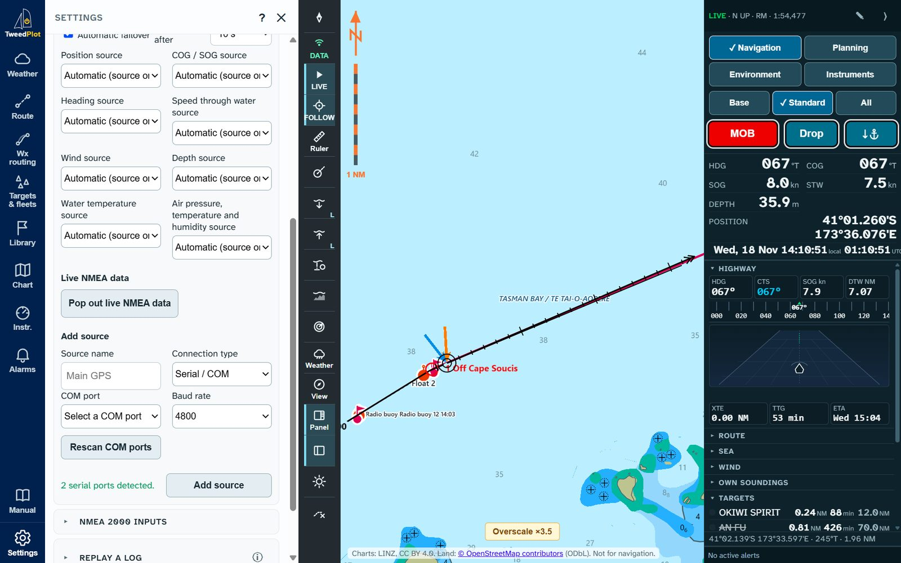

**Replaying a log**

TweedPlot logs every Signal K session, AIS targets included, while it runs. **Settings › Connections › Replay a log** lists the logs by start time, length and size; choose one and press **Replay**. The log then drives the boat, instruments, AIS targets and alarms as if it were live, and the live Signal K data waits until the replay stops. A bar at the top of the chart has pause, speed (1× to 300×), a slider to jump to any time, and **✕** to go back to live data. Tracks are not recorded from a replay. Use it to go over a race, test alarms and settings at the dock, or show someone what happened.

**Live and planning**

| Mode | Button (toolbar) | The boat | Time used by the instruments and routing |
| --- | --- | --- | --- |
| Live | {icon:live} **Live** | Follows Signal K (or NMEA) | Now (GPS time) |
| Planning | {icon:paused} **Paused** | Stays where you put it: right-click › **Move boat here** | The weather slider time |

{icon:follow} **Follow** keeps the boat in the same place on the screen, and the chart moves with it (dragging the chart turns it off). It starts centred. To see more chart ahead, drag the boat towards the opposite side of the screen: with a north-west course, drag it towards the bottom right. The boat then stays where you put it, whatever the course, zoom or rotation, until you drag it again; double-click the boat to centre it. Follow must be on to move the boat this way. Right-click › **Centre chart here** centres the chart on a place once; {icon:clear-track} **Clear track** clears the short trail behind the boat.

**Size and GPS antenna**

In **Settings › Vessel**, set the **Length overall** and **Breadth**, and where the **GPS antenna** is: metres aft of the bow, and metres off the centre line to starboard or port. Signal K gives the antenna's position, not the boat's centre, so on a 20 m boat with the antenna at the stern the bow is 20 m ahead of the position. When the position can come from more than one receiver (several NMEA inputs, or two GPS told apart on one input), each gets its own row there, **Aft of bow** and **Off centreline**: the bow (anchor drop and anchor alarm) and the outline use the antenna of the receiver in use, and follow it when the position changes receiver. A receiver left blank uses the two fields above. Rows for receivers no longer heard stay (marked *not heard now*) until you **Remove** them and save. When you zoom in far enough for the boat to be bigger than its symbol (harbour scales), it is drawn to scale as its outline, pointing along the heading (or the course over ground when there is no heading), with a dot at the antenna. Zoom out again and the symbol comes back.

**Lines and arrows on the boat**

- *Heading line* (solid) and *COG line* (dashed orange): each as long as a set time at the boat's speed, or to the edge of the chart. Set in Chart › Layers › Own ship.
- *Beam bearing line* (dashed, off to begin with): through the boat at right angles to the heading, to the edge of the chart, so you can see what is abeam. Chart › Layers › Own ship.
- *Set and drift vector* (off to begin with): the current the boat is in, from the boat, as long in time as the COG line (10 minutes when that runs to the edge), dashed with a triple arrowhead. Chart › Layers › Own ship. TweedPlot works it out as the boat's movement over the ground (COG, SOG) minus its movement through the water (heading, boat speed), averaged over the last minute; the **Set** (where the current flows to) and **Drift** readings and their history come from the same sum. It needs a heading and a log. Leeway isn't allowed for, so under sail it shows as current; a log that isn't calibrated, or reads nothing below a knot, shows as a false current along the heading.
- *Range rings*: rings round the boat, as many as you choose (1 to 10) and as far apart as you choose, in nautical miles: type 0.25, 1/4, ½ or 1 1/2. Each ring's range is written where it crosses north of the boat, the outermost with "NM". Chart › Layers › Own ship, or right-click the boat › **Range rings round own ship…**. For rings round a mark or a route waypoint, see *Range rings round marks and waypoints*.
- *Wind arrows*: true wind (blue) and apparent wind (orange), each pointing towards the boat from the direction the wind comes from, longer as the wind gets stronger. They use the same colours as the needles on the **Wind** dial, which point in the opposite direction, towards the source of the wind. With live data they sit on the boat. When planning (the Planning view, paused, or no live data) they follow the cursor instead, wherever it is over the forecast, showing the GRIB's true wind there at the weather slider time. Near a shown routing they show that routing's nearest point instead: the true wind it had at that point's time, and the apparent wind you would feel on its heading and boat speed, matching the point's hover box. Away from a routing there is no boat to feel it, so only the true wind is shown. Expect the apparent wind well forward of the true wind whenever the boat is fast for the wind: at 7 kn on a broad reach (TWA 128°) in 9 kn of true wind, the apparent wind is about 77°, forward of the beam. That is why asymmetric spinnakers are trimmed for a beam reach in light air. Hover a routing point for the exact AWA and AWS. Turn them on or off in **Chart › Layers › Own ship**.

**Own ship with the IHO symbols**

With **Chart › Chart display › Symbols** set to one of the IHO sets, own ship is drawn as an ECDIS draws it (IHO S-52 and IEC 62288), in the IHO palette's own-ship colour for the time of day:

- the boat is a double circle (6 and 3 mm across) at its position, and at harbour scales its outline to scale with the GPS antenna marked;
- the heading line is a thin solid line;
- the COG line becomes the course and speed over ground vector: a heavier line, as long as the time set for the COG line, with a short mark at every minute and a longer one every six minutes, and two arrowheads at the end (two: it is ground stabilised). Set to the edge of the chart, it has the six-minute marks and no arrowheads;
- the past track is in the IHO past-track colour, with a mark every ten minutes and the time (hhmm) every half hour.

With the paper-chart symbols, own ship, its lines and the track keep TweedPlot's own look. Range rings, EBL/VRM, the beam bearing line and the overscale indication are there with both.

**Damping**

Wave motion makes heading, speed and wind jump about. Settings › Connections › Damping averages them over a few seconds for the boat, its lines and the instruments. Position is never damped.

**Polars**

A polar is the table of your boat's speed at each true wind angle (TWA) and true wind speed (TWS). Routing, the target speeds and the polar efficiency all come from it, so it is worth getting right. The weather routing tutorial explains what a polar is and why every polar is optimistic; this section is about the files.

*Where TweedPlot looks.* {icon:settings} **Settings › Vessel › Performance › Polar** lists two kinds:

| Kind | Where | Notes |
| --- | --- | --- |
| Yours | The `polars` folder in the data folder | **Import polar…** copies a file here; **Open folder** opens it in Explorer. Anything you put here yourself appears too |
| Shipped | Installed with TweedPlot, marked *(shipped)* in the list | Replaced on every update: don't edit them. Copy one into your folder under the same name to use your version instead |

TweedPlot reads files ending `.pol`, `.csv` or `.txt`, and lists only those it can read. Import checks a file before copying it and says what is wrong if it can't read it.

*The format.* A plain text table, the same as qtVlm, OpenCPN, Expedition's text export and most other routers use:

```text
TWA\TWS	4	6	8	10	12	16	20
40	3.1	4.5	5.5	6.2	6.6	6.9	7.0
52	3.9	5.5	6.5	7.1	7.4	7.6	7.7
90	4.7	6.3	7.2	7.8	8.2	8.8	9.2
120	4.2	5.9	7.0	7.7	8.2	9.0	9.6
150	2.8	4.3	5.5	6.6	7.3	8.2	9.1
180	2.0	3.1	4.1	5.1	6.0	7.3	8.2
```

- **First line**: any label in the first cell (`TWA\TWS` by custom), then the true wind speeds in knots, increasing from left to right.
- **Each further line**: a true wind angle in degrees (0 = head to wind, 180 = dead downwind), then the boat speed in knots at each wind speed. Every line needs one speed per wind speed. The angles can be in any order; the same table serves both tacks.
- **Separators**: semicolons, tabs, commas or spaces. TweedPlot works out which from the first line. Use a full stop for decimals (`6.5`, not `6,5`).
- **Comments**: blank lines and lines starting with `#` are ignored, so you can note the source and date at the top.
- **The file name** is the polar's name in the list.

*Between and beyond the numbers.* Speeds between the table's angles and wind speeds are interpolated in a straight line both ways. Below the lightest wind speed the speed falls in proportion to zero at 0 kn (unless the table has a 0 kn column, as a power polar does). Above the strongest it holds the last column: TweedPlot never extrapolates upwards. Angles inside the first row (inside 40° in the example) are interpolated towards the nearest row; put a row of zeros at 0° (or at the angle the boat stops sailing, about 30° for most yachts) so the routing doesn't think the boat can point higher than it can.

*Where to get one.*

| Source | Notes |
| --- | --- |
| ORC certificate | The best start for most racing yachts. The certificate's speed guide is a VPP polar for that boat as measured; copy its table into a text file. The ORC site has certificates for many boats, including sister ships of yours |
| Designer, builder or class association | Often on request or in the owner's documents. Usually VPP results for a fully crewed boat with new sails |
| Another router | qtVlm, OpenCPN, Expedition, Adrena and the online sailing games ship or share polars for many production boats. Their quality varies: check against what you know of your boat |
| Sailmaker | Will often run a VPP for a customer, especially with a new sail plan |
| Your own logs | The most honest, once you have hours in a range of conditions. Recording tracks builds the data; building a polar from them is planned |

*Making or checking one.*

1. Start from the nearest you can find: your boat's ORC certificate, a sister ship's, or a similar boat's scaled by length.
2. Check the shape. Upwind speeds should peak in 12–16 kn and level off; the best upwind angle is usually 38–45°, the best downwind angle 140–170° depending on the boat and wind. Speeds that keep climbing in 30+ kn are a VPP with no sea in it.
3. Compare with the instruments: sail at a steady angle for a few minutes in steady wind, note TWS, TWA and boat speed, and compare with the table. Do this at several angles and wind speeds over a season.
4. If you are consistently a set fraction below, lower the **Polar efficiency** (Settings › Vessel › Performance) rather than editing the table. Edit the table (in a spreadsheet, saved as CSV, or any text editor) where it is wrong in shape: a sail you don't carry, an angle the boat can't hold.
5. Keep the original. Save your version under a new name (`First40_7_ours.pol`) with a `#` line saying what you changed.

For a power boat, see *Making a power polar* in the Route planning tutorial.

## Targets and fleets

{icon:fleet} **Targets & fleets › AIS** shows ships, aids to navigation, SAR aircraft and AIS distress beacons on the chart, from these sources merged by MMSI:

- **Signal K**: whatever an AIS receiver or transponder on board passes to the Signal K server.
- **Online (aisstream.io)**: what volunteer shore stations hear. Get a free API key by signing in at aisstream.io with a GitHub account, paste it in and press **Go online**.
- **Online (Open Waters)**: a community network of receivers (openwaters.io/ais). Press **Get a token** (free, no account; TweedPlot makes it and fills it in) and then **Go online**. It sends the last known position, name and type of every ship in the area as soon as you connect. It has no class field, so TweedPlot infers it: a ship reporting no status and no rate of turn is shown as class B, and a class B+ ship may show as plain B.

Each online feed has its own section and status light, and you can use either or both. **Online area** (shared by both) is the chart view (up to about 6° across), or a **Range** in NM round the chart centre or round your boat (it follows you); Open Waters limits the area it will send (100 square degrees without a token, 400 with one). Online targets are not for navigation (see the AIS tab): they show in italics, marked "Net", and raise no collision alarm unless **Alarms for internet-only targets too** is ticked. A ship's info window ("Heard by") and the target list's source column say which feed it came from.

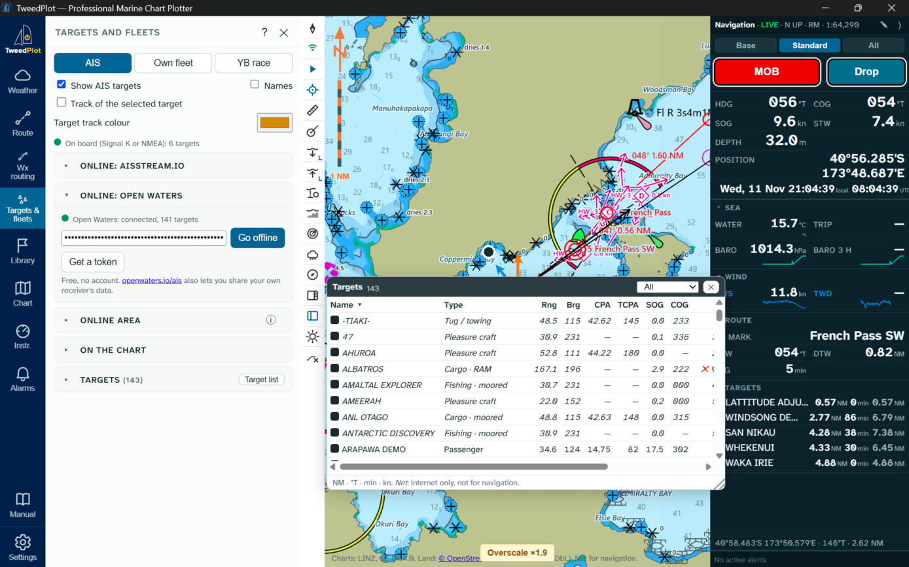

On the chart, every ship is one colour, and a ship inside the CPA and TCPA alarm limits is red. Class and kind are shown by shape and size:

- <span class="mi"><svg viewBox="0 0 20 20"><path d="M10 2 L17 18 L10 15 L3 18 Z" fill="#1d2a33"/></svg></span> Class A: the largest triangle, pointing along the heading
- <span class="mi"><svg viewBox="0 0 20 20"><path d="M10 4 L15.5 17 L10 14.5 L4.5 17 Z" fill="#1d2a33"/></svg></span> Class B+ (SOTDMA or extended class B): medium
- <span class="mi"><svg viewBox="0 0 20 20"><path d="M10 6 L14 16 L10 14 L6 16 Z" fill="#1d2a33"/></svg></span> Class B: the smallest
- <span class="mi"><svg viewBox="0 0 20 20"><path d="M10 4 L15.5 17 L10 14.5 L4.5 17 Z" fill="#1d2a33"/><path d="M3 11 L17 11" stroke="#1d2a33" stroke-width="2"/></svg></span> A fishing vessel (type 30, or "engaged in fishing"): the same, with a bar across, at each size
- <span class="mi"><svg viewBox="0 0 20 20"><circle cx="10" cy="10" r="4" fill="#1d2a33"/></svg></span> A dot: stopped, or sending no heading
- <span class="mi"><svg viewBox="0 0 20 20"><circle cx="10" cy="10" r="3.5" fill="none" stroke="#1d2a33" stroke-width="1.6"/></svg></span> A small ring: a sleeping target (below)
- A thin **heading line** from the ship, with a short barb at its end on the side the ship is turning to when it turns at 3° to 10° a minute, and a long barb at 10° a minute or more, including a ship whose AIS reports only "turning fast" (the **rate of turn**, also in the ship's details). The line is only drawn when it adds something: not while the ship has a course vector (it would say the same thing), and not when the ship is making way astern (a double-ended ferry), where the heading and the course point opposite ways
- With **Curve course vectors by rate of turn** ticked (on by default), the course vector of a ship turning at 3° a minute or more bends into an arc, as if it held that turn
- An own-fleet ship has the V at its stern filled in, giving a flat back, in the colour you chose for its group. The ship you clicked has thin corner brackets round it

Other AIS targets:

- <span class="mi"><svg viewBox="0 0 20 20"><path d='M10 3 L17 10 L10 17 L3 10 Z' fill='none' stroke='#6a1b9a' stroke-width='2'/></svg></span> Aid to navigation (AtoN): a buoy or beacon with its own AIS
- <span class="mi"><svg viewBox="0 0 20 20"><path d='M10 3 L17 10 L10 17 L3 10 Z' fill='none' stroke='#c2185b' stroke-width='2'/></svg></span> Virtual aid to navigation: only a broadcast, nothing is physically there
- <span class="mi"><svg viewBox="0 0 20 20"><circle cx='10' cy='10' r='7' fill='none' stroke='#d00000' stroke-width='2'/><path d='M5 5 L15 15 M15 5 L5 15' stroke='#d00000' stroke-width='2'/></svg></span> AIS-SART, MOB device or EPIRB (always raises an alarm)
- <span class="mi"><svg viewBox="0 0 20 20"><rect x='4' y='4' width='12' height='12' fill='none' stroke='#5d6d7e' stroke-width='2'/></svg></span> AIS base station
- <span class="mi"><svg viewBox="0 0 20 20"><path d='M10 2 L11 8 L17 11 L17 13 L11 11 L11 15 L13 17 L7 17 L9 15 L9 11 L3 13 L3 11 L9 8 Z' fill='#e67e22'/></svg></span> Search and rescue aircraft

**Sleeping targets.** A busy harbour fills the chart with ships that are tied up or far away. **Targets & fleets › AIS › Sleeping targets** chooses how those are drawn: **Show all as active**, **Small, no vectors** (the small ring) or **Hide**. A target is asleep when it is slower than **Asleep when slower than** (kn), or further away than **Asleep when further than** (NM; 0 for no limit). Dangerous targets, the one you have selected and own-fleet boats are never asleep.

**Not heard: crossed through.** A target that hasn't been heard for a while is drawn crossed through {img:ais-lostx} at its last known position, with no course vector, as radar and ECDIS displays show a lost target (IEC 62288). "A while" is six of the target's reporting intervals (ITU-R M.1371), as shipborne radars and ECDIS count it: a class A ship is lost after 60 seconds up to 14 kn, 36 seconds at 14–23 kn, 12 seconds over 23 kn, and 18 minutes at anchor or moored; a class B (carrier-sense) after 3 minutes when moving faster than 2 kn and 18 minutes slower; a class B+ (SOTDMA) after 3 minutes, 90 seconds over 14 kn and 30 seconds over 23 kn; an AtoN after 18 minutes; a SART, MOB or EPIRB after 6 minutes. Targets heard only over the internet arrive less often, so they are lost after 3 minutes moving and 10 minutes stopped (20 for an AtoN or base station). Targets go after 20 minutes. In the target list its age shows in red with a ✕.

**Navigational status.** With **Day shapes for navigational status** ticked in Targets & fleets › AIS (off by default: crews set the status by hand and often don't change it, so don't trust it), a small white tag beside a ship shows the day shape it would show for the status it sends, so it reads as it would on the water (from zoom 8 in):

| Tag | Status | Tag | Status |
| --- | --- | --- | --- |
| {img:ais-st-ball} | At anchor (one ball) | {img:ais-st-nuc} | Not under command (two balls) |
| {img:ais-st-ram} | Restricted in her ability to manoeuvre (ball, diamond, ball): dredging, diving, survey, cable laying | {img:ais-st-cbd} | Constrained by her draught (cylinder) |
| {img:ais-st-aground} | Aground (three balls) | {img:ais-st-fishing} | Engaged in fishing (two cones, points together) |
| {img:ais-st-tow} | Towing or pushing (diamond) | {img:ais-st-moored} | Moored (a bollard: there is no day shape for it) |

Under way using engine or sailing has no tag. The status is set by hand on the ship and is often wrong: trawlers at sea still "at anchor", ships at anchor "under way" (see the AIS tab).

A line ahead of a moving ship shows where it will be in 6 minutes (**Course vectors** sets the time). Click a target and its info window shows its name, type, status, speed and course, size, destination, and the range, bearing, CPA and TCPA from your boat, with **Add to own fleet** and track buttons. The window keeps updating while it is open, and the target has brackets round it while selected.

**CPA lines** draw, for dangerous targets and the one you clicked (or every target closing within the time limit), dashed lines from your boat and the target to where each will be at the closest point of approach, joined by the CPA line with its distance and time: red inside the alarm limits, amber outside.

**Target list**: {icon:targets} **Target list** in the toolbar, **Target list** in Targets & fleets › AIS, or **T** opens a list over the chart with name, type (with the status, such as "Fishing · anchored" or "Cargo · RAM"), range, bearing, CPA, TCPA, speed, course, the age of the last position (✕ in red when not heard for a while) and the source. Click a heading to sort (again to reverse); distress beacons and dangerous targets always come first. The filter shows all targets, vessels only, those under way, those closing, or only dangerous ones. Click a row to centre the chart on the target and open its details. Drag the list by its title bar and resize it from the corner; it stays where you leave it. The list under the settings in the drawer sorts by range, CPA or name.

**Alarms**: the collision alarm (CPA and TCPA limits, anchored and moored ships ignored or not, internet-only targets) and the distress beacon alarm are set in {icon:alarms} **Alarms › Targets (AIS)**. Chart visibility, fleet-only and target-list display filters do not exclude received targets from collision checks. If an alarming target is hidden by the primary window's display settings, its alarm says so; click the alarm in the primary window for its details. Internet-only targets remain excluded unless their alarm option is enabled. An AIS-SART, MOB device or EPIRB always raises an alarm, with its bearing and distance.

- **While it is heard** the alarm stays: **Silence** stops the sound, and the watchdog sounds it again after the watchdog time (Alarms › Sound) for as long as it is heard. It can't be cleared while it is heard: someone may be in the water.
- **Not heard for 6 minutes** (these transmitters send every minute): the alarm becomes an amber warning, "not heard for n min", with the last position. It no longer sounds, and **Clear** removes it. The target stays on the chart, crossed out, until it hasn't been heard for 20 minutes. If it is heard again, the alarm comes back and sounds, even after Clear.
- **Active or test?** An active transmitter sends navigational status 14 and the safety message "SART ACTIVE" (or "MOB ACTIVE", "EPIRB ACTIVE"); one being tested sends status 15 and "… TEST". TweedPlot reads both (the safety message is AIS message 14), and the target's card shows **Mode** (ACTIVE, TEST, or not known), the **Navigational status** and the **Safety message**. A test transmission is an amber caution, not an alarm, with **Clear**. If neither has been received yet, it is treated as active.
- **Heard over the internet only** (online AIS, not your own receiver): an amber warning with how old it is, not a distress alarm, and it can be cleared. Internet AIS can be minutes late and is not for navigation; your own receiver hearing it raises the full alarm.

**To scale**: at harbour scales, a ship that has sent its size is drawn as its outline at its real size, placed by its GPS antenna (the A, B, C and D distances in its AIS data) and pointing along its heading (or its course when it has no heading and is moving). Click the outline for its details as you would the symbol. Ships whose size or heading isn't known keep their symbol.

**Your own boat**: put your MMSI in **Settings › Vessel** and your boat is never shown or alarmed as a target, whichever source hears it.

**Tracks**: tick **Track** against a target in the target list (or press **Track** in its info window, or tick **Track of the selected target**) and it shows where it has been, with a dot on the ship. Tracks are what TweedPlot has heard over the last 6 hours, so they start when the app does. **Target track colour** sets the colour of the trails (own-fleet boats use their group colour).

**Tracking, own fleet and groups are set from the target list.** Each row has a **Track** tick and a group menu (No group, Friends, Company, Race fleet, Other). Choosing a group puts the target in your own fleet; tracking a target does not.

**Own fleet** (Targets & fleets › Own fleet): a list of boats to pick out, such as friends, your company's vessels or a race fleet. Add an MMSI with a name and a group, set a group from the target list or the info window, or click a boat on the chart and press **Add to own fleet**. Own-fleet boats have a filled stern in their group's colour and are named at every zoom; each has a **Track** tick, **Track all** draws them all, and **Only these on the chart** hides other AIS targets on the chart and in target lists, but does not exclude them from collision alarms. The list shows each boat's speed, distance and how long since it was heard; click one to show it.

**YB race tracking**

In **Targets & fleets › YB race**, type the race's YB name (as in `yb.tl/<race>`, for example `ggr2026`) and **Open**. TweedPlot downloads the race setup, every boat's published track, then the latest positions every 5 minutes to 3 hours.

- Boats show at their latest fix, or where they were at the weather slider time, so you can replay a race against the forecast.
- ★ follows a boat (thicker track, name kept first when names would overlap). Choose a class, tracks for all or followed boats, names, and the YB course.
- The Fleet table in the dock ranks boats by distance to finish, with speed and course made good and distance in the last 24 hours.
- **Copy course** puts the YB course in the Route drawer; **Route** on a boat starts a routing from its last fix and time: what would the router have them do now?

Positions may be delayed by the race organiser.

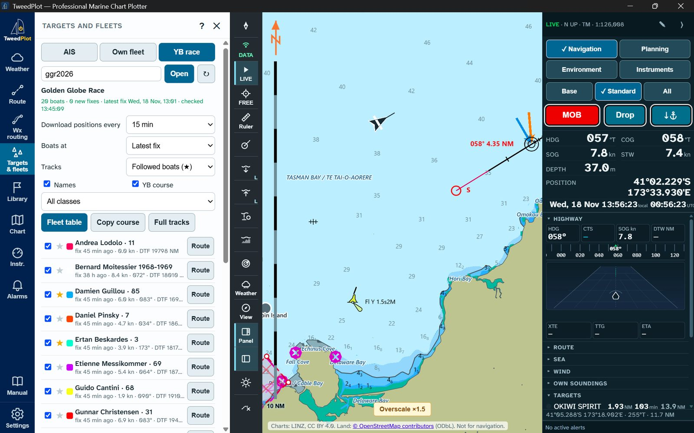

## Routes

A **route** is a start and an ordered list of marks. A **mark** is a named position kept in the library. Marks are shared: move a mark once and every route using it follows.

**The Route drawer**

{icon:course} **Route** keeps sailing a route apart from planning one, as an ECDIS keeps route monitoring apart from route planning:

- **Navigate**, at the top: **Start navigating** makes the route the one being navigated. Only then does it appear in the Navigation and Instruments views' Route readings, Marks ahead and Highway, and only then do *Off track* and *Approaching the next mark* watch it. A route that is only being planned shows "Not navigating" and feeds those readings in Planning and Environment alone. **◀ ▶** choose the mark being steered to; with live data it moves on by itself when you reach a mark. **Stop navigating** ends it. The navigated route is kept as its own copy, so you can open or plan another route while it carries on: it is then drawn heavier in magenta with its marks numbered, the route in the editor turns orange, and Navigate names the navigated route. **Navigate the route below instead** changes over to the route in the editor. **A route can't be changed while it is being navigated**: while it is in the editor, Set start, From boat, Add marks, Undo, the name and the mark list are greyed out, and its marks can't be dragged on the chart. Press **Stop navigating**, change it, then **Start navigating** again. When another route is in the editor, **Stop and edit** stops navigating the navigated route and puts it in the editor (it asks first, and says if the route there has unsaved changes).
- **Plan**, below: the route being built or changed.

**Building a route**

1. **Set start**, then click the chart (or click a library mark to start at it). **From boat** starts at the boat, departing now.
2. **Add marks**, then click the chart for each mark in order, or click library marks to reuse them. Press Esc or **Add marks** again to stop.
3. Under each mark choose how it is to be reached (below) and, if you like, a radius.
4. Name the route and **Save**. New marks are saved to the library under the route's name.

**Departure** and **Planning speed**, under the start buttons, are the route's one departure time: **Now**, or **Set a time** for a passage that starts later (in two days, say, while you still have a day to run on the route being navigated). **Weather on route** and weather routing both use it. With **From boat** the departure is now and can't be set; a set time more than an hour past is flagged.

**New** clears the drawer for another route (a saved route stays in the library). **Undo** takes off the last mark added. **Draw legs as great circles** draws each leg as the shortest path over the globe instead of a straight (rhumb) line, which matters on ocean legs. **Weather on route** opens the forecast along the route (see Weather and tides).

The list shows each leg's distance. **↑ ↓** reorder marks; **✕** takes a mark off the route (it stays in the library). Click a mark on the chart to select it; wait for the green ring to drag it, or right-click to move or remove it.

**How each mark is reached**

| Choice | Meaning for routing | On the chart |
| --- | --- | --- |
| Pass through | Reach the mark's arrival circle: its own radius if typed, else the routing's arrival radius. For waypoints and turning points | A grey dashed ring if it has its own radius |
| Leave to port | Pass with the mark on your left, at least the radius off. The routing may not cut through the mark's circle on the way in or out | Red ring |
| Leave to starboard | The same, mark on your right | Green ring |
| As close as possible | Reach within 0.01 NM (about 20 m): a fishing spot, a mooring, a fuel berth, an anchorage. The mark may be in water shallower than the safety depth: if land, shallow water or a barrier stop the routing getting that close, the nearest water it can reach within 0.5 NM counts as arriving, and the routing says how close it got | Black ring |

Rounding works like the string rule in the racing rules: a string following the route from the previous mark to the next must go round the mark on the side asked. When the course turns towards that side (the mark is inside the turn: a windward mark, a turning mark you go out to and come back from, an island you sail round), the routing goes right round it. When the course turns away from that side, passing it on the correct side is enough. The rounding leg ends a little way out from the mark heading for the next one (about a mile, or half the distance to the next mark), so the route never runs up a blind inlet just to touch the line to the next mark. The routing really goes round, so if the way between the mark and the shore is closed by land, water shallower than the safety depth or a barrier, it stops and says there is no way round on that side, rather than touching the mark and turning back. Then check the rounding side in the sailing instructions, and only lower the safety depth if the water is really safe.

A mark in the middle of an island (as in "leave Little Barrier to starboard") is fine: give it a clearance (radius) that keeps the route off the shore by as much as you want, and the routing rounds the island.

Use the rounding sides for race marks and headlands you must keep off; use a generous radius for marks you only need to pass near (an offshore waypoint) so the routing is not forced through a single point.

**Range rings round marks and waypoints**

Right-click a library mark or a route waypoint › **Range rings round …** and choose how many rings (1 to 10) and how far apart, in nautical miles: 0.1, 1/8, 1/4, ½, 1 1/2, 2… (type it, or pick one from the list). The rings show as you change them; **Add rings** (or **Done**) closes the box, **Remove rings** takes them off. A library mark keeps its rings in the library, so they are there in every route that uses it and after a restart, and move with the mark; a waypoint you haven't saved yet keeps them until the route is saved, when they go into the library with the new mark. The range of each ring is written where it crosses north of the mark. Rings are drawn in the IHO colour for mariner's notes (orange) with the IHO symbols, and orange with the paper ones. Own ship's rings are set in Chart › Layers › Own ship.

**The route with the IHO symbols**

With **Chart › Chart display › Symbols** set to one of the IHO sets, the route being sailed is drawn as an ECDIS draws a planned route (IHO S-52): solid lines in the IHO route colour (red by day), the leg being sailed heavier; each waypoint a circle with its number and name, the next waypoint (the one the instruments steer to) a double circle; and beside each leg its course (°T, rhumb line; a great-circle leg its starting course) and distance. With the paper-chart symbols the route keeps TweedPlot's numbered marks and dashed legs.

**Go to, laylines and the tacking cone**

- **Go to here** (right-click a mark or any point, "Go to *mark name*" on a mark) makes that point what you are navigating to, in place of the route: the leg runs from where the boat was when you set it, and the data panel (Route readings, Marks ahead with →, the highway), the instruments, the laylines and the arrival and off-track alarms all work to it. **GO TO** shows in the data panel's status line while it is set. The route keeps its place meanwhile; **Cancel go to** (right-click) returns to the route's next mark.
- **Laylines** run from the target at the best upwind (or downwind) true wind angles of your polar at the current true wind speed, or without a polar at the tacking and gybing angles in Settings › Vessel › Laylines (120° tacking to begin with). The wind is live from your instruments, else the GRIB at the weather slider time. Only the pair that applies is drawn: upwind if you are downwind of the mark, else downwind.
- The **tacking cone** (off by default; turn it on from the right-click menu, Chart › Layers › My things or Settings › Vessel › Laylines) is a wedge from the mark toward the boat: tack at its edge, so tacks are long far out and short near the mark. It suits cruising; when racing with laylines on it isn't needed. Laylines and the cone switch on and off separately.
- Laylines and the tacking cone are not drawn in the Fishing use; a Go to is.

## The library

Everything you make and keep is in the **library**: marks, routes, tracks, trips, the catch log, saved weather routings and barriers.

**The Library drawer.** {icon:library} **Library** opens on its tabs: **Marks**, **Routes**, **Tracks**, **Trips**, **Catch log** (shots, hauls and catch), **Wx routings** (saved weather routings) and **Barriers**. Under them, each tab has a **Find** box, the order, and **Filters**. With Filters closed, only the filters in use show, each with **✕** to clear it, so it's always clear why something isn't listed; open, every filter shows: the tab's own (group, type, tag…) and the **Whole library** ones (saved filters, dates, months, trip, in chart view), which apply to every tab and to the chart. The drawer's header shows the library in use and opens the **Library menu** (below).

**From the chart.** Double-click a library mark, a barrier (its line, edge or a point), a track or the route on the chart to open it in the Library: its tab, its row (flashed; the search and filters are cleared if they hid it) and, for marks and tracks, its editor. Right-click it for **Edit in the library**, which does the same. A route not saved yet opens in the Route drawer.

**The tabs.** All times are shown on the 24-hour clock. Each tab has the same list:

- **Find**: by name (marks also by group, notes and tags; tracks also by date).
- **Order**: by name, newest or oldest first, and others to suit (marks: deepest first, nearest the boat, nearest the chart centre; routes and tracks: longest first). With **Nearest the boat** each mark's line starts with its range and bearing from the boat.
- **Whole library** filters, in the band above the tabs, apply to every tab and to the chart at once: **Dates**, **Months**, **Trip** and **In chart view**. Set Dates to a week and every tab lists only what was made (or ran) that week, the chart shows only those marks, and the tracks that match are drawn (up to 200; past that, only those you show yourself). What counts as when: a mark, when it was made (marks whose date is unknown, moved in from another plotter in one go, are left out); a track or trip, any time it ran; a routing, when computed. Routes and barriers aren't filtered by date (In chart view still applies to routes).
- **Each tab's own filters**, as buttons under its search: each opens its choices, with how many each has; a filter in use is highlighted and has ✕ to clear it; **Clear filters** clears the tab's own.
  - Marks: Group, Type, Tag, TimeZero symbol, **Near the boat** (within 0.5, 1, 2, 5, 10, 20 or 50 NM; with Nearest the boat or this filter the list follows the boat, re-sorted every 15 seconds while it moves), Routes (in a saved route or not), **Duplicates** (marks that repeat another: the same name within 30 m, or unnamed within 5 m; the oldest of each is left out, so Select these then Delete keeps one of each), Date unknown.
  - Tracks: From (logged here, GPX, TimeZero), Sea temperature, Depth (logged along it), On the chart.
  - Routes: From a file. Barriers: Kind, Not used, Imported.
  - When a route has been brought in more than once (the same name and the same marks in the same order), **Remove duplicates** shows in the Routes tab: it keeps the oldest copy of each.
- **★ Saved**, the first button of Whole library, keeps every filter set now (the Whole library ones and each tab's own) under a name, such as Tuna season or Last trip, and brings them all back in one press. The button shows the name while those filters are in use; ✕ beside one in its list forgets it. Saved filters are the same in every library.
- **Months** picks months of the year, any year: Nov, Dec and Jan shows only what was made in the tuna season, whatever the year.
- **Select**: tick rows one by one, or **Select all** (or **Select these**, all the filters list). In Marks, **Select on chart** then drag a box on the chart lists just the marks inside it, all ticked (the **In the drawn box** filter; untick it to see the rest again). Esc stops. A bar then shows how many and what can be done with them:
  - Marks: **GPX** (one file), **Library file…** (a library of their own, to give another boat or keep apart; the library in use is unchanged), **Group…** (move them to a group: type a new one or pick), **Type…**, **Colour…**, **Route** (a route of them, in the order listed, opened in the Route drawer), **Delete** (marks in saved routes are taken out of them).
  - Tracks: **Show**, **Hide**, **GPX**, **Library file…**, **Colour…**, **Delete**.
  - Routes: **GPX**, **Library file…** (with their marks), **Delete** (their marks stay). Routings: Delete. Barriers: Use, Don't use, Delete.
  Delete asks first, with the number.
- The list is drawn as it scrolls, so tens of thousands of marks or tracks scroll smoothly.

Marks: click a row to go to the mark; **+ Route** adds it to the route being built; **Edit** opens the mark editor above the list, which also shows when it was made and the depth, sea temperature and speed then, and has **Route start** and **Delete**. **Chart shows only the marks listed** draws just the marks the search and filters list (else every mark), handy with Months or a group; **Marks on chart**, at the top of the drawer, shows or hides them all. Tracks: the round swatch at the left of a row shows or hides the track on the chart; click the row to zoom to it.

**Marks**

**Adding a mark.** Press **+ Add mark** at the top of Library › Marks (or right-click the chart › **New library mark here**). The mark editor opens above the list as **New mark**, at the boat's position (or the middle of the chart when there is no boat, or where you right-clicked). Type the name and the position (36 50.12 S, -36.8353 and similar all work), or set the position with **Position from**: **Boat**, **Chart centre**, or **Pick on chart** (then click the chart where the mark goes; click it again to move it). A blue ring on the chart shows where the mark will go as you type. **Add mark** saves it; **Cancel** leaves nothing behind. The type and group you used last are filled in for the next one, and the group box offers the groups you already have. The same position buttons are there when you edit a mark.

**Mark types and points of interest.** In the mark editor choose a type: racing mark, waypoint, start or finish line end, danger, an IALA A buoy (port, starboard, cardinals, isolated danger, safe water, special), or a point of interest: good anchorage, mooring, shelter, fishing spot, diving spot, foul ground, wreck, hazard, landing point, camping spot, hut, viewpoint, water filling, fuel, provisions, note. Each draws with its own symbol, and the **Type** list shows each symbol in front of its name. Any of them can be a course mark. On the chart, the course itself shows the start {img:mk:S} and the marks numbered in order {img:mk:1} {img:mk:2}.

| Symbol | Type | Symbol | Type |
| --- | --- | --- | --- |
| {img:s57:b|2|3||} | Port lateral (red can) | {img:s57:b|1|4||} | Starboard lateral (green cone) |
| {img:s57:b|4|2,6|1|n} {img:s57:b|4|2,6,2|1|e} {img:s57:b|4|6,2|1|s} {img:s57:b|4|6,2,6|1|w} | North, east, south and west cardinals | {img:s57:b|4|2,3,2|1|isd} {img:s57:b|3|3,1|2|saw} {img:s57:b|4|6||spp} | Isolated danger, safe water, special |
| {img:poi:anchorage} | Good anchorage | {img:poi:mooring} | Mooring |
| {img:poi:shelter} | Shelter | {img:poi:fishing} | Fishing spot |
| {img:poi:diving} | Diving spot | {img:poi:foul} | Foul ground |
| {img:poi:wreck} | Wreck | {img:poi:hazard} | Hazard |
| {img:poi:landing} | Landing point | {img:poi:camping} | Camping spot |
| {img:poi:hut} | Hut or building | {img:poi:viewpoint} | Viewpoint |
| {img:poi:water} | Water filling | {img:poi:fuel} | Fuel |
| {img:poi:provisions} | Provisions or shop | {img:poi:info} | Note |

**Symbols for your own marks**, drawn in the mark's own colour (a TimeZero mark keeps its red, blue and so on), or when it has none in red (shapes), black (seabed and dangers), teal (fish), orange (fishing gear) or blue (signs):

| Symbol | Type | Symbol | Type |
| --- | --- | --- | --- |
| {img:sym:sym-circle:} {img:sym:sym-circle-f:} | Circle, filled circle | {img:sym:sym-square:} {img:sym:sym-square-f:} | Square, filled square |
| {img:sym:sym-diamond:} {img:sym:sym-diamond-f:} | Diamond, filled diamond | {img:sym:sym-tri-up:} {img:sym:sym-tri-up-f:} | Triangle up, filled |
| {img:sym:sym-tri-down:} {img:sym:sym-tri-down-f:} | Triangle down, filled | {img:sym:sym-cross:} {img:sym:sym-x:} | Cross, X |
| {img:sym:sym-star:} {img:sym:sym-flag:} {img:sym:sym-dot:} | Star, flag, dot | {img:sym:sym-excl:} {img:sym:sym-asterisk:} | Exclamation mark, asterisk |
| | | {img:sym:sym-rock:} | Rock |
| {img:sym:sym-wreck:} | Wreck | {img:sym:sym-snag:} | Obstruction or snag (a hang) |
| {img:sym:sym-pot:} | Pot or trap (fishing gear) | {img:sym:sym-fish:} {img:sym:sym-school:} | Fish, school of fish |
| {img:sym:sym-tuna:} | Tuna | {img:sym:sym-swordfish:} | Swordfish |
| {img:sym:sym-shark:} | Shark | {img:sym:sym-skate:} | Skate or ray |
| {img:sym:sym-crayfish:} | Crayfish | {img:sym:sym-albacore:} | Albacore |
| {img:sym:sym-ling:} | Ling | {img:sym:sym-hoki:} | Hoki |
| {img:sym:sym-squid:} | Squid | {img:sym:sym-trawl:} | Trawl |
| {img:sym:sym-fish-1:} {img:sym:sym-fish-2:} {img:sym:sym-fish-3:} | Fish, rated one to three stars | {img:sym:sym-lost-gear:} | Lost gear |
| {img:sym:sym-other-gear:} | Another boat's gear | {img:sym:sym-bait:} | Bait school (signs) |
| {img:sym:sym-birds:} | Birds working (signs) | {img:sym:sym-break:} | Temperature break or current line (signs) |
| {img:sym:sym-fad:} | FAD or log (signs) | {img:sym:sym-protected:} | Protected species interaction (signs) |
| {img:sym:sym-ledge:} | Ledge or drop-off | {img:sym:sym-pinnacle:} | Pinnacle |
| {img:sym:sym-reef:} | Reef | {img:sym:sym-weed:} | Weed or kelp |
| {img:sym:sym-longline:} | Longline | {img:sym:sym-hook:} | Hook |
| {img:sym:sym-float:} | Float | {img:sym:sym-float-flag:} | Float with a flag |

Every type list (the mark editor, Type… for selected marks, and TimeZero symbols) shows each type with its picture. A mark whose name says rock or wreck comes in with the rock or wreck symbol.

Racing marks, waypoints, line ends and dangers show as coloured dots with their names. Groups (e.g. "RNZYS 2026", "Fishing spots") keep the library tidy.

**Groups.** Library › Marks › **Groups…** lists every group (TimeZero's layers come in as groups) with how many marks it has. Untick one to hide its marks on the chart. **Lock** keeps a group's marks from being deleted or moved by accident: on the chart, by Delete, or by Group… to another group; **Unlock** lets them be again. **List** filters the list to the group.

**TimeZero symbols.** Library › Marks › **Groups…** › **TimeZero symbols** lists the symbol numbers your marks use, with how many marks and their colours. **Show** draws only the marks with that symbol (list and chart) so you can see what you used it for; then pick its type from the list. Every mark with that symbol takes the type (marks you've changed yourself, and foul ground or wrecks found from their names, keep theirs), and so do marks imported later. There is one table of symbol meanings for all your libraries: a new library, or one you open, takes the same meanings (its marks change type to match), and setting a symbol in any library sets it for all.

**Tracks**

Library › Tracks › **Record** logs the boat's track from the live data while TweedPlot runs, even while plotting is paused. It keeps a fix every 10 s while moving, sooner in a tack or gybe, and is saved every 30 s and when the app closes. **New log** finishes one track and starts another. Tracks can be shown, renamed, coloured, exported as GPX, and imported from GPX (from a plotter, Navionics, qtVlm and so on). The Tracks tab finds, filters (months, dates, where from, what was logged) and selects tracks like every Library tab (see The library); an imported file's tracks are named after the file, so searching for its name finds them all. **Colour by** colours the shown tracks by **Sea temperature**, **Depth**, **Depth (own soundings colours)** (the colours and depth range set in Chart › Get data › Own soundings, to compare with them) or **Speed (SOG)** instead of their own colours, with a scale on the chart (drag the scale wherever it's out of the way; double-click puts it back). **Line width** sets how thick all tracks are drawn.

**Effort map** (Library › Tracks) shows where the boat spent its time, from all the tracks listed (the tab's search and filters, and the Whole library ones: Months Nov–Jan for the tuna season, a trip, a year), as a heat map: red is where most time was spent. Only time at speeds in the band counts (0.5 to 5 kn to start with: towing or working, not steaming; set it to suit the gear). Each fix counts the time to the next (gaps over five minutes don't count). **Detail** sets the grid: about 2 km, 1 km or 500 m. It's made when **Show the effort map** is pressed (thousands of tracks take a few seconds, with a card and Cancel); change the filters and press it again to update it. **Hide it** takes it off the chart. The filter under it works as the GRIB sea layers' (Weather drawer): drag the outer pointers to set the lowest and highest coloured, and the middle one to a target, drawn bold on the track (for example the temperature the fish were on); **Fit** goes back to the shown tracks' whole range. Parts of a track outside the band are drawn thin and grey, and so are parts with nothing logged. Depth and sea temperature come with TimeZero tracks and are logged by TweedPlot's own recorder from Signal K (`environment.depth.belowSurface`, else `belowTransducer`, and `environment.water.temperature`). Click a track for the time, speed, course, depth and sea temperature at that point; tick **Boat at weather time** to see where the boat was at the slider time, which is useful for comparing a race track with the forecast.

**Trips.** Library › **Trips**. A trip holds what was made while it lasted: the marks made between its start and end, and the tracks that ran in that time. Nothing has to be put into a trip by hand.

- **Start a trip** (the large button) when you leave: the number goes up by one from the last trip, the fishery and crew are the last trip's (change them if need be), and **Record the track** starts the track recorder with a new track. **Start the trip** saves it.
- While a trip is on, the tab shows it at the top: its name, how long it has been out, the distance and marks so far, and the large **End the trip** button (**Stop recording the track** stops the recorder too). Ended by mistake? **Edit** and clear **Ended**.
- **Add a past trip…** gives a trip already made its dates; the marks and tracks made then (imported from TimeZero, say) fall into it. Marks whose date is unknown are never in a trip.
- Each trip in the list shows its dates, time out, distance, and the marks and tracks made. **Show** sets the Whole library **Trip** filter to it (every tab and the chart show just that trip, and its tracks are drawn) and moves the chart to it; the filter's ✕ shows everything again. **Edit** changes the name, number, fishery, crew, times and notes.
- Select trips for **Library file…** (their marks and tracks as a library of their own) or **Delete** (the trips only: their marks and tracks stay; the Trash brings a trip back).
- Only one trip can be on at a time.

**Barriers**

Barriers are places routings must keep out of, beyond what the chart already avoids: a marine reserve, a race exclusion zone from the sailing instructions, a shipping lane, a bar you won't cross, or a rough headland you'd rather stay off.

- **Lines** (Library › Barriers › **Draw line**): fences the routing may not cross. Click points, double-click to finish.
- **Zones** (**Draw zone**): areas the routing may not enter. Click the corners, double-click to finish.
- **Barrier marks**: give any mark a **Barrier radius** in the mark editor and routings keep that far off it (a red dashed circle), unless the mark is on the course.

**Hatch zones** (beside **Show**, on to begin with) fills every zone, clearing bearing and barrier mark's circle with a red cross hatch. Zoomed in until a zone's edges are off the screen, the hatch is what tells you the chart view is inside one. A barrier that isn't in use has a fainter hatch. Untick it for a plain tint.

Untick a barrier to keep it but not use it; rename it in the list; move its points like marks; right-click it to delete a point, delete it, or switch it off. Wx routing › Run › Limits and barriers › **Keep off barriers** turns them all on or off for routings.
- **Clearing bearings** (**Clearing bearing**): click the mark, then a point out to sea along the bearing; the danger side is where you click third. It is labelled "Clearing bearing xxx°T xxx°M" and, as a barrier, the router avoids its danger side.

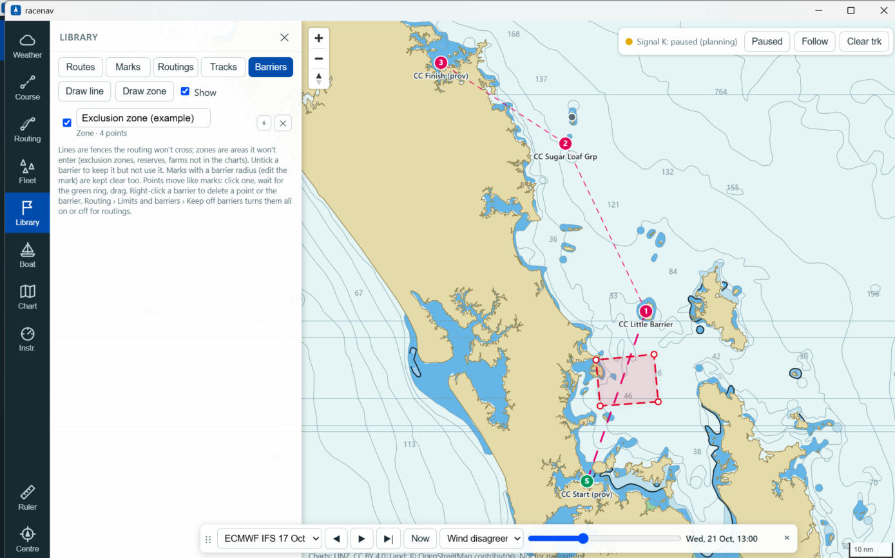

**The Library menu**

{icon:library} The drawer's header shows the library in use (*My library* is the one TweedPlot starts with) and opens the menu:

| Menu | Does |
| --- | --- |
| New library… | Starts an empty library (another boat, another fishery). The one in use stays as it is, and is in the menu to go back to |
| Open library… | Uses another TweedPlot library (a `.gpkg` file, or a protected `.tplib`): one shared from another boat, or kept for a different seasonal fishery. The libraries used lately are listed under it. A protected one asks for its passphrase and is unlocked into a `.gpkg` beside it |
| Save a copy as… | A copy of the whole library, to share or keep. The one in use stays in use |
| Merge from another library… | Brings another library's marks, routes, tracks, routings and barriers into this one, matched as an import is, so merging twice adds nothing. After you tick what to bring in, a preview says how many of each are new and how many are already here (and names the new routes and tracks) before anything changes. The other library isn't changed |
| Import… | Marks, routes and tracks from GPX, TimeZero (`.tzd`, `.TzBackup`), Google Earth (KML, KMZ) or a spreadsheet (CSV) (below) |
| Export everything as GPX | Every mark and route in one GPX file in the export folder |
| Back up to… | Copies the whole library to a USB stick or another disk, as `<library> YYYY-MM-DD HHMM.gpkg`, so it survives if this computer fails (TweedPlot's own backups are on the same disk). The folder is remembered: next time the menu offers **Back up to <folder>** (greyed while the stick isn't plugged in) and **Back up to another folder…**, and says when the library was last copied out. If it hasn't been for a week, a card says so once a day. To use a copy: Open library |
| Backups… | TweedPlot's own daily copies of this library, in the `backups` folder beside it (the menu shows where, and **Open the backups folder** shows them in Explorer). One is made the first time TweedPlot starts each day (by the computer's date); the last 7 days are kept, and one a week for 4 weeks before that. Using one copies it beside the library and opens the copy: the backup and the library stay as they were |
| Libraries alongside… | Shows other libraries on the chart with this one, read-only (below) |
| Trash… | What was deleted in the last 30 days (below) |
| Undo an import… | Takes out again what a file brought in (below) |

TweedPlot opens the library last used. Changing library isn't possible while the track recorder is on (stop recording first).

**Libraries alongside.** Library menu › **Libraries alongside…** shows another library on the chart with the one in use: a mate's marks, or another season's, without mixing them in. Nothing in it can be changed. **Show another library alongside…** picks one (a protected one asks for its passphrase). Each has its own colour, as a ring round its marks (its own symbols and colours are kept); click one of its marks to see what it is, from which library, when it was made, the depth and temperature and its notes. The Whole library filters (Dates, Months, Trip) apply to it too, so "Nov, Dec, Jan" shows the tuna-season marks of every library shown. Its tracks are drawn, dashed in its colour, when those filters pick 200 or fewer (untick **Tracks** to leave them out). Untick a library to hide it for now, or **Remove** it (the library itself isn't touched). The libraries shown are opened again next time; the chip by the library's name in the drawer header lists them and opens this view. They don't appear in the tabs' lists: to work with their marks, open the library, or merge it in.

**Sharing a library file.** **Library file…** (select marks, routes, tracks or trips) asks first: **Include notes** (untick to leave out the notes, catch details and so on) and **Protect it with a passphrase**. A protected file (`.tplib`) can't be opened or read without the passphrase: it's locked with XChaCha20-Poly1305 under a key made from the passphrase (Argon2id), so a wrong passphrase, or a damaged file, is refused. Give the passphrase separately (by phone, not in the same email). A lost passphrase can't be recovered.

**Trash.** Library menu › **Trash…** lists everything deleted in the last 30 days: marks, routes, tracks, trips, routings and barriers, newest deletion first. **Kind** and **Deleted** filter it (Deleted picks one deletion: the 1,240 marks deleted at 14:05 on Tuesday). **Restore** on a row, or select and press Restore, brings things back; a route brings its marks back with it, but a restored mark isn't put back into routes it was taken out of. **Delete for good** and **Empty the Trash** (press it twice) can't be undone. After 30 days things are deleted for good when the library is opened. **← Back** returns to the lists.

**Undo an import.** Library menu › **Undo an import…** lists each GPX or TimeZero file (and each merged library) with what it brought in that is still here. **Undo** asks first, then moves those marks, routes and tracks to the Trash, so a wrong import can be taken out and, if need be, put back. Marks that were already in the library and only matched (or had depth and temperature filled in) stay.

**Where the library is kept.** Everything in the Library drawer is in one database file, `library\library.gpkg` in the data folder (SQLite, as a GeoPackage, so QGIS and other GIS software can open it and show the marks). Lists and the chart come up quickly however big it grows: tens of thousands of marks and years of tracks. Deleted marks, routes, routings, barriers and tracks are kept for 30 days before they are cleared out (Library menu › Trash). Each import is remembered, so it can be undone (Library menu › Undo an import). TweedPlot keeps its own backups in `library\backups`: a copy each day it's started, kept for 7 days, and one a week for 4 weeks before that. Each is a complete library, so restoring one is a matter of copying it over `library.gpkg` with TweedPlot closed. To copy the library to another PC or a USB stick, close TweedPlot and copy `library.gpkg`; don't keep it in a Dropbox or OneDrive folder while TweedPlot is open.

**GPX** exchanges marks, routes and tracks with plotters, phone apps, qtVlm, OpenCPN and Navionics. Import adds new marks and matches ones you already have: a named mark within about 50 m of one with the same name, an unnamed mark within a few metres of another unnamed one, so importing the same file twice adds nothing. Marks keep their date, colour and plotter symbol; TimeZero files keep their symbol number and colour, and export back the same way.

**TimeZero.** Library menu › **Import…** also reads TimeZero's own files: a `.tzd` (File › Export user data) or `.TzBackup`, or the `WaypointRouteDatabase.xml` inside one. Each TimeZero layer becomes a group, marks keep their symbol number, colour and date, text labels come in as marks, and routes come in as routes. Tracks (`Tracks.bin`) come in too, thinned as TweedPlot's own recorder keeps fixes (one every 10 s, sooner in turns; TimeZero keeps one every 2 s), each in its TimeZero colour and named by the file and its start time; tracks already in the library are skipped, so a file can be imported again safely. A plotter's years of tracks are not all shown at once: show the ones you want in Library › Tracks (Months, Dates and In chart view find them quickly). Lines, areas and circles come in as barriers, switched off: drawn faintly on the chart, not used by routing until ticked in Library › Barriers (**Imported** lists them). Each is named by its TimeZero name, or its layer ("WESTCOAST-STN circle"), and its notes say the layer, colour and, for a circle, the radius; a circle becomes a 48-sided zone. Importing again matches them, and Undo an import takes them out. The lines some files keep among the tracks (brought in from MaxSea) come in the same way, in the layer MaxSea. A TimeZero file with millions of fixes takes several seconds, a 2 GB one about a minute. Unnamed marks (most of a plotter's) stay unnamed and are listed as *(no name)*, newest first, after the named ones. Exports go to `library\export` in the data folder.

**KML and KMZ** (Google Earth, and many plotters' and websites' exports): a point is a mark (with its folder as its group, its time, its description as notes, and its icon colour), a line of 60 points or fewer is a route, a longer one a track, a Google Earth track (gx:Track) a track with its times, and an area (polygon) a barrier, switched off, as TimeZero's areas are.

**CSV** (a spreadsheet of marks): the first row names the columns, in any order: **name**, **lat** (or latitude) and **lon** (or long, lng, longitude) are needed; **notes** (or description), **group** (or layer, folder), **date** (or time), **symbol** (or type), **colour** and **depth** are used if there. Positions can be decimal (-41.25) or degrees and minutes (41 15.000 S, 41°15.000'S, or with seconds). Commas, semicolons or tabs all work; a date is ISO (2024-11-21 05:30) or day/month/year, taken as UTC. Rows without a position it can read are counted in the report.

**What TweedPlot reads from TimeZero marks.** Besides the symbol, colour, date and layer:
- *Marks made at the boat.* A mark made within 2 seconds of a track fix and within 30 m of the boat takes that fix's depth, sea temperature and speed, and the tag *at-boat*. Importing a file again fills these in for marks already in the library.
- *Names.* A depth in the name ("180 m", "200MTS", "10 fm") becomes the mark's depth (a plain number like "6" is taken as the mark's number). Words become tags: foul ground (foul, fast, snag, hang), rock, wreck, the bottom (hard, rough, rolly, soft, mud, sand, shell, gravel, weed), tow; "?" is *unsure* and "!" *caution*. Foul ground, wrecks and rocks get their own symbols on the chart.
- *Event marks.* Marks dropped with TimeZero's quick-mark or event button ("Event 12") are tagged *event*.
- *Dates.* Marks moved into TimeZero from another plotter in one go (20 or more made in the same second, such as a fleet's SeaPlot marks) carry only the day they were moved: they show *date unknown*.

The Marks list shows each mark's date, depth, sea temperature and tags.

## Shooting, hauling and the catch log

The fishing tools that log what the boat does are here. Ocean data, own soundings and how to use them together are in the **Fishing tools** tab.

**Shoot and Haul on the toolbar.** Left click shoots or hauls the gear used last (the small letter on the button: N net, L line, P pots); right-click chooses **net**, **line** or **pots**. Shooting a line opens the line-shooting window; shooting a net or pots logs it at once. Hauling any of them opens the haul box.


**The catch log (Library › Catch log).** One press saves an event with the time, the boat's position (from Signal K) and what the instruments said: depth, sea temperature, SOG and COG. The large buttons: **Net shot** and **Net haul**, **Line shot** (opens the line-shooting window, above) and **Line haul**, **Pots shot** and **Pots haul** (each haul opens the haul box), **Catch** and **Note** (these two ask for a few words; the time is when the button was pressed). **Gear** chooses which pairs of buttons show. A haul is paired with the last shot (or set) of the same gear not hauled yet, and its row shows the tow: how long, and how far from where it was shot. While gear is in, the top of the tab says since when.

- **Timer every … min, Start**: a reminder (a soft chime and a card, never an alarm) every so many minutes until stopped. **Start the timer when gear goes in** starts it with each shot or set, and stops it with the haul.
- Events are listed newest first, with **Event** to filter by kind; the Whole library filters (Dates, Months, Trip, In chart view) apply. **Edit** changes the time and notes, or deletes it (the Trash keeps it 30 days). Select events for **CSV** (time in UTC, event, position, depth, sea temperature, SOG, COG, when the tow started, notes: for a spreadsheet, or an e-logbook that takes CSV) or **Library file…**.
- On the chart (**On chart**), a shot or set is a blue triangle pointing down, a haul an orange one pointing up, a catch a fish and a note an exclamation mark, with the time beside it close in; a tow is a dashed line from shot to haul. Click one to find it in the log.
- A trip's summary counts its sets, and a trip's library file takes its log events with it.

**Shooting a longline (toolbar Shoot, or Library › Catch log › Line shot).** It opens the line-shooting window: the snood and float beeper, in place of a hardware hook-and-buoy timer. It stays on top of other windows and can be dragged to another screen; it follows the main window's day and night colours. The pattern, basket after basket: a float (a long tone, 1 s, higher), then the empty intervals, then the snoods (a short tone, 0.5 s, for each), then the empty intervals and the next float. The big number counts down to the next tone, and says when a float is next; counters show the hooks, floats and baskets set and the time.

- **This set**: the **radio buoys** at the start and end of the line (name or number), **Hooks to set** (the set finishes at the end of the basket that reaches it; empty for no limit) and notes.
- **Start** logs **Line shot** in the Catch log (with the radio buoys and the settings) and, after three seconds, sounds the first float. **Pause** (or the space bar) stops the tones; **Resume** carries on with the pattern after two seconds. **−1 beep** and **+1 beep** move the pattern back or on one interval if the crew gets out of step. **Last basket** finishes after the next float with three short tones; **Finish** (press twice) ends the set now. Either way **Line shot finished** is logged with the hooks, floats and baskets. **Radio buoy** logs one put on part way.
- **Settings**: tones **every so many seconds** (4 to 20), or **every so many metres of line**: the interval is the snood spacing over the line speed, from the **line shooter speed** (typed in, or worked out from its wheel's circumference × RPM), or SOG if no shooter speed is given (setting without a shooter). While setting, the window shows the interval, SOG, shooter speed and the **sag ratio** (SOG over shooter speed: below 1 the line sags and fishes deeper). **Snoods per basket**, **intervals each side of a float** (1 to 4), the two tones' pitch (snood 1 kHz and float 1.5 kHz to start with; **Test** plays each), **Sharp** (a square wave, which carries over engine noise) or **Clear**, the volume, and which **speaker** (a USB sound card wired to the horn amplifier keeps Windows' own sounds off the horns). **Log each float's position** puts each float in the Catch log (listed when **Floats** is ticked in the Catch log; always on the chart while the Catch log's **On chart** is ticked), for finding the line at the haul. Deleting the set's shot in the Catch log deletes its floats too; with **Floats** unticked, a line above the Catch log list says how many floats are on the chart and offers **List them** and **Delete them** (floats left from sets no longer in the log included). **Make a mark at each float** also puts a library mark (the float symbol) at each float, and one (a float with a flag) at each radio buoy, all in a group named after the set ("Set 28 Oct 05:30") with the tag *floats and buoys of a line set*: in Library › Marks › Groups the whole line can be shown, hidden, locked or deleted at once. Each mark keeps the depth, sea temperature and SOG at the time. **Saved settings** keeps them per gear (Bigeye deep, Swordfish).
- The window scales with its size: the top part (state, countdown, counters, **Start** and **Pause**) shrinks to fit and always stays in view, down to a small window; the buttons and sections below it scroll. The tones are timed by the sound card, so they keep time when the computer is busy or the window is behind another. A set keeps the pattern it started with; the interval can be changed while setting.
- **Hauling** (toolbar **Haul**, or Library › Catch log › Line haul) opens the haul box: **Start haul** when the first float comes aboard (it pairs with the shot, so the soak time shows), **Catch** as fish come aboard, however you like to count them (per hook or per basket: type what, and how many, and press Catch; each catch is logged with the time and position), and **End haul** (press twice) at the last float, which logs the haul with how many were caught, how long it took and the soak. The box can be closed and opened again: a haul in progress is read back from the Catch log. Nets and pots haul the same way.

## Weather and tides

**Environment** brings the GRIB controls together: **Get data** downloads and manages files and makes Saildocs requests; **Explore** shows chart time, cursor readings, layers and filters. Get data replaces the Explore panes until you return to Explore. Weather and ocean GRIB overlays are off in Navigation until you switch them on there: add **Weather layers and filters** to the Navigation data panel (✎ › **+ Add a section**) and press **Show weather on chart**. What Planning or Environment shows never switches them on in Navigation, and each view keeps its own layer, overlays and filter. The chart time is one time for the window, whichever view is shown; the vessel is always drawn where it is now. A colour key for the shaded layer sits under the Chart time buttons. 

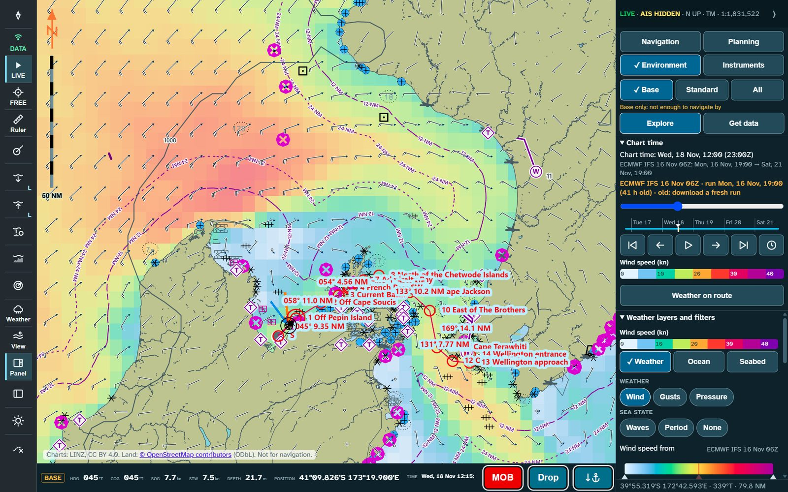

In Environment the panel is one list that scrolls as a whole, with Chart time held at the top. **Explore** and **Get data** are two tabs under the view icons. In Chart time, play and **now** sit beside the time, and back (start, previous step) and forward (next step, end) either side of the slider. Under the time slider a timeline shows the days, a mark at now, and a bar for each loaded GRIB over the times it covers (the shown GRIB brighter); click it to go to a time. The **Showing** list picks **Weather**, **Ocean** or **Seabed**. They are modes: each remembers its own layer, sources, overlays and filter and puts them back when you return to it. The layer is chosen from chips grouped as Weather, Sea state and Ocean, one for each layer a loaded GRIB has, with **None** for the overlays alone; the line under the chips says which GRIB the layer comes from and lets you change it when more than one has it. The colour bar and filter come straight after, then Overlays, Compare GRIBs and the presets; the cursor read-out is last. In the Fishing use, **Use latest past analysis outside chart time** starts ticked, so a satellite sea temperature from yesterday shows at today's chart time; the tick is remembered. If a GRIB cannot be read while drawing, a red line under the key says why. While another route is in the editor, a mark of the navigated route can still be moved: click it, then drag it.

**Get data** lists every GRIB file in the GRIB folders, newest run first: the model and run, the times it covers, its area, what it contains, its size and age, and whether it is loaded or shown. **Load**, **Unload** and **Show** act on that file. **Update** appears on a file downloaded with TweedPlot when a newer run is probably out (six hours after its run for forecast models, a day for daily analyses, plus the time the run takes to reach the server): it downloads the same area, parameters and length again. After a download in Environment the panel returns to Explore with the new file shown and the chart time at now. **Add file…** copies GRIB files from anywhere on the PC into the GRIB folder and loads them. **Tidy up…** deletes GRIB files whose data ended more than the number of days chosen ago, after asking: a forecast once its last time has passed, a satellite analysis once its last day has (so yesterday's MUR, which is a day or two old by its date, is kept). Old files that are loaded are unloaded first. Tick **Automatically** and TweedPlot tidies up by itself a minute after it starts and every six hours, using the days chosen: it never touches a loaded file, and the activity log lists what went. This covers everything in the GRIB folder: forecasts, ocean analyses and sea ice. qtVlm's own GRIB folder (C:\Program Files (x86)\qtVlm\grib) is listed so its files can be loaded, but TweedPlot never deletes there (Windows needs administrator rights in Program Files, and they are qtVlm's): those rows say *in qtVlm's folder*, and Tidy up names any old ones so you can delete them in qtVlm or File Explorer.

The Weather drawer continues to provide tides and live observations.

Weather comes from GRIB files: gridded forecasts from computer models, one value per grid point per forecast time. TweedPlot downloads them, reads files from other sources, shows them on the chart, compares several at once, and routes through them. The Weather routing tutorial explains models, resolution and how much to trust them.

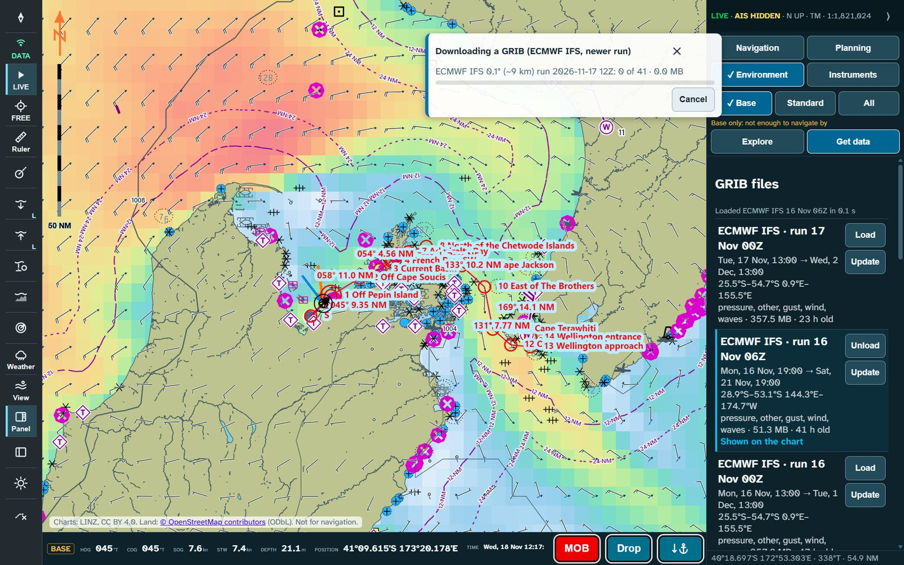

**Loading GRIBs**

The list shows every GRIB in the GRIB folders, described by model, run time, area and how far ahead it goes rather than by file name. Choose one and **Load** (↻ rescans the folders). Load as many as you like: different models, or several runs of one. One is shown on the chart (its radio button). A tick beside each loaded GRIB includes it in the agreement displays; × unloads it without deleting the file.

In **Get data**, **Download GRIBs** and **Saildocs email request** come first, then the list of GRIB files. The list reads the configured GRIB folders; put files from elsewhere in one of those folders first. The toolbar's Weather button opens Environment; **GRIBs…** opens Get data.

TweedPlot reads GRIB2 (including ECMWF's compressed files) and GRIB1 (Saildocs and older tools): wind, gusts, pressure, waves (height, period, direction, swell, wind waves), rain, CAPE, air temperature and ocean currents. Outside a file's area or forecast time span there is no value: a short forecast never shows as calm. Some ocean analyses can be held beyond their last sample, subject to the Environment option below.

**Time**

The data panel's **Chart time** slider and icon buttons set the time (also **[** and **]**; with Shift, six hours). The time shows in local time with UTC in brackets. Hover or focus the **Start**, **Previous**, **Play/Pause**, **Next**, **End** and **Now** buttons for their names. **Start** and **End** go to the ends of the shown file's span. The slider covers all loaded files, so it can also reach times outside the shown GRIB; the time section warns when it does. The span covers the earliest to latest time of any field in the file: individual fields can have shorter coverage or gaps.

In Environment, fields outside their own time span are not shown. **Use latest past analysis outside chart time** explicitly permits available older MUR, ACSPO, Geo-Polar, VIIRS, Copernicus chlorophyll, Himawari or sea ice analysis values; their analysis time is identified and they are not a forecast. This choice resets when leaving the view. Forecasts are not extended by this option.

Weather, Ocean and Seabed (the **Showing** list) are starting points; the last chosen is shown in the list, and afterwards you can choose any combination of layers and overlays. Seabed includes survey depths, outlines and own soundings with per-view visibility. High-resolution, NIWA, ETOPO and world-depth visibility is shared with other views; the controls say so. Obtain seabed packages under **Chart › Get data**.

**Wave period** is the GRIB's wave period in seconds, not the forecast update interval. Depending on the source, it can be a primary-wave mean period or a peak period; it is not itself significant wave height (Hs).

In Planning, forecast time stays above the scrolling panel. Cursor values identify their forecast time and shown GRIB, with other contributing files marked separately. The individual runs at the cursor are listed under **Compare GRIBs**.

**What the chart shows**

| Control | Choices |
| --- | --- |
| **Layer** (the chips under *Weather layers and filters*) | Wind speed, gusts, wave height, swell, wave period, rain, CAPE (squall risk), pressure, air temperature, or none; the agreement and verify displays (below) are in *Compare GRIBs* |
| Wind barbs | Arrows with feathers: each full feather 10 kn, half feather 5 kn, flag 50 kn |
| Wave direction | Arrows pointing the way the waves travel |
| Current direction | Blue arrows pointing the way the current flows, longer where it is stronger. Needs a GRIB with currents (ECMWF surface currents or HYCOM) |
| Current flow (animated) | Moving particles that drift with the current, faster and brighter where it runs harder, so eddies, rips and where two flows meet show at a glance. Off to begin with. They pause while the chart is moved and start again when it stops, and follow the chart time as it steps or plays. Same data as Current direction; dim at night |
| Isobars | Pressure lines at 1 to 10 hPa intervals (2 hPa suits the tropics, 4 hPa higher latitudes); **Auto** widens the interval when zoomed out |
| Display | Barb density and size, shading opacity and steps (smooth, or 1, 2 or 5 kn bands), shading under the land or under the coastline only |

The data panel offers layers and overlays supplied by the loaded GRIBs, and a wave-only GRIB switches to wave height by itself. Isobar spacing and other display settings are in Weather › **Advanced display and verification**.

**Weather in the data panel**

The Environment icon at the top of the data panel (or **Chart › Layers › Weather controls…**) opens the Weather layers and filters section. **Hide weather** hides the layers without unloading data; **Show weather** restores them; **Picture** saves the chart as a picture.

- **Run line**: the loaded file being shown, when its run was made and how old it is. It turns red and bold when the run is more than a day old, or the slider is past the end of the forecast.
- **Forecast time**: the slider, steps, play, start, end and Now stay above the scrolling panel in Planning and Environment.
- **Colour bar and filter**: for whatever is shaded now (wind, sea temperature, salinity, sea surface height, chlorophyll ...), drag the outer pointers to the lowest and highest values you care about and the target between them. Wind, gusts, waves, pressure, rain and the other weather layers keep one fixed colour scale, so a colour always means the same value, until you move a pointer; the ocean layers always spread their colours over the range. Once a filter is set, the full colour scale fits between the limits, with the target at the cool-to-warm transition. Only a limit you have moved hides anything: move the low pointer to 16 kn and lighter wind is not shaded, while wind above the high end is still drawn, in the top colour (the key shows it as ≥). Banded shading uses the same colours and includes a band boundary at the target. **Highlight band:** the two green pointers above the bar mark a band (for example 19.5–25 °C for yellowfin): the whole colour scale is spread across the band, so small differences inside it show as clear changes of colour; everything below the band takes the first colour and everything above it the last, so the band stands out while the water around it stays in view. A target inside the band is the middle of the colours, as before. They are faint until used; drag one to start a band, double-click one to clear it. Click a pointer's number to type a value; the small buttons under the bar do the same for each pointer (lowest, band from, band to, highest, target) and the last clears the band and the target. Fit clears the band and the target and restores the full grid range at chart time, following it as the time changes; manually set limits stay fixed. The bar with its pointers sits under the chart time in every view that shows it (Planning and Navigation included), so a filter can always be seen and changed where it is in use.
- The filter also offers **Set low**, **Set high**, **Set target** and **Clear target** buttons, so it can be operated without dragging or double-clicking. In the data panel these are icons; hover over them for their names.
- **At the cursor**: a fixed list of every parameter in the loaded GRIBs, so it never grows or shrinks as the cursor moves; a dash where the file has no value. When two files supply the same parameter, the one on the chart is used and the others fill the gaps; a value taken from another file is marked with a small letter, and the file it came from is named under the list. With a strong wind blowing against a current of a knot or more it adds a warning of steep, short seas.
- **Show on the chart**: one choice for each thing that can be shaded; a drop-down beside it picks the file when more than one loaded file can supply it (two sea temperatures, say). Choosing one never needs a wind file to be selected in the drawer. Presets (**Fishing**, **Passage**, **Anchorage**, and your own with **Save…**) set the shading and overlays together. **Species** presets show sea temperature with the band a species is usually found in highlighted, its target temperature marked, and isotherms and temperature breaks (fronts) drawn; see *Species presets*.
- **Overlays**: wind barbs, wave direction, current direction, isobars, temperature breaks and contours, each from the file you choose. Set the isobar interval here; Auto widens the interval as you zoom out.
- {icon:snap} saves the chart as it is, with the shading, as a picture.

**Species presets.** In the presets list under **Species (sea temperature)**. Each sets the sea temperature layer, a band, a target, and the isotherm and temperature-break overlays; you can then move the band like any filter, and **Save…** keeps your own version. The bands are where each species is usually reported, not a promise of fish: they follow food, fronts and currents as much as temperature, and local knowledge beats any band. Hover a preset for its note.

| Preset | Band (°C) | Target | Based on |
| --- | --- | --- | --- |
| Albacore | 16–20 | 18 | Juvenile albacore (the fish NZ trollers catch) across the South Pacific in summer surface water of 16–21 °C (FAO review, Murray); thermal preference 10–20 °C (ICCAT) |
| Southern bluefin | 14–18 | 16 | Large fish tagged in NZ waters in winter at 13.6–18.3 °C surface temperature (PLOS One 2012) |
| Yellowfin | 19.5–25.5 | 21 | Preferred 20.3–25.5 °C (ICCAT review 2022); arrive in NZ when offshore water reaches about 19–20 °C |
| Bigeye (at 250 m) | 10–14 | 12 | By day at 200–400 m in 8–14 °C water (Howell et al. 2010); best longline catches at 12–14 °C around 240–280 m (Indian Ocean survey). Shown on **Sea temperature at depth**, 250 m: needs Copernicus or HYCOM with depths. With none loaded, the preset offers to get Copernicus at 250 m for the area on the chart (2–10 days ahead) and is applied once it has loaded |
| Skipjack | 19–28 | 22 | 19.3–27.9 °C (ICCAT review 2022); major fisheries in 19–23 °C (NOAA) |
| Striped marlin | 18–25 | 21 | Prefer 20–25 °C (NOAA); 18–20 °C is usual NZ marlin water, with good seasons above 21 °C |
| Mahi-mahi | 24–29 | 26 | Catch rates highest at 24–29 °C (published studies summarised by Heuer et al. 2021) |

Pacific bluefin and broadbill swordfish have no preset: neither has a surface temperature band that the published work agrees on.

The Weather drawer manages the loaded files; the data panel controls how their weather is viewed. Presets and the picture button are in the data panel.

**Downloading: Weather › Download GRIBs**

| Source | Models | Notes |
| --- | --- | --- |
| NOAA NOMADS | GFS 0.25°, 0.5°, 1° (wind, gusts, pressure, rain, CAPE, air temperature); GFS-Wave 0.25°; AIGFS 0.25° (NOAA's AI model: wind, pressure, air temperature, 6-hourly to 16 days) | GFS is cut to your area on the server: small downloads. AIGFS comes only as whole-globe files, so TweedPlot fetches just the fields you tick (about 1.3 MB each a step) and cuts them to your area. Free, US government data |
| ECMWF open data | IFS 0.1° (~11 km grid; model about 9 km) and 0.25° (wind, pressure, gusts, air temperature); 0.1° IFS surface currents (non-tidal); AIFS 0.25° (ECMWF's AI model); ECMWF wave 0.1° and 0.25° | Free open data, CC BY 4.0, © ECMWF. The 0.1° products arrive about two hours after the 0.25° products; 0.1° surface and pressure-level data are separate global files. TweedPlot fetches only the fields you tick and crops them to your area. Requested 0.1° global fields are cached for reuse across areas (up to 5 GiB; oldest first). IFS 06Z and 18Z runs stop at 144 h |
| NOAA CoastWatch ERDDAP | MUR sea surface temperature, 1 km; Geo-Polar Blended sea temperature, 5 km (ocean, see below) | Satellite analyses and observations, cut to your area on the server. Free to use and share (NASA JPL; NOAA, GHRSST) |
| NOAA CoastWatch THREDDS | Himawari-9 hourly sea temperature, 2 km; ACSPO daily sea temperature, 2 km (ocean, see below) | One file an hour (Himawari) or a day (ACSPO), cut to your area on the server. GHRSST data, free and open |
| NOAA CoastWatch ERDDAP | Chlorophyll-a, 9 km, daily (ocean, see below) | Cut to your area on the server. Free to use and share |
| University of Bremen | Sea ice concentration, 3 km, daily, polar seas (ocean, see below) | One file a day for the whole hemisphere (about 1 MB), cut to your area in TweedPlot. Free; no warranty |
| HYCOM (US Navy) | HYCOM ESPC ocean model, 1/12°: sea temperature, salinity, currents, sea surface height, and temperature and salinity at a depth (ocean, see below) | Cut to your area on the server. Public release; a demonstration service, so it may be down at times |
| Copernicus Marine (EU) | Mercator ocean model, 1/12°: sea temperature, salinity, currents (with the total current including tides hourly), mixed layer depth, sea height, temperature and salinity at a depth; biology model, 1/4°: chlorophyll, phytoplankton, primary production, oxygen, pH; satellite chlorophyll, 4 km (ocean, see below) | Read from Copernicus Marine's cloud store, no account needed; the download is larger than the file (see below). Free and open (E.U. Copernicus Marine Service Information) |

1. Choose the model and tick the fields.
2. Set the area: **Draw** a rectangle, use the **Chart view**, or the **Course** with a margin. Edges can be typed.
3. Choose the forecast length and time step; check the size estimate.
4. **Download**. TweedPlot finds the newest complete run, downloads it, saves it in the GRIB folder and loads it.

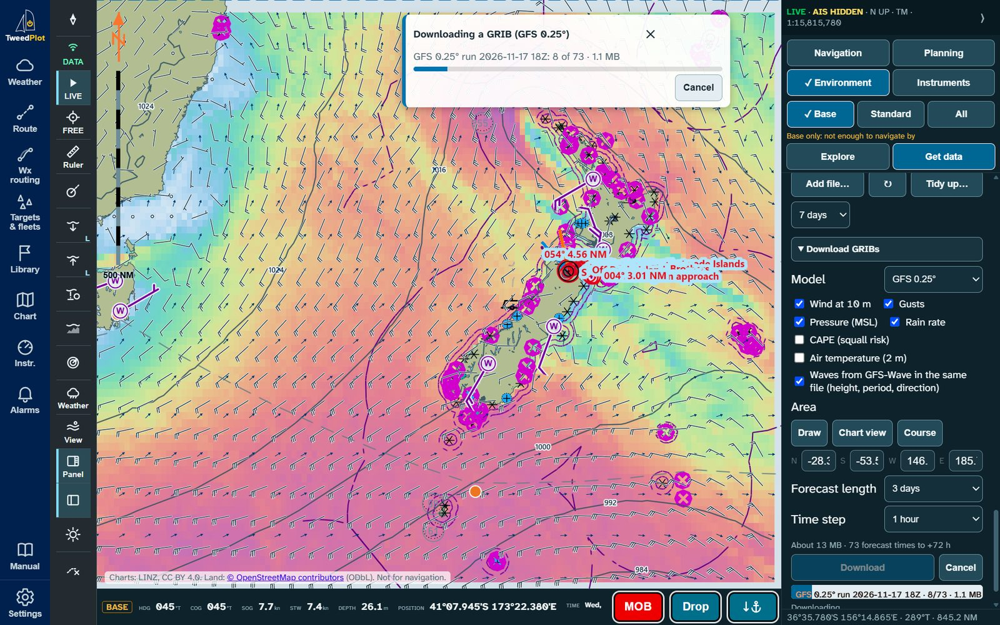

**ECMWF 0.1° product coverage**

The 0.1° IFS data is the same high-resolution forecast as the 0.25° product, distributed on a finer grid (roughly 11 km north–south). It is free open data, released about two hours later than the 0.25° products. ECMWF publishes surface (`sfc`, including soil-level fields) and pressure-level (`pl`) files separately; the Download choices fetch selected surface fields, not the pressure-level files.

| File | Products available from ECMWF |
| --- | --- |
| Surface atmosphere | 10 m and 100 m wind components; 10 m gusts; 2 m temperature and dewpoint; 3-hour maximum and minimum 2 m temperature; mean sea-level and surface pressure; skin temperature; low, medium, high and total cloud cover; most-unstable CAPE |
| Precipitation and snow | Convective and total precipitation, precipitation rate and type; snowfall; runoff; snow depth, density and albedo |
| Water and radiation | Total column water and water vapour; cloud ice, cloud liquid water and rain water; surface and top-of-atmosphere shortwave and longwave radiation |
| Soil, land, ocean and ice | Soil temperature and soil water; land-sea mask and sub-grid orography; eastward and northward sea-water velocity components (surface-current components), sea-surface height and sea-ice thickness; eastward and northward turbulent surface stress |
| Pressure levels | Geopotential and geopotential height, temperature, U/V wind, specific and relative humidity, vertical velocity, divergence and relative vorticity, at 1000, 925, 850, 700, 600, 500, 400, 300, 250, 200, 150, 100, 50 and 10 hPa |
| Wave stream | Significant wave height, mean wave direction, peak/mean/zero-crossing periods, wave-height bands by period, and other wave-model diagnostics |

The surface-current fields are ECMWF's eastward (`sve`) and northward (`svn`) sea-water velocity components; together they describe current speed and direction. Tick **Surface currents** in the **ECMWF IFS 0.1°** download choices to fetch them. ECMWF's open-data product documentation does not specify whether these fields include astronomical tidal-current components, so do not treat them as a tide prediction. They can be drawn with **Show › Current** and included in routing when **Use GRIB currents** is ticked. **Surface currents** from HYCOM are also available in the ocean-model download.

**Ocean: sea temperature, salinity, currents, chlorophyll and sea ice**

Five free ocean sources sit in the same Download list, for fishing and for anyone who cares where the warm water, the fronts and the currents are:

| Source | What | Resolution and time | Best for |
| --- | --- | --- | --- |
| **MUR sea temperature** | Sea surface temperature analysed from all the satellites, without cloud gaps | About 1 km, one analysis a day, usually a day or two old. **Days of analyses** sets how many of the latest days to fetch | The detail: fronts, eddies, upwelling, river plumes near the coast |
| **ACSPO sea temperature** | Each day's sea temperature seen in clear sky by all the polar-orbiting satellites (VIIRS on S-NPP, NOAA-20 and NOAA-21, AVHRR on MetOp), combined by NOAA (L3S-LEO); only best-quality pixels | About 2 km, one a day, usually one to two days old. **Days of analyses** as for MUR: the newest days on the server. Real observations, not smoothed: gaps where it was cloudy all day | Sharp fronts and the true edge of a warm tongue, where MUR's smoothing blurs them |
| **Geo-Polar Blended sea temperature** | A gap-free daily sea temperature (night-time, so no afternoon warming) from the geostationary satellites (Himawari-9 over New Zealand) and the polar orbiters, with the **estimated error** of every cell | About 5 km, one a day, usually two days old. **Days of analyses** as for MUR. Shade **SST error** to see where the analysis is sure (green, a tenth of a degree or so) and where it is filling in under cloud (red) | A second analysis to check MUR against, and the error map shows how far to trust either in cloudy spells |
| **Himawari-9 sea temperature** | Sea surface temperature seen by the Japanese geostationary satellite over the western Pacific, every hour, where the sky is clear (only its best-quality pixels are kept) | About 2 km, hourly, two or three hours after the hour. **Hours back** sets how far back to fetch (3 to 72 hours), the step every 1, 2, 3 or 6 hours. Cloud leaves gaps: each hour keeps the last clear value seen in the hours downloaded, so fetch 12 or 24 hours to fill in round passing cloud | Today's water, hour by hour: a front moving with the tide, a warm tongue that MUR has not caught up with yet |
| **Chlorophyll-a** | The green of the plankton: the base of the food chain, where bait and fish gather | About 9 km, one gap-filled analysis a day from the VIIRS satellites, about three days old. **Days of analyses** as for MUR | Plankton blooms and colour fronts (green water against blue), upwelling; read it with the sea temperature |
| **Sea ice concentration** | How much of the sea is covered by ice (per cent), from the AMSR2 microwave radiometer, which sees through cloud and polar night (University of Bremen, ASI algorithm) | About 3 km, one grid a day of all the day's passes, on the server early the next day (UTC). **Days of analyses** as for MUR. Polar seas only: the area must be wholly south of 45°S (or north of 45°N); an area across 180°, such as the Ross Sea, is fine | Where the pack ice and the ice edge are: planning a passage in the Southern Ocean, the Ross Sea or round the Antarctic Peninsula, and fishing along the ice edge |
| **HYCOM ocean model** | Sea surface temperature and salinity, surface currents, **sea surface height**, and temperature and salinity at a **depth** you choose (10–500 m); those two are off until ticked | About 9 km, from the latest analysis out to an 8-day forecast, every 3 hours or more (HYCOM's server is very slow on hourly steps). Fetched one day at a time, as HYCOM asks: each day takes from a few seconds to a minute or two, and the progress bar counts them | Salinity, what is happening below the surface (the thermocline), currents, and where things are heading over the next days |
| **Copernicus ocean model** | The European (Mercator Ocean) model: sea surface temperature and salinity, surface currents, the **total surface current** (the ocean's own current plus the tidal stream plus the drift the waves give), **mixed layer depth**, sea surface height, temperature, salinity and current at a **depth** you choose, or at **every depth to 500 m** (see *Below the surface*) | About 9 km, from the latest analysis out to a 10-day forecast: temperature, salinity and currents 6-hourly, the total current hourly, mixed layer and sea height as daily means. Each parameter is a separate download | A second model to set against HYCOM; the total current is the one to sail or drift in near the coast; the mixed layer depth shows how deep the warm surface water goes (shallow over the shelf and in summer, deep in winter and in eddies) |
| **Copernicus biology model** | Chlorophyll-a, **phytoplankton**, **primary production** (how fast the plankton is growing), **dissolved oxygen** and **pH**, at the surface | About 28 km, daily means from the latest analysis out to a 10-day forecast | Where the food chain is busy and where it is heading, under cloud as well; smoother than the satellite pictures |
| **Copernicus chlorophyll** | Chlorophyll-a from all the ocean colour satellites, gap-filled (GlobColour) | About 4 km, one a day, a day or two old. **Days of analyses** as for MUR | Twice the detail of the VIIRS chlorophyll, for colour fronts and blooms near the coast |

**Below the surface (Copernicus depth stack).** Tick **Every depth to 500 m** under the Copernicus ocean model to fetch temperature, salinity and current at all 31 of the model's levels from the surface to about 450 m (closer together near the top: 0.5, 1.5, 2.6, 3.8, 5.1, 6.4, 7.9, 9.6, 11, 13, 16, 19, 22, 25, 29, 34, 40, 47, 56, 66, 78, 92, 110, 131, 156, 186, 222, 266, 318, 380 and 454 m). It is a big download, so keep the area tight or the step long (24 hours is plenty for planning). The stack has its own resolution budget, so a long, wide stack may come every 2nd or 3rd point while the surface fields in the same file keep their full resolution. Once it is loaded:

* **Sea temperature at depth**, **Salinity at depth** and **Current at depth** (under *Below the surface* in the layer chips) shade one depth; choose it with **Depth** under the colour key, or step up and down with ▲ and ▼. The filter and contours work as at the surface.
* **Thermocline** and **Thermocline strength** map where the water cools fastest with depth, between 10 and 300 m (the seasonal thermocline; the top few metres warm and cool with the day and are left out), and how fast in °C per 10 m. Where it cools by less than 0.1 °C per 10 m there is no thermocline to speak of and the depth map is left clear. A shallow, strong thermocline keeps surface fish (skipjack, for instance) up where a purse seine reaches them; longliners set above it for swordfish at night and below it for bigeye. The model's levels are 2 to 15 m apart between 10 and 100 m and further apart below, so read the depth to the nearest level or so.
* **Shear depth** and **Shear strength** map where the current changes fastest from one level to the next, between 5 and 300 m, in knots per 10 m: where a midwater net or a longline will be bent by water moving differently at its top and bottom.
* Under *GRIB data at the cursor*, **Below the surface** gives the thermocline and shear at the cursor in one line, and the readings *Temp at depth*, *Salinity at depth* and *Current at depth* are at the depth chosen under the colour key.
* **Water column** opens the dock with three graphs side by side on one depth scale: temperature (red), salinity (green) and current (blue), with a narrow **Set** column beside the current: an arrow at each level pointing the way the water flows, north up, so you can see the current turn with depth. The thermocline (red dashes) and the shear (pink dots) run across all of them. It follows the cursor and keeps the last place with water when the cursor leaves the chart; click the chart to pin it to a place (an orange dot marks it), **Follow the cursor** to let it go. Hover over the graphs to read each level.
* **Section along a line…** beside it: click along a line on the chart, double-click (or press Enter) to finish, Esc to cancel. The dock shows the water under the line: distance along the bottom, depth down, coloured by temperature, salinity or current (choose at the top), with the thermocline dashed white and the sea floor brown. Coloured by current, arrows show the way it flows (north up, as if seen from above). Hover over it to read a value (and the set, for current) and see the place marked on the chart. It follows the chart time; **Draw another line** starts again.

The depth stack is a model: it gets the big features right (the thermocline over the shelf break, an eddy's warm core going down 200 m) but not a one-mile front, and its sea floor is the model's own, smoothed. Check against your sounder and your own temperature-at-depth readings.

**Copernicus downloads.** Copernicus Marine keeps its data in blocks (a big area at one time, or a small area for months of times), and TweedPlot reads whole blocks, taking whichever kind costs less, then keeps only your area and times. So the download is several times the size of the file, and the size line gives both. A small area over many days is cheap; a large area at many times is not (all of New Zealand's waters for ten days of the hourly total current is hundreds of megabytes): pick a longer step, fewer days or a smaller area, and do big downloads ashore. No account is needed.

Area, length and step work as for GRIBs, and an area across 180° (east of New Zealand, the Chathams, Fiji, Tonga) works for every source: TweedPlot asks for the part west of 180° and the part east of it and joins them into one file with no seam. The files are saved in the GRIB folder like any other and load straight away.

**Resolution.** MUR, ACSPO, Geo-Polar and Himawari come at their full resolution (1, 2, 5 and 2 km) unless the area and length together would make a very large file (more than about 4 million points at one time, or 40 million in the file): then every 2nd (or 3rd…) point is taken, and the size line under the form says so, with the spacing you will get. A smaller area, or fewer days or hours, gives full resolution again. HYCOM, Copernicus and chlorophyll come at full resolution (about 9 km, 28 km for the biology model and 4 km for Copernicus chlorophyll) unless the same limits are passed.

Ocean data is shown under whatever weather GRIB is on the chart: choose **Sea temperature** (from MUR, ACSPO, Geo-Polar or HYCOM: pick the source under it), **Sea temperature error** (Geo-Polar), **Sea temperature, satellite hourly (Himawari)**, **Salinity**, their **at depth** versions, **Sea surface height**, **Chlorophyll-a**, **Sea ice concentration**, **Current**, or from the Copernicus models **Mixed layer depth**, **Phytoplankton**, **Primary production**, **Dissolved oxygen** or **pH** under **Show** and the shading comes from the loaded ocean file while the wind barbs stay on. Under the colour bar, three pointers set a **filter**: drag the outer two to the lowest and highest temperature (or salinity) you want to see, and nothing outside them is shaded; drag the red middle one to your **target**. The colours run from the low limit to the target over the cool half of the scale and from the target to the high limit over the warm half, so the target water is always the green-yellow middle and stands out, and it gets its own bold contour. The track refits around the selected range after adjustment; push an outer pointer to an edge to make room to widen it, up to the full grid range at chart time. **Fit** restores that range and follows it as chart time changes. The colours depend only on the filter, never on the zoom, and each layer keeps its own filter between sessions. **Contours** draws lines within the filter: bunched lines are a front. **Interval** under it sets their spacing: **Auto** gives about ten lines across the highlight band if there is one, otherwise across the values in view (so zooming in to a patch of water that varies by a degree still shows lines every 0.1 or 0.2 °C), or choose a fixed 0.1, 0.2, 0.25, 0.5, 1 or 2. Chlorophyll spans a hundredfold (0.05 to 5 mg/m³ is usual), so its colours, filter and contours run on a log scale (so do phytoplankton and primary production): each step along the colour bar multiplies the value, and the contours sit at tidy values (0.1, 0.2, 0.3, 0.5, 1, 2 …).

Values at the cursor show under the GRIB table, one line for each ocean file (its name, then sea temperature, satellite temperature, salinity, at depth, current and set, chlorophyll, sea ice). The same values can be shown in the data panel (Planning · Fishing has them to begin with): **✎**, then add the readings of the *Sea at cursor* group (Sea temp, Sea temp sat, Salinity, Temp at depth, Salinity at depth, Current, Current set, Chlorophyll).

A daily MUR analysis stands for four days after its date, so it still shows at the slider's "now". Remember what each is: MUR is an analysis of the satellites' skin temperature (the top millimetre, smoothed where cloud hid the sea); HYCOM is a model, good for the big picture and the days ahead but not for a 1 km eddy. Where they disagree, MUR is the better guide to today's surface. Himawari is the freshest of all (a couple of hours old) and the most detailed in time, but it only sees through clear sky and reads the top skin of the sea, which a calm sunny afternoon warms by a degree or more; MUR smooths that out. An hourly view stands for half a day after its time; a daily chlorophyll analysis for six days after its date; a day's sea ice for three days after its date.

Sea ice is shaded in the colours ice charts use (the WMO colour code): blue where there is a little ice in open water, green very open drift ice (1–3 tenths), yellow open drift (4–6 tenths), orange close drift (7–8 tenths) and red very close or compact ice (9–10 tenths); under 1 % is left clear and land is not drawn. The cursor gives the per cent. Read it as a guide to where the pack is, not as a chart of the ice: each value is the average over a cell about 3 km across, a microwave radiometer does not see icebergs, bergy bits or growlers, and the figures are least reliable close to the coast, in thin new ice and in melting ice with water on it. Use the official ice charts (the US National Ice Center, and for the Antarctic Peninsula the Argentine Naval Hydrographic Service) and a radar watch as well.

**Sea surface height** is HYCOM's height of the sea surface in metres above its long-term mean, shaded blue (low) to red (high) and labelled with a sign: +0.30 m is a bulge, −0.30 m a dip. It leaves out the tide, so it shows the ocean's own slopes: eddies and the big currents that run along them. Tick **Sea surface height** in the HYCOM download choices to fetch it. ECMWF's 0.1° files also list sea-surface height, but TweedPlot does not download it from there.

Ocean data for fishing is explained, with worked examples, in the **Fishing tools** tab of this manual.

**Tides**

In **Weather › Tides**, tick **Tide stations** and press **Download LINZ tides** once a year: TweedPlot fetches the LINZ tide tables for this year and next (about 90 standard ports plus the secondary ports). Tide stations then appear on the chart with the ECDIS tide symbol (IMO SN.1/Circ.243), a diamond with T in it: {img:tide:daily} a standard port (daily LINZ tables), {img:tide:sec} a secondary port (worked from a standard port, a little smaller, from about 1:1,000,000 in), {img:tide:levels} dashed, a place with mean levels only (LINZ gives no times). Click one and its info window shows the day's tide curve, with high and low times and heights, a marker at the current time (or the weather time when planning) and arrows to step through the days. Times are New Zealand time (Chatham Islands time for Chatham ports). Secondary ports are worked from their LINZ time and height differences. These are predictions, not official tide tables, and weather (wind and pressure) can raise or lower the actual tide by several decimetres.

**Tide gauges.** With **Tide gauges** ticked, a small bar beside each station shows where the tide is (at the chart time in Planning and Environment, now in Navigation and Instruments, or the planning time when paused) between low water (empty) and high water (full), filled with chevrons that point up while the tide rises {img:tg:3:u} and down while it falls {img:tg:6:d}. This is the "tidal gauge" part of the ECDIS tide symbol.

**Tidal streams.** With **Tidal streams (chart tidal diamonds)** ticked, the tidal diamonds of the LINZ charts show from about 1:500,000 in, as on a paper chart {img:tsd:A}, each with the stream it predicts (at the chart time in Planning and Environment, now in Navigation and Instruments, or the planning time when paused): a dashed line with three arrowheads {img:tsa} pointing the way the stream runs, the rate on one side and the time on the other (HW+2 is two hours after high water at the diamond's reference port), as the ECDIS symbol for a predicted tidal stream (IMO SN.1/Circ.243). Each diamond's table gives the direction and spring rate for every hour from six hours before to six hours after high water at a reference port (Port Taranaki, Auckland, Nelson ...). TweedPlot finds that port's nearest high water in the LINZ tide tables, takes the direction and rate for the hour, and scales the rate by the tide's range against the mean spring range (neaps run at about half). Click a diamond for its whole table, with the current hour marked. The charted flood {img:tsf:1} and ebb {img:tsf:2} arrows show too, with their rates. They come from LINZ's "Tidal stream panel data points" and "Tidal stream - flood/ebb points" layers, in the hydrographic downloads (see Getting the New Zealand data); the tide tables must be downloaded for the predictions. Wind, pressure and river flow change real streams, and the diamonds only cover the places the charts have them. Cook Strait streams are too irregular for LINZ to predict.

Ocean currents (not tidal streams) come from the ECMWF 0.1° and HYCOM downloads; **Use GRIB currents** in Wx routing › Run › Settings includes them in a routing.

**Saildocs email request** (its own fold-out, after Download GRIBs): for boats on email-only links (satellite or HF radio). It builds the request line from the area, length and step set in Download GRIBs, for GFS, ICON (0.125°) or the free part of ECMWF (0.4°), with a size estimate. **Email** opens a message to query@saildocs.com in your mail program; **Copy** copies the line. Save the GRIB that comes back attached into the GRIB folder. Keep requests small over satellite: fewer fields, a coarser grid, a shorter forecast.

**Weather on route**

**Weather on route** opens the forecast the boat meets along the way in the dock. In Planning the button is below the forecast time controls: it highlights while the view is open and toggles it closed. It is also in the Route drawer and under a routing's summary in Wx routing. Hiding the rail does not hide the dock; **✕** closes it too.

- **Wind**: true wind speed (solid) and gusts (dashed), with arrows along the top pointing where the wind blows.
- **Waves**: significant height Hs (solid, left scale) and peak period Tp (dotted, right scale), with arrows for the wave direction.
- Tick **Pressure**, **Rain**, **Air temp**, **CAPE**, **Sea temp** or **Current** to add their strips; your choice is remembered.
- **Spread by distance** lays the plots out by distance along the route instead of by time: every mile gets the same room, so a slow stretch (a calm, a foul tide) isn't drawn out and the weather lines up with places on the route. The axis then shows NM, with the time and course at each step below; the cursor still follows the chart time.
- **Coverage warning**: it names only real gaps (a field missing altogether, starting late, with holes, or ending before the others). A route that simply outlasts the forecast is not a gap: the heading says where the forecast ends.
- **Previous, Play, Next and Now**: under the plots. Play steps along the route's forecast points about three a second (the 1× button beside it doubles that to 2×). The cursor, values and boat move smoothly on the clock; the chart weather is redrawn at most twice a second, so a slow chart never holds the cursor back, moving the chart time with them, and stops at the end or when you press it again, drag or step. Now goes to the point where the boat is at the real time now (greyed if that is outside the route's times).
- **Plots beside**: the button at the right of the dock's title row puts the plots in a column on the chart's right, with time running down the screen. This suits a route that runs north-south. Each plot is a column; the time column shows the day or hour, the distance along the route and the route's course there. Drag the dock's left edge to change its width; **Plots below** puts them back.
- **Settings and details**: what the plots follow, the forecast sources, plot choices and heading fold into one line above the plots (open it with its arrow; it remembers). Its line shows the route, speed, departure, distance and plots.
- **Close the coverage note** with its **✕** once read: the plots take its room. It comes back if the coverage changes. Gaps over land (no waves, sea temperature or current where there is wind) are not counted.
- **The cursor**: it also follows the chart time when you move the Explore slider or play. The graph ends where the forecast does, and the heading says if the route goes on beyond it. Press anywhere on the plots and drag. The purple line follows, snapping to the route's forecast points, and each plot shows its value in its own colour where the line crosses it. The cursor, values and boat marker follow at once as you drag; the chart's weather catches up when you pause for a moment (about 0.15 s) and on release. So you do not need the panel's GRIB readout while the view is open.

It follows one of three tracks; when there is more than one, buttons in Settings and details choose:

- **Navigated route**: the route being navigated, from the boat now, along the marks still to come, at the speed over ground (a 5-minute mean). It is worked out again every 5 minutes while open. Under 1 kn it uses the route's planning speed and says so.
- **Planned route**: the route in the editor, from its **Departure** at its **Planning speed** (Route › Plan). Use it for a passage you will start later while another route is being navigated.
- **Weather routing**: the active, visible routing, named above the graph, with its own times and positions (and its TWA in the readout). A warning appears if it was computed for a different route.

Times are local to the computer; the GRIB run time is shown in UTC.

Click or tap a strip, or use **Previous / Next**, to select an estimated position and time on the passage. The mark on the chart and the readout show the selection; the weather time and cursor forecast move to it when the time is available. This does **not** change the departure. If the time is outside the loaded forecast's time range, the chart time and cursor forecast stay as they were and the readout says so. Distance run is marked under the graph.

Values come from the GRIB shown on the chart, with missing fields filled from other loaded files. The sources and run times are listed above the graph, and the selected point lists its contributing sources. Missing fields or sampled coverage are reported; gaps are not calm conditions. When the route, routing or loaded forecast changes, old results are hidden while the new calculation runs. An error is shown with **Retry**, not as a valid empty forecast. Forecasts and fixed-speed passage times are estimates, not observations.

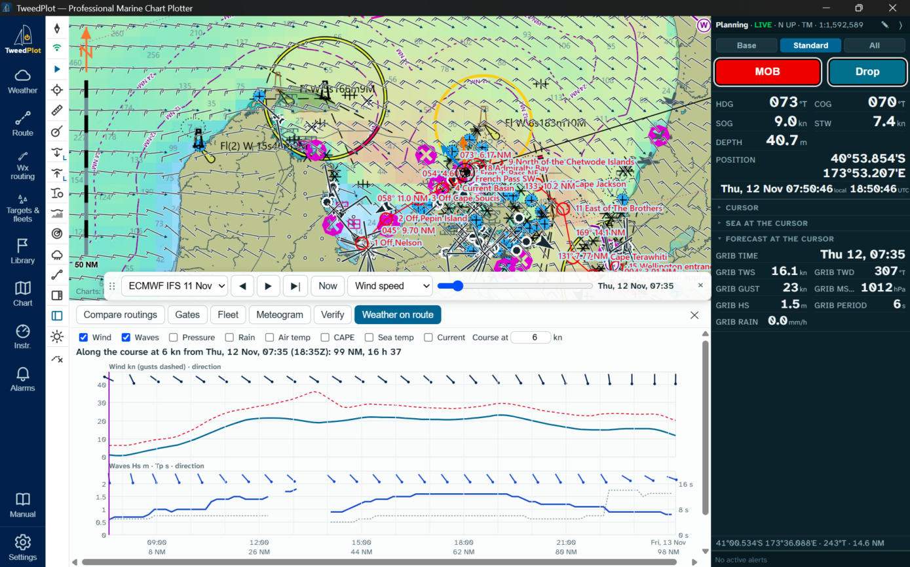

**Meteogram**

Right-click the chart › **Meteogram here**: the forecast at that point over time, in the dock. A quick way to see when a front arrives, how long a blow lasts, or whether the models agree for your departure.

- **Plots ▾** chooses what it shows: wind speed and gusts, wind direction, waves (height, period and direction), pressure, rain, air temperature, sea temperature and current. The standard set is wind, direction, waves and pressure; a plot the loaded GRIBs don't have at the point is marked *no data*.
- **Wind and pressure** are drawn for every loaded GRIB, each in its own colour, so you can compare models: gusts dashed, an ensemble's spread shaded, and direction drawn so GRIBs that agree stay together through north.
- **Waves, rain, temperatures and current** come from the first loaded GRIB that has them, the shown one first (so a separate wave GRIB fills in the waves); the legend says which file each came from.
- **Press on the plots and drag** to move along the forecast: the violet line shows the values at that time, and the chart's weather follows. **◀ Previous** and **Next ▶** step an hour (three hours for long forecasts), **Now** goes to the time now. Moving the time slider elsewhere moves the line too.


**Wind and waves in one file**

Wind and waves come from different models: GFS with GFS-Wave, ECMWF IFS or AIFS with the ECMWF wave model. TweedPlot can keep them in one file, so one GRIB shows the wind, the waves, the readings at the cursor and the meteogram together, and a routing with a wave limit finds its waves without a second file.

- **When downloading**: for GFS, ECMWF IFS or AIFS, tick **Waves … in the same file**. The wave model at the matching ECMWF resolution is downloaded for the same run, area and steps and written into the same file, named `…+waves.grb2`. If the waves can't be had (not on the server yet, say), the wind file is kept and a note says so.
- **Files you already have**: load the wind GRIB and the wave GRIB of the same run. The Weather drawer offers **Combine**; it writes `<wind file>+waves.grb2`, loads it and unloads the two. The original files are kept.

**Agreement of the loaded GRIBs**

Everything for comparing GRIBs is in one place: Environment › Explore › Weather layers and filters › **Compare GRIBs**. It has the GRIBs to compare (tick two or more that have wind or pressure), the agreement displays (**Off** returns to the layer shown before), each GRIB's values at the cursor, and **Verify runs…**. The colour key under the Chart time buttons shows the display's scale.

With two or more GRIBs loaded, the **Compare GRIBs** section lists displays that show how far the forecasts disagree at the chart time: green where the forecasts agree, red where they don't. Vector disagreement (speed and direction together), speed spread, direction spread (blank in light winds), pressure spread, and run trend (newest run minus oldest: is the forecast getting windier?). The note under the legend lists what is compared. Where the forecasts disagree, plan with margin.


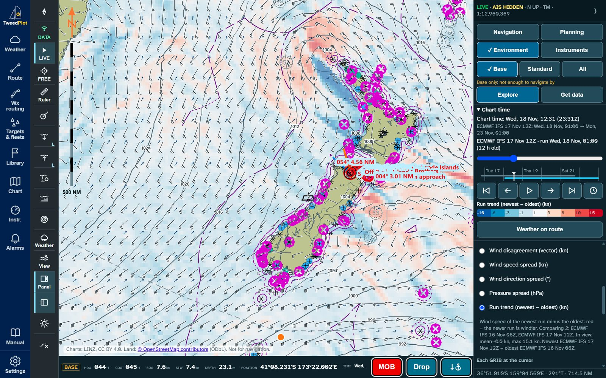

**Verify runs**

**Compare GRIBs** › **Verify runs…** scores earlier forecasts against what a later run says actually happened at its first hour (its analysis), over the sea in the chart view: vector error, speed and direction bias, pressure bias. The track record averages every verify time by model and lead time, so after some days of downloads it shows which model has been doing best in your area. Click a forecast to shade its error on the chart.

**Sea temp v boat**

**Compare GRIBs** › **Sea temp v boat…** scores each sea temperature product against the water temperature your boat logged along its tracks: the one measurement made where you actually fish. It reads every loaded sea temperature file and, with **Files not loaded** ticked, every sea temperature file in the weather folders that covers the tracks, at the boat's positions and times (one reading every 10 minutes or 2 km). Each reading is matched to a product's field nearest in time, up to the age chosen (12, 24, 36 or 72 hours). Choose **All tracks**, **Tracks in the chart view**, **Last 7 days** or **Last 30 days**.

| Column | Meaning |
| --- | --- |
| **Bias °C** | Product minus boat, averaged. + means the product reads warmer than the boat |
| **SD °C** | The spread of the error once the bias is taken off: how well the product follows the changes the boat saw. The table is sorted by it, best first |
| **RMS °C**, **Mean \|error\| °C** | The whole error, bias included |
| **Coverage** | Share of the readings inside the product's area and time that got a value. Cloud (ACSPO, Himawari) and coastlines leave gaps |
| **Data age h** | How old, on average, the fields used were |

Click a product to plot it against the boat's temperature over time and to show its error at each reading on the chart: blue where the product is colder than the boat, red where it is warmer (full colour at 2 °C).

The boat's sensor reads the water 0.5–2 m down; satellites read the skin or a modelled foundation temperature. A steady bias, larger on calm sunny afternoons, is normal and can be allowed for. A low **SD** matters more: that product shows the breaks where they are. The scores need tracks with a water temperature (NMEA 0183 MTW, or Signal K `environment.water.temperature`) and sea temperature files for the same days, so keep the files from the days you are out.

**Weather stations and buoys**

**Weather › Weather stations and buoys** shows what the wind is actually doing at stations around the chart, the quickest way to see which forecast is right today. Tick **Show observations** and the sources:

| Source | What | Updates |
| --- | --- | --- |
| **MetService (NZ)** | MetService's synoptic stations around New Zealand, many on the coast and islands (Farewell Spit, Stephens Island, Cape Campbell …). Open access data | Hourly or 3-hourly |
| **Airports (METAR)** | Airport weather reports worldwide from aviationweather.gov | Half-hourly |
| **Buoys (NDBC)** | NOAA moored buoys and coastal stations, mostly around the US, with waves and sea temperature | Hourly |

Each station is drawn with the ECDIS weather station symbol (IMO SN.1/Circ.243): {img:stnc} a circle with W in it, and its reported wind as a shaft from the circle towards where the wind comes from, with barbs like the GRIB wind barbs: a half barb 5 kn, a full barb 10 kn, a pennant 50 kn, on the anticlockwise side of the shaft in the southern hemisphere (clockwise in the northern). So {img:stnw:15:s} is 15 kn from the north. A second circle {img:stnc:calm} means calm, and an x at the end of the shaft means a direction was reported without a speed. Beside it is the wind speed and the gust after a G (15G25), with the wave height for buoys, and the station's name from about 1:70,000 in. Click a station for its latest report and a graph of its last 24 hours: observed wind (with gusts as dots) and pressure against each loaded GRIB's forecast for that place, and the average difference (the forecast minus what was observed, in knots and degrees of veer). Observations refresh every 10 minutes while shown.

## Weather routing

A routing is the fastest way from the start through your marks, given a forecast, your boat's speeds and the chart. TweedPlot uses the isochrone method (explained in the Weather routing tutorial) and keeps off land, water shallower than your safety depth, charted dangers, marine farms and your barriers. Lakes (from the Topo50 lake layer) can be routed on, using their charted depths where they have them; rivers are kept as land, so no route goes up one.

**Before you compute**

- **Settings › Vessel › Performance**: a polar (your boat's speed at each wind angle and strength), **Polar efficiency** (90 % is realistic for most crews; less for short-handed or cruising trim), and the seconds lost in each **tack** and **gybe** (**Tack costs**, **Gybe costs**).
- **Route drawer**: a start and at least one mark.
- **Weather**: a GRIB covering the area and the time of the passage.
- **Chart › Safety**: the safety depth.

**The Wx routing drawer: Run**

| Control | What it does |
| --- | --- |
| **Start time** | **Route's departure** (Route › Plan: Now, a set time, or now when it starts from the boat), **Chart time** (the weather slider), **Now** (when you press Compute), or **A set time** you type. Route's departure is the default |
| Settings › **Time step** | Minutes per isochrone; 0 = automatic (about 80 steps per leg, 5 minutes to 3 hours) |
| Settings › **Arrival radius** | How close counts as reaching a mark without a radius of its own |
| Settings › **Use GRIB currents** | Adds available ocean currents from the GRIB to the boat's speed; ECMWF does not document its 0.1° currents as tidal-stream predictions |
| Settings › **Hovering a routing point moves the GRIB time** | Off by default, so pointing at the screen doesn't move the forecast |
| **Limits and barriers** | Below |
| **Compute** | Routes with the GRIB shown on the chart |
| **With each GRIB** | One routing per loaded GRIB, then opens the compare table |

Each result is drawn in its own colour. The active one shows its points (hover for time, heading, TWA, TWS and boat speed) and isochrones, and a summary: start, ETA, elapsed time, distance, average speed, time upwind, reaching and downwind, wind range, tacks and gybes, and each leg. A triangle on every routing shows where that boat is at the slider time, so scrubbing the time slider plays the routings against each other. **Save** keeps it in the library, **GPX** writes it with times, **Use its course** puts its marks back in the Route drawer.

**Limits and barriers**

| Limit | Use it to |
| --- | --- |
| **Search angle** (±° from the mark) | Speed up long routings by only trying headings towards the mark. Keep 90° or more where the route may need to tack, gybe or go round land |
| **Heading step** | Spacing of headings tried: larger is faster, smaller finds finer routes |
| **Wind min / max** | Keep out of calms (min) or of more wind than you want to sail in (max) |
| **Max wave height Hs** | Keep out of big seas: uses the waves in the routing GRIB, else a loaded wave GRIB covering the start. The message warns if no waves were found |
| **TWA min / max** | Keep the boat off the wind (e.g. 50° for a cruiser that won't pinch) or off a dead run (e.g. 165°) |
| **Route round dangers** | Keep off rocks, wrecks and obstructions that dry, are awash, or have less water than the safety depth or an unknown depth |
| **Route round marine farms** | Keep out of charted marine farms |
| **Keep off barriers** | Use the Library's barrier lines, zones and barrier marks |

Limits stop the routing sailing on from places outside them. If every way forward is blocked, the routing says so: relax a limit, move a barrier, or change the start time.

**Comparing routings: the Routings tab**

Every routing of this session and the saved ones are listed; tick to show, click to make it the active one. **Compare table** opens a table in the dock with a column for each statistic (choose them with ⚙, sort by any column; the best values are green: earliest finish, shortest elapsed time, fewest tacks and so on. Distance is marked only when no routing reached the finish, and then the furthest is best, since it made the most progress; once routings finish, sailing further is no merit and Elapsed shows the winner), with its own GRIB chooser and time slider. Typical uses: one routing per GRIB to see how much the route depends on the model; several start times to choose when to leave.

**Gate sweep: the Gates tab**

The automated gate method: one routing through each of a row of points ("gates") on the way to a mark, to see how much each option costs. Choose the mark the gates come before, a line along a meridian (e.g. 5°E) or a parallel, the range (e.g. 30°S to 40°S) and the number of gates; the gates show as violet dots. **Run gate sweep** uses the same start time and settings as Compute, with the GRIB shown or with each loaded GRIB. The Gates table in the dock gives each gate's arrival and the time lost against the best gate; with several GRIBs, the mean and worst time lost, ranked by the mean. The gate that is nearly best under every GRIB is the robust choice when the models disagree.


**Power boats**

Routing is built around a sailing polar, and dedicated power-boat routing (fuel use, sea-state slowdown, comfort) is planned. Meanwhile a power boat can be routed with a simple "power polar": a polar file with the same cruising speed at every wind angle and strength. The routing then finds the shortest safe track round land and dangers, and the wind, wave and barrier limits keep it out of weather you don't want. See the Route planning tutorial for how to make one.

## Measuring

**Ruler**

Press {icon:ruler} **Ruler** in the toolbar and click the first point, or right-click the chart › **Start ruler here**; click for each next point, and double-click to finish; Esc stops. Each leg is labelled with its bearing (°T, plus °M) and distance, and the total shows at the end. The magnetic variation comes from your instruments when the boat is within 100 NM, and from the built-in World Magnetic Model (WMM2025, valid to the end of 2029) anywhere else or when planning with no instruments. Rulers stay on the chart until deleted. Move their points like marks. Right-click a ruler to delete a point, delete it, delete all rulers, **Show ruler as great circle**, or **Save ruler as route** (its points become library marks and a route opens in the Route drawer): a fast way to sketch a passage.

**EBL/VRM**

An EBL (electronic bearing line) and VRM (variable range marker) measure from the boat as a radar's do. Press {icon:ebl} **EBL/VRM** in the toolbar (or **V**): a dashed bearing line and a range ring follow the cursor; click to fix them, Esc to cancel. The bearing (°T and °M, to a tenth of a degree) and the range are written where the line meets the ring. Both move with the boat. For an EBL/VRM from somewhere else (offset), such as a headland or a mark, right-click there › **EBL/VRM from here**: its origin is marked with a small circle and cross. There can be two at a time (a third replaces the oldest). Right-click one to **Adjust** it (the cursor moves it again) or **Delete** it. They stay on the chart after a restart. Their colour is the IHO colour for mariner's notes (orange), as on an ECDIS.

Ruler bearings and distances are rhumb lines: a constant compass course, which is what you steer and what a paper chart's straight line shows. Over a few hundred miles a great circle is shorter: **Show ruler as great circle** draws that ruler's legs as great circles, with each leg's starting bearing and its great-circle distance. The router allows for the curve itself.

**Cursor readout**

The data panel shows the cursor's position, the depth there, and the bearing and range to it from the boat, on one line above the alerts (on the line under the chart when the panel is hidden). The **GRIB data at the cursor** section shows available weather and sea fields at the slider time; the Planning view's **Cursor** section also shows the own sounding there.

**Magnetic variation diagram.** Right-click the chart › **Magnetic variation diagram here** puts a true north line (25 mm high on your screen at any zoom) on the screen, with the magnetic north vector beside it and the text "Var 19.5°E inc 6′ annually", from the World Magnetic Model (or your instruments near the boat). It is fixed to the screen, not the chart: drag it where you want it, and it turns with the chart and takes the variation of the chart under it. It follows the night palettes. Right-click it › **Remove variation diagram**; right-click the chart › **Move variation diagram here** to relocate it. Its place is kept between runs.

## Settings

{icon:settings} **Settings** holds what is set once for the vessel and the PC, in four tabs: **Vessel**, **Connections**, **Display** and **Diagnostics**.

**Vessel**

| Section | Settings | Used for |
| --- | --- | --- |
| **Vessel identity** | Vessel name, IMO number, call sign, **MMSI** | The MMSI keeps your own boat from showing as an AIS target |
| **Vessel dimensions** | **Draft**, **Length overall**, **Breadth**, **Air draft**, **Transducer depth** (metres) | The boat drawn to scale, the fishing rules for vessels over 46 m, the air draft alarm; the transducer depth is added to the sounder's depth for own soundings |
| **Position and GPS antenna** | Reference latitude and longitude; GPS antenna aft of the bow and off the centre line; one row per receiver when there are several | Where the chart opens without a GPS fix; placing the boat's outline round the antenna; the bow for the anchor |
| **Performance (polar)** | **Polar**, **Import polar…**, **Open folder**, **Polar efficiency**, **Tack costs**, **Gybe costs** | Weather routing and the target speeds (see Polars, under Your boat). Wx routing shows the boat it routes, with a **change** link here |
| **Laylines** | **Show laylines**, **Show tacking cone**, the tacking and gybing angles without a polar, the cone's half-angle | Laylines and the tacking cone (also switched in Chart › Layers › My things and the right-click menu; not drawn in the Fishing use) |
| **Fishing** | The methods the boat fishes (bottom trawl, longline, potting…) | Chart › Layers › Fishing closures with **My methods**, and the closed-area alarm |

Press **Save vessel details** after changing the identity, dimensions or antenna; the polar settings save as you change them.

**Connections**

Where the live data comes from and how it is treated: **Signal K** (its connection and what is arriving), **NMEA 0183 inputs** (COM, TCP and UDP sources and failover, see *NMEA 0183 direct*), **NMEA 2000 inputs** (through Signal K; direct inputs are not supported), **Replay a log**, and **Damping** (see Your boat). **Pop out live NMEA data** under **NMEA 0183 inputs** opens the raw monitor in its own window; the inline monitor is under **Diagnostics**.

**Display**

**Use (Cruising, Fishing, Racing).** **Settings › Display › Use** says what the boat is mostly for. It decides three things:

- **The toolbar.** Fishing adds the **Shoot**, **Haul**, **Own soundings** and **Record soundings** buttons. **Record soundings button in every use** shows that one whatever the Use.
- **The data panel.** Each Use has its own layout in each view (see *The data panel*). Changing the Use swaps the layout; changing back brings yours back as you left it.
- **The Instruments screen.** The first Use you choose sets it up: Cruising has the highway, wind dial, COG, SOG and depth; Fishing has the sounder history, wind dial, depth, COG and SOG; Racing has the highway, wind dial, COG and SOG. After that, changing the Use never touches the Instruments screen, so your own arrangement is kept.

Laylines and the tacking cone are not drawn in the Fishing use. Everything else is the same for every Use.

**Data panel side** puts the data panel to the right of the chart (to begin with) or the left.

**Anchor button beside MOB and Drop** (off to begin with) adds the anchor button to the data panel. Without it, drop and weigh anchor from the right-click menu, **K** or Alarms › Anchor watch.

**Welcome screen.** The first time TweedPlot starts it asks what the boat is mostly for and sets the Use from the answer; **Not now** leaves the Use unset. **Show the welcome screen** opens it again.

**Screenshots.** The toolbar's {icon:screenshot} **Capture** button (or **Ctrl+Shift+S**) saves a picture of the whole TweedPlot window as you see it, drawers, data panel and any open box included, as a PNG named by the local date and time (TweedPlot-2026-11-23-125930.png). They all go in one folder: the first screenshot asks where, suggesting **TweedPlot-Screenshots** on the Desktop, which is easy to find when attaching one to an email for support. This section shows the folder, **Change folder…** picks another, and **Open folder** opens it (right-clicking the button does too). Each picture carries TweedPlot's version and the time in UTC. On a Mac, macOS asks once to allow TweedPlot to record the screen (System Settings › Privacy & Security › Screen Recording).

**Screen calibration.** A bar that is 50 mm long on a typical screen: measure it on yours with a ruler and enter what you measure. The IHO chart symbols and the data panel's text are then drawn true to size in millimetres (see *Chart symbols at a glance* under Charts).

**Colours: day, dusk and night.** The colours button {icon:day} in the toolbar (or **Settings › Display › Colours**) steps through five sets of colours; it shows a moon {icon:night} while dusk or night colours are on. Right-click it for all five and the brightness in one small panel:

| Colours | Use |
| --- | --- |
| **Day** | Normal colours |
| **Dusk** | With **Symbols: IHO (S-52)**: the chart in the IHO dusk colours, as on an ECDIS (dark background), with dark drawers and data panel. With the paper chart symbols: dimmer, a little less colour |
| **Night (IHO)** | With **Symbols: IHO (S-52)**: the chart in the IHO night colours, very dark, as on an ECDIS at night. The rest of the screen (the toolbar, the MOB and Drop buttons, the drawers, the data panel, the line under the chart, the scale, the attribution, the own soundings card, info windows and the target list) is shown in the same dim red as Night (red), so nothing bright is left. With the paper chart symbols: dark colours throughout |
| **Night (red)** | Everything as shades of red on black: chart, GRIB shading, drawers and data panel. Keeps night vision best |
| **Night (green)** | The same in green, if you find it easier to read than red |

With the IHO dusk and night colours, what TweedPlot draws over the chart (routes, tracks, AIS targets, marks, weather) is darkened to match: light colours go dark and dark ones go grey, so nothing glares. The IHO day colours (Symbols: IHO in day colours) are a little brighter and bluer than TweedPlot's own.

**Brightness** sets how bright dusk and night are. Turn the screen's own brightness down at night too: night colours dim what is drawn, not the backlight.

**Each window has its own colours.** A monitor window in a lit office can stay on day colours while the one on the fly bridge is on night red. Each window remembers its own setting.

**Night cursors.** In the night modes the mouse pointer is drawn in the night colour (an arrow, a ring over things you can click, a cross while drawing and a four-way mark for dragging the chart), because the system's white pointer would spoil night vision. The pointer is drawn at a fixed brightness; the resize pointers and the text caret stay as Windows draws them.

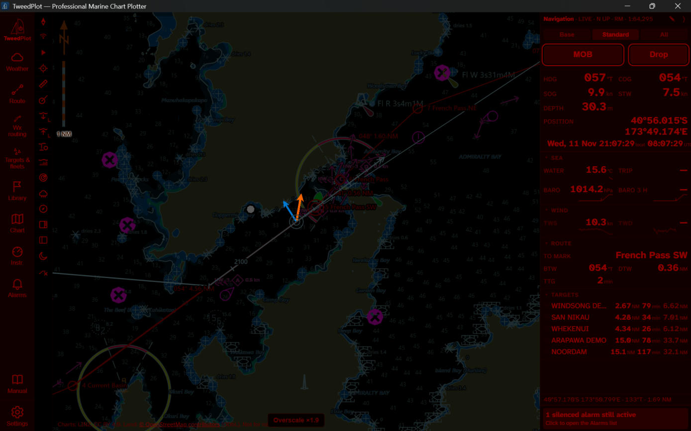

In Night (IHO), AIS targets are a dim grey with a dark outline, and the selection brackets and course lines are dimmed to match.

With dusk and night colours the window's title bar turns dark as well. To get rid of it altogether, press **F11** (or **Full screen** in Settings › Display) to fill the screen; F11 again switches back. Monitor windows do the same with their own colours and F11.

**Screen controls** are kept for each window:

- **Zoom buttons**: **Show** puts two round buttons at the bottom centre of the chart, well apart, for a trackball or a mouse without a wheel; **Hide** (the default) leaves them off.
- **Return to Navigation after Planning inactivity**: five minutes by default, adjustable from one to ten minutes or Off. It applies to Planning and Environment in this window while a live position is arriving, gives a 30-second notice with a **Stay** button, and changes view even if a dialog or edit is open.

**Diagnostics**

- **Live NMEA data**: inspect, capture or pop out the raw NMEA monitor.
- **About this system**: TweedPlot's version and the computer's details (Windows, processor, memory, graphics). **Copy for support** puts all of it, with the activity log, on the clipboard to paste into an email to TweedsMarine.
- **Where to install data files**: every data folder with its full path and what goes there; **Open** opens it in File Explorer (see *The data folder*).
- **Activity log**: what TweedPlot has done (imports, deletes, exports, chart changes) and how each went, newest first, with **Refresh** and **Copy for support**.
- **Radar overlay test**: a simulated radar scanner, there to prove that this PC can draw a real radar overlay smoothly before radar support is built. It makes echoes in the app's core at a real scanner's rate (24 or 48 rpm, up to 4096 spokes of 1024 samples), sends them to the chart as raw bytes and draws them with the graphics card round the boat (or the chart centre): two islands, a coast to the south, a rain cell, eight moving ships and sea clutter. The numbers underneath show frames per second, data rate, how long the chart spends taking the data in, and any backlog. Smooth means 50–60 frames a second while you pan and zoom, with no backlog building up.

## Keyboard shortcuts

Press **?** for this list on the screen. A button's tooltip shows its key too.

Single keys (letters, Space, the brackets) work whenever you aren't typing in a box; keys with **Ctrl** and the F keys work everywhere. The arrow keys and **+ / −** move and zoom the chart without clicking it first, unless the keyboard is in an open drawer, the manual, a dialog or a floating window (where they scroll or choose as usual): click the chart, or press a toolbar button, to give them back to the chart. Moving the chart with the keys turns **Follow** off; **B** centres on the boat and follows it again. Space on a focused button or tick box presses that, as usual.

{keys}

## Troubleshooting

| Problem | Likely cause and fix |
| --- | --- |
| No detailed NZ chart | The LINZ zips aren't in the `charts` folder (Settings › Diagnostics › Where to install data files), or only small-scale bands were downloaded. Add the bands for the area and restart |
| A harbour's buoys are missing | The open data has no large-scale coverage there. Add them as library marks with buoy symbols |
| Live data button stays red or amber | Red: the server isn't running, or is on another port or PC. Amber: connected, but the server is sending no boat data (check its connections to the GPS and instruments). Hover the button, and check **Settings › Connections** (and `RACENAV_SK_URL` if you set it) |
| A reading shows — or is greyed out | A dash: no data for that reading. Greyed out: the data stopped more than 10 s ago. Check the live data button and Settings › Connections |
| "Load the GRIB first" | Routing needs the GRIB shown on the chart to be loaded and cover the start time |
| "The weather runs out first" | The GRIB ends before the boat arrives: download a longer forecast, or accept the partial routing |
| "No wind data" | The route leaves the GRIB's area: download a bigger area |
| "Start (or mark) blocked" | It is on land, in water shallower than the safety depth, or inside a barrier: move it |
| "Every heading is blocked" | Land, shallow water, barriers or limits close every way forward: relax a limit or check the safety depth |
| The routing hugs a point | A mark without its own radius uses the arrival radius: give offshore waypoints a radius of a mile or more |
| ECMWF download slow or huge | ECMWF publishes whole-globe fields: choose fewer fields, a shorter forecast or a longer time step. 0.1° is much larger per field than 0.25°; requested global fields are cached (up to 5 GiB) and reused for later area requests |
| Saildocs reply too big | Coarser grid, fewer fields, shorter forecast, smaller area |
| MOB, Drop or the readings have gone | The data panel is hidden: they are on the line under the chart. **O**, or **⟨ Panel**, brings the panel back |
| A toolbar button described here isn't there | Shoot, Haul and Own soundings show in the Fishing use only: Settings › Display › Use |
| Laylines don't show | They aren't drawn in the Fishing use, or without a wind (live, or a loaded GRIB), or without a next mark or Go to |
| The data panel or time controls have gone | Open the data panel with **O** or **⟨ Panel**, then open its **Forecast time** section |
| Soundings, contours or cables have gone | The display is on Base or Standard: press **All** at the top of the data panel, or tick **Soundings** in Chart › Chart display |
| An info window is off where I can't see it | It is kept on the screen, but may be behind a drawer: close the drawer, or drag the window by its title bar |
| An AIS target is crossed through | It hasn't been heard for a while (see Targets): out of range, behind land, its set switched off, or (online AIS) no shore station in reach |
| Fishing rules download fails | Check the internet connection; MPI's map server is sometimes down for maintenance. The message gives the cause for each set that failed; the sets that came in are kept |
| Fishing rules show nothing | By default only areas closed to your ticked methods are drawn: tick **Restrictions too**, or choose **All methods** for Fishing closures in Chart › Layers |
| High-resolution depths: none here | LINZ has flown coastal surveys only in some places: the line under the row says when there is no survey for the chart view |

## Data sources and credits

TweedPlot downloads open data from the organisations below. They did not make TweedPlot and do not endorse it. Where a licence asks for credit, this is the credit. Every source is free to use, but check the provider's current terms before you pass its data on. **Not for navigation:** forecasts and models are wrong in places, and the charts here are not a replacement for official charts.

| Data | Provider and licence |
| --- | --- |
| Charts, depths, survey depth models, tide predictions, tidal diamonds, coastal elevation, maritime boundaries | © Toitū Te Whenua Land Information New Zealand (LINZ), CC BY 4.0 (maritime boundaries: sourced from Land Information New Zealand data, Crown Copyright Reserved). Tide predictions are LINZ's, calculated for chart datum |
| NIWA bathymetry (imported by you) | NZ 250 m gridded bathymetric data set and imagery, Mitchell et al. 2012, released 2016. © National Institute of Water and Atmospheric Research (NIWA). Not to be used for navigational purposes. Not distributed with TweedPlot |
| Fishing rules | Ministry for Primary Industries (MPI), CC BY 4.0. A guide to the regulations, not the regulations |
| World depths (bundled) | Natural Earth, public domain (naturalearthdata.com) |
| World coastline | GSHHG 2.3.7: Wessel and Smith, University of Hawaiʻi and NOAA, LGPL 3 |
| Deep-sea depths | ETOPO 2022, NOAA National Centers for Environmental Information (doi:10.25921/fd45-gt74), free to use and redistribute |
| Wind, pressure, waves (GFS, GFS-Wave, AIGFS) | NOAA National Centers for Environmental Prediction (NOMADS). US Government data, free to use. Contains NOAA model output |
| Wind, pressure, waves, currents (IFS, AIFS) | ECMWF open data, CC BY 4.0, © ECMWF. Downloaded from data.ecmwf.int or its AWS mirror and cropped to your area. TweedPlot changes the file format and the area only |
| Sea temperature (MUR) | NASA JPL MUR SST, via NOAA CoastWatch (ERDDAP). Free to use and share: please acknowledge NASA JPL / PO.DAAC |
| Sea temperature (ACSPO L3S-LEO, Geo-Polar Blended) | NOAA NESDIS (STAR, OSPO), GHRSST, via NOAA CoastWatch |
| Copernicus ocean, biology and chlorophyll | E.U. Copernicus Marine Service Information (Mercator Ocean International; GlobColour, ACRI-ST) |
| Sea temperature (Himawari-9) | Japan Meteorological Agency Himawari-9 AHI, processed by NOAA STAR (ACSPO L3C, GHRSST), via NOAA CoastWatch |
| Chlorophyll-a | NOAA CoastWatch, VIIRS (S-NPP, NOAA-20), DINEOF gap-filled. Free to use and share |
| Sea ice concentration | University of Bremen, Institute of Environmental Physics: ASI sea ice concentration from AMSR2 (JAXA GCOM-W). Spreen, G., L. Kaleschke and G. Heygster (2008), Sea ice remote sensing using AMSR-E 89 GHz channels, J. Geophys. Res. 113, C02S03, doi:10.1029/2005JC003384. No warranty |
| Ocean model (HYCOM) | HYCOM ESPC global ocean model, US Navy / HYCOM Consortium (hycom.org), public release. A demonstration service without guarantee |
| Weather stations | MetService (New Zealand, WIS2 open data); NOAA Aviation Weather Center (METAR); NOAA National Data Buoy Center (NDBC buoys) |
| Online AIS | aisstream.io, from volunteer shore stations (needs your own free key), and Open Waters (openwaters.io/ais, a community network of receivers; free token). Not for navigation |
| Race tracking | YB Tracking (yb.tl) and the race organiser. Positions may be delayed |
| Saildocs | Saildocs (saildocs.com) forecasts by email, from NOAA and other sources |
| Chart symbols, line styles, area patterns, chart colours and portrayal rules (bundled) | IHO S-101 Portrayal Catalogue 2.1.0, from the International Hydrographic Organization (IHO), NOAA and the contributors (github.com/iho-ohi/S-101_Portrayal-Catalogue), included unchanged. Their licence and disclaimer are below |
| Chart feature definitions (bundled) | IHO S-101 Feature Catalogue 2.1.0, from the IHO and the contributors (github.com/iho-ohi/S-101-Documentation-and-FC), included unchanged, under the same licence and disclaimer |
| Font | Atkinson Hyperlegible Next, Braille Institute of America, SIL Open Font License 1.1 |
| Map display | MapLibre GL JS, BSD-3-Clause |
| Land outlines (bundled) | © OpenStreetMap contributors, ODbL |
| Online maps (optional) | OpenStreetMap tiles and OpenSeaMap seamarks, © OpenStreetMap contributors, ODbL. OpenSeaMap is not for navigation |
| Satellite images (optional) | Contains modified Copernicus Sentinel data (ESA, European Union), from Element 84's Earth Search catalogue and the AWS Open Data copy of Sentinel-2. Free to use, Copernicus Sentinel data licence. Not surveyed, not for navigation |
| Raster charts and GeoTIFFs you import | Their publishers' terms |

### IHO S-101 Portrayal Catalogue: licence and disclaimer

TweedPlot includes the IHO S-101 Portrayal Catalogue 2.1.0 and the S-101 Feature Catalogue 2.1.0 unchanged (installed with the program in `resources/s101-pc` and `resources/s101-fc`, each with this notice in `LICENSE-IHO.txt`). Credit: International Hydrographic Organization (IHO), NOAA and the contributors. The IHO, NOAA and the contributors did not make TweedPlot and do not endorse it.

> **License.** Permission to copy and distribute this document is hereby granted provided that this notice is retained on all copies, and that IHO, NOAA and the contributors are credited when the material is redistributed or used in part or whole in derivative works. Redistributions in binary form must reproduce this notice in the documentation and/or other materials provided with the distribution.
>
> **Disclaimer.** This work is provided by the copyright holders and contributors "as is" and any express or implied warranties, including, but not limited to, the implied warranties of merchantability and fitness for a particular purpose are disclaimed. In no event shall the copyright owner or contributors be liable for any direct, indirect, incidental, special, exemplary, or consequential damages (including, but not limited to, procurement of substitute goods or services; loss of use, data, or profits; or business interruption) however caused and on any theory of liability, whether in contract, strict liability, or tort (including negligence or otherwise) arising in any way out of the use of this software, even if advised of the possibility of such damage.

TweedPlot is free software, licensed GPL-3.0-or-later. The licence, the full list of third-party notices and the source are in the project's repository. TweedPlot's name and logos belong to TweedsMarine.
